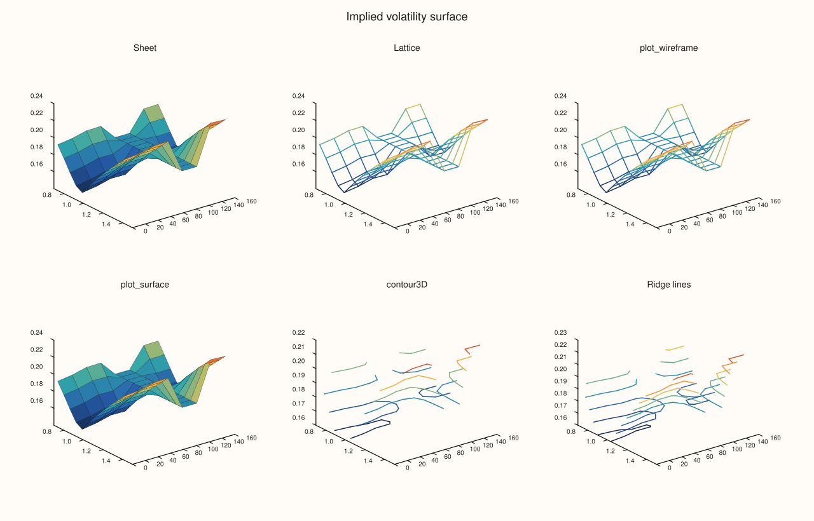
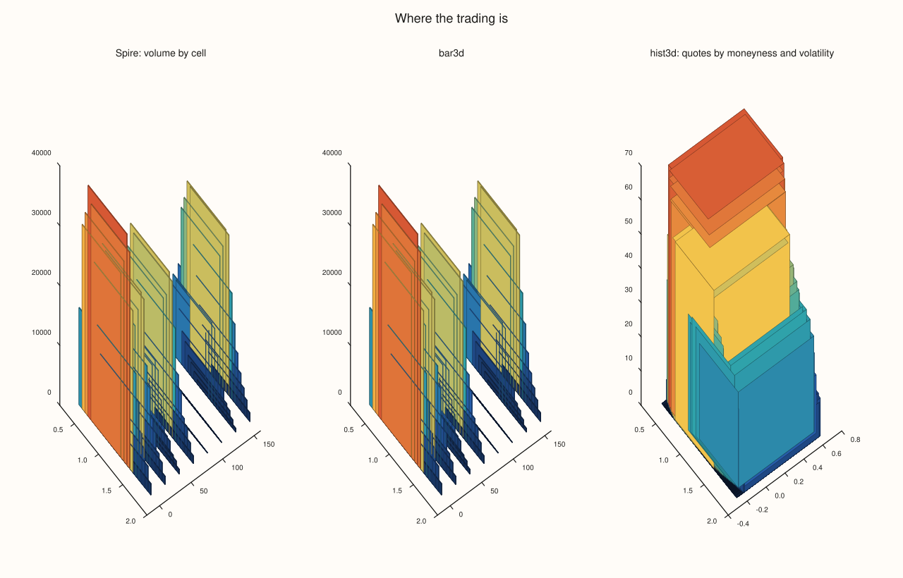
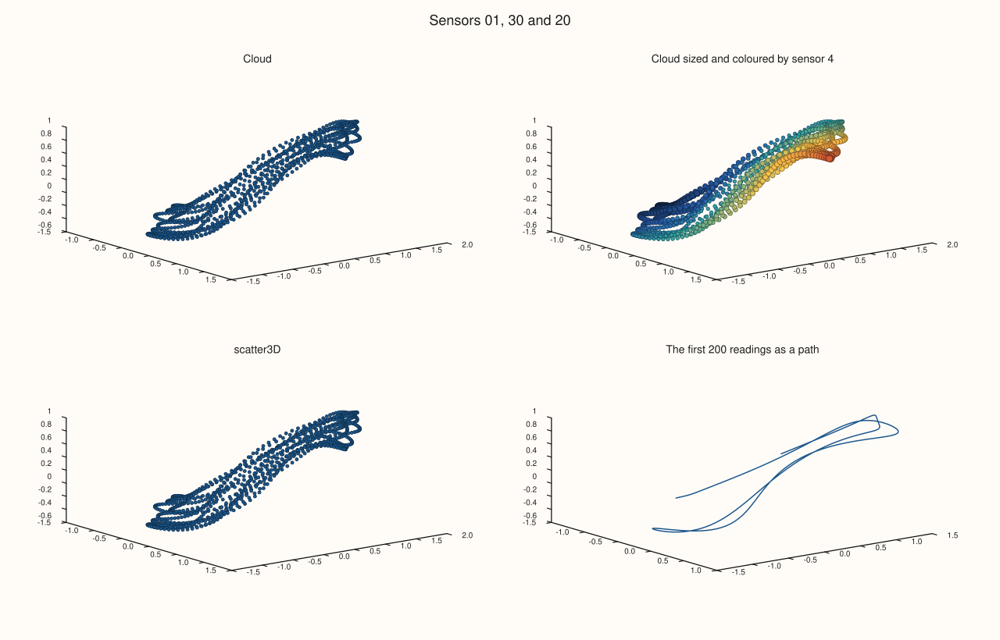
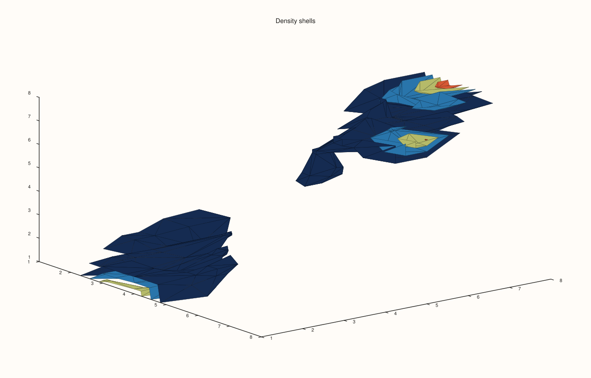
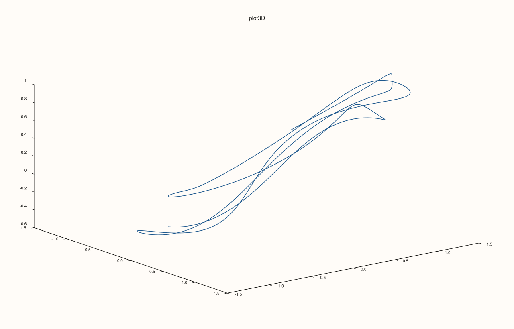

<!-- generated from three_dimensions.md.in by PlussMa/docs/tools/render_guide.py; edit the template -->

# Three dimensions

[Back to PlussPl by example](../guide.md)

Three-dimensional plots show surfaces, point clouds, paths and densities. This page draws a volatility surface from an options market, the clouds, paths and density shells of three sensors, and a surface under different cameras, lights and themes.

## How it works

A 3D pane (`pane3`) takes the volumetric traces. A **surface** over a grid is a `sheet` (filled) or a `lattice` (wireframe), and `ridge3` draws it as stacked ridge lines; `spire3` draws vertical bars over a grid. **Points** are `cloud3` (optionally sized and coloured), **paths** are `path3`, and the level surfaces of a 3D field are `isoshell`. Several `flash::` aliases (`plot3D`, `scatter3D`, `plot_surface`, `plot_wireframe`, `contour3D`, `bar3d`, `hist3d`) draw the same things under familiar names. How the scene is seen is separate: the camera (`camera3d`, `camera_preset3d`), the lights (`lighting3d`) and the theme and scene presets.

## The implied-volatility surface

Four thousand option quotes. The program computes the days to expiry as the difference of two timelines, drops the quotes stamped after their own expiry, averages the implied volatility in a grid of moneyness by time to expiry, and draws the grid six ways; a second figure shows where the trading is.

```cpp
#include <pluss/pl/plusspl.h>
#include <pluss/pluss.h>

#include <cmath>
#include <cstdlib>
#include <filesystem>
#include <iostream>

using namespace pluss::pl;

static std::string out(const char *name) {
  const char *dir = std::getenv("PLUSSMA_GUIDE_ASSETS");
  return ((dir ? std::filesystem::path(dir) : std::filesystem::path(".")) / name).string();
}


int main() {
  auto loaded = flash::load_dataset("options_chain");
  const auto chain = loaded->frame();
  auto moneyness = chain.features("moneyness").as_series();
  auto iv = chain.features("iv").as_series();
  auto volume = chain.features("volume").as_series();
  // Time to expiry in days: the difference of two Timelines is a Duration, and its host copy holds nanoseconds.
  const auto nanos = (chain.features("expiry_date").as_timeline() - chain.features("quote_time").as_timeline()).host();
  std::vector<double> days;
  for (const auto ns : nanos) days.push_back(static_cast<double>(ns) / 86400e9);
  auto expiry = pluss::make_series(days);
  // A few quotes in the data are stamped after their own expiry: drop them, and say how many.
  auto live = expiry.gt(0.0);
  std::cout << "quotes after expiry dropped: " << live.logical_not().sum().item<double>() << " of " << expiry.numel() << "\n";
  moneyness = moneyness.masked_select(live);
  iv = iv.masked_select(live);
  volume = volume.masked_select(live);
  expiry = expiry.masked_select(live);

  // Grid: 12 moneyness bins by 8 expiry bins; each cell holds the mean implied volatility of the quotes that fall in it.
  const int bins = 12, terms_n = 8;
  const double lo = moneyness.min().item<double>(), hi = moneyness.max().item<double>() + 1e-9;
  const double dlo = expiry.min().item<double>(), dhi = expiry.max().item<double>() + 1e-9;
  auto bin = ((moneyness - lo) / (hi - lo) * bins).floor().to(pluss::ScalarType::Int64);
  auto tbin = ((expiry - dlo) / (dhi - dlo) * terms_n).floor().to(pluss::ScalarType::Int64);
  auto cell = bin * terms_n + tbin;
  auto sums = pluss::series::zeros({bins * terms_n}, pluss::ScalarType::Float64).scatter_add(0, cell, iv);
  auto counts = pluss::series::zeros({bins * terms_n}, pluss::ScalarType::Float64).scatter_add(0, cell, pluss::series::ones({iv.numel()}, pluss::ScalarType::Float64));
  // A cell with no quotes takes the market-wide mean volatility, so the surface has no holes.
  auto surface = ((sums + counts.eq(0.0).to(pluss::ScalarType::Float64) * iv.mean().item<double>()) / counts.clamp_min(1.0)).reshape({bins, terms_n});
  auto traded = pluss::series::zeros({bins * terms_n}, pluss::ScalarType::Float64).scatter_add(0, cell, volume).reshape({bins, terms_n});
  auto strikes = pluss::series::arange(0, bins, pluss::ScalarType::Float64) * ((hi - lo) / bins) + lo;
  auto terms = pluss::series::arange(0, terms_n, pluss::ScalarType::Float64) * ((dhi - dlo) / terms_n) + dlo;
  std::cout << "expiries from " << dlo << " to " << dhi << " days; surface " << surface.size(0) << " x " << surface.size(1) << ", volatility from " << surface.min().item<double>() << " to " << surface.max().item<double>() << "\n";
  std::cout << "smile depth at the shortest expiry (edge minus centre): " << (surface.select(1, 0).select(0, 0).item<double>() - surface.select(1, 0).select(0, bins / 2).item<double>()) << "\n";

  auto fig = studio("vol_surface");
  fig.mosaic(2, 3);
  fig.headline("Implied volatility surface");
  auto &sheet = fig.pane3("Sheet");
  sheet.sheet(strikes, terms, surface.t());
  auto &lattice = fig.pane3("Lattice");
  lattice.lattice(strikes, terms, surface.t());
  auto &wire = fig.pane3("plot_wireframe");
  flash::plot_wireframe(wire, strikes, terms, surface.t());
  auto &surf = fig.pane3("plot_surface");
  flash::plot_surface(surf, strikes, terms, surface.t());
  auto &cont = fig.pane3("contour3D");
  flash::contour3D(cont, strikes, terms, surface.t(), 6);
  auto &ridge = fig.pane3("Ridge lines");
  ridge.ridge3(strikes, terms, surface.t());
  fig.show();

  auto fig2 = studio("vol_volume");
  fig2.mosaic(1, 3);
  fig2.headline("Where the trading is");
  auto &spire = fig2.pane3("Spire: volume by cell");
  spire.spire3(strikes, terms, traded.t());
  auto &bars = fig2.pane3("bar3d");
  flash::bar3d(bars, strikes, terms, traded.t());
  auto &hist = fig2.pane3("hist3d: quotes by moneyness and volatility");
  flash::hist3d(hist, moneyness, iv);
  fig2.show();
}
```

Output

```text
quotes after expiry dropped: 387 of 4000
expiries from 0.0416667 to 179.417 days; surface 12 x 8, volatility from 0.151883 to 0.229087
smile depth at the shortest expiry (edge minus centre): 0.0214727
```




The output lists what the data cleaning did: `387` of `4000` quotes are stamped after their expiry and are dropped, leaving expiries from about a hundredth of a day to `179` days. The surface is `12 x 8` with volatility between `0.152` and `0.229`, and the volatility smile is visible as a depth of `0.021` between the edge and the centre of the shortest expiry. The six panes of the first figure are the same grid as a filled surface, a wireframe, contours on the surface and ridge lines; the second shows the volume as bars over the same grid and a 3D histogram of quotes by moneyness and volatility.

## Three sensors in space

Readings of three sensors as a cloud, a path through time and a density.

```cpp
#include <pluss/pl/plusspl.h>
#include <pluss/pluss.h>

#include <cmath>
#include <cstdlib>
#include <filesystem>
#include <iostream>

using namespace pluss::pl;

static std::string out(const char *name) {
  const char *dir = std::getenv("PLUSSMA_GUIDE_ASSETS");
  return ((dir ? std::filesystem::path(dir) : std::filesystem::path(".")) / name).string();
}


int main() {
  auto loaded = flash::load_dataset("sensor64");
  const auto sensors = loaded->frame();
  auto x = sensors.features("sensor_01").as_series();
  auto y = sensors.features("sensor_30").as_series();
  auto z = sensors.features("sensor_20").as_series();
  auto machine = sensors.features("machine").as_note();
  std::cout << x.numel() << " readings; ranges: x " << x.min().item<double>() << ".." << x.max().item<double>() << ", y " << y.min().item<double>() << ".." << y.max().item<double>() << ", z " << z.min().item<double>() << ".." << z.max().item<double>() << "\n";

  auto fig = studio("sensor_clouds");
  fig.mosaic(2, 2);
  fig.headline("Sensors 01, 30 and 20");
  auto &cloud = fig.pane3("Cloud");
  cloud.cloud3(x, y, z);
  auto &sized = fig.pane3("Cloud sized and coloured by sensor 4");
  sized.cloud3(x, y, z, sensors.features("sensor_04").as_series().abs() + 0.5, sensors.features("sensor_05").as_series());
  auto &scatter = fig.pane3("scatter3D");
  flash::scatter3D(scatter, x, y, z);
  auto &path = fig.pane3("The first 200 readings as a path");
  path.path3(x.slice(0, 0, 200), y.slice(0, 0, 200), z.slice(0, 0, 200));
  fig.show();

  // Density: count the readings in an 8 x 8 x 8 grid and draw nested surfaces of equal count.
  const int g = 8;
  auto scale = [&](const pluss::Series &v) { return ((v - v.min()) / (v.max() - v.min() + 1e-9) * g).floor().to(pluss::ScalarType::Int64); };
  auto cell = scale(x) * (g * g) + scale(y) * g + scale(z);
  auto density = pluss::series::zeros({g * g * g}, pluss::ScalarType::Float64).scatter_add(0, cell, pluss::series::ones({x.numel()}, pluss::ScalarType::Float64)).reshape({g, g, g});
  std::cout << "densest cell holds " << density.max().item<double>() << " readings; occupied cells " << density.gt(0.0).sum().item<double>() << " of " << g * g * g << "\n";
  auto shells = studio("sensor_density");
  auto &pane = shells.pane3("Density shells");
  pane.isoshell(density, 4);
  shells.show();

  // A time-ordered view: the same three readings as a 3D line through time, with the plot3D alias.
  auto line = studio("sensor_plot3d");
  auto &lp = line.pane3("plot3D");
  flash::plot3D(lp, x.slice(0, 0, 300), y.slice(0, 0, 300), z.slice(0, 0, 300));
  line.show();
}
```

Output

```text
1024 readings; ranges: x -1.34017..1.49867, y -1.20562..1.77617, z -0.42409..0.96409
densest cell holds 65 readings; occupied cells 89 of 512
```






There are `1024` readings; the ranges are about `-1.3` to `1.5` for sensor 1, `-1.2` to `1.8` for sensor 30 and `-0.4` to `1.0` for sensor 20. Counting the readings in an `8 x 8 x 8` grid gives a densest cell of `65` readings and `89` of `512` cells occupied: the data live on a thin, curved structure rather than filling the cube, which the density shells show as nested surfaces around it. The cloud can carry two more variables through the size and the colour of its points.

## One surface, many viewpoints

The same sinc surface under different cameras, lights, themes and presets.

```cpp
#include <pluss/pl/plusspl.h>
#include <pluss/pluss.h>

#include <cmath>
#include <cstdlib>
#include <filesystem>
#include <iostream>

using namespace pluss::pl;

static std::string out(const char *name) {
  const char *dir = std::getenv("PLUSSMA_GUIDE_ASSETS");
  return ((dir ? std::filesystem::path(dir) : std::filesystem::path(".")) / name).string();
}


int main() {
  // A smooth test surface: z = sin(r) / r over a 40 x 40 grid.
  const std::int64_t n = 40;
  auto axis = pluss::series::linspace(-8.0, 8.0, n, pluss::ScalarType::Float64);
  auto gx = axis.unsqueeze(0).expand({n, n});
  auto gy = axis.unsqueeze(1).expand({n, n});
  auto r = (gx.square() + gy.square()).sqrt() + 1e-9;
  auto z = r.sin() / r;
  std::cout << "surface " << n << " x " << n << ", height from " << z.min().item<double>() << " to " << z.max().item<double>() << "\n";

  auto fig = studio("camera_and_scenes");
  fig.mosaic(2, 3);
  fig.headline("The same surface, six ways");
  auto &spatial = fig.pane3("Default camera");
  spatial.sheet(axis, axis, z);
  auto &top = fig.pane3("Top-down preset");
  top.sheet(axis, axis, z);
  flash::camera_preset3d(top, flash::CameraPreset3D::TopDown);
  auto &iso = fig.pane3("Custom angles, perspective");
  iso.sheet(axis, axis, z);
  flash::camera3d(iso, 20.0, 35.0, ProjectionKind::Perspective, 40.0);
  auto &lit = fig.pane3("Lamps on");
  lit.sheet(axis, axis, z);
  flash::lighting3d(lit, flash::Lighting3DOptions{.clear_first = true, .headlight = false, .lamp_left = true, .lamp_right = true, .sun_key = true});
  auto &themed = fig.pane3("Slate theme preset");
  themed.sheet(axis, axis, z);
  flash::theme_preset3d(themed, flash::ThemePreset3D::Slate);
  auto &scene = fig.pane3("Presentation scene with trace preset");
  auto &trace = scene.sheet(axis, axis, z);
  flash::scene_preset3d(scene, flash::ScenePreset3D::Presentation);
  flash::trace_preset3d(trace, flash::TracePreset3D::Wireframe);
  fig.show();

  // The option structs do the same in one call: scene3d for the pane, trace3d for the trace.
  auto combined = studio("camera_scene_options");
  auto &pane = combined.pane3("scene3d and trace3d");
  auto &surface = pane.sheet(axis, axis, z);
  flash::scene3d(pane, flash::Scene3DOptions{.preset = flash::ScenePreset3D::Survey, .camera_preset = flash::CameraPreset3D::Isometric});
  flash::trace3d(surface, flash::Trace3DOptions{.preset = flash::TracePreset3D::Surface, .transparent = true});
  combined.show();
  std::cout << "two figures written\n";
}
```

Output

```text
surface 40 x 40, height from -0.217223 to 0.986033
two figures written
```


The surface is `40 x 40` with heights from `-0.217` to `0.986`. The six panes change one thing each: the camera angles, a top-down view, a perspective projection with a wider angle, three lamps instead of the headlight, a slate theme, and a scene preset together with a trace preset that turns the sheet into a wireframe. `scene3d` and `trace3d` take the same choices as option structs when you want to set them in one call.

## Decisions

- **Sheet or lattice:** a sheet to read heights from colour; a lattice to see through the surface or to overlay several.
- **Camera:** an isometric or oblique view to show the shape; a top-down view to read positions; perspective when the depth matters.
- **Density in 3D:** nested shells for a point cloud; the counts must be gridded first.
- **Presets before tuning:** start from a scene or theme preset and adjust only what you need.

## Pitfalls

The program below makes 2 mistakes on purpose and prints the message each one produces.

```cpp
#include <pluss/pl/plusspl.h>
#include <pluss/pluss.h>

#include <iostream>

using namespace pluss::pl;

template <class F> static void report(const char *what, F &&call) {
  try {
    call();
    std::cout << what << ": no error\n";
  } catch (const pluss::Error &e) {
    std::cout << what << ": " << e.message() << "\n";
  }
}

int main() {
  auto x = pluss::series::linspace(0.0, 1.0, 5, pluss::ScalarType::Float64);
  auto y = x.sin();
  auto y3 = pluss::series::linspace(0.0, 1.0, 3, pluss::ScalarType::Float64);
  auto flat = pluss::make_series({1.0, 2.0, 3.0, 4.0});
  auto matrix = pluss::series::linspace(0.0, 1.0, 20, pluss::ScalarType::Float64).reshape({4, 5});
  auto empty = pluss::series::zeros({0}, pluss::ScalarType::Float64);
  auto groups = pluss::make_note({"a", "b", "c"});
  report("a 3D path with a z of a different length", [&] { auto f = studio("t"); flash::plot3D(f.pane3("a"), x, y, y3); });
  report("a 3D plot in a 2D pane", [&] { auto f = studio("t"); flash::plot3D(f.pane2("a"), x, y, y); });
}
```

Output

```text
a 3D path with a z of a different length: path3: z length must match broadcasted x/y length
a 3D plot in a 2D pane: path3 requires a volumetric pane
```
- **A 3D path with a z of a different length:** x, y and z must broadcast together.
- **A 3D plot in a 2D pane:** Create the pane with `pane3` for anything three-dimensional.

Each message names the function that refused the input, so the fix is to correct the data before the call: check lengths and shapes where the data is built, not where it is drawn.

## Where next

Reference pages: [`Pane::sheet`](../api/pane/sheet.md), [`Pane::lattice`](../api/pane/lattice.md), [`Pane::ridge3`](../api/pane/ridge3.md), [`Pane::spire3`](../api/pane/spire3.md), [`Pane::cloud3`](../api/pane/cloud3.md), [`Pane::path3`](../api/pane/path3.md), [`Pane::isoshell`](../api/pane/isoshell.md), [`flash::plot3D`](../api/flash/plot3D.md), [`flash::scatter3D`](../api/flash/scatter3D.md), [`flash::plot_surface`](../api/flash/plot_surface.md), [`flash::plot_wireframe`](../api/flash/plot_wireframe.md), [`flash::contour3D`](../api/flash/contour3D.md), [`flash::bar3d`](../api/flash/bar3d.md), [`flash::hist3d`](../api/flash/hist3d.md), [`flash::camera3d`](../api/flash/camera3d.md), [`flash::camera_preset3d`](../api/flash/camera_preset3d.md), [`flash::lighting3d`](../api/flash/lighting3d.md), [`flash::theme_preset3d`](../api/flash/theme_preset3d.md), [`flash::scene_preset3d`](../api/flash/scene_preset3d.md), [`flash::scene3d`](../api/flash/scene3d.md), [`flash::trace_preset3d`](../api/flash/trace_preset3d.md), [`flash::trace3d`](../api/flash/trace3d.md). Next: [Four dimensions and animation](four_dimensions_and_animation.md).
