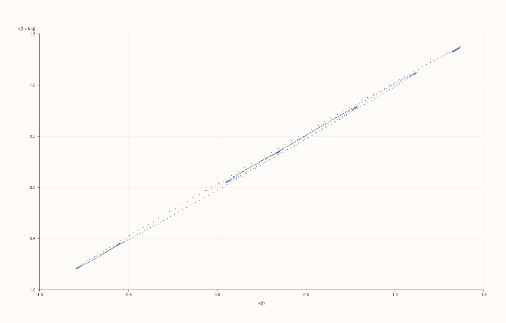
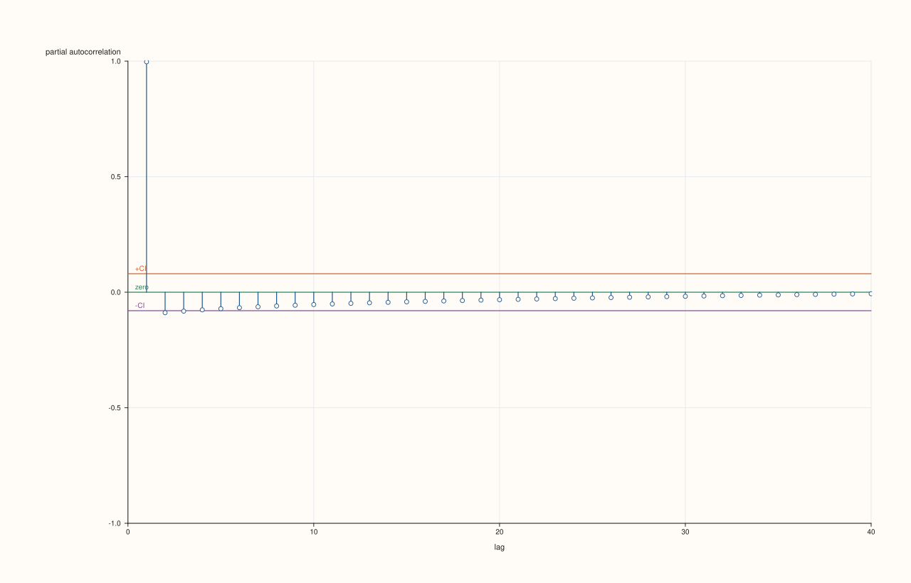
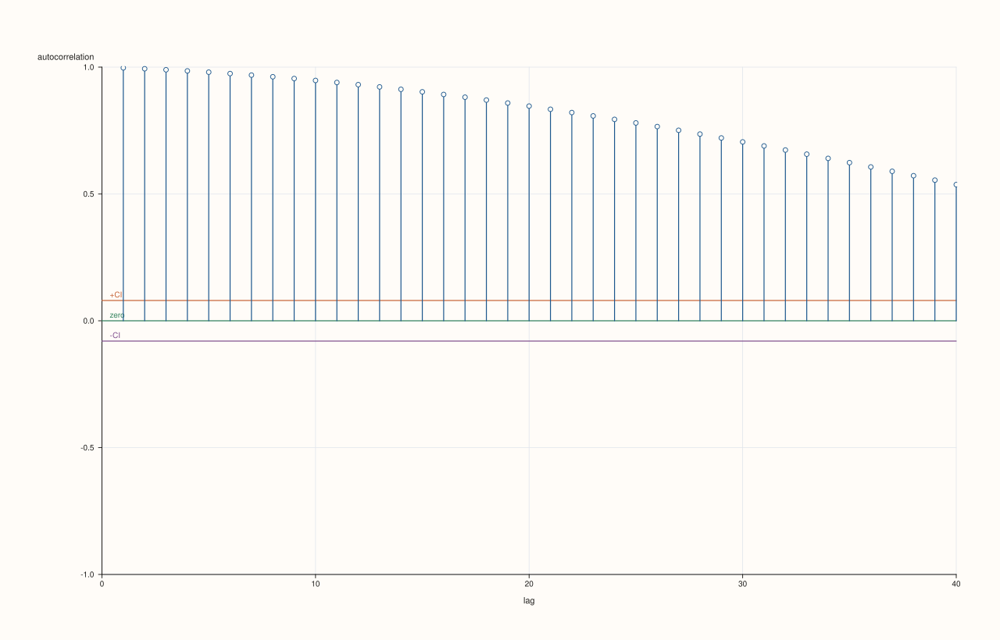
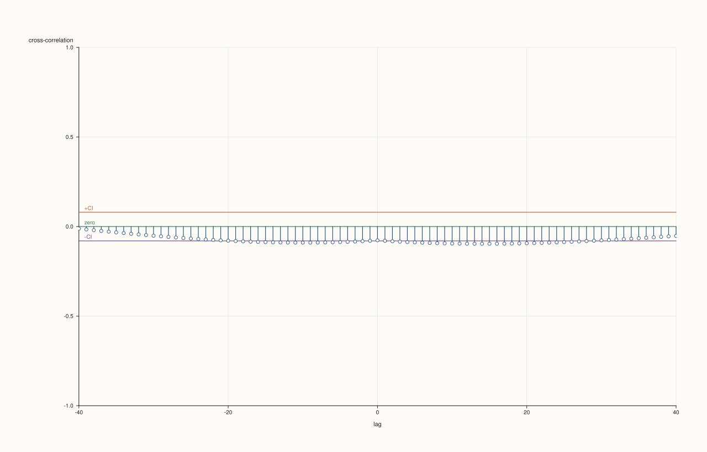
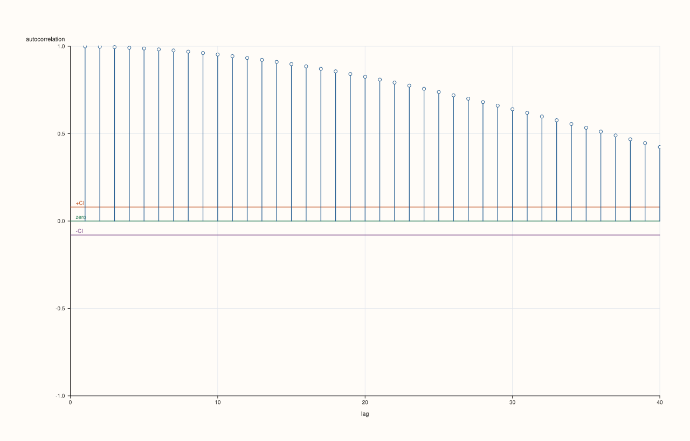
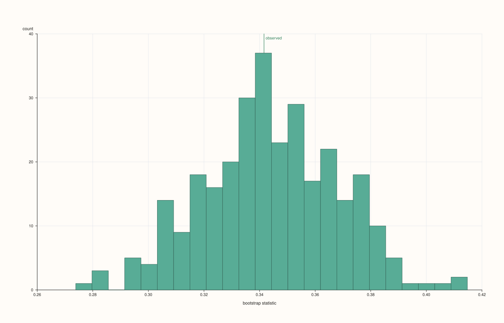

<!-- generated from time_series_diagnostics.md.in by PlussMa/docs/tools/render_guide.py; edit the template -->

# Time-series diagnostics

[Back to PlussPl by example](../guide.md)

Before modelling a series, look at how it depends on its own past. This page draws the standard diagnostics for a regime-switching signal: the lag plot, the autocorrelation and partial autocorrelation functions, a cross-correlation with another series, the autocorrelation of regression residuals and the bootstrap distribution of the mean.

## How it works

Each diagnostic is one function that takes a studio and a series and draws a whole figure. `lagplot` plots the series against itself shifted by one step. `acfplot` and `pacfplot` draw the autocorrelation and partial autocorrelation at increasing lags with significance bands, and `actplot` the autocorrelation as a function of time. `ccfplot` draws the cross-correlation between two series, `resid_acfplot` the autocorrelation of the residuals of a regression of one series on another, and `bootstrapplot` the bootstrap distribution of the mean.

## Is this signal predictable?

Six hundred observations of a signal, with its trend and volatility series.

```cpp
#include <pluss/pl/plusspl.h>
#include <pluss/pluss.h>

#include <cmath>
#include <cstdlib>
#include <filesystem>
#include <iostream>

using namespace pluss::pl;

static std::string out(const char *name) {
  const char *dir = std::getenv("PLUSSMA_GUIDE_ASSETS");
  return ((dir ? std::filesystem::path(dir) : std::filesystem::path(".")) / name).string();
}


int main() {
  auto loaded = flash::load_dataset("regimes");
  const auto data = loaded->frame();
  auto signal = data.features("signal").as_series().slice(0, 0, 600);
  auto trend = data.features("trend").as_series().slice(0, 0, 600);
  auto volatility = data.features("volatility").as_series().slice(0, 0, 600);
  const double lag1 = ((signal.slice(0, 1, 600) - signal.mean()) * (signal.slice(0, 0, 599) - signal.mean())).sum().item<double>() / (signal - signal.mean()).square().sum().item<double>();
  std::cout << "lag-1 autocorrelation " << lag1 << "\n";

  auto lag = studio("diag_lag");
  flash::lagplot(lag, signal);
  lag.show();
  auto acf = studio("diag_acf");
  flash::acfplot(acf, signal);
  acf.show();
  auto pacf = studio("diag_pacf");
  flash::pacfplot(pacf, signal);
  pacf.show();
  auto act = studio("diag_act");
  flash::actplot(act, signal);
  act.show();
  auto ccf = studio("diag_ccf");
  flash::ccfplot(ccf, signal, volatility);
  ccf.show();
  auto resid = studio("diag_resid_acf");
  flash::resid_acfplot(resid, trend, signal);
  resid.show();
  auto boot = studio("diag_bootstrap");
  flash::bootstrapplot(boot, signal);
  boot.show();
  std::cout << "seven diagnostic figures written\n";
}
```

Output

```text
lag-1 autocorrelation 0.997048
seven diagnostic figures written
```













The lag-1 autocorrelation is `0.997`: the signal is almost its own previous value, a slowly moving series. The lag plot is a tight line along the diagonal for the same reason. The autocorrelation function decays slowly from 1 and the partial autocorrelation drops sharply after the first lag, the signature of a persistent first-order process. The cross-correlation with volatility shows at which lags the two series are related, and the residual autocorrelation tells whether regressing on the trend has removed the dependence: a decaying function means it has not. The bootstrap figure shows the uncertainty of the mean by resampling.

## Decisions

- **Slow decay in the ACF:** the series is persistent or has a trend; difference it before modelling.
- **A sharp cut-off in the PACF:** the order of an autoregression.
- **Residual autocorrelation:** if it remains after a regression, the model has missed structure.
- **The bootstrap:** when the standard error has no formula, resample.

## Pitfalls

The program below makes 3 mistakes on purpose and prints the message each one produces.

```cpp
#include <pluss/pl/plusspl.h>
#include <pluss/pluss.h>

#include <iostream>

using namespace pluss::pl;

template <class F> static void report(const char *what, F &&call) {
  try {
    call();
    std::cout << what << ": no error\n";
  } catch (const pluss::Error &e) {
    std::cout << what << ": " << e.message() << "\n";
  }
}

int main() {
  auto x = pluss::series::linspace(0.0, 1.0, 5, pluss::ScalarType::Float64);
  auto y = x.sin();
  auto y3 = pluss::series::linspace(0.0, 1.0, 3, pluss::ScalarType::Float64);
  auto flat = pluss::make_series({1.0, 2.0, 3.0, 4.0});
  auto matrix = pluss::series::linspace(0.0, 1.0, 20, pluss::ScalarType::Float64).reshape({4, 5});
  auto empty = pluss::series::zeros({0}, pluss::ScalarType::Float64);
  auto groups = pluss::make_note({"a", "b", "c"});
  report("an autocorrelation of a single value", [&] { auto f = studio("s"); flash::acfplot(f, pluss::make_series({1.0})); });
  report("a lag plot of a single value", [&] { auto f = studio("s"); flash::lagplot(f, pluss::make_series({1.0})); });
  report("a cross-correlation of series of different lengths", [&] { auto f = studio("s"); flash::ccfplot(f, x, y3); });
}
```

Output

```text
an autocorrelation of a single value: flash::acfplot requires at least three points
a lag plot of a single value: flash::lagplot requires at least two points
a cross-correlation of series of different lengths: flash::ccfplot requires aligned x/y with at least three points
```
- **An autocorrelation of a single value:** A correlation needs at least three points.
- **A lag plot of a single value:** A lag plot pairs each value with an earlier one, so it needs at least two.
- **A cross-correlation of series of different lengths:** Both series must be aligned and at least three points long.

Each message names the function that refused the input, so the fix is to correct the data before the call: check lengths and shapes where the data is built, not where it is drawn.

## Where next

Reference pages: [`flash::lagplot`](../api/flash/lagplot.md), [`flash::acfplot`](../api/flash/acfplot.md), [`flash::pacfplot`](../api/flash/pacfplot.md), [`flash::actplot`](../api/flash/actplot.md), [`flash::ccfplot`](../api/flash/ccfplot.md), [`flash::resid_acfplot`](../api/flash/resid_acfplot.md), [`flash::bootstrapplot`](../api/flash/bootstrapplot.md). Next: [Fields and polar plots](fields_and_polar.md).
