# PlussPl Core API

`pluss::pl` is the low-level plotting surface (`Studio`, `Pane`, `Trace`).

This page follows the same usage-first pattern as the other API docs:

- `Signature`: user-facing call forms (`self` is explicit)
- `Notes`: practical behavior and constraints
- `Example`: runnable snippet from `PlussPl/examples/docs/flash_api_capture_demo.cpp`
- `Output`: SVG generated by running that exact snippet (`PNG` fallback for PDF)

## API Reference Style

### `Pane::align_xy`

#### Signature

```cpp
Pane& align_xy(self: Pane, group: std::string);
```

#### Notes

Links X and Y autoscaling across panes in the same group so comparisons stay on identical limits.

#### Example

```{literalinclude} ../../examples/docs/snippets/keys/core_pane_alignment.cpp
:language: cpp
```

#### Output

```{only} html

```

```{only} not html
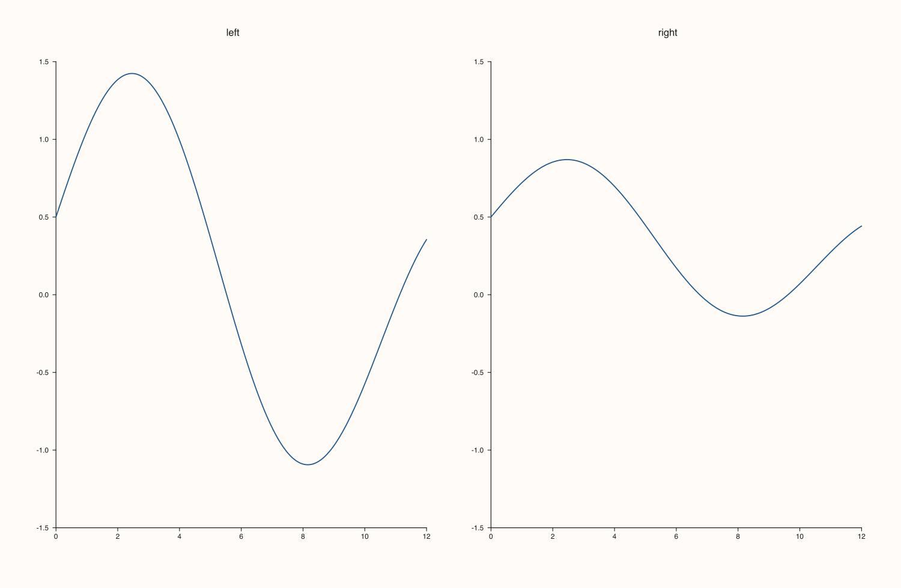
```

### `Pane::bucket`

#### Signature

```cpp
Trace& bucket(self: Pane, values: SeriesLike, bins: int = 12);
Trace& bucket(self: Pane, values: SeriesLike, bins: int, range: Range1d);
```

#### Notes

Builds histogram bars from raw numeric values.

#### Example

```{literalinclude} ../../examples/docs/snippets/keys/core_bucket.cpp
:language: cpp
```

#### Output

```{only} html
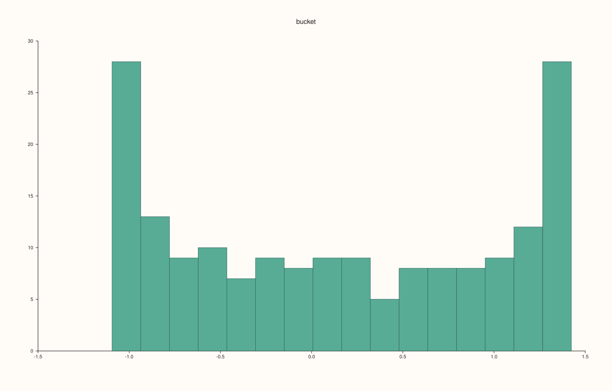
```

```{only} not html
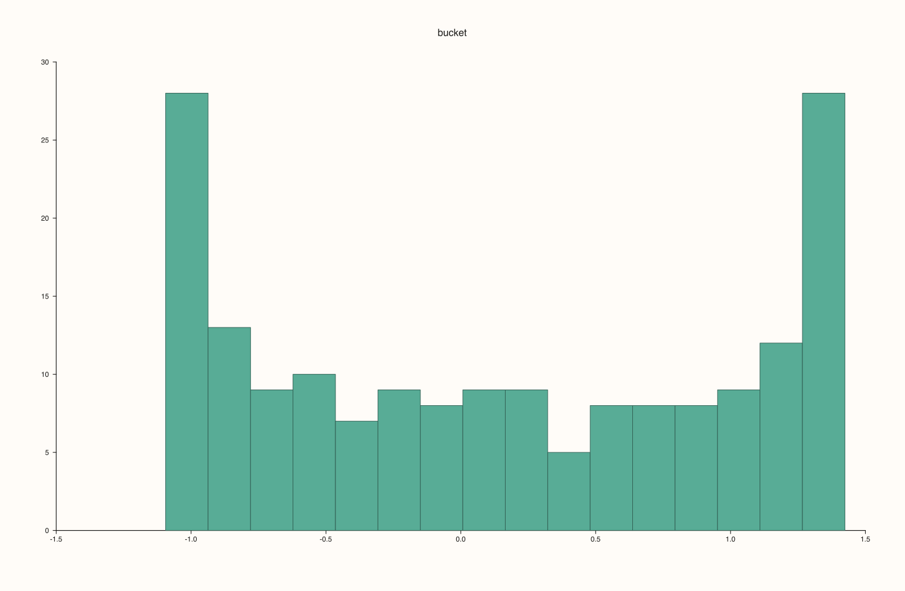
```

### `Pane::cloud`

#### Signature

```cpp
Trace& cloud(self: Pane, x: SeriesLike, y: SeriesLike);
Trace& cloud(self: Pane, x: SeriesLike, y: SeriesLike, size: SeriesLike);
Trace& cloud(self: Pane, x: SeriesLike, y: SeriesLike, size: SeriesLike, color: SeriesLike);
```

#### Notes

2D scatter primitive with optional size and color encodings.

#### Example

```{literalinclude} ../../examples/docs/snippets/keys/core_cloud.cpp
:language: cpp
```

#### Output

```{only} html
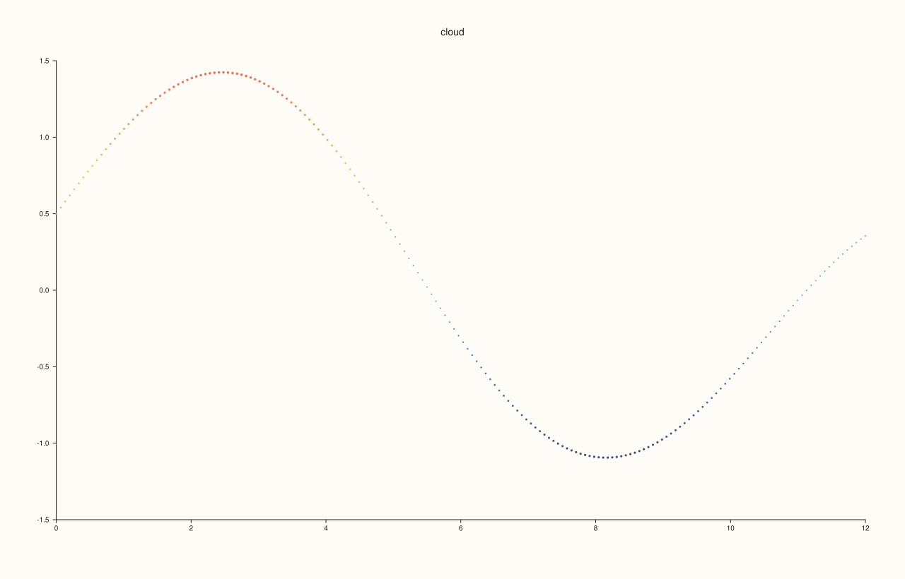
```

```{only} not html
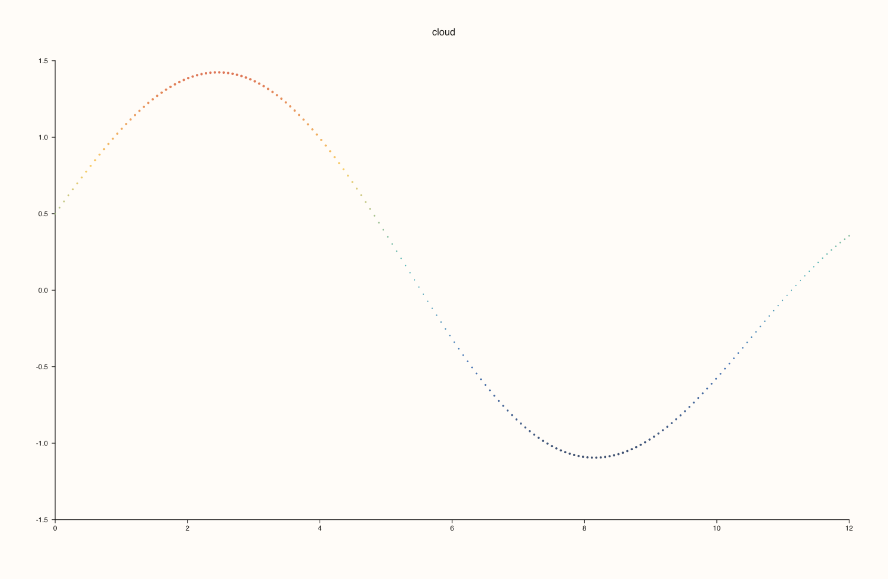
```

### `Pane::cloud3`

#### Signature

```cpp
Trace& cloud3(self: Pane, x: SeriesLike, y: SeriesLike, z: SeriesLike);
Trace& cloud3(self: Pane, x: SeriesLike, y: SeriesLike, z: SeriesLike, size: SeriesLike);
Trace& cloud3(self: Pane, x: SeriesLike, y: SeriesLike, z: SeriesLike, size: SeriesLike, color: SeriesLike);
```

#### Notes

3D scatter primitive with optional size and color encodings.

#### Example

```{literalinclude} ../../examples/docs/snippets/keys/core_cloud3.cpp
:language: cpp
```

#### Output

```{only} html

```

```{only} not html
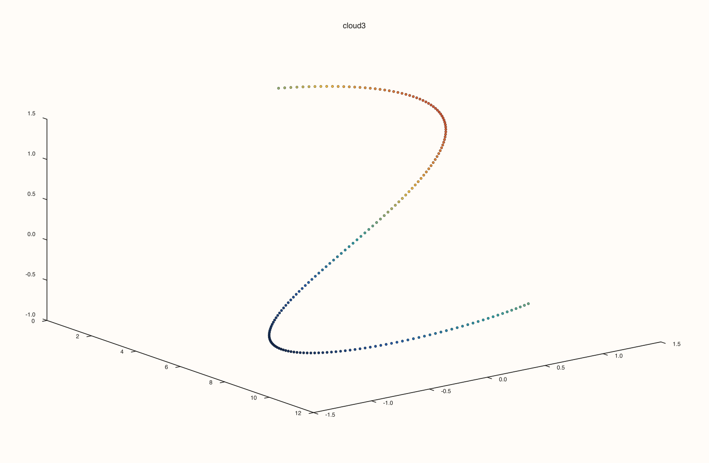
```

### `Pane::columns`

#### Signature

```cpp
Trace& columns(self: Pane, y: SeriesLike);
Trace& columns(self: Pane, x: SeriesLike, y: SeriesLike);
```

#### Notes

Vertical bar primitive. Use note/category labels on `x` for named groups.

#### Example

```{literalinclude} ../../examples/docs/snippets/keys/core_columns.cpp
:language: cpp
```

#### Output

```{only} html

```

```{only} not html
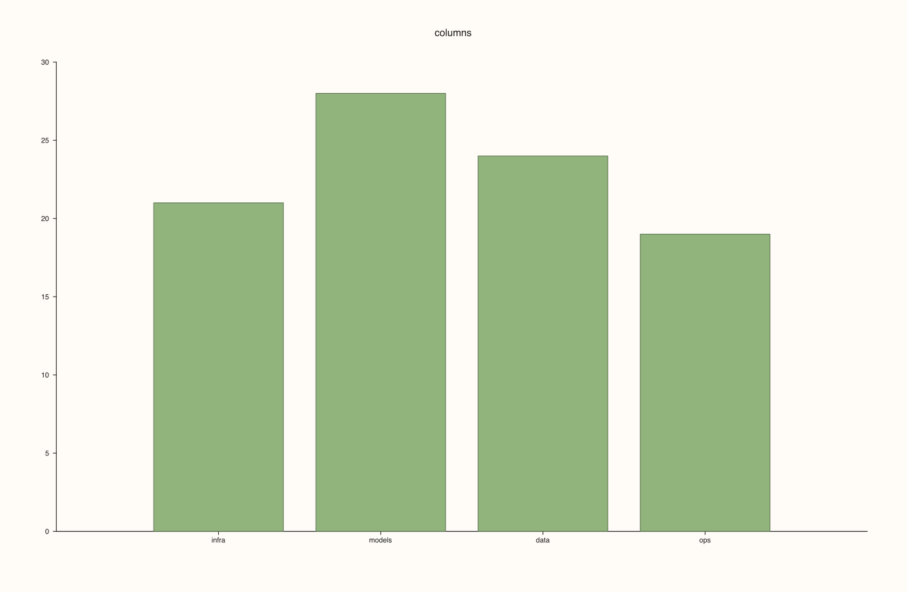
```

### `Pane::columns_h`

#### Signature

```cpp
Trace& columns_h(self: Pane, x: SeriesLike);
Trace& columns_h(self: Pane, x: SeriesLike, y: SeriesLike);
```

#### Notes

Horizontal bar primitive; useful for ranking displays.

#### Example

```{literalinclude} ../../examples/docs/snippets/keys/core_columns_h.cpp
:language: cpp
```

#### Output

```{only} html
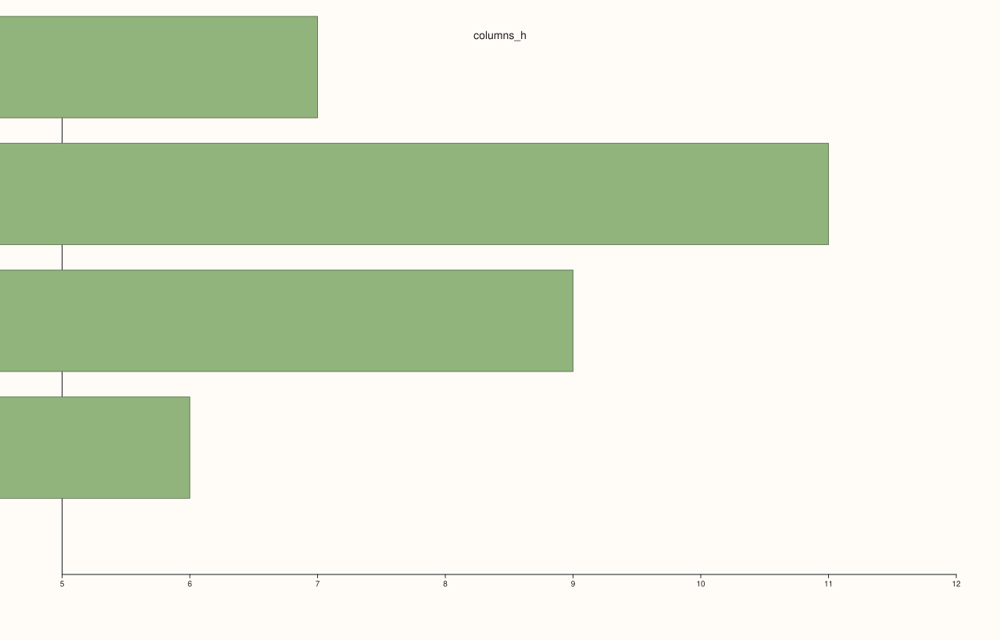
```

```{only} not html
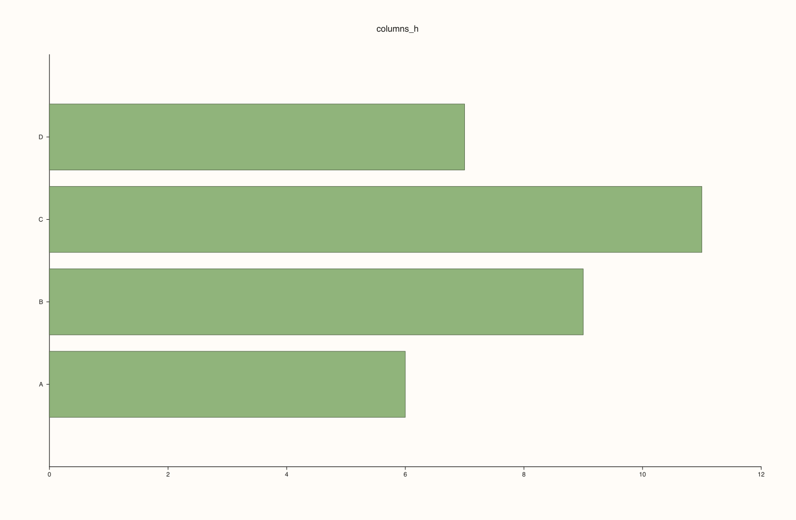
```

### `Pane::contour`

#### Signature

```cpp
Trace& contour(self: Pane, x: SeriesLike, y: SeriesLike, z: SeriesLike);
Trace& contour(self: Pane, x: SeriesLike, y: SeriesLike, z: SeriesLike, levels: int);
Trace& contour(self: Pane, x: SeriesLike, y: SeriesLike, z: SeriesLike, levels: std::vector<double>);
```

#### Notes

Isoline surface slices in 3D space.

#### Example

```{literalinclude} ../../examples/docs/snippets/keys/core_contour.cpp
:language: cpp
```

#### Output

```{only} html
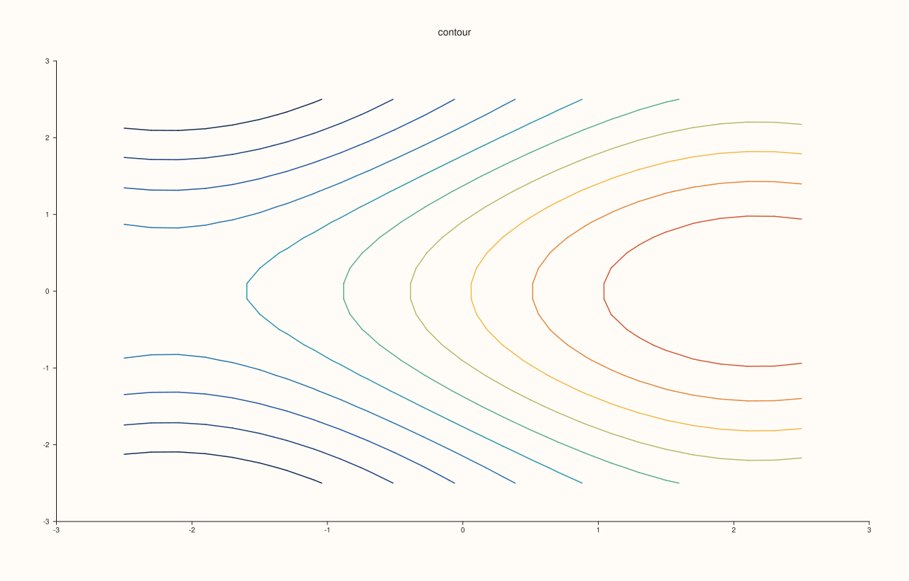
```

```{only} not html
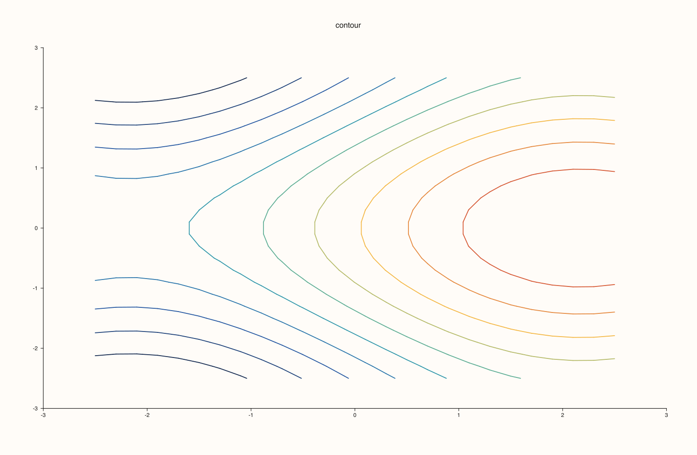
```

### `Pane::fieldmap`

#### Signature

```cpp
Trace& fieldmap(self: Pane, x: SeriesLike, y: SeriesLike, z: SeriesLike);
Trace& fieldmap(self: Pane, x: SeriesLike, y: SeriesLike, z: SeriesLike, color: SeriesLike);
```

#### Notes

Heatmap-like rectilinear field for 2D scalar surfaces.

#### Example

```{literalinclude} ../../examples/docs/snippets/keys/core_fieldmap.cpp
:language: cpp
```

#### Output

```{only} html
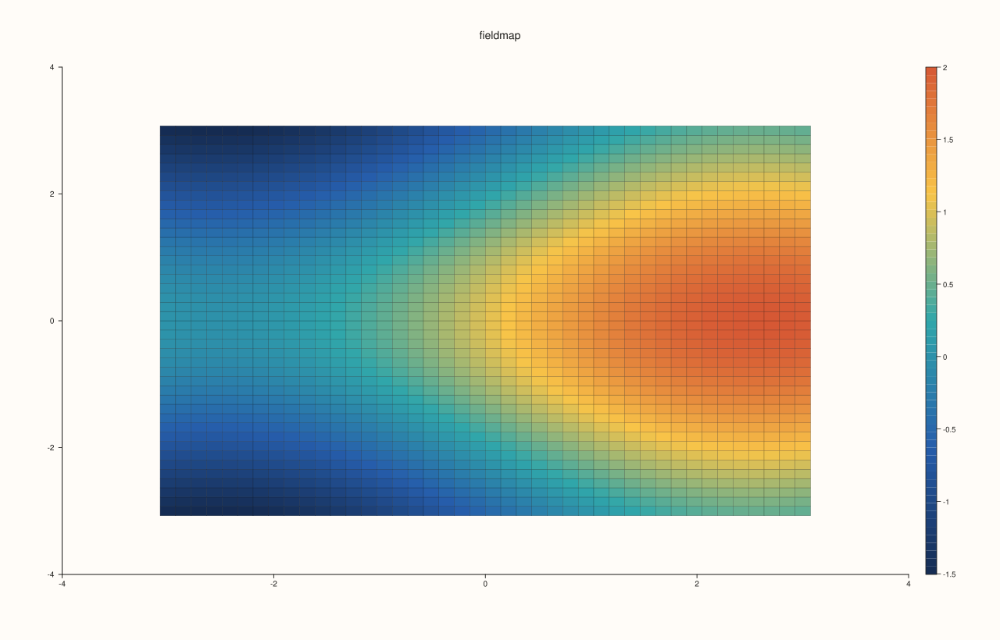
```

```{only} not html

```

### `Pane::grid / legend / legend_frame / legend_shape`

#### Signature

```cpp
Pane& grid(self: Pane, style: GridStyle);
Pane& legend(self: Pane, place: KeyPlace);
Pane& legend_frame(self: Pane, frame: KeyFrame);
Pane& legend_shape(self: Pane, shape: KeyShape);
```

#### Notes

Controls pane-level grid and legend placement/styling.

#### Example

```{literalinclude} ../../examples/docs/snippets/keys/core_pane_grid_legend.cpp
:language: cpp
```

#### Output

```{only} html
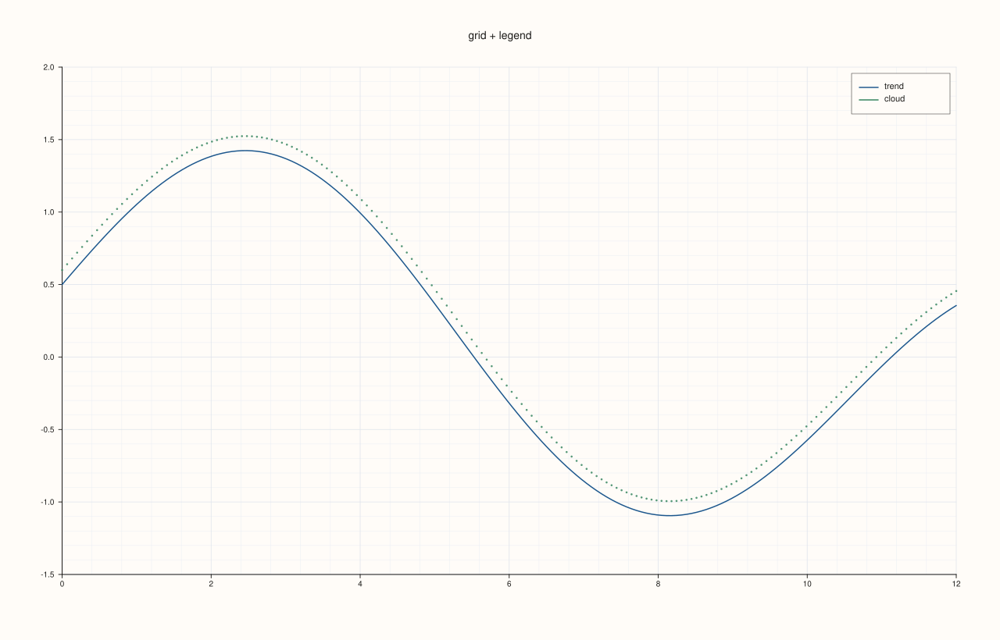
```

```{only} not html

```

### `Pane::isoband`

#### Signature

```cpp
Trace& isoband(self: Pane, x: SeriesLike, y: SeriesLike, z: SeriesLike);
Trace& isoband(self: Pane, x: SeriesLike, y: SeriesLike, z: SeriesLike, levels: int);
Trace& isoband(self: Pane, x: SeriesLike, y: SeriesLike, z: SeriesLike, levels: std::vector<double>);
```

#### Notes

Filled contour bands in planar coordinates.

#### Example

```{literalinclude} ../../examples/docs/snippets/keys/core_isoband.cpp
:language: cpp
```

#### Output

```{only} html
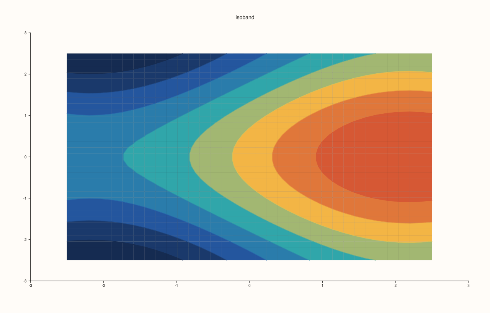
```

```{only} not html
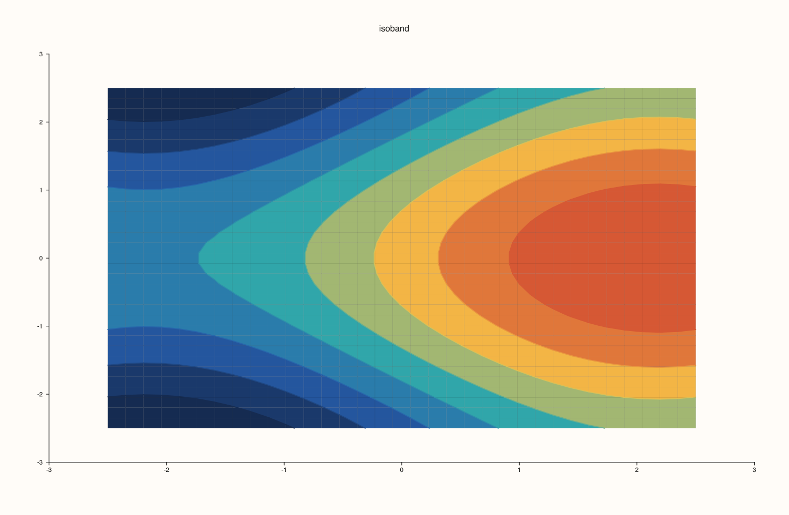
```

### `Pane::isoshell`

#### Signature

```cpp
Trace& isoshell(self: Pane, values: SeriesLike, level_count: int = 4);
Trace& isoshell(self: Pane, x: SeriesLike, y: SeriesLike, z: SeriesLike, values: SeriesLike, level_count: int = 4);
Trace& isoshell(self: Pane, x: SeriesLike, y: SeriesLike, z: SeriesLike, values: SeriesLike, levels: std::vector<double>);
```

#### Notes

Extracts 3D iso-surfaces from volumetric scalar fields.

#### Example

```{literalinclude} ../../examples/docs/snippets/keys/core_isoshell.cpp
:language: cpp
```

#### Output

```{only} html

```

```{only} not html
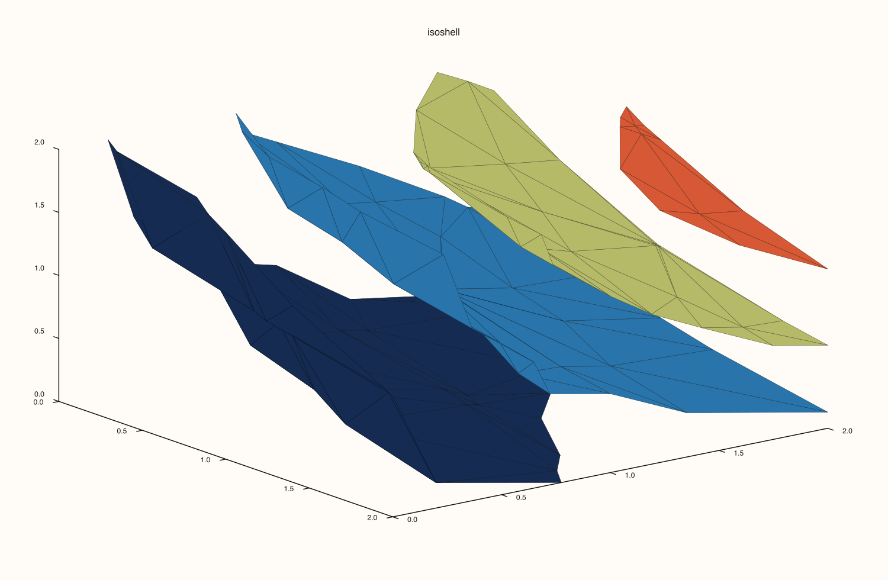
```

### `Pane::lattice`

#### Signature

```cpp
Trace& lattice(self: Pane, x: SeriesLike, y: SeriesLike, z: SeriesLike);
Trace& lattice(self: Pane, x: SeriesLike, y: SeriesLike, z: SeriesLike, color: SeriesLike);
```

#### Notes

Wireframe-style surface for gridded 3D data.

#### Example

```{literalinclude} ../../examples/docs/snippets/keys/core_lattice.cpp
:language: cpp
```

#### Output

```{only} html
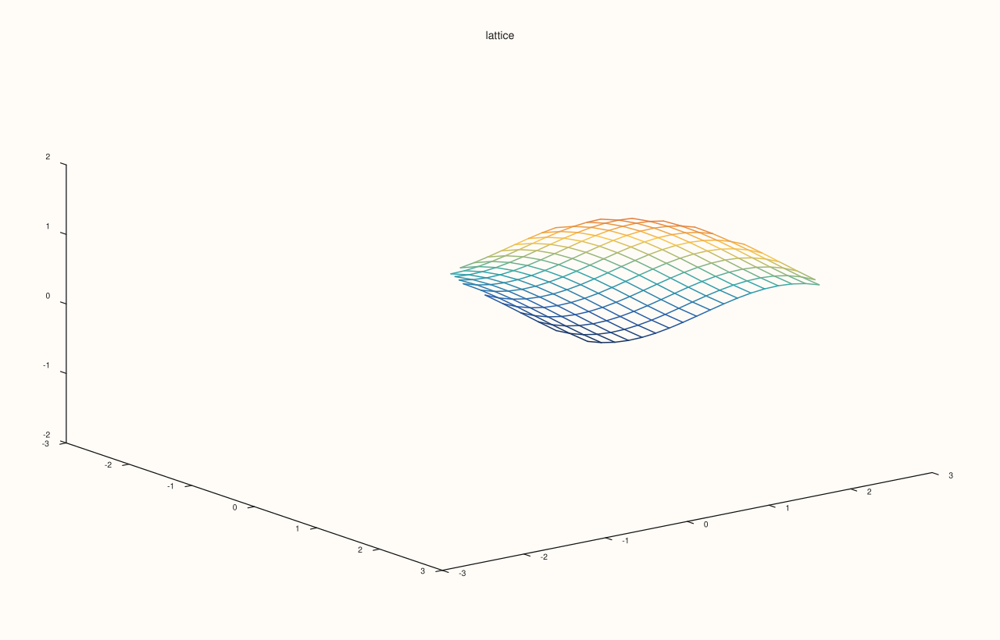
```

```{only} not html
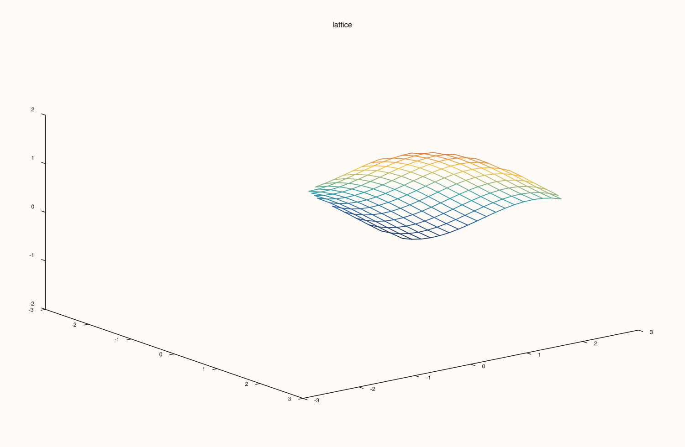
```

### `Pane::path3`

#### Signature

```cpp
Trace& path3(self: Pane, x: SeriesLike, y: SeriesLike, z: SeriesLike);
```

#### Notes

3D path/trajectory primitive.

#### Example

```{literalinclude} ../../examples/docs/snippets/keys/core_path3.cpp
:language: cpp
```

#### Output

```{only} html
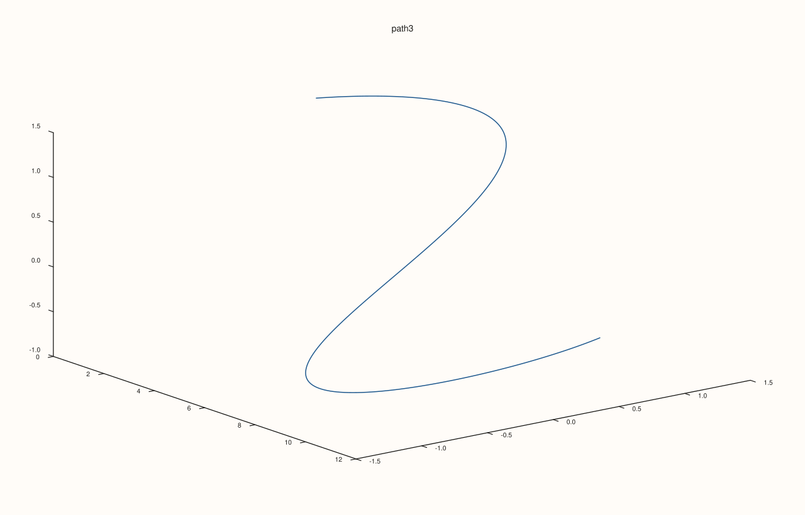
```

```{only} not html

```

### `Pane::quartet`

#### Signature

```cpp
Trace& quartet(self: Pane, values: SeriesLike);
Trace& quartet(self: Pane, group: SeriesLike, values: SeriesLike);
```

#### Notes

Box-and-whisker-style summary distribution marks, optionally grouped.

#### Example

```{literalinclude} ../../examples/docs/snippets/keys/core_quartet.cpp
:language: cpp
```

#### Output

```{only} html
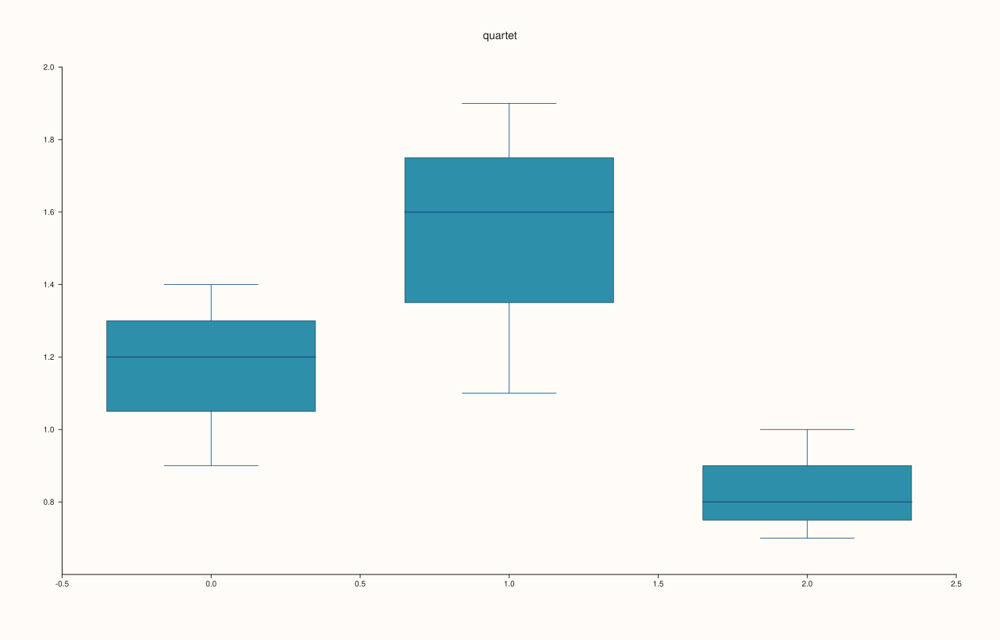
```

```{only} not html

```

### `Pane::radial`

#### Signature

```cpp
Trace& radial(self: Pane, theta: SeriesLike, radius: SeriesLike);
```

#### Notes

Polar-coordinate trace primitive.

#### Example

```{literalinclude} ../../examples/docs/snippets/keys/core_radial.cpp
:language: cpp
```

#### Output

```{only} html
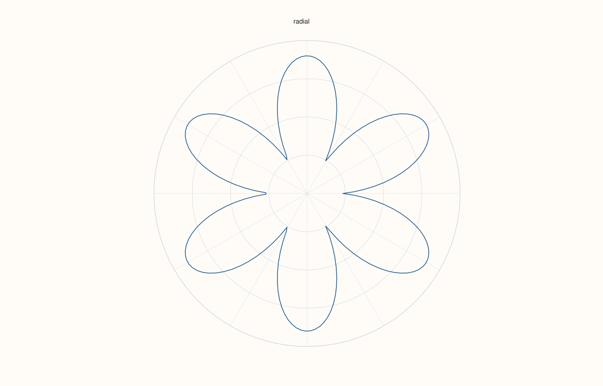
```

```{only} not html
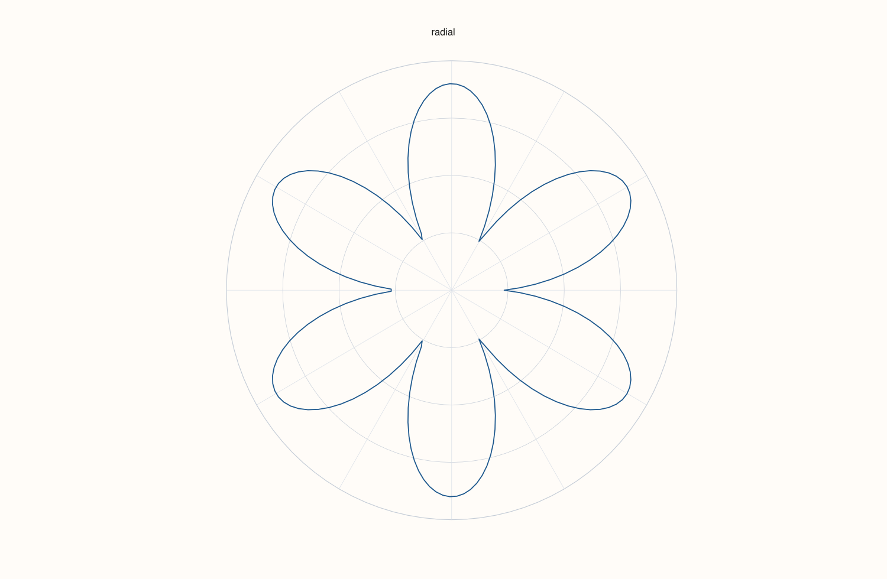
```

### `Pane::ribbon`

#### Signature

```cpp
Trace& ribbon(self: Pane, y: SeriesLike, base: double = 0.0);
Trace& ribbon(self: Pane, x: SeriesLike, y: SeriesLike, base: double = 0.0);
```

#### Notes

Area-under-curve primitive with explicit baseline.

#### Example

```{literalinclude} ../../examples/docs/snippets/keys/core_ribbon.cpp
:language: cpp
```

#### Output

```{only} html

```

```{only} not html
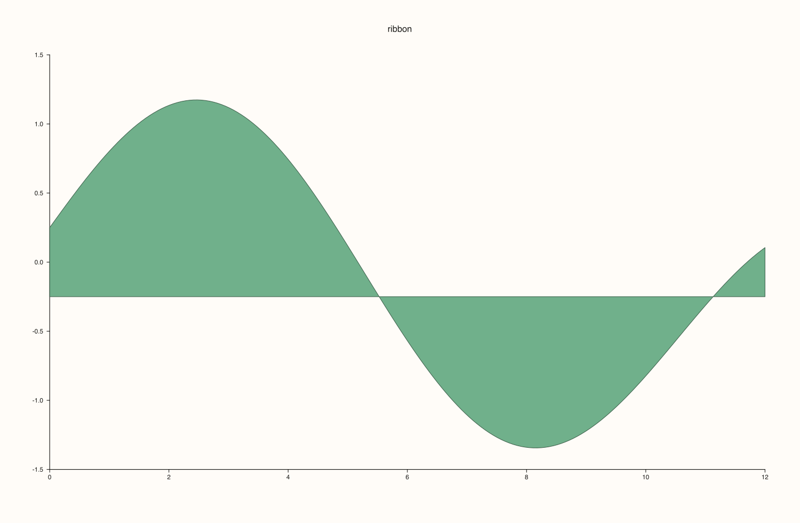
```

### `Pane::ridge3`

#### Signature

```cpp
Trace& ridge3(self: Pane, x: SeriesLike, y: SeriesLike, z: SeriesLike);
Trace& ridge3(self: Pane, x: SeriesLike, y: SeriesLike, z: SeriesLike, levels: int);
Trace& ridge3(self: Pane, x: SeriesLike, y: SeriesLike, z: SeriesLike, levels: std::vector<double>);
```

#### Notes

Layered 3D ridge representation of gridded scalar surfaces.

#### Example

```{literalinclude} ../../examples/docs/snippets/keys/core_ridge3.cpp
:language: cpp
```

#### Output

```{only} html

```

```{only} not html
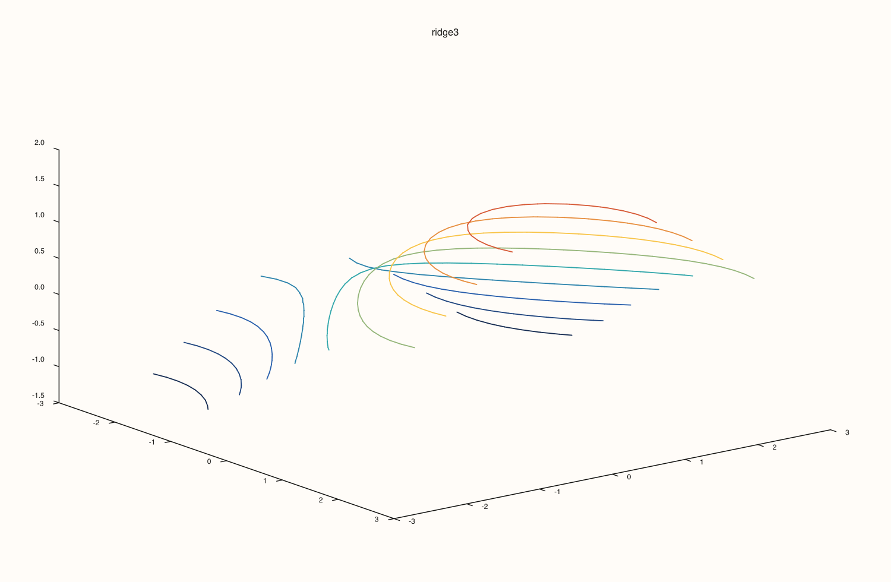
```

### `Pane::rule_* / band_* / pin / caption`

#### Signature

```cpp
Pane& rule_x(self: Pane, value: double, label: std::string = {});
Pane& rule_y(self: Pane, value: double, label: std::string = {});
Pane& band_x(self: Pane, span: Range1d, label: std::string = {});
Pane& band_y(self: Pane, span: Range1d, label: std::string = {});
Pane& pin(self: Pane, text: std::string, x: double, y: double, offset_x: double = 38.0, offset_y: double = -18.0);
Pane& caption(self: Pane, text: std::string);
```

#### Notes

Adds reference lines, highlighted ranges, annotations, and pane captions without changing trace data.

#### Example

```{literalinclude} ../../examples/docs/snippets/keys/core_pane_guides_annotations.cpp
:language: cpp
```

#### Output

```{only} html
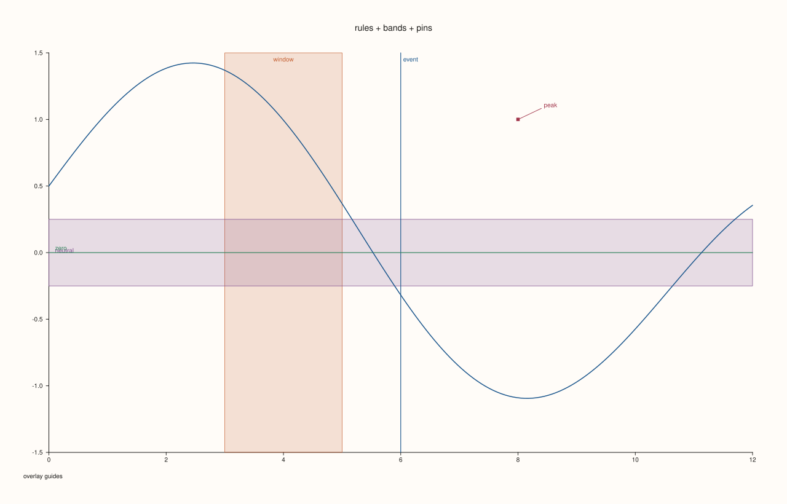
```

```{only} not html
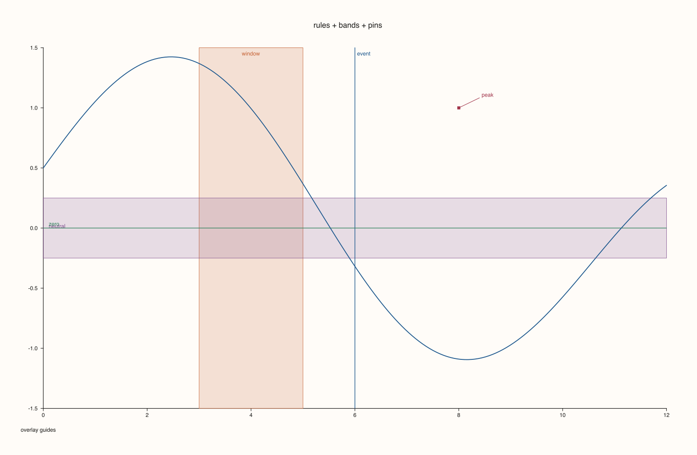
```

### `Pane::scale_x / scale_y`

#### Signature

```cpp
Pane& scale_x(self: Pane, policy: ScalePolicy);
Pane& scale_y(self: Pane, policy: ScalePolicy);
```

#### Notes

Applies logarithmic/symlog/linear scale policies at axis level.

#### Example

```{literalinclude} ../../examples/docs/snippets/keys/core_pane_scales.cpp
:language: cpp
```

#### Output

```{only} html

```

```{only} not html
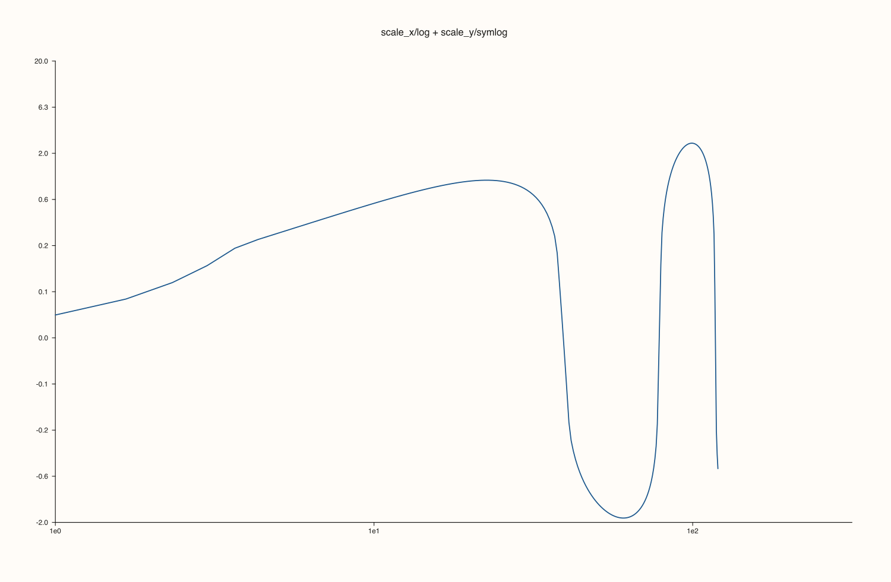
```

### `Pane::sheet`

#### Signature

```cpp
Trace& sheet(self: Pane, x: SeriesLike, y: SeriesLike, z: SeriesLike);
Trace& sheet(self: Pane, x: SeriesLike, y: SeriesLike, z: SeriesLike, color: SeriesLike);
```

#### Notes

Filled 3D surface primitive.

#### Example

```{literalinclude} ../../examples/docs/snippets/keys/core_sheet.cpp
:language: cpp
```

#### Output

```{only} html
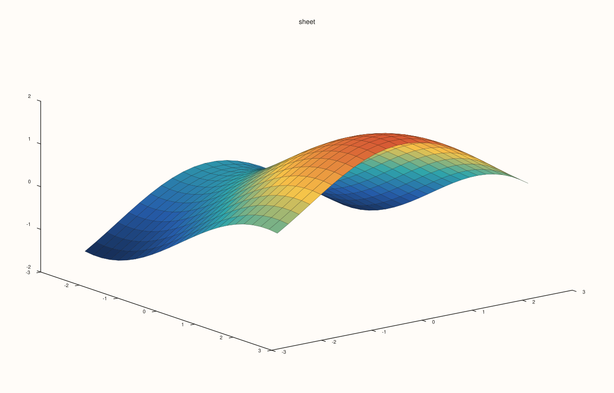
```

```{only} not html

```

### `Pane::spike`

#### Signature

```cpp
Trace& spike(self: Pane, y: SeriesLike, base: double = 0.0);
Trace& spike(self: Pane, x: SeriesLike, y: SeriesLike, base: double = 0.0);
```

#### Notes

Stem/impulse rendering from baseline.

#### Example

```{literalinclude} ../../examples/docs/snippets/keys/core_spike.cpp
:language: cpp
```

#### Output

```{only} html
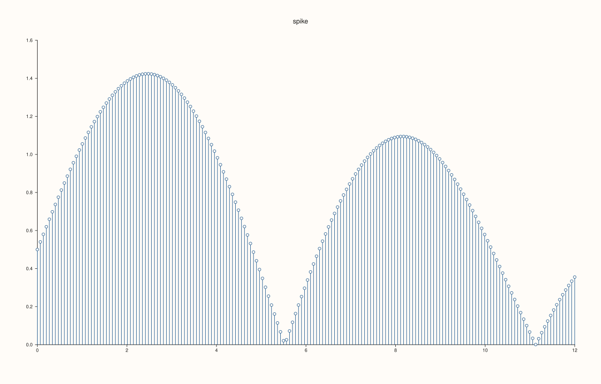
```

```{only} not html
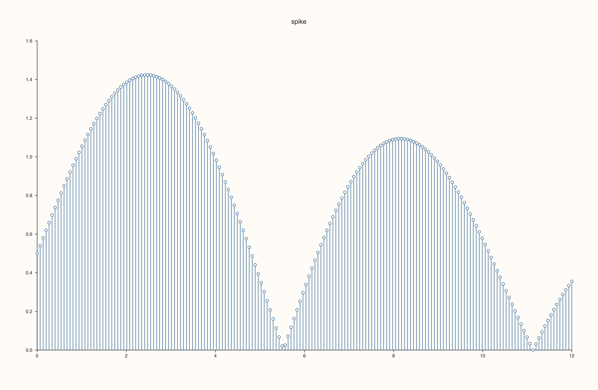
```

### `Pane::spire3`

#### Signature

```cpp
Trace& spire3(self: Pane, z: SeriesLike);
Trace& spire3(self: Pane, y: SeriesLike, z: SeriesLike);
Trace& spire3(self: Pane, x: SeriesLike, y: SeriesLike, z: SeriesLike);
Trace& spire3(self: Pane, x: SeriesLike, y: SeriesLike, z: SeriesLike, color: SeriesLike);
```

#### Notes

3D bar/spire primitive with optional explicit axis grids and color mapping.

#### Example

```{literalinclude} ../../examples/docs/snippets/keys/core_spire3.cpp
:language: cpp
```

#### Output

```{only} html
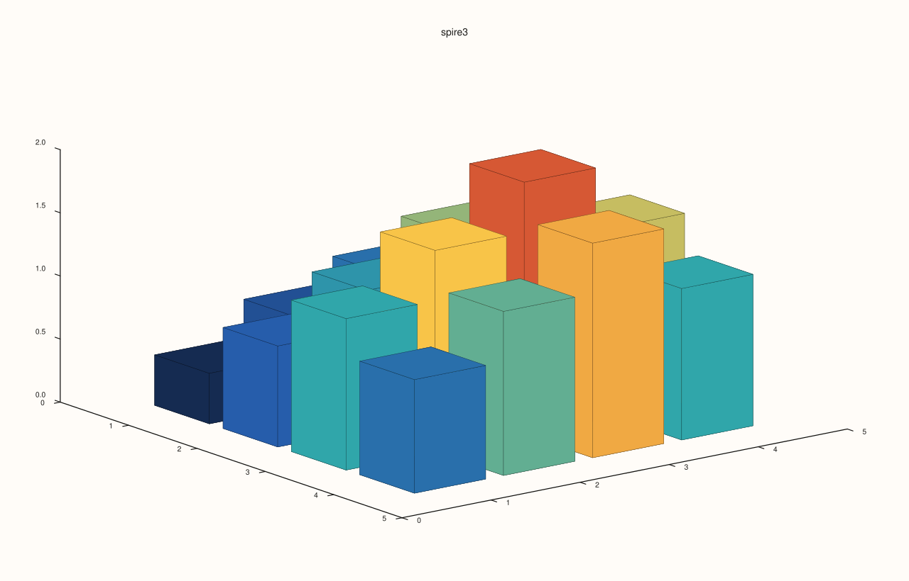
```

```{only} not html

```

### `Pane::trend`

#### Signature

```cpp
Trace& trend(self: Pane, x: SeriesLike, y: SeriesLike);
```

#### Notes

Base 2D line primitive used under many high-level wrappers.

#### Example

```{literalinclude} ../../examples/docs/snippets/keys/core_trend.cpp
:language: cpp
```

#### Output

```{only} html

```

```{only} not html
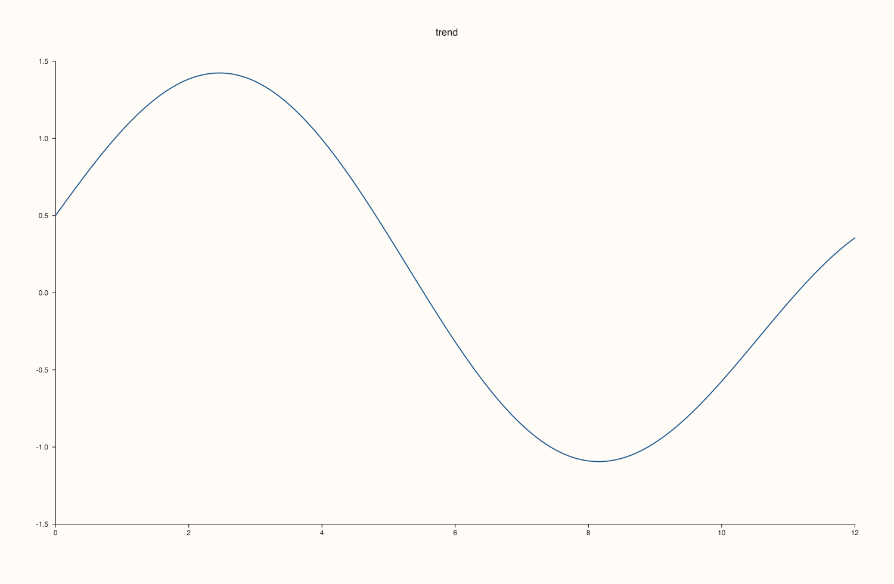
```

### `Pane::violin`

#### Signature

```cpp
Trace& violin(self: Pane, values: SeriesLike);
Trace& violin(self: Pane, values: SeriesLike, options: ViolinOptions);
Trace& violin(self: Pane, group: SeriesLike, values: SeriesLike);
Trace& violin(self: Pane, group: SeriesLike, values: SeriesLike, options: ViolinOptions);
```

#### Notes

Kernel-density distribution shape with optional grouping and configurable inner marks.

#### Example

```{literalinclude} ../../examples/docs/snippets/keys/core_violin.cpp
:language: cpp
```

#### Output

```{only} html
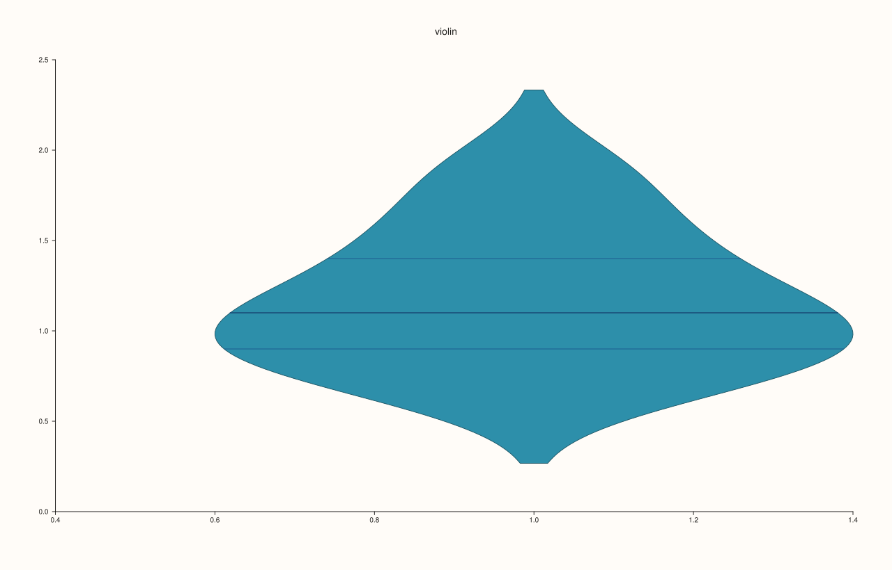
```

```{only} not html

```

### `Pane::visible / axes_visible`

#### Signature

```cpp
Pane& visible(self: Pane, enable: bool = true);
Pane& axes_visible(self: Pane, enable: bool = true);
Pane& hide(self: Pane);
Pane& show(self: Pane);
```

#### Notes

Controls pane and axis chrome visibility independently.

#### Example

```{literalinclude} ../../examples/docs/snippets/keys/core_pane_visibility.cpp
:language: cpp
```

#### Output

```{only} html

```

```{only} not html
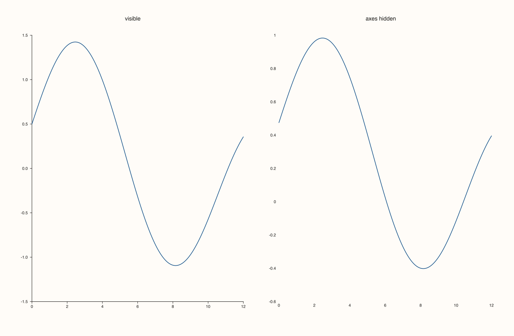
```

### `Pane::wedge`

#### Signature

```cpp
Trace& wedge(self: Pane, values: SeriesLike);
Trace& wedge(self: Pane, values: SeriesLike, labels: std::vector<std::string>);
Trace& wedge(self: Pane, values: SeriesLike, explode: SeriesLike, labels: std::vector<std::string>);
```

#### Notes

Pie/wedge primitive with optional explode offsets.

#### Example

```{literalinclude} ../../examples/docs/snippets/keys/core_wedge.cpp
:language: cpp
```

#### Output

```{only} html
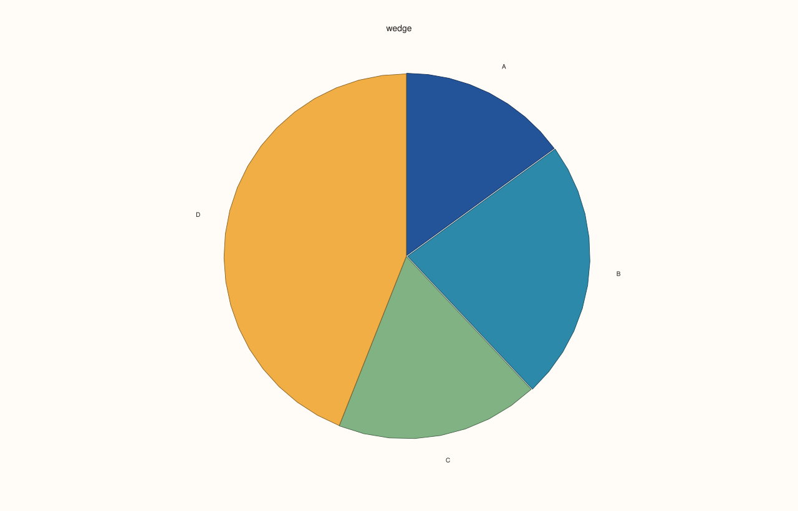
```

```{only} not html
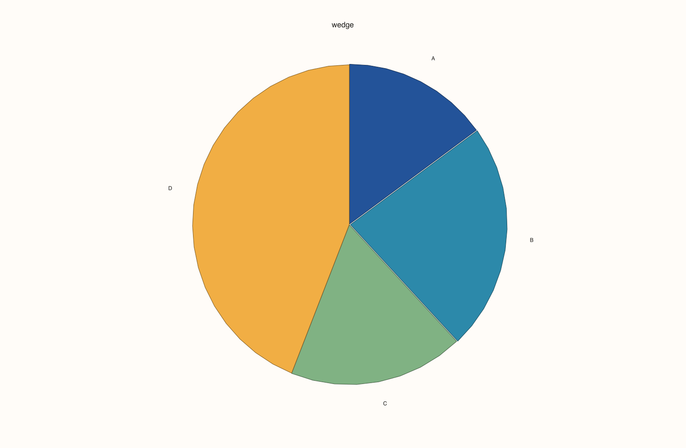
```

### `Pane::whisk`

#### Signature

```cpp
Trace& whisk(self: Pane, y: SeriesLike, err: SeriesLike);
Trace& whisk(self: Pane, x: SeriesLike, y: SeriesLike, err: SeriesLike);
Trace& whisk(self: Pane, x: SeriesLike, y: SeriesLike, neg: SeriesLike, pos: SeriesLike);
Trace& whisk(self: Pane, x: SeriesLike, y: SeriesLike, yneg: SeriesLike, ypos: SeriesLike, xneg: SeriesLike, xpos: SeriesLike);
```

#### Notes

Error-bar primitive with symmetric or asymmetric intervals.

#### Example

```{literalinclude} ../../examples/docs/snippets/keys/core_whisk.cpp
:language: cpp
```

#### Output

```{only} html
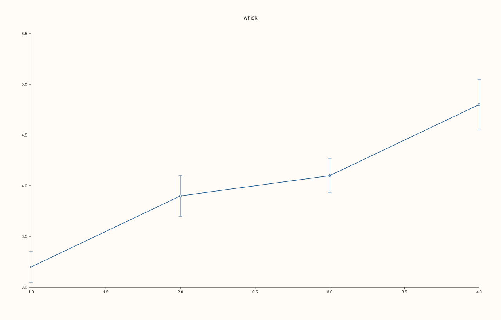
```

```{only} not html
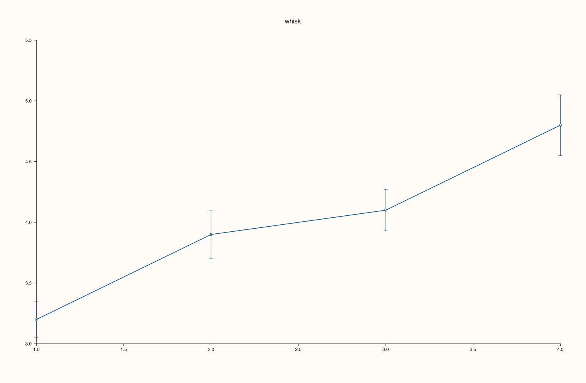
```

### `Pane::x_limits / y_limits / method`

#### Signature

```cpp
Pane& x_limits(self: Pane, limits: Range1d);
Pane& y_limits(self: Pane, limits: Range1d);
Pane& x_limit_method(self: Pane, method: LimitMethod);
Pane& y_limit_method(self: Pane, method: LimitMethod);
```

#### Notes

Sets explicit axis windows and autoscale policy for limit computation.

#### Example

```{literalinclude} ../../examples/docs/snippets/keys/core_pane_axes_limits.cpp
:language: cpp
```

#### Output

```{only} html

```

```{only} not html
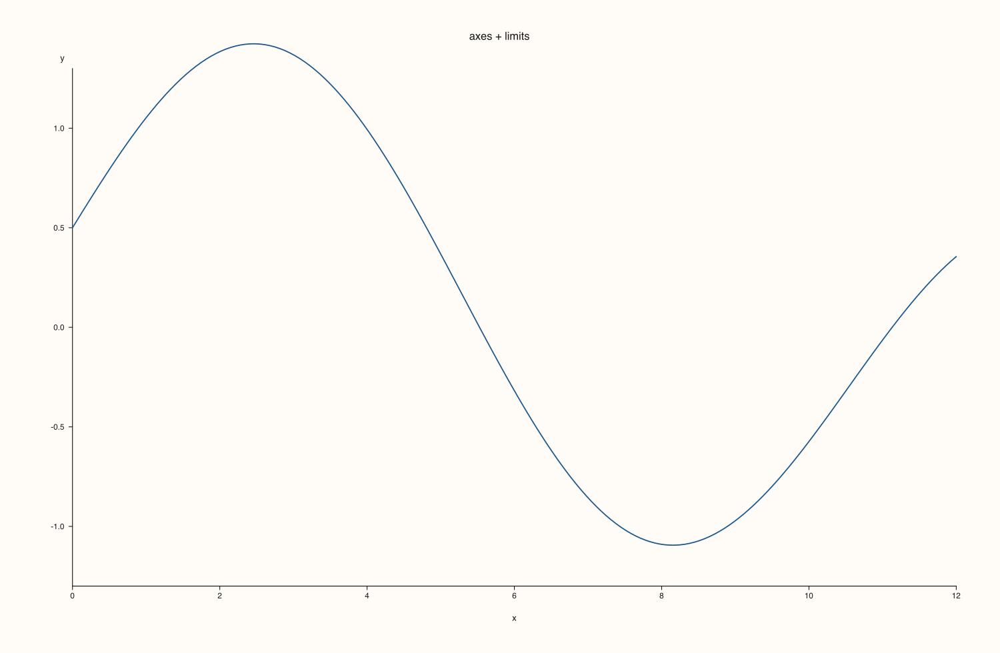
```

### `Pane::x_tick_format / y_tick_format`

#### Signature

```cpp
Pane& x_tick_format(self: Pane, format: TickFormat);
Pane& y_tick_format(self: Pane, format: TickFormat);
Pane& x_auto_tick_decimals(self: Pane, decimals: int);
Pane& y_auto_tick_decimals(self: Pane, decimals: int);
```

#### Notes

Forces label formatting for readability and consistency in reports.

#### Example

```{literalinclude} ../../examples/docs/snippets/keys/core_pane_tick_format.cpp
:language: cpp
```

#### Output

```{only} html
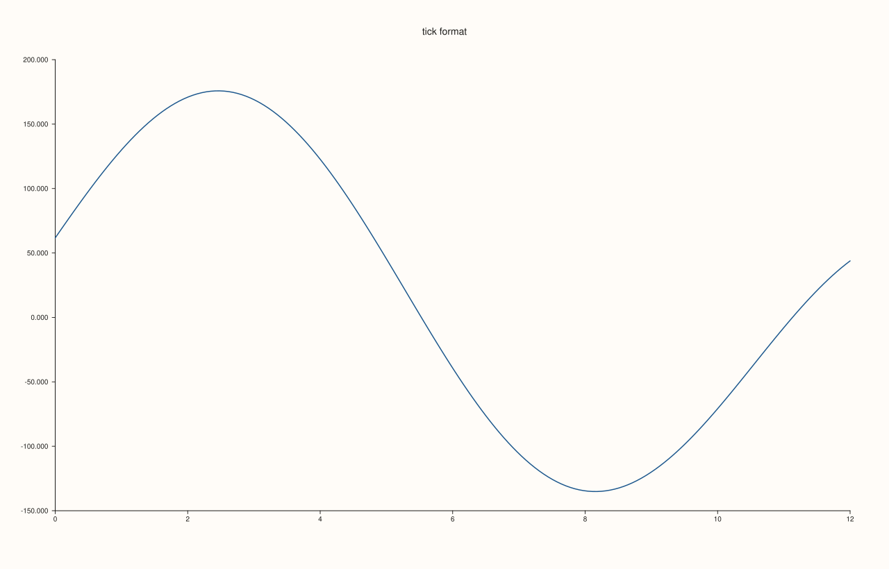
```

```{only} not html
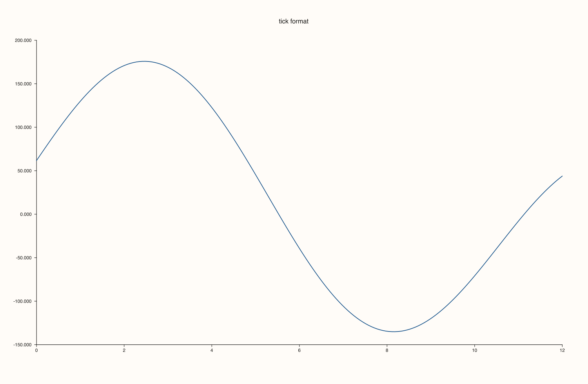
```

### `Pane::x_tick_rotation / gaps`

#### Signature

```cpp
Pane& x_tick_rotation(self: Pane, degrees: double);
Pane& x_tick_label_gap(self: Pane, points: double);
Pane& x_label_gap(self: Pane, points: double);
Pane& y_label_centered(self: Pane, enable: bool = true);
```

#### Notes

Controls tick/label spacing and angle to prevent overlaps in dense dashboards.

#### Example

```{literalinclude} ../../examples/docs/snippets/keys/core_pane_tick_rotation_gaps.cpp
:language: cpp
```

#### Output

```{only} html

```

```{only} not html
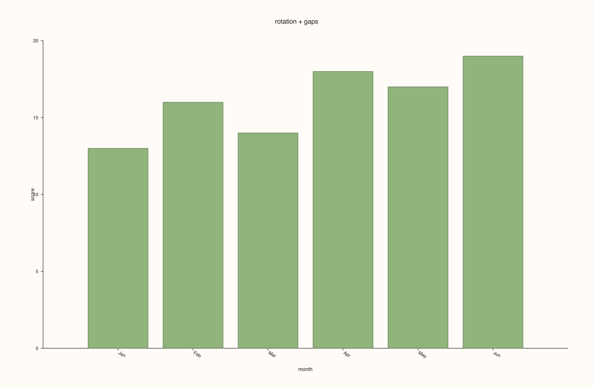
```

### `Pane::x_ticks / x_categories / y_categories`

#### Signature

```cpp
Pane& x_ticks(self: Pane, positions: SeriesLike, labels: pluss::msharp::RangeView::Of<std::string_view>);
Pane& x_ticks(self: Pane, positions: SeriesLike, labels: std::initializer_list<std::string_view>);
Pane& x_categories(self: Pane, labels: pluss::msharp::RangeView::Of<std::string_view>, first: double = 1.0, step: double = 1.0);
Pane& x_categories(self: Pane, labels: std::initializer_list<std::string_view>, first: double = 1.0, step: double = 1.0);
Pane& y_categories(self: Pane, labels: pluss::msharp::RangeView::Of<std::string_view>, first: double = 1.0, step: double = 1.0);
Pane& y_categories(self: Pane, labels: std::initializer_list<std::string_view>, first: double = 1.0, step: double = 1.0);
```

#### Notes

Switches between explicit numeric tick positions and category-axis labels.

#### Example

```{literalinclude} ../../examples/docs/snippets/keys/core_pane_ticks_categories.cpp
:language: cpp
```

#### Output

```{only} html
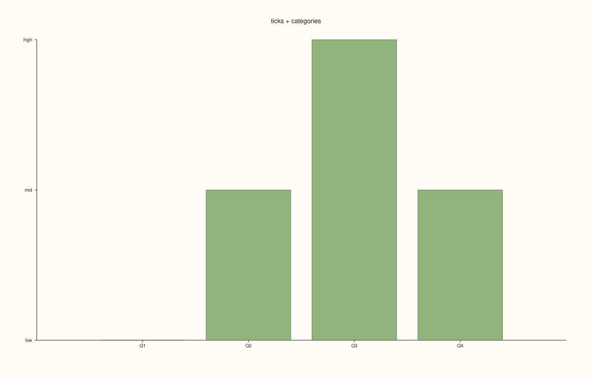
```

```{only} not html

```

### `Studio::context_scales`

#### Signature

```cpp
Studio& context_scales(self: Studio, tick_font_scale: double, axis_label_font_scale: double);
```

#### Notes

Sets global text scale defaults applied to newly created panes.

#### Example

```{literalinclude} ../../examples/docs/snippets/keys/core_studio_context_scales.cpp
:language: cpp
```

#### Output

```{only} html
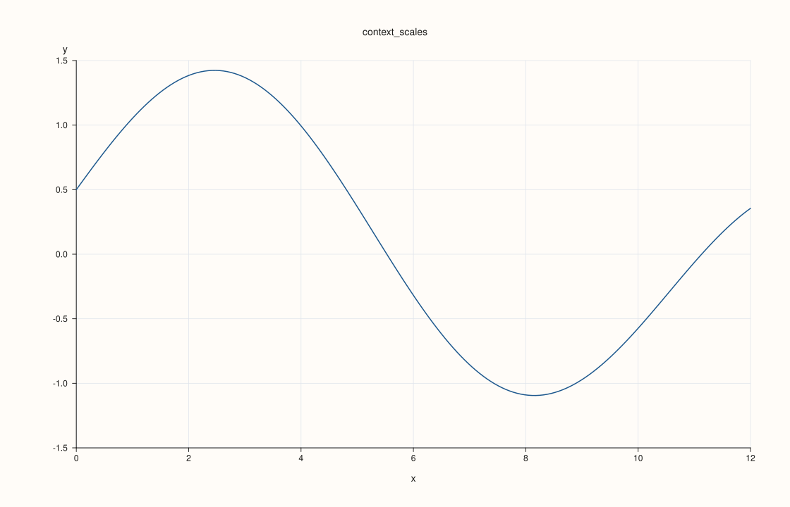
```

```{only} not html
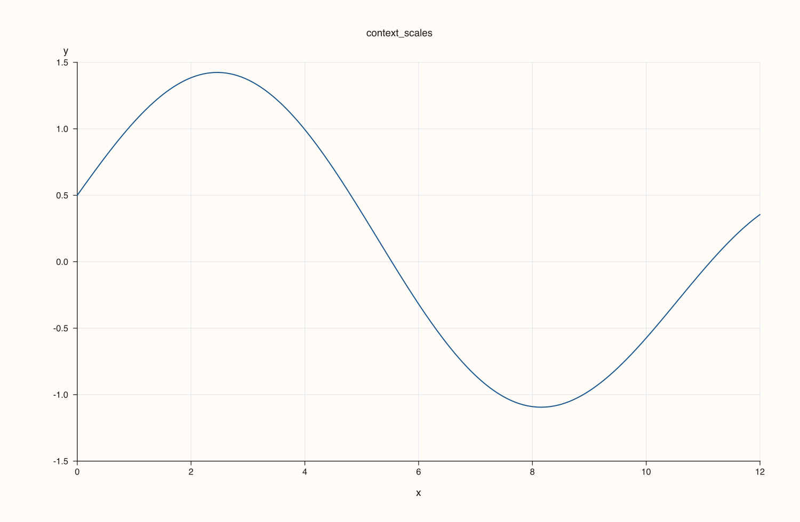
```

### `Studio::mosaic / pane2 / place`

#### Signature

```cpp
Studio& mosaic(self: Studio, rows: int64_t, cols: int64_t, gutter_x: double = 18.0, gutter_y: double = 18.0);
Pane& pane2(self: Studio, title: std::string = {});
Pane& place(self: Pane, row: int64_t, col: int64_t, row_span: int64_t = 1, col_span: int64_t = 1);
```

#### Notes

Primary layout path for 2D dashboards.

#### Example

```{literalinclude} ../../examples/docs/snippets/keys/core_studio_mosaic.cpp
:language: cpp
```

#### Output

```{only} html
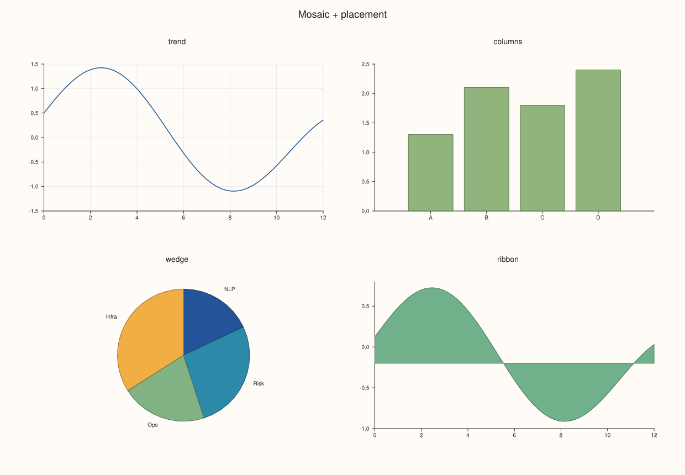
```

```{only} not html

```

### `Studio::pane_style_defaults`

#### Signature

```cpp
Studio& pane_style_defaults(self: Studio, pane_style_template: Pane);
Studio& clear_pane_style_defaults(self: Studio);
```

#### Notes

Copies style defaults from a template `Pane` into future panes.

#### Example

```{literalinclude} ../../examples/docs/snippets/keys/core_studio_pane_style_defaults.cpp
:language: cpp
```

#### Output

```{only} html
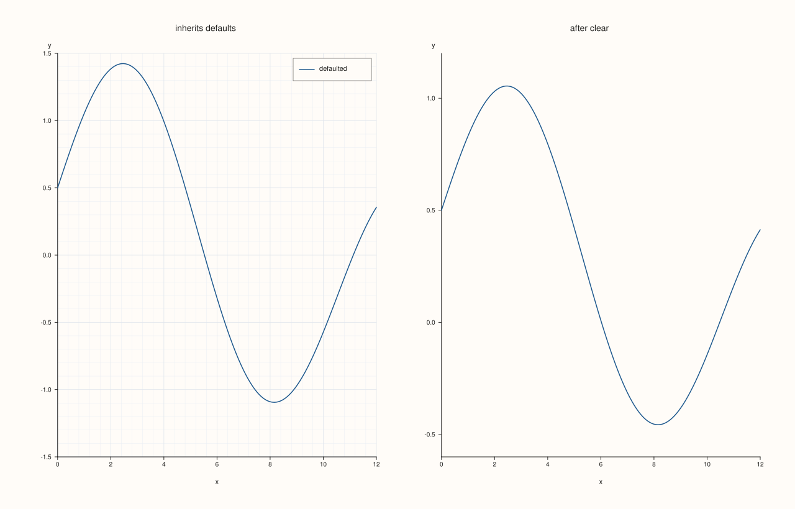
```

```{only} not html
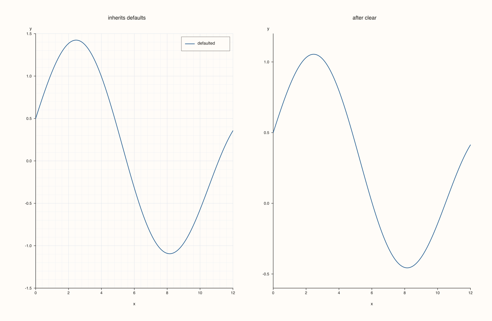
```

### `Studio::row_title / x_caption / y_caption`

#### Signature

```cpp
Studio& row_title(self: Studio, row: int64_t, text: std::string);
Studio& clear_row_title(self: Studio, row: int64_t);
Studio& x_caption(self: Studio, group: std::string, text: std::string);
Studio& y_caption(self: Studio, group: std::string, text: std::string);
```

#### Notes

Adds shared row and axis-group labeling for multi-pane reports.

#### Example

```{literalinclude} ../../examples/docs/snippets/keys/core_studio_captions_row_titles.cpp
:language: cpp
```

#### Output

```{only} html
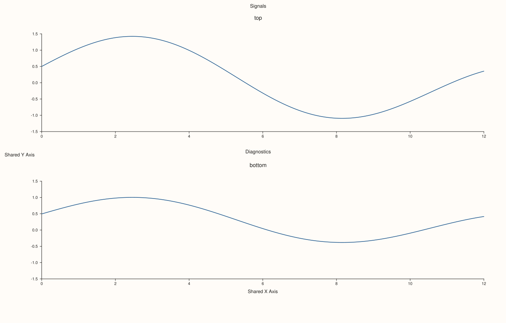
```

```{only} not html
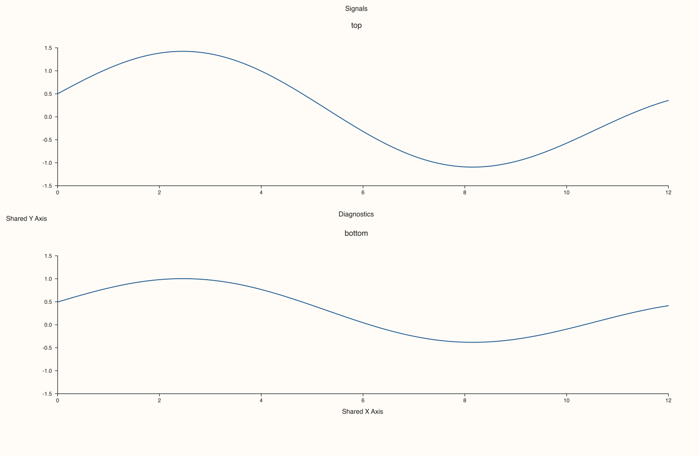
```

### `Studio::save_svg`

#### Signature

```cpp
void save_svg(self: Studio, path: std::string_view) const;
```

#### Notes

Writes deterministic vector output suitable for docs and version control.

#### Example

```{literalinclude} ../../examples/docs/snippets/keys/core_save_svg.cpp
:language: cpp
```

#### Output

```{only} html

```

```{only} not html

```

### `Studio::save_png`

#### Signature

```cpp
void save_png(self: Studio, path: std::string_view, dpi: int64_t = 144) const;
```

#### Notes

Raster export path for slides and reports requiring pixel images.

#### Example

```{literalinclude} ../../examples/docs/snippets/keys/core_save_png.cpp
:language: cpp
```

#### Output

```{only} html

```

```{only} not html

```

### `Studio::save_pdf`

#### Signature

```cpp
void save_pdf(self: Studio, path: std::string_view, engine: PdfEngine = PdfEngine::Auto) const;
```

#### Notes

Print/PDF export with backend selection.

#### Example

```{literalinclude} ../../examples/docs/snippets/keys/core_save_pdf.cpp
:language: cpp
```

#### Output

```{only} html

```

```{only} not html

```

### `Studio::subpane2`

#### Signature

```cpp
Pane& subpane2(self: Studio, parent_index: size_t, rows: int64_t, cols: int64_t, row: int64_t, col: int64_t, row_span: int64_t = 1, col_span: int64_t = 1, title: std::string = {});
```

#### Notes

Creates nested 2D panes inside a parent pane cell.

#### Example

```{literalinclude} ../../examples/docs/snippets/keys/core_studio_subpane2.cpp
:language: cpp
```

#### Output

```{only} html

```

```{only} not html

```

### `Studio::subpane3`

#### Signature

```cpp
Pane& subpane3(self: Studio, parent_index: size_t, rows: int64_t, cols: int64_t, row: int64_t, col: int64_t, row_span: int64_t = 1, col_span: int64_t = 1, title: std::string = {});
```

#### Notes

Creates nested 3D panes inside a parent pane cell.

#### Example

```{literalinclude} ../../examples/docs/snippets/keys/core_studio_subpane3.cpp
:language: cpp
```

#### Output

```{only} html

```

```{only} not html

```

### `Studio::theme`

#### Signature

```cpp
Studio& theme(self: Studio, tokens: Theme);
Studio& rename(self: Studio, name: std::string);
Studio& headline(self: Studio, text: std::string);
```

#### Notes

Applies figure tokens and top-level identity metadata.

#### Example

```{literalinclude} ../../examples/docs/snippets/keys/core_studio_theme.cpp
:language: cpp
```

#### Output

```{only} html

```

```{only} not html

```

### `Studio::tight_layout`

#### Signature

```cpp
Studio& tight_layout(self: Studio, enable: bool = true, padding: double = 6.0);
```

#### Notes

Compacts pane geometry to reduce overlaps and dead space.

#### Example

```{literalinclude} ../../examples/docs/snippets/keys/core_studio_tight_layout.cpp
:language: cpp
```

#### Output

```{only} html

```

```{only} not html

```

### `Trace::hide / show`

#### Signature

```cpp
Trace& hide(self: Trace);
Trace& show(self: Trace);
```

#### Notes

Allows toggling traces in chained construction flows without deleting geometry.

#### Example

```{literalinclude} ../../examples/docs/snippets/keys/core_trace_visibility.cpp
:language: cpp
```

#### Output

```{only} html

```

```{only} not html

```

### `Trace::label / width / stroke / palette / color_limits`

#### Signature

```cpp
Trace& label(self: Trace, label: std::string);
Trace& width(self: Trace, width: float);
Trace& stroke(self: Trace, color: Rgba);
Trace& palette(self: Trace, palette: PaletteRamp);
Trace& color_limits(self: Trace, limits: Range1d);
```

#### Notes

Primary 2D/continuous styling controls for line/scatter/surface traces.

#### Example

```{literalinclude} ../../examples/docs/snippets/keys/core_trace_style_2d.cpp
:language: cpp
```

#### Output

```{only} html

```

```{only} not html

```

### `Trace::shade / lighting / material / transparent`

#### Signature

```cpp
Trace& shade(self: Trace, mode: ShadeMode);
Trace& lighting(self: Trace, mode: LightingMode);
Trace& material(self: Trace, profile: MaterialProfile);
Trace& transparent(self: Trace, enable: bool = true);
```

#### Notes

3D surface rendering controls for geometry perception and layering.

#### Example

```{literalinclude} ../../examples/docs/snippets/keys/core_trace_style_3d.cpp
:language: cpp
```

#### Output

```{only} html

```

```{only} not html

```
