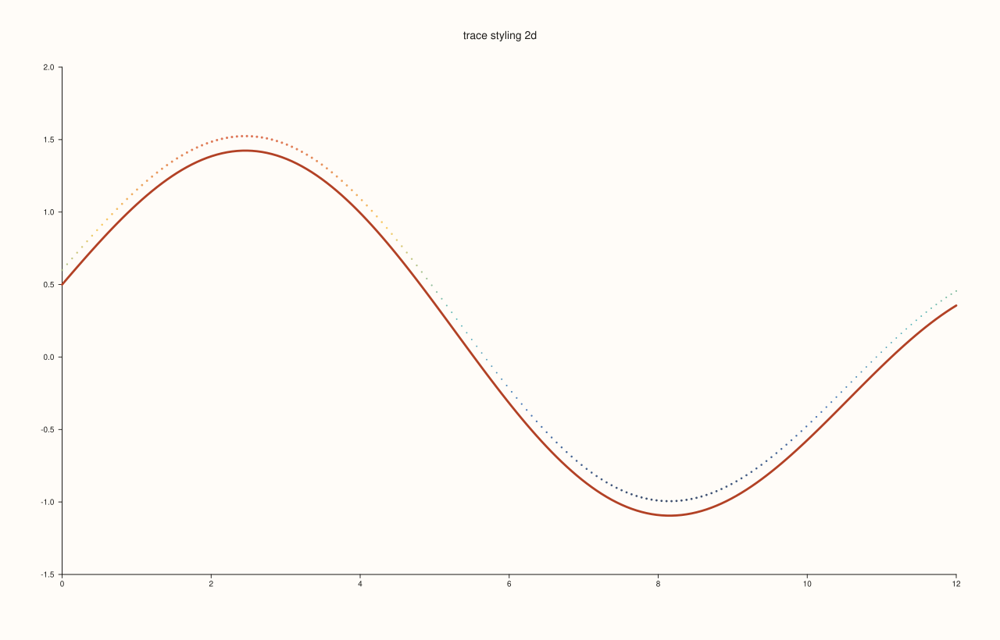
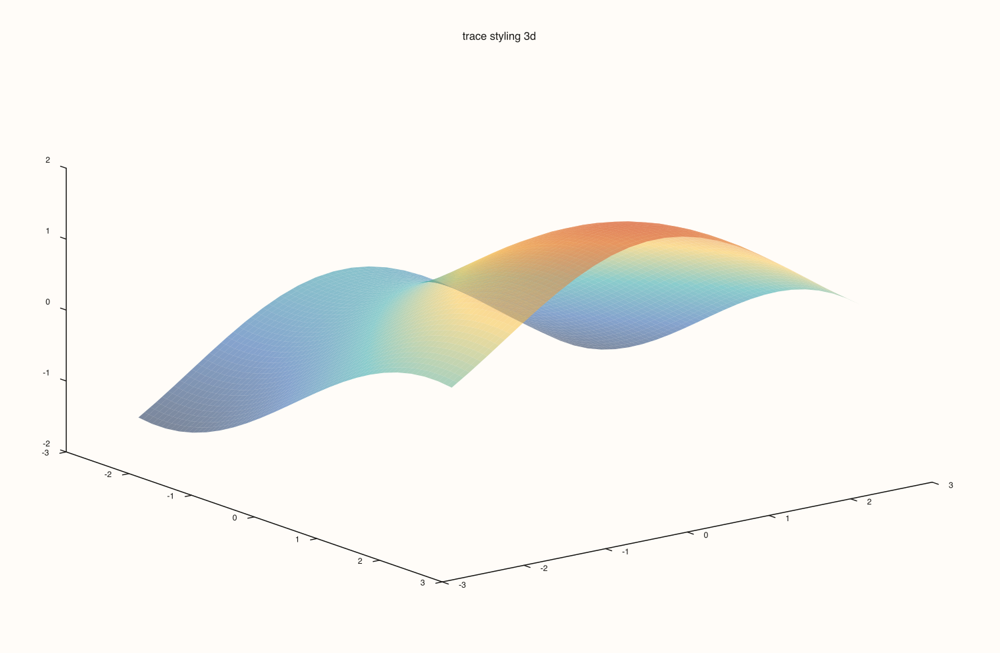
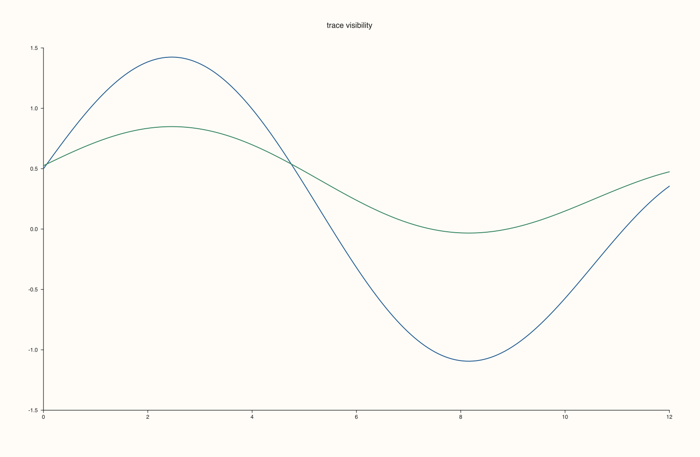
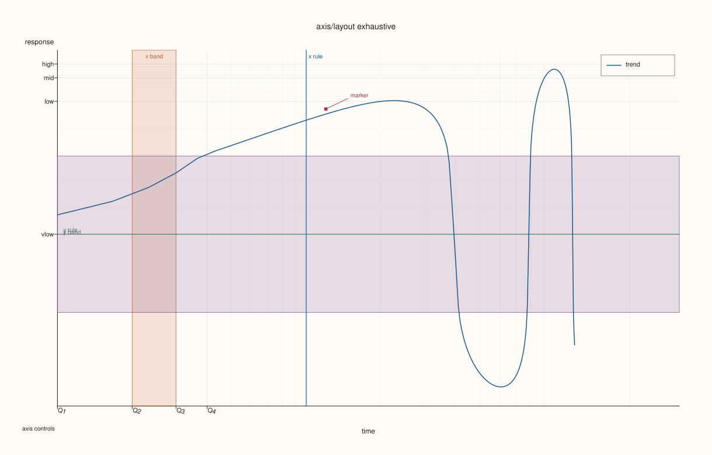
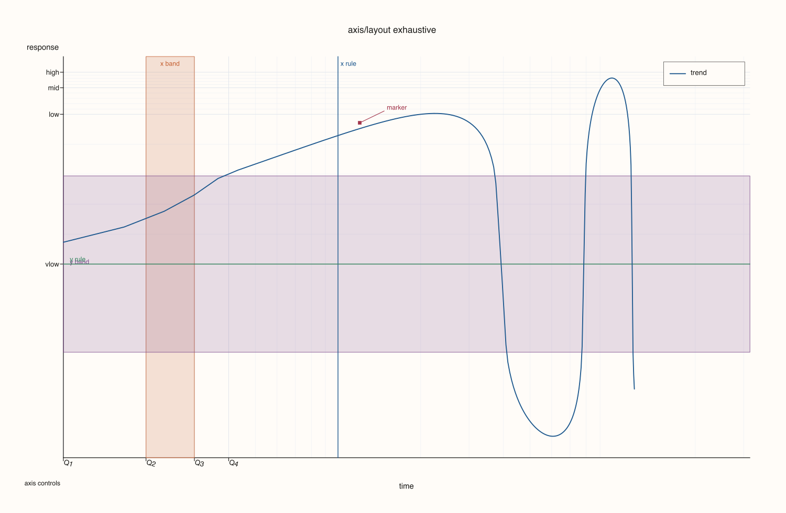
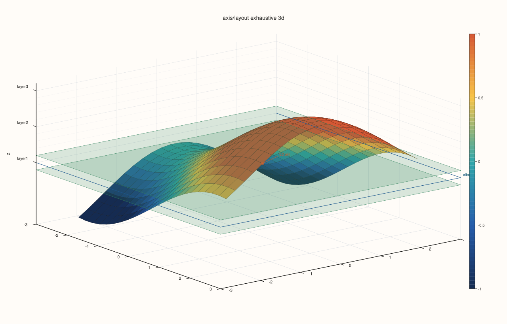
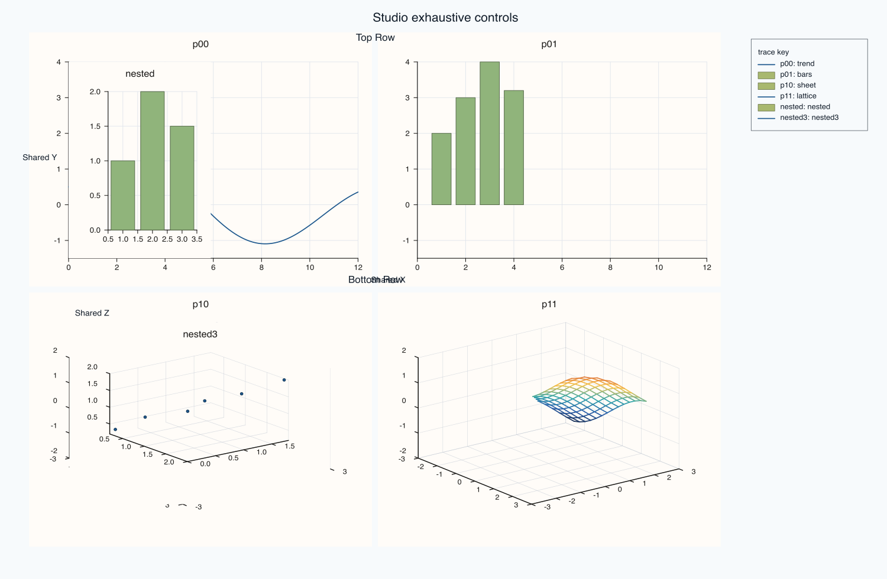

# PlussPl Core Controls API

This page aggressively documents additional `Studio`, `Pane`, and `Trace` controls not previously expanded one-by-one.

Every section links to a real runnable snippet and generated output artifact.

## API Reference Style

### `Trace::width`

#### Signature

```cpp
Trace& width(self: Trace, float width);
```

#### Notes

Sets stroke width for the active trace.

#### Example

```{literalinclude} ../../examples/docs/flash_api_capture_demo.cpp
:language: cpp
:start-at: if (key == "core_trace_style_2d") {
:end-at: return true;
```

#### Output

```{only} html

```

```{only} not html

```

### `Trace::stroke`

#### Signature

```cpp
Trace& stroke(self: Trace, Rgba color);
```

#### Notes

Overrides the trace stroke color.

#### Example

```{literalinclude} ../../examples/docs/flash_api_capture_demo.cpp
:language: cpp
:start-at: if (key == "core_trace_style_2d") {
:end-at: return true;
```

#### Output

```{only} html

```

```{only} not html

```

### `Trace::palette`

#### Signature

```cpp
Trace& palette(self: Trace, PaletteRamp palette);
```

#### Notes

Assigns a palette ramp used for continuous color mapping.

#### Example

```{literalinclude} ../../examples/docs/flash_api_capture_demo.cpp
:language: cpp
:start-at: if (key == "core_trace_style_2d") {
:end-at: return true;
```

#### Output

```{only} html

```

```{only} not html

```

### `Trace::color_limits`

#### Signature

```cpp
Trace& color_limits(self: Trace, Range1d limits);
```

#### Notes

Fixes color normalization bounds for comparable panels.

#### Example

```{literalinclude} ../../examples/docs/flash_api_capture_demo.cpp
:language: cpp
:start-at: if (key == "core_trace_style_2d") {
:end-at: return true;
```

#### Output

```{only} html

```

```{only} not html

```

### `Trace::lighting`

#### Signature

```cpp
Trace& lighting(self: Trace, LightingMode mode);
```

#### Notes

Sets lighting model for 3D surfaces.

#### Example

```{literalinclude} ../../examples/docs/flash_api_capture_demo.cpp
:language: cpp
:start-at: if (key == "core_trace_style_3d") {
:end-at: return true;
```

#### Output

```{only} html

```

```{only} not html

```

### `Trace::material`

#### Signature

```cpp
Trace& material(self: Trace, MaterialProfile profile);
```

#### Notes

Sets material profile for 3D rendering.

#### Example

```{literalinclude} ../../examples/docs/flash_api_capture_demo.cpp
:language: cpp
:start-at: if (key == "core_trace_style_3d") {
:end-at: return true;
```

#### Output

```{only} html

```

```{only} not html

```

### `Trace::transparent`

#### Signature

```cpp
Trace& transparent(self: Trace, bool enable = true);
```

#### Notes

Toggles trace alpha/transparency mode.

#### Example

```{literalinclude} ../../examples/docs/flash_api_capture_demo.cpp
:language: cpp
:start-at: if (key == "core_trace_style_3d") {
:end-at: return true;
```

#### Output

```{only} html

```

```{only} not html

```

### `Trace::annotate_levels`

#### Signature

```cpp
Trace& annotate_levels(self: Trace, bool enable = true);
```

#### Notes

Turns contour/level annotations on or off.

#### Example

```{literalinclude} ../../examples/docs/flash_api_capture_demo.cpp
:language: cpp
:start-at: if (key == "core_trace_style_3d") {
:end-at: return true;
```

#### Output

```{only} html

```

```{only} not html

```

### `Trace::show`

#### Signature

```cpp
Trace& show(self: Trace);
```

#### Notes

Makes a previously hidden trace visible again.

#### Example

```{literalinclude} ../../examples/docs/flash_api_capture_demo.cpp
:language: cpp
:start-at: if (key == "core_trace_visibility") {
:end-at: return true;
```

#### Output

```{only} html

```

```{only} not html

```

### `Pane::title`

#### Signature

```cpp
Pane& title(self: Pane, std::string title);
```

#### Notes

Sets or updates pane title text.

#### Example

```{literalinclude} ../../examples/docs/flash_api_capture_demo.cpp
:language: cpp
:start-at: if (key == "core_axis_layout_exhaustive") {
:end-at: return true;
```

#### Output

```{only} html

```

```{only} not html

```

### `Pane::scale_y`

#### Signature

```cpp
Pane& scale_y(self: Pane, ScalePolicy scale);
```

#### Notes

Applies scale policy on Y axis.

#### Example

```{literalinclude} ../../examples/docs/flash_api_capture_demo.cpp
:language: cpp
:start-at: if (key == "core_axis_layout_exhaustive") {
:end-at: return true;
```

#### Output

```{only} html

```

```{only} not html

```

### `Pane::scale_z`

#### Signature

```cpp
Pane& scale_z(self: Pane, ScalePolicy scale);
```

#### Notes

Applies scale policy on Z axis (3D panes).

#### Example

```{literalinclude} ../../examples/docs/flash_api_capture_demo.cpp
:language: cpp
:start-at: if (key == "core_axis_layout_exhaustive_3d") {
:end-at: return true;
```

#### Output

```{only} html

```

```{only} not html

```

### `Pane::y_limits`

#### Signature

```cpp
Pane& y_limits(self: Pane, Range1d limits);
```

#### Notes

Sets explicit Y-axis limits.

#### Example

```{literalinclude} ../../examples/docs/flash_api_capture_demo.cpp
:language: cpp
:start-at: if (key == "core_axis_layout_exhaustive") {
:end-at: return true;
```

#### Output

```{only} html

```

```{only} not html

```

### `Pane::z_limits`

#### Signature

```cpp
Pane& z_limits(self: Pane, Range1d limits);
```

#### Notes

Sets explicit Z-axis limits.

#### Example

```{literalinclude} ../../examples/docs/flash_api_capture_demo.cpp
:language: cpp
:start-at: if (key == "core_axis_layout_exhaustive_3d") {
:end-at: return true;
```

#### Output

```{only} html

```

```{only} not html

```

### `Pane::color_limits`

#### Signature

```cpp
Pane& color_limits(self: Pane, Range1d limits);
```

#### Notes

Sets explicit color-axis limits.

#### Example

```{literalinclude} ../../examples/docs/flash_api_capture_demo.cpp
:language: cpp
:start-at: if (key == "core_axis_layout_exhaustive") {
:end-at: return true;
```

#### Output

```{only} html

```

```{only} not html

```

### `Pane::x_limit_method`

#### Signature

```cpp
Pane& x_limit_method(self: Pane, LimitMethod method);
```

#### Notes

Chooses X-axis auto-limit strategy.

#### Example

```{literalinclude} ../../examples/docs/flash_api_capture_demo.cpp
:language: cpp
:start-at: if (key == "core_axis_layout_exhaustive") {
:end-at: return true;
```

#### Output

```{only} html

```

```{only} not html

```

### `Pane::y_limit_method`

#### Signature

```cpp
Pane& y_limit_method(self: Pane, LimitMethod method);
```

#### Notes

Chooses Y-axis auto-limit strategy.

#### Example

```{literalinclude} ../../examples/docs/flash_api_capture_demo.cpp
:language: cpp
:start-at: if (key == "core_axis_layout_exhaustive") {
:end-at: return true;
```

#### Output

```{only} html

```

```{only} not html

```

### `Pane::z_limit_method`

#### Signature

```cpp
Pane& z_limit_method(self: Pane, LimitMethod method);
```

#### Notes

Chooses Z-axis auto-limit strategy.

#### Example

```{literalinclude} ../../examples/docs/flash_api_capture_demo.cpp
:language: cpp
:start-at: if (key == "core_axis_layout_exhaustive_3d") {
:end-at: return true;
```

#### Output

```{only} html

```

```{only} not html

```

### `Pane::color_limit_method`

#### Signature

```cpp
Pane& color_limit_method(self: Pane, LimitMethod method);
```

#### Notes

Chooses color-axis auto-limit strategy.

#### Example

```{literalinclude} ../../examples/docs/flash_api_capture_demo.cpp
:language: cpp
:start-at: if (key == "core_axis_layout_exhaustive") {
:end-at: return true;
```

#### Output

```{only} html

```

```{only} not html

```

### `Pane::y_tick_format`

#### Signature

```cpp
Pane& y_tick_format(self: Pane, TickFormat format);
```

#### Notes

Sets Y tick label format.

#### Example

```{literalinclude} ../../examples/docs/flash_api_capture_demo.cpp
:language: cpp
:start-at: if (key == "core_axis_layout_exhaustive") {
:end-at: return true;
```

#### Output

```{only} html

```

```{only} not html

```

### `Pane::z_tick_format`

#### Signature

```cpp
Pane& z_tick_format(self: Pane, TickFormat format);
```

#### Notes

Sets Z tick label format.

#### Example

```{literalinclude} ../../examples/docs/flash_api_capture_demo.cpp
:language: cpp
:start-at: if (key == "core_axis_layout_exhaustive_3d") {
:end-at: return true;
```

#### Output

```{only} html

```

```{only} not html

```

### `Pane::x_auto_tick_decimals`

#### Signature

```cpp
Pane& x_auto_tick_decimals(self: Pane, int decimals);
```

#### Notes

Hints decimal precision for X ticks.

#### Example

```{literalinclude} ../../examples/docs/flash_api_capture_demo.cpp
:language: cpp
:start-at: if (key == "core_axis_layout_exhaustive") {
:end-at: return true;
```

#### Output

```{only} html

```

```{only} not html

```

### `Pane::y_auto_tick_decimals`

#### Signature

```cpp
Pane& y_auto_tick_decimals(self: Pane, int decimals);
```

#### Notes

Hints decimal precision for Y ticks.

#### Example

```{literalinclude} ../../examples/docs/flash_api_capture_demo.cpp
:language: cpp
:start-at: if (key == "core_axis_layout_exhaustive") {
:end-at: return true;
```

#### Output

```{only} html

```

```{only} not html

```

### `Pane::z_auto_tick_decimals`

#### Signature

```cpp
Pane& z_auto_tick_decimals(self: Pane, int decimals);
```

#### Notes

Hints decimal precision for Z ticks.

#### Example

```{literalinclude} ../../examples/docs/flash_api_capture_demo.cpp
:language: cpp
:start-at: if (key == "core_axis_layout_exhaustive_3d") {
:end-at: return true;
```

#### Output

```{only} html

```

```{only} not html

```

### `Pane::clear_x_auto_tick_decimals`

#### Signature

```cpp
Pane& clear_x_auto_tick_decimals(self: Pane);
```

#### Notes

Clears X decimal override.

#### Example

```{literalinclude} ../../examples/docs/flash_api_capture_demo.cpp
:language: cpp
:start-at: if (key == "core_axis_layout_exhaustive") {
:end-at: return true;
```

#### Output

```{only} html

```

```{only} not html

```

### `Pane::clear_y_auto_tick_decimals`

#### Signature

```cpp
Pane& clear_y_auto_tick_decimals(self: Pane);
```

#### Notes

Clears Y decimal override.

#### Example

```{literalinclude} ../../examples/docs/flash_api_capture_demo.cpp
:language: cpp
:start-at: if (key == "core_axis_layout_exhaustive") {
:end-at: return true;
```

#### Output

```{only} html

```

```{only} not html

```

### `Pane::clear_z_auto_tick_decimals`

#### Signature

```cpp
Pane& clear_z_auto_tick_decimals(self: Pane);
```

#### Notes

Clears Z decimal override.

#### Example

```{literalinclude} ../../examples/docs/flash_api_capture_demo.cpp
:language: cpp
:start-at: if (key == "core_axis_layout_exhaustive_3d") {
:end-at: return true;
```

#### Output

```{only} html

```

```{only} not html

```

### `Pane::tick_font_scale`

#### Signature

```cpp
Pane& tick_font_scale(self: Pane, double scale);
```

#### Notes

Scales tick font size for this pane.

#### Example

```{literalinclude} ../../examples/docs/flash_api_capture_demo.cpp
:language: cpp
:start-at: if (key == "core_axis_layout_exhaustive") {
:end-at: return true;
```

#### Output

```{only} html

```

```{only} not html

```

### `Pane::axis_label_font_scale`

#### Signature

```cpp
Pane& axis_label_font_scale(self: Pane, double scale);
```

#### Notes

Scales axis label font size for this pane.

#### Example

```{literalinclude} ../../examples/docs/flash_api_capture_demo.cpp
:language: cpp
:start-at: if (key == "core_axis_layout_exhaustive") {
:end-at: return true;
```

#### Output

```{only} html

```

```{only} not html

```

### `Pane::y_tick_rotation`

#### Signature

```cpp
Pane& y_tick_rotation(self: Pane, double degrees);
```

#### Notes

Rotates Y tick labels.

#### Example

```{literalinclude} ../../examples/docs/flash_api_capture_demo.cpp
:language: cpp
:start-at: if (key == "core_axis_layout_exhaustive") {
:end-at: return true;
```

#### Output

```{only} html

```

```{only} not html

```

### `Pane::z_tick_rotation`

#### Signature

```cpp
Pane& z_tick_rotation(self: Pane, double degrees);
```

#### Notes

Rotates Z tick labels.

#### Example

```{literalinclude} ../../examples/docs/flash_api_capture_demo.cpp
:language: cpp
:start-at: if (key == "core_axis_layout_exhaustive_3d") {
:end-at: return true;
```

#### Output

```{only} html

```

```{only} not html

```

### `Pane::x_tick_label_gap`

#### Signature

```cpp
Pane& x_tick_label_gap(self: Pane, double points);
```

#### Notes

Sets X tick-label distance from axis.

#### Example

```{literalinclude} ../../examples/docs/flash_api_capture_demo.cpp
:language: cpp
:start-at: if (key == "core_axis_layout_exhaustive") {
:end-at: return true;
```

#### Output

```{only} html

```

```{only} not html

```

### `Pane::y_tick_label_gap`

#### Signature

```cpp
Pane& y_tick_label_gap(self: Pane, double points);
```

#### Notes

Sets Y tick-label distance from axis.

#### Example

```{literalinclude} ../../examples/docs/flash_api_capture_demo.cpp
:language: cpp
:start-at: if (key == "core_axis_layout_exhaustive") {
:end-at: return true;
```

#### Output

```{only} html

```

```{only} not html

```

### `Pane::z_tick_label_gap`

#### Signature

```cpp
Pane& z_tick_label_gap(self: Pane, double points);
```

#### Notes

Sets Z tick-label distance from axis.

#### Example

```{literalinclude} ../../examples/docs/flash_api_capture_demo.cpp
:language: cpp
:start-at: if (key == "core_axis_layout_exhaustive_3d") {
:end-at: return true;
```

#### Output

```{only} html

```

```{only} not html

```

### `Pane::x_label_gap`

#### Signature

```cpp
Pane& x_label_gap(self: Pane, double points);
```

#### Notes

Sets X axis-label gap.

#### Example

```{literalinclude} ../../examples/docs/flash_api_capture_demo.cpp
:language: cpp
:start-at: if (key == "core_axis_layout_exhaustive") {
:end-at: return true;
```

#### Output

```{only} html

```

```{only} not html

```

### `Pane::y_label_gap`

#### Signature

```cpp
Pane& y_label_gap(self: Pane, double points);
```

#### Notes

Sets Y axis-label gap.

#### Example

```{literalinclude} ../../examples/docs/flash_api_capture_demo.cpp
:language: cpp
:start-at: if (key == "core_axis_layout_exhaustive") {
:end-at: return true;
```

#### Output

```{only} html

```

```{only} not html

```

### `Pane::z_label_gap`

#### Signature

```cpp
Pane& z_label_gap(self: Pane, double points);
```

#### Notes

Sets Z axis-label gap.

#### Example

```{literalinclude} ../../examples/docs/flash_api_capture_demo.cpp
:language: cpp
:start-at: if (key == "core_axis_layout_exhaustive_3d") {
:end-at: return true;
```

#### Output

```{only} html

```

```{only} not html

```

### `Pane::x_label_rotation`

#### Signature

```cpp
Pane& x_label_rotation(self: Pane, double degrees);
```

#### Notes

Rotates X axis label.

#### Example

```{literalinclude} ../../examples/docs/flash_api_capture_demo.cpp
:language: cpp
:start-at: if (key == "core_axis_layout_exhaustive") {
:end-at: return true;
```

#### Output

```{only} html

```

```{only} not html

```

### `Pane::y_label_rotation`

#### Signature

```cpp
Pane& y_label_rotation(self: Pane, double degrees);
```

#### Notes

Rotates Y axis label.

#### Example

```{literalinclude} ../../examples/docs/flash_api_capture_demo.cpp
:language: cpp
:start-at: if (key == "core_axis_layout_exhaustive") {
:end-at: return true;
```

#### Output

```{only} html

```

```{only} not html

```

### `Pane::z_label_rotation`

#### Signature

```cpp
Pane& z_label_rotation(self: Pane, double degrees);
```

#### Notes

Rotates Z axis label.

#### Example

```{literalinclude} ../../examples/docs/flash_api_capture_demo.cpp
:language: cpp
:start-at: if (key == "core_axis_layout_exhaustive_3d") {
:end-at: return true;
```

#### Output

```{only} html

```

```{only} not html

```

### `Pane::y_label_centered`

#### Signature

```cpp
Pane& y_label_centered(self: Pane, bool enable = true);
```

#### Notes

Centers Y label along the axis span.

#### Example

```{literalinclude} ../../examples/docs/flash_api_capture_demo.cpp
:language: cpp
:start-at: if (key == "core_axis_layout_exhaustive") {
:end-at: return true;
```

#### Output

```{only} html

```

```{only} not html

```

### `Pane::clear_x_tick_rotation`

#### Signature

```cpp
Pane& clear_x_tick_rotation(self: Pane);
```

#### Notes

Clears custom X tick rotation.

#### Example

```{literalinclude} ../../examples/docs/flash_api_capture_demo.cpp
:language: cpp
:start-at: if (key == "core_axis_layout_exhaustive") {
:end-at: return true;
```

#### Output

```{only} html

```

```{only} not html

```

### `Pane::clear_y_tick_rotation`

#### Signature

```cpp
Pane& clear_y_tick_rotation(self: Pane);
```

#### Notes

Clears custom Y tick rotation.

#### Example

```{literalinclude} ../../examples/docs/flash_api_capture_demo.cpp
:language: cpp
:start-at: if (key == "core_axis_layout_exhaustive") {
:end-at: return true;
```

#### Output

```{only} html

```

```{only} not html

```

### `Pane::clear_z_tick_rotation`

#### Signature

```cpp
Pane& clear_z_tick_rotation(self: Pane);
```

#### Notes

Clears custom Z tick rotation.

#### Example

```{literalinclude} ../../examples/docs/flash_api_capture_demo.cpp
:language: cpp
:start-at: if (key == "core_axis_layout_exhaustive_3d") {
:end-at: return true;
```

#### Output

```{only} html

```

```{only} not html

```

### `Pane::clear_x_tick_label_gap`

#### Signature

```cpp
Pane& clear_x_tick_label_gap(self: Pane);
```

#### Notes

Clears X tick-label gap override.

#### Example

```{literalinclude} ../../examples/docs/flash_api_capture_demo.cpp
:language: cpp
:start-at: if (key == "core_axis_layout_exhaustive") {
:end-at: return true;
```

#### Output

```{only} html

```

```{only} not html

```

### `Pane::clear_y_tick_label_gap`

#### Signature

```cpp
Pane& clear_y_tick_label_gap(self: Pane);
```

#### Notes

Clears Y tick-label gap override.

#### Example

```{literalinclude} ../../examples/docs/flash_api_capture_demo.cpp
:language: cpp
:start-at: if (key == "core_axis_layout_exhaustive") {
:end-at: return true;
```

#### Output

```{only} html

```

```{only} not html

```

### `Pane::clear_z_tick_label_gap`

#### Signature

```cpp
Pane& clear_z_tick_label_gap(self: Pane);
```

#### Notes

Clears Z tick-label gap override.

#### Example

```{literalinclude} ../../examples/docs/flash_api_capture_demo.cpp
:language: cpp
:start-at: if (key == "core_axis_layout_exhaustive_3d") {
:end-at: return true;
```

#### Output

```{only} html

```

```{only} not html

```

### `Pane::clear_x_label_gap`

#### Signature

```cpp
Pane& clear_x_label_gap(self: Pane);
```

#### Notes

Clears X label gap override.

#### Example

```{literalinclude} ../../examples/docs/flash_api_capture_demo.cpp
:language: cpp
:start-at: if (key == "core_axis_layout_exhaustive") {
:end-at: return true;
```

#### Output

```{only} html

```

```{only} not html

```

### `Pane::clear_y_label_gap`

#### Signature

```cpp
Pane& clear_y_label_gap(self: Pane);
```

#### Notes

Clears Y label gap override.

#### Example

```{literalinclude} ../../examples/docs/flash_api_capture_demo.cpp
:language: cpp
:start-at: if (key == "core_axis_layout_exhaustive") {
:end-at: return true;
```

#### Output

```{only} html

```

```{only} not html

```

### `Pane::clear_z_label_gap`

#### Signature

```cpp
Pane& clear_z_label_gap(self: Pane);
```

#### Notes

Clears Z label gap override.

#### Example

```{literalinclude} ../../examples/docs/flash_api_capture_demo.cpp
:language: cpp
:start-at: if (key == "core_axis_layout_exhaustive_3d") {
:end-at: return true;
```

#### Output

```{only} html

```

```{only} not html

```

### `Pane::x_tick_labels`

#### Signature

```cpp
Pane& x_tick_labels(self: Pane, bool enable = true);
```

#### Notes

Shows or hides X tick labels.

#### Example

```{literalinclude} ../../examples/docs/flash_api_capture_demo.cpp
:language: cpp
:start-at: if (key == "core_axis_layout_exhaustive") {
:end-at: return true;
```

#### Output

```{only} html

```

```{only} not html

```

### `Pane::y_tick_labels`

#### Signature

```cpp
Pane& y_tick_labels(self: Pane, bool enable = true);
```

#### Notes

Shows or hides Y tick labels.

#### Example

```{literalinclude} ../../examples/docs/flash_api_capture_demo.cpp
:language: cpp
:start-at: if (key == "core_axis_layout_exhaustive") {
:end-at: return true;
```

#### Output

```{only} html

```

```{only} not html

```

### `Pane::z_tick_labels`

#### Signature

```cpp
Pane& z_tick_labels(self: Pane, bool enable = true);
```

#### Notes

Shows or hides Z tick labels.

#### Example

```{literalinclude} ../../examples/docs/flash_api_capture_demo.cpp
:language: cpp
:start-at: if (key == "core_axis_layout_exhaustive_3d") {
:end-at: return true;
```

#### Output

```{only} html

```

```{only} not html

```

### `Pane::clear_x_label_rotation`

#### Signature

```cpp
Pane& clear_x_label_rotation(self: Pane);
```

#### Notes

Clears X label rotation override.

#### Example

```{literalinclude} ../../examples/docs/flash_api_capture_demo.cpp
:language: cpp
:start-at: if (key == "core_axis_layout_exhaustive") {
:end-at: return true;
```

#### Output

```{only} html

```

```{only} not html

```

### `Pane::clear_y_label_rotation`

#### Signature

```cpp
Pane& clear_y_label_rotation(self: Pane);
```

#### Notes

Clears Y label rotation override.

#### Example

```{literalinclude} ../../examples/docs/flash_api_capture_demo.cpp
:language: cpp
:start-at: if (key == "core_axis_layout_exhaustive") {
:end-at: return true;
```

#### Output

```{only} html

```

```{only} not html

```

### `Pane::clear_z_label_rotation`

#### Signature

```cpp
Pane& clear_z_label_rotation(self: Pane);
```

#### Notes

Clears Z label rotation override.

#### Example

```{literalinclude} ../../examples/docs/flash_api_capture_demo.cpp
:language: cpp
:start-at: if (key == "core_axis_layout_exhaustive_3d") {
:end-at: return true;
```

#### Output

```{only} html

```

```{only} not html

```

### `Pane::auto_x`

#### Signature

```cpp
Pane& auto_x(self: Pane);
```

#### Notes

Restores automatic X-axis limits.

#### Example

```{literalinclude} ../../examples/docs/flash_api_capture_demo.cpp
:language: cpp
:start-at: if (key == "core_axis_layout_exhaustive") {
:end-at: return true;
```

#### Output

```{only} html

```

```{only} not html

```

### `Pane::auto_y`

#### Signature

```cpp
Pane& auto_y(self: Pane);
```

#### Notes

Restores automatic Y-axis limits.

#### Example

```{literalinclude} ../../examples/docs/flash_api_capture_demo.cpp
:language: cpp
:start-at: if (key == "core_axis_layout_exhaustive") {
:end-at: return true;
```

#### Output

```{only} html

```

```{only} not html

```

### `Pane::auto_z`

#### Signature

```cpp
Pane& auto_z(self: Pane);
```

#### Notes

Restores automatic Z-axis limits.

#### Example

```{literalinclude} ../../examples/docs/flash_api_capture_demo.cpp
:language: cpp
:start-at: if (key == "core_axis_layout_exhaustive_3d") {
:end-at: return true;
```

#### Output

```{only} html

```

```{only} not html

```

### `Pane::auto_color`

#### Signature

```cpp
Pane& auto_color(self: Pane);
```

#### Notes

Restores automatic color-axis limits.

#### Example

```{literalinclude} ../../examples/docs/flash_api_capture_demo.cpp
:language: cpp
:start-at: if (key == "core_axis_layout_exhaustive") {
:end-at: return true;
```

#### Output

```{only} html

```

```{only} not html

```

### `Pane::x_label`

#### Signature

```cpp
Pane& x_label(self: Pane, std::string label);
```

#### Notes

Sets X axis label text.

#### Example

```{literalinclude} ../../examples/docs/flash_api_capture_demo.cpp
:language: cpp
:start-at: if (key == "core_axis_layout_exhaustive") {
:end-at: return true;
```

#### Output

```{only} html

```

```{only} not html

```

### `Pane::y_label`

#### Signature

```cpp
Pane& y_label(self: Pane, std::string label);
```

#### Notes

Sets Y axis label text.

#### Example

```{literalinclude} ../../examples/docs/flash_api_capture_demo.cpp
:language: cpp
:start-at: if (key == "core_axis_layout_exhaustive") {
:end-at: return true;
```

#### Output

```{only} html

```

```{only} not html

```

### `Pane::z_label`

#### Signature

```cpp
Pane& z_label(self: Pane, std::string label);
```

#### Notes

Sets Z axis label text.

#### Example

```{literalinclude} ../../examples/docs/flash_api_capture_demo.cpp
:language: cpp
:start-at: if (key == "core_axis_layout_exhaustive_3d") {
:end-at: return true;
```

#### Output

```{only} html

```

```{only} not html

```

### `Pane::y_ticks`

#### Signature

```cpp
Pane& y_ticks(self: Pane, Series positions, std::vector<std::string> labels);
```

#### Notes

Sets explicit Y tick positions and labels.

#### Example

```{literalinclude} ../../examples/docs/flash_api_capture_demo.cpp
:language: cpp
:start-at: if (key == "core_axis_layout_exhaustive") {
:end-at: return true;
```

#### Output

```{only} html

```

```{only} not html

```

### `Pane::z_ticks`

#### Signature

```cpp
Pane& z_ticks(self: Pane, Series positions, std::vector<std::string> labels);
```

#### Notes

Sets explicit Z tick positions and labels.

#### Example

```{literalinclude} ../../examples/docs/flash_api_capture_demo.cpp
:language: cpp
:start-at: if (key == "core_axis_layout_exhaustive_3d") {
:end-at: return true;
```

#### Output

```{only} html

```

```{only} not html

```

### `Pane::clear_x_ticks`

#### Signature

```cpp
Pane& clear_x_ticks(self: Pane);
```

#### Notes

Clears custom X ticks.

#### Example

```{literalinclude} ../../examples/docs/flash_api_capture_demo.cpp
:language: cpp
:start-at: if (key == "core_axis_layout_exhaustive") {
:end-at: return true;
```

#### Output

```{only} html

```

```{only} not html

```

### `Pane::clear_y_ticks`

#### Signature

```cpp
Pane& clear_y_ticks(self: Pane);
```

#### Notes

Clears custom Y ticks.

#### Example

```{literalinclude} ../../examples/docs/flash_api_capture_demo.cpp
:language: cpp
:start-at: if (key == "core_axis_layout_exhaustive") {
:end-at: return true;
```

#### Output

```{only} html

```

```{only} not html

```

### `Pane::clear_z_ticks`

#### Signature

```cpp
Pane& clear_z_ticks(self: Pane);
```

#### Notes

Clears custom Z ticks.

#### Example

```{literalinclude} ../../examples/docs/flash_api_capture_demo.cpp
:language: cpp
:start-at: if (key == "core_axis_layout_exhaustive_3d") {
:end-at: return true;
```

#### Output

```{only} html

```

```{only} not html

```

### `Pane::z_categories`

#### Signature

```cpp
Pane& z_categories(self: Pane, std::vector<std::string> labels, double first = 1.0, double step = 1.0);
```

#### Notes

Assigns categorical labels on the Z axis.

#### Example

```{literalinclude} ../../examples/docs/flash_api_capture_demo.cpp
:language: cpp
:start-at: if (key == "core_axis_layout_exhaustive_3d") {
:end-at: return true;
```

#### Output

```{only} html

```

```{only} not html

```

### `Pane::legend`

#### Signature

```cpp
Pane& legend(self: Pane, KeyPlace place);
```

#### Notes

Sets pane-level legend placement.

#### Example

```{literalinclude} ../../examples/docs/flash_api_capture_demo.cpp
:language: cpp
:start-at: if (key == "core_axis_layout_exhaustive") {
:end-at: return true;
```

#### Output

```{only} html

```

```{only} not html

```

### `Pane::legend_frame`

#### Signature

```cpp
Pane& legend_frame(self: Pane, KeyFrame frame);
```

#### Notes

Sets pane-level legend frame style.

#### Example

```{literalinclude} ../../examples/docs/flash_api_capture_demo.cpp
:language: cpp
:start-at: if (key == "core_axis_layout_exhaustive") {
:end-at: return true;
```

#### Output

```{only} html

```

```{only} not html

```

### `Pane::legend_shape`

#### Signature

```cpp
Pane& legend_shape(self: Pane, KeyShape shape);
```

#### Notes

Sets pane-level legend orientation.

#### Example

```{literalinclude} ../../examples/docs/flash_api_capture_demo.cpp
:language: cpp
:start-at: if (key == "core_axis_layout_exhaustive") {
:end-at: return true;
```

#### Output

```{only} html

```

```{only} not html

```

### `Pane::x_major_grid`

#### Signature

```cpp
Pane& x_major_grid(self: Pane, bool enable = true);
```

#### Notes

Toggles major X grid lines.

#### Example

```{literalinclude} ../../examples/docs/flash_api_capture_demo.cpp
:language: cpp
:start-at: if (key == "core_axis_layout_exhaustive") {
:end-at: return true;
```

#### Output

```{only} html

```

```{only} not html

```

### `Pane::y_major_grid`

#### Signature

```cpp
Pane& y_major_grid(self: Pane, bool enable = true);
```

#### Notes

Toggles major Y grid lines.

#### Example

```{literalinclude} ../../examples/docs/flash_api_capture_demo.cpp
:language: cpp
:start-at: if (key == "core_axis_layout_exhaustive") {
:end-at: return true;
```

#### Output

```{only} html

```

```{only} not html

```

### `Pane::z_major_grid`

#### Signature

```cpp
Pane& z_major_grid(self: Pane, bool enable = true);
```

#### Notes

Toggles major Z grid lines.

#### Example

```{literalinclude} ../../examples/docs/flash_api_capture_demo.cpp
:language: cpp
:start-at: if (key == "core_axis_layout_exhaustive_3d") {
:end-at: return true;
```

#### Output

```{only} html

```

```{only} not html

```

### `Pane::x_minor_grid`

#### Signature

```cpp
Pane& x_minor_grid(self: Pane, bool enable = true);
```

#### Notes

Toggles minor X grid lines.

#### Example

```{literalinclude} ../../examples/docs/flash_api_capture_demo.cpp
:language: cpp
:start-at: if (key == "core_axis_layout_exhaustive") {
:end-at: return true;
```

#### Output

```{only} html

```

```{only} not html

```

### `Pane::y_minor_grid`

#### Signature

```cpp
Pane& y_minor_grid(self: Pane, bool enable = true);
```

#### Notes

Toggles minor Y grid lines.

#### Example

```{literalinclude} ../../examples/docs/flash_api_capture_demo.cpp
:language: cpp
:start-at: if (key == "core_axis_layout_exhaustive") {
:end-at: return true;
```

#### Output

```{only} html

```

```{only} not html

```

### `Pane::z_minor_grid`

#### Signature

```cpp
Pane& z_minor_grid(self: Pane, bool enable = true);
```

#### Notes

Toggles minor Z grid lines.

#### Example

```{literalinclude} ../../examples/docs/flash_api_capture_demo.cpp
:language: cpp
:start-at: if (key == "core_axis_layout_exhaustive_3d") {
:end-at: return true;
```

#### Output

```{only} html

```

```{only} not html

```

### `Pane::scale_guide`

#### Signature

```cpp
Pane& scale_guide(self: Pane, bool enable = true);
```

#### Notes

Shows color scale guide when supported by trace type.

#### Example

```{literalinclude} ../../examples/docs/flash_api_capture_demo.cpp
:language: cpp
:start-at: if (key == "core_axis_layout_exhaustive_3d") {
:end-at: return true;
```

#### Output

```{only} html

```

```{only} not html

```

### `Pane::rule_z`

#### Signature

```cpp
Pane& rule_z(self: Pane, double value, std::string label = {});
```

#### Notes

Adds a Z-axis reference line.

#### Example

```{literalinclude} ../../examples/docs/flash_api_capture_demo.cpp
:language: cpp
:start-at: if (key == "core_axis_layout_exhaustive_3d") {
:end-at: return true;
```

#### Output

```{only} html

```

```{only} not html

```

### `Pane::band_z`

#### Signature

```cpp
Pane& band_z(self: Pane, Range1d span, std::string label = {});
```

#### Notes

Adds a Z-axis highlighted band.

#### Example

```{literalinclude} ../../examples/docs/flash_api_capture_demo.cpp
:language: cpp
:start-at: if (key == "core_axis_layout_exhaustive_3d") {
:end-at: return true;
```

#### Output

```{only} html

```

```{only} not html

```

### `Pane::align_z`

#### Signature

```cpp
Pane& align_z(self: Pane, std::string group);
```

#### Notes

Aligns Z-axis limits with panes in the same group.

#### Example

```{literalinclude} ../../examples/docs/flash_api_capture_demo.cpp
:language: cpp
:start-at: if (key == "core_axis_layout_exhaustive_3d") {
:end-at: return true;
```

#### Output

```{only} html

```

```{only} not html

```

### `Pane::align_xyz`

#### Signature

```cpp
Pane& align_xyz(self: Pane, std::string group);
```

#### Notes

Aligns X, Y, and Z limits with panes in the same group.

#### Example

```{literalinclude} ../../examples/docs/flash_api_capture_demo.cpp
:language: cpp
:start-at: if (key == "core_axis_layout_exhaustive_3d") {
:end-at: return true;
```

#### Output

```{only} html

```

```{only} not html

```

### `Pane::axes_visible`

#### Signature

```cpp
Pane& axes_visible(self: Pane, bool enable = true);
```

#### Notes

Shows/hides axis chrome while keeping data visible.

#### Example

```{literalinclude} ../../examples/docs/flash_api_capture_demo.cpp
:language: cpp
:start-at: if (key == "core_axis_layout_exhaustive") {
:end-at: return true;
```

#### Output

```{only} html

```

```{only} not html

```

### `Pane::hide`

#### Signature

```cpp
Pane& hide(self: Pane);
```

#### Notes

Hides pane output.

#### Example

```{literalinclude} ../../examples/docs/flash_api_capture_demo.cpp
:language: cpp
:start-at: if (key == "core_axis_layout_exhaustive") {
:end-at: return true;
```

#### Output

```{only} html

```

```{only} not html

```

### `Pane::show`

#### Signature

```cpp
Pane& show(self: Pane);
```

#### Notes

Shows a previously hidden pane.

#### Example

```{literalinclude} ../../examples/docs/flash_api_capture_demo.cpp
:language: cpp
:start-at: if (key == "core_axis_layout_exhaustive") {
:end-at: return true;
```

#### Output

```{only} html

```

```{only} not html

```

### `Pane::clear_x_align`

#### Signature

```cpp
Pane& clear_x_align(self: Pane);
```

#### Notes

Clears X-axis alignment group.

#### Example

```{literalinclude} ../../examples/docs/flash_api_capture_demo.cpp
:language: cpp
:start-at: if (key == "core_axis_layout_exhaustive") {
:end-at: return true;
```

#### Output

```{only} html

```

```{only} not html

```

### `Pane::clear_y_align`

#### Signature

```cpp
Pane& clear_y_align(self: Pane);
```

#### Notes

Clears Y-axis alignment group.

#### Example

```{literalinclude} ../../examples/docs/flash_api_capture_demo.cpp
:language: cpp
:start-at: if (key == "core_axis_layout_exhaustive") {
:end-at: return true;
```

#### Output

```{only} html

```

```{only} not html

```

### `Pane::clear_z_align`

#### Signature

```cpp
Pane& clear_z_align(self: Pane);
```

#### Notes

Clears Z-axis alignment group.

#### Example

```{literalinclude} ../../examples/docs/flash_api_capture_demo.cpp
:language: cpp
:start-at: if (key == "core_axis_layout_exhaustive_3d") {
:end-at: return true;
```

#### Output

```{only} html

```

```{only} not html

```

### `Pane::clear_align`

#### Signature

```cpp
Pane& clear_align(self: Pane);
```

#### Notes

Clears all alignment groups.

#### Example

```{literalinclude} ../../examples/docs/flash_api_capture_demo.cpp
:language: cpp
:start-at: if (key == "core_axis_layout_exhaustive") {
:end-at: return true;
```

#### Output

```{only} html

```

```{only} not html

```

### `Studio::rename`

#### Signature

```cpp
Studio& rename(self: Studio, std::string name);
```

#### Notes

Renames the figure/session handle.

#### Example

```{literalinclude} ../../examples/docs/flash_api_capture_demo.cpp
:language: cpp
:start-at: if (key == "core_studio_exhaustive") {
:end-at: return true;
```

#### Output

```{only} html

```

```{only} not html

```

### `Studio::headline`

#### Signature

```cpp
Studio& headline(self: Studio, std::string text);
```

#### Notes

Sets top headline text.

#### Example

```{literalinclude} ../../examples/docs/flash_api_capture_demo.cpp
:language: cpp
:start-at: if (key == "core_studio_exhaustive") {
:end-at: return true;
```

#### Output

```{only} html

```

```{only} not html

```

### `Studio::clear_pane_style_defaults`

#### Signature

```cpp
Studio& clear_pane_style_defaults(self: Studio);
```

#### Notes

Stops applying template defaults to new panes.

#### Example

```{literalinclude} ../../examples/docs/flash_api_capture_demo.cpp
:language: cpp
:start-at: if (key == "core_studio_exhaustive") {
:end-at: return true;
```

#### Output

```{only} html

```

```{only} not html

```

### `Studio::size`

#### Signature

```cpp
Studio& size(self: Studio, double width, double height);
```

#### Notes

Sets figure pixel extent.

#### Example

```{literalinclude} ../../examples/docs/flash_api_capture_demo.cpp
:language: cpp
:start-at: if (key == "core_studio_exhaustive") {
:end-at: return true;
```

#### Output

```{only} html

```

```{only} not html

```

### `Studio::legend`

#### Signature

```cpp
Studio& legend(self: Studio, KeyDock dock);
```

#### Notes

Sets figure-level legend docking.

#### Example

```{literalinclude} ../../examples/docs/flash_api_capture_demo.cpp
:language: cpp
:start-at: if (key == "core_studio_exhaustive") {
:end-at: return true;
```

#### Output

```{only} html

```

```{only} not html

```

### `Studio::legend_frame`

#### Signature

```cpp
Studio& legend_frame(self: Studio, KeyFrame frame);
```

#### Notes

Sets figure-level legend frame style.

#### Example

```{literalinclude} ../../examples/docs/flash_api_capture_demo.cpp
:language: cpp
:start-at: if (key == "core_studio_exhaustive") {
:end-at: return true;
```

#### Output

```{only} html

```

```{only} not html

```

### `Studio::legend_shape`

#### Signature

```cpp
Studio& legend_shape(self: Studio, KeyShape shape);
```

#### Notes

Sets figure-level legend orientation.

#### Example

```{literalinclude} ../../examples/docs/flash_api_capture_demo.cpp
:language: cpp
:start-at: if (key == "core_studio_exhaustive") {
:end-at: return true;
```

#### Output

```{only} html

```

```{only} not html

```

### `Studio::x_caption`

#### Signature

```cpp
Studio& x_caption(self: Studio, std::string group, std::string text);
```

#### Notes

Sets shared X caption for alignment group.

#### Example

```{literalinclude} ../../examples/docs/flash_api_capture_demo.cpp
:language: cpp
:start-at: if (key == "core_studio_exhaustive") {
:end-at: return true;
```

#### Output

```{only} html

```

```{only} not html

```

### `Studio::y_caption`

#### Signature

```cpp
Studio& y_caption(self: Studio, std::string group, std::string text);
```

#### Notes

Sets shared Y caption for alignment group.

#### Example

```{literalinclude} ../../examples/docs/flash_api_capture_demo.cpp
:language: cpp
:start-at: if (key == "core_studio_exhaustive") {
:end-at: return true;
```

#### Output

```{only} html

```

```{only} not html

```

### `Studio::z_caption`

#### Signature

```cpp
Studio& z_caption(self: Studio, std::string group, std::string text);
```

#### Notes

Sets shared Z caption for alignment group.

#### Example

```{literalinclude} ../../examples/docs/flash_api_capture_demo.cpp
:language: cpp
:start-at: if (key == "core_studio_exhaustive") {
:end-at: return true;
```

#### Output

```{only} html

```

```{only} not html

```

### `Studio::clear_row_title`

#### Signature

```cpp
Studio& clear_row_title(self: Studio, int64_t row);
```

#### Notes

Clears one row title.

#### Example

```{literalinclude} ../../examples/docs/flash_api_capture_demo.cpp
:language: cpp
:start-at: if (key == "core_studio_exhaustive") {
:end-at: return true;
```

#### Output

```{only} html

```

```{only} not html

```

### `Studio::clear_row_titles`

#### Signature

```cpp
Studio& clear_row_titles(self: Studio);
```

#### Notes

Clears all row titles.

#### Example

```{literalinclude} ../../examples/docs/flash_api_capture_demo.cpp
:language: cpp
:start-at: if (key == "core_studio_exhaustive") {
:end-at: return true;
```

#### Output

```{only} html

```

```{only} not html

```

### `Studio::pane2`

#### Signature

```cpp
Pane& pane2(self: Studio, std::string title = {});
```

#### Notes

Creates a new 2D pane in this studio.

#### Example

```{literalinclude} ../../examples/docs/flash_api_capture_demo.cpp
:language: cpp
:start-at: if (key == "core_studio_exhaustive") {
:end-at: return true;
```

#### Output

```{only} html

```

```{only} not html

```

### `Studio::pane3`

#### Signature

```cpp
Pane& pane3(self: Studio, std::string title = {});
```

#### Notes

Creates a new 3D pane in this studio.

#### Example

```{literalinclude} ../../examples/docs/flash_api_capture_demo.cpp
:language: cpp
:start-at: if (key == "core_studio_exhaustive") {
:end-at: return true;
```

#### Output

```{only} html

```

```{only} not html

```

### `Studio::show`

#### Signature

```cpp
bool show(self: Studio, std::string_view title = {}, int64_t width = 1280, int64_t height = 820, bool launch = true) const;
```

#### Notes

Renders an HTML viewer payload (optionally launches a window).

#### Example

```{literalinclude} ../../examples/docs/flash_api_capture_demo.cpp
:language: cpp
:start-at: if (key == "core_studio_exhaustive") {
:end-at: return true;
```

#### Output

```{only} html

```

```{only} not html

```

### `Pane::x_categories`

#### Signature

```cpp
Pane& x_categories(self: Pane, std::vector<std::string> labels, double first = 1.0, double step = 1.0);
```

#### Notes

Assigns categorical labels on the X axis.

#### Example

```{literalinclude} ../../examples/docs/flash_api_capture_demo.cpp
:language: cpp
:start-at: if (key == "core_axis_layout_exhaustive") {
:end-at: return true;
```

#### Output

```{only} html

```

```{only} not html

```

### `Pane::y_categories`

#### Signature

```cpp
Pane& y_categories(self: Pane, std::vector<std::string> labels, double first = 1.0, double step = 1.0);
```

#### Notes

Assigns categorical labels on the Y axis.

#### Example

```{literalinclude} ../../examples/docs/flash_api_capture_demo.cpp
:language: cpp
:start-at: if (key == "core_axis_layout_exhaustive") {
:end-at: return true;
```

#### Output

```{only} html

```

```{only} not html

```

### `Pane::caption`

#### Signature

```cpp
Pane& caption(self: Pane, std::string text);
```

#### Notes

Sets pane footer/caption text.

#### Example

```{literalinclude} ../../examples/docs/flash_api_capture_demo.cpp
:language: cpp
:start-at: if (key == "core_axis_layout_exhaustive") {
:end-at: return true;
```

#### Output

```{only} html

```

```{only} not html

```

### `Pane::rule_x`

#### Signature

```cpp
Pane& rule_x(self: Pane, double value, std::string label = {});
```

#### Notes

Adds an X-axis reference line.

#### Example

```{literalinclude} ../../examples/docs/flash_api_capture_demo.cpp
:language: cpp
:start-at: if (key == "core_axis_layout_exhaustive") {
:end-at: return true;
```

#### Output

```{only} html

```

```{only} not html

```

### `Pane::rule_y`

#### Signature

```cpp
Pane& rule_y(self: Pane, double value, std::string label = {});
```

#### Notes

Adds a Y-axis reference line.

#### Example

```{literalinclude} ../../examples/docs/flash_api_capture_demo.cpp
:language: cpp
:start-at: if (key == "core_axis_layout_exhaustive") {
:end-at: return true;
```

#### Output

```{only} html

```

```{only} not html

```

### `Pane::band_x`

#### Signature

```cpp
Pane& band_x(self: Pane, Range1d span, std::string label = {});
```

#### Notes

Adds a highlighted X-axis span.

#### Example

```{literalinclude} ../../examples/docs/flash_api_capture_demo.cpp
:language: cpp
:start-at: if (key == "core_axis_layout_exhaustive") {
:end-at: return true;
```

#### Output

```{only} html

```

```{only} not html

```

### `Pane::band_y`

#### Signature

```cpp
Pane& band_y(self: Pane, Range1d span, std::string label = {});
```

#### Notes

Adds a highlighted Y-axis span.

#### Example

```{literalinclude} ../../examples/docs/flash_api_capture_demo.cpp
:language: cpp
:start-at: if (key == "core_axis_layout_exhaustive") {
:end-at: return true;
```

#### Output

```{only} html

```

```{only} not html

```

### `Pane::pin`

#### Signature

```cpp
Pane& pin(self: Pane, std::string text, double x, double y, double offset_x = 38.0, double offset_y = -18.0);
Pane& pin(self: Pane, std::string text, Vec3d anchor, double offset_x = 38.0, double offset_y = -18.0);
```

#### Notes

Adds text callouts anchored to 2D or 3D coordinates.

#### Example

```{literalinclude} ../../examples/docs/flash_api_capture_demo.cpp
:language: cpp
:start-at: if (key == "core_axis_layout_exhaustive_3d") {
:end-at: return true;
```

#### Output

```{only} html

```

```{only} not html

```

### `Pane::align_x`

#### Signature

```cpp
Pane& align_x(self: Pane, std::string group);
```

#### Notes

Aligns X-axis range with other panes in the same group.

#### Example

```{literalinclude} ../../examples/docs/flash_api_capture_demo.cpp
:language: cpp
:start-at: if (key == "core_axis_layout_exhaustive") {
:end-at: return true;
```

#### Output

```{only} html

```

```{only} not html

```

### `Pane::align_y`

#### Signature

```cpp
Pane& align_y(self: Pane, std::string group);
```

#### Notes

Aligns Y-axis range with other panes in the same group.

#### Example

```{literalinclude} ../../examples/docs/flash_api_capture_demo.cpp
:language: cpp
:start-at: if (key == "core_axis_layout_exhaustive") {
:end-at: return true;
```

#### Output

```{only} html

```

```{only} not html

```

### `Pane::parallel_xy_labels`

#### Signature

```cpp
Pane& parallel_xy_labels(self: Pane, bool enable = true);
```

#### Notes

Controls alignment strategy for shared X/Y labels in grouped panes.

#### Example

```{literalinclude} ../../examples/docs/flash_api_capture_demo.cpp
:language: cpp
:start-at: if (key == "core_axis_layout_exhaustive") {
:end-at: return true;
```

#### Output

```{only} html

```

```{only} not html

```

### `Pane::place`

#### Signature

```cpp
Pane& place(self: Pane, int64_t row, int64_t col);
Pane& place(self: Pane, int64_t row, int64_t col, int64_t row_span, int64_t col_span);
```

#### Notes

Assigns pane position in the active mosaic cell grid.

#### Example

```{literalinclude} ../../examples/docs/flash_api_capture_demo.cpp
:language: cpp
:start-at: if (key == "core_axis_layout_exhaustive") {
:end-at: return true;
```

#### Output

```{only} html

```

```{only} not html

```
