# PlussPl Core Full Overload Reference

This page expands core engine coverage to one section per callable form for `Studio`, `Pane`, `Trace`, and related object/state types.

Pattern per section: Signature -> Notes -> Example -> Output.

## Complete Overload Catalog

### `Pane::align_xy (single form)`

#### Signature

```cpp
Pane& align_xy(self: Pane, group: std::string);
```

#### Notes

Links X and Y autoscaling across panes in the same group so comparisons stay on identical limits.

#### Example

```{literalinclude} ../../examples/docs/snippets/keys/core_pane_alignment.cpp
:language: cpp
```

#### Output

```{only} html

```

```{only} not html
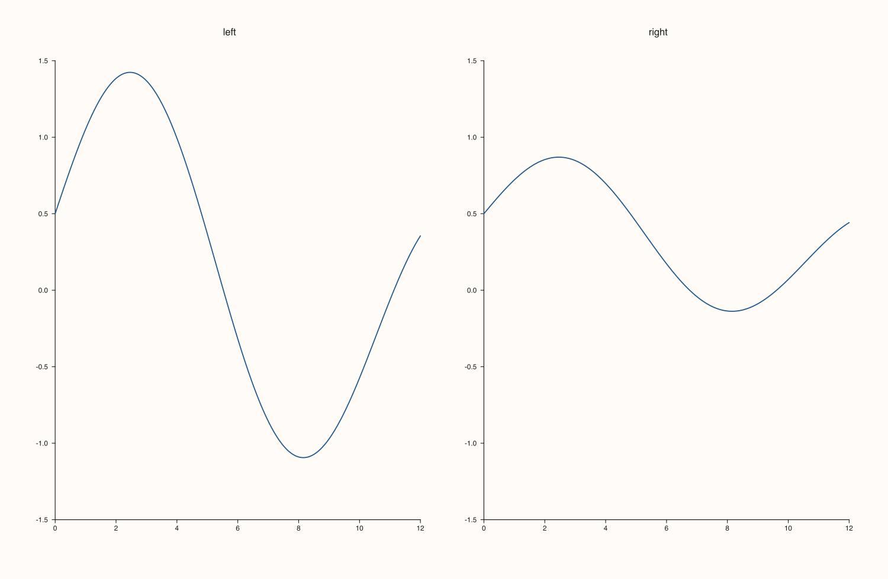
```

`Source section`: `plusspl_core_api.md`

### `Pane::bucket (overload 1)`

#### Signature

```cpp
Trace& bucket(self: Pane, values: SeriesLike, bins: int = 12);
```

#### Notes

Builds histogram bars from raw numeric values.

#### Example

```{literalinclude} ../../examples/docs/snippets/keys/core_bucket.cpp
:language: cpp
```

#### Output

```{only} html
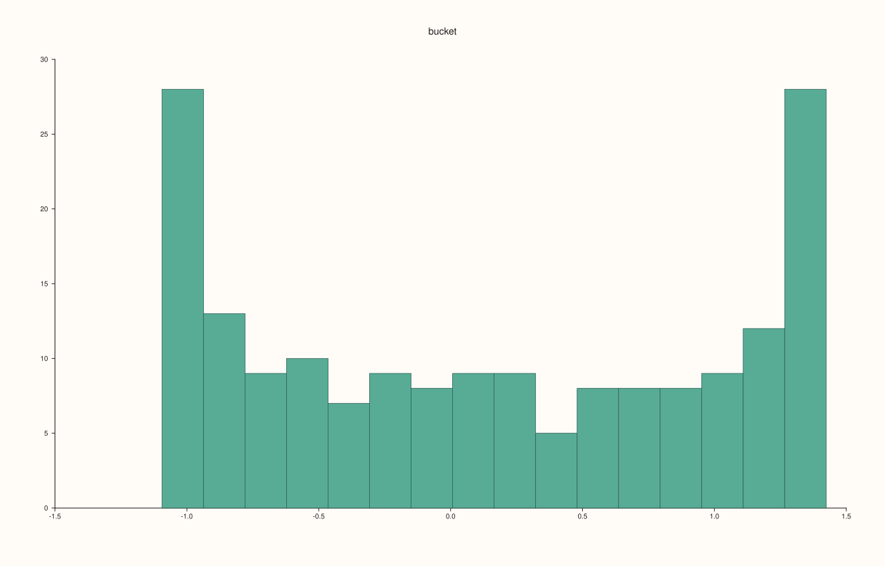
```

```{only} not html
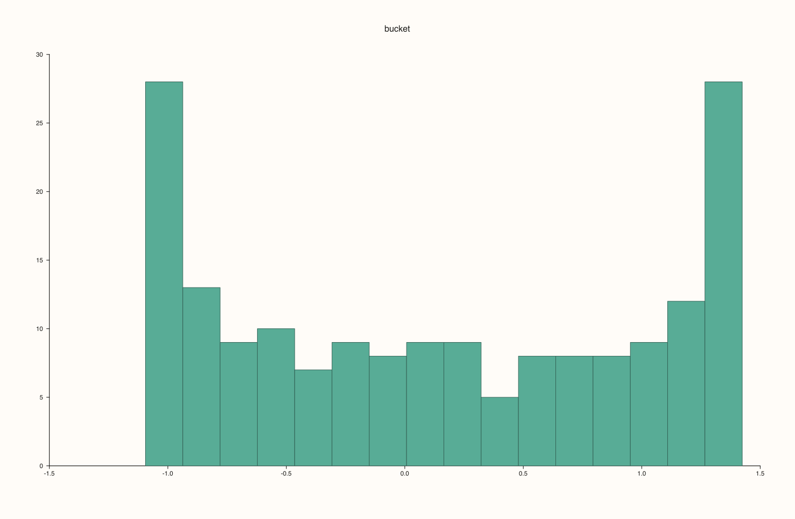
```

`Source section`: `plusspl_core_api.md`

### `Pane::bucket (overload 2)`

#### Signature

```cpp
Trace& bucket(self: Pane, values: SeriesLike, bins: int, range: Range1d);
```

#### Notes

Builds histogram bars from raw numeric values.

#### Example

```{literalinclude} ../../examples/docs/snippets/keys/core_bucket.cpp
:language: cpp
```

#### Output

```{only} html

```

```{only} not html

```

`Source section`: `plusspl_core_api.md`

### `Pane::cloud (overload 1)`

#### Signature

```cpp
Trace& cloud(self: Pane, x: SeriesLike, y: SeriesLike);
```

#### Notes

2D scatter primitive with optional size and color encodings.

#### Example

```{literalinclude} ../../examples/docs/snippets/keys/core_cloud.cpp
:language: cpp
```

#### Output

```{only} html
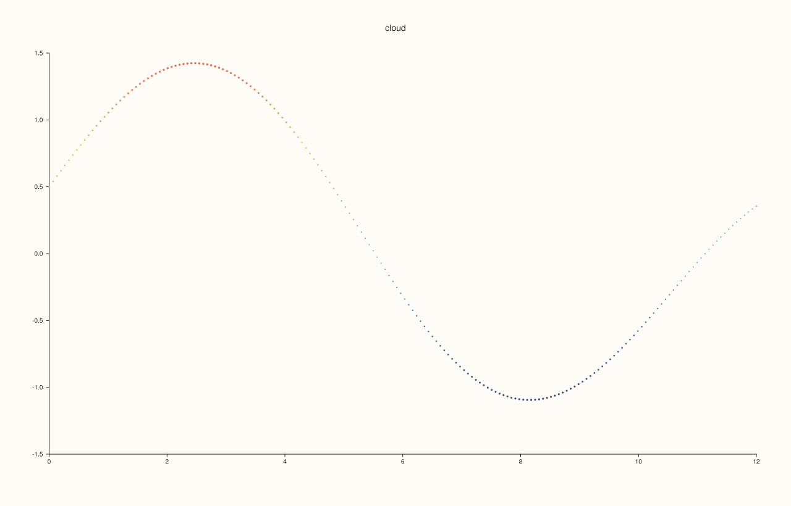
```

```{only} not html
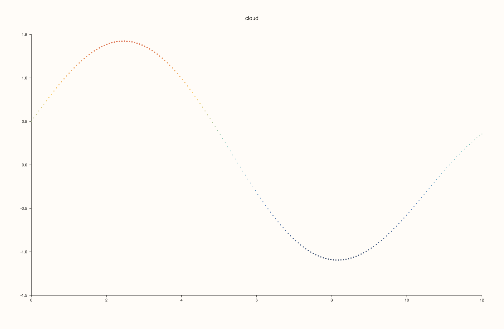
```

`Source section`: `plusspl_core_api.md`

### `Pane::cloud (overload 2)`

#### Signature

```cpp
Trace& cloud(self: Pane, x: SeriesLike, y: SeriesLike, size: SeriesLike);
```

#### Notes

2D scatter primitive with optional size and color encodings.

#### Example

```{literalinclude} ../../examples/docs/snippets/keys/core_cloud.cpp
:language: cpp
```

#### Output

```{only} html

```

```{only} not html

```

`Source section`: `plusspl_core_api.md`

### `Pane::cloud (overload 3)`

#### Signature

```cpp
Trace& cloud(self: Pane, x: SeriesLike, y: SeriesLike, size: SeriesLike, color: SeriesLike);
```

#### Notes

2D scatter primitive with optional size and color encodings.

#### Example

```{literalinclude} ../../examples/docs/snippets/keys/core_cloud.cpp
:language: cpp
```

#### Output

```{only} html

```

```{only} not html

```

`Source section`: `plusspl_core_api.md`

### `Pane::cloud3 (overload 1)`

#### Signature

```cpp
Trace& cloud3(self: Pane, x: SeriesLike, y: SeriesLike, z: SeriesLike);
```

#### Notes

3D scatter primitive with optional size and color encodings.

#### Example

```{literalinclude} ../../examples/docs/snippets/keys/core_cloud3.cpp
:language: cpp
```

#### Output

```{only} html

```

```{only} not html
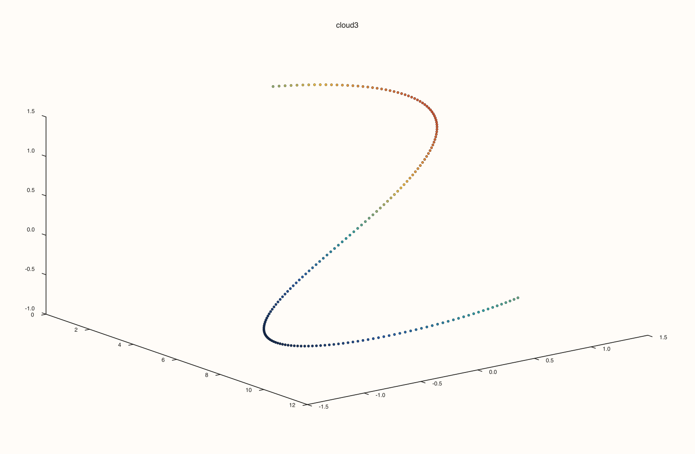
```

`Source section`: `plusspl_core_api.md`

### `Pane::cloud3 (overload 2)`

#### Signature

```cpp
Trace& cloud3(self: Pane, x: SeriesLike, y: SeriesLike, z: SeriesLike, size: SeriesLike);
```

#### Notes

3D scatter primitive with optional size and color encodings.

#### Example

```{literalinclude} ../../examples/docs/snippets/keys/core_cloud3.cpp
:language: cpp
```

#### Output

```{only} html

```

```{only} not html

```

`Source section`: `plusspl_core_api.md`

### `Pane::cloud3 (overload 3)`

#### Signature

```cpp
Trace& cloud3(self: Pane, x: SeriesLike, y: SeriesLike, z: SeriesLike, size: SeriesLike, color: SeriesLike);
```

#### Notes

3D scatter primitive with optional size and color encodings.

#### Example

```{literalinclude} ../../examples/docs/snippets/keys/core_cloud3.cpp
:language: cpp
```

#### Output

```{only} html

```

```{only} not html

```

`Source section`: `plusspl_core_api.md`

### `Pane::columns (overload 1)`

#### Signature

```cpp
Trace& columns(self: Pane, y: SeriesLike);
```

#### Notes

Vertical bar primitive. Use note/category labels on `x` for named groups.

#### Example

```{literalinclude} ../../examples/docs/snippets/keys/core_columns.cpp
:language: cpp
```

#### Output

```{only} html

```

```{only} not html
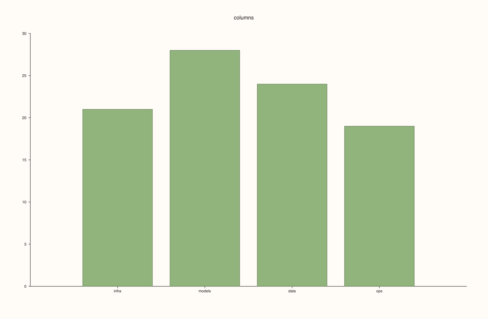
```

`Source section`: `plusspl_core_api.md`

### `Pane::columns (overload 2)`

#### Signature

```cpp
Trace& columns(self: Pane, x: SeriesLike, y: SeriesLike);
```

#### Notes

Vertical bar primitive. Use note/category labels on `x` for named groups.

#### Example

```{literalinclude} ../../examples/docs/snippets/keys/core_columns.cpp
:language: cpp
```

#### Output

```{only} html

```

```{only} not html

```

`Source section`: `plusspl_core_api.md`

### `Pane::columns_h (overload 1)`

#### Signature

```cpp
Trace& columns_h(self: Pane, x: SeriesLike);
```

#### Notes

Horizontal bar primitive; useful for ranking displays.

#### Example

```{literalinclude} ../../examples/docs/snippets/keys/core_columns_h.cpp
:language: cpp
```

#### Output

```{only} html
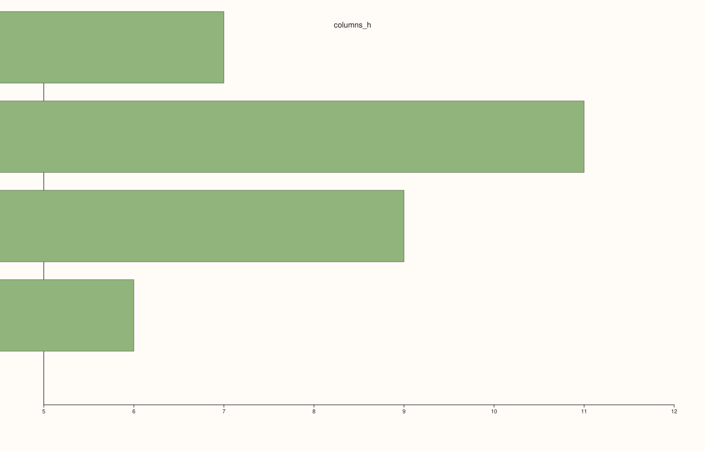
```

```{only} not html
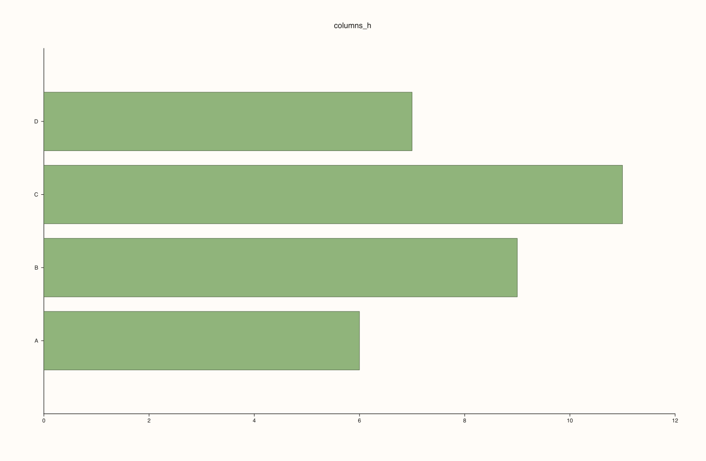
```

`Source section`: `plusspl_core_api.md`

### `Pane::columns_h (overload 2)`

#### Signature

```cpp
Trace& columns_h(self: Pane, x: SeriesLike, y: SeriesLike);
```

#### Notes

Horizontal bar primitive; useful for ranking displays.

#### Example

```{literalinclude} ../../examples/docs/snippets/keys/core_columns_h.cpp
:language: cpp
```

#### Output

```{only} html

```

```{only} not html

```

`Source section`: `plusspl_core_api.md`

### `Pane::contour (overload 1)`

#### Signature

```cpp
Trace& contour(self: Pane, x: SeriesLike, y: SeriesLike, z: SeriesLike);
```

#### Notes

Isoline surface slices in 3D space.

#### Example

```{literalinclude} ../../examples/docs/snippets/keys/core_contour.cpp
:language: cpp
```

#### Output

```{only} html
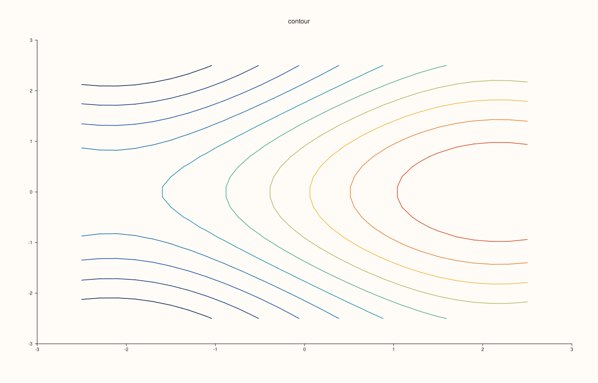
```

```{only} not html
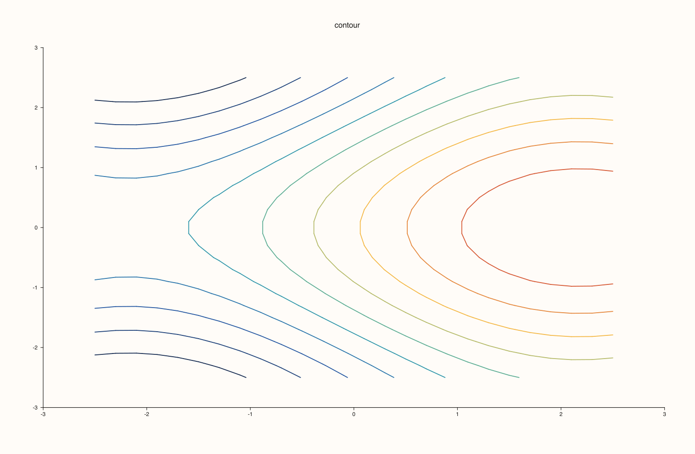
```

`Source section`: `plusspl_core_api.md`

### `Pane::contour (overload 2)`

#### Signature

```cpp
Trace& contour(self: Pane, x: SeriesLike, y: SeriesLike, z: SeriesLike, levels: int);
```

#### Notes

Isoline surface slices in 3D space.

#### Example

```{literalinclude} ../../examples/docs/snippets/keys/core_contour.cpp
:language: cpp
```

#### Output

```{only} html

```

```{only} not html

```

`Source section`: `plusspl_core_api.md`

### `Pane::contour (overload 3)`

#### Signature

```cpp
Trace& contour(self: Pane, x: SeriesLike, y: SeriesLike, z: SeriesLike, levels: std::vector<double>);
```

#### Notes

Isoline surface slices in 3D space.

#### Example

```{literalinclude} ../../examples/docs/snippets/keys/core_contour.cpp
:language: cpp
```

#### Output

```{only} html

```

```{only} not html

```

`Source section`: `plusspl_core_api.md`

### `Pane::fieldmap (overload 1)`

#### Signature

```cpp
Trace& fieldmap(self: Pane, x: SeriesLike, y: SeriesLike, z: SeriesLike);
```

#### Notes

Heatmap-like rectilinear field for 2D scalar surfaces.

#### Example

```{literalinclude} ../../examples/docs/snippets/keys/core_fieldmap.cpp
:language: cpp
```

#### Output

```{only} html
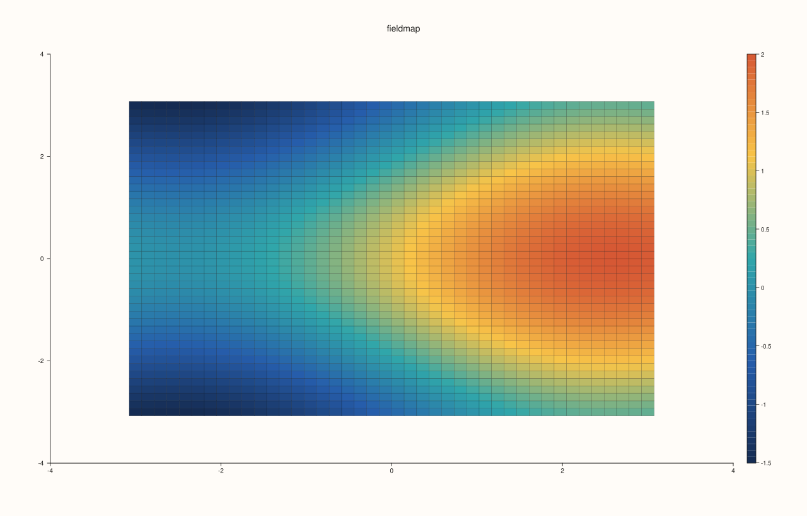
```

```{only} not html

```

`Source section`: `plusspl_core_api.md`

### `Pane::fieldmap (overload 2)`

#### Signature

```cpp
Trace& fieldmap(self: Pane, x: SeriesLike, y: SeriesLike, z: SeriesLike, color: SeriesLike);
```

#### Notes

Heatmap-like rectilinear field for 2D scalar surfaces.

#### Example

```{literalinclude} ../../examples/docs/snippets/keys/core_fieldmap.cpp
:language: cpp
```

#### Output

```{only} html

```

```{only} not html

```

`Source section`: `plusspl_core_api.md`

### `Pane::grid / legend / legend_frame / legend_shape (overload 1)`

#### Signature

```cpp
Pane& grid(self: Pane, style: GridStyle);
```

#### Notes

Controls pane-level grid and legend placement/styling.

#### Example

```{literalinclude} ../../examples/docs/snippets/keys/core_pane_grid_legend.cpp
:language: cpp
```

#### Output

```{only} html
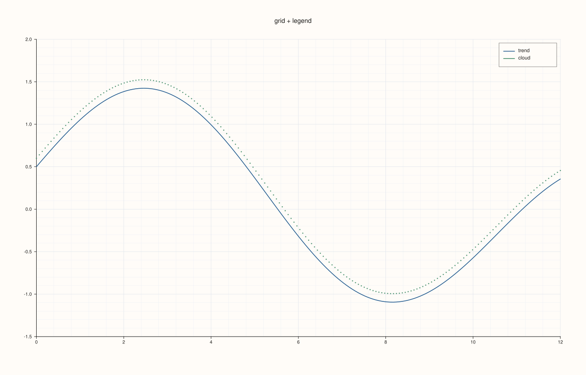
```

```{only} not html

```

`Source section`: `plusspl_core_api.md`

### `Pane::grid / legend / legend_frame / legend_shape (overload 2)`

#### Signature

```cpp
Pane& legend(self: Pane, place: KeyPlace);
```

#### Notes

Controls pane-level grid and legend placement/styling.

#### Example

```{literalinclude} ../../examples/docs/snippets/keys/core_pane_grid_legend.cpp
:language: cpp
```

#### Output

```{only} html

```

```{only} not html

```

`Source section`: `plusspl_core_api.md`

### `Pane::grid / legend / legend_frame / legend_shape (overload 3)`

#### Signature

```cpp
Pane& legend_frame(self: Pane, frame: KeyFrame);
```

#### Notes

Controls pane-level grid and legend placement/styling.

#### Example

```{literalinclude} ../../examples/docs/snippets/keys/core_pane_grid_legend.cpp
:language: cpp
```

#### Output

```{only} html

```

```{only} not html

```

`Source section`: `plusspl_core_api.md`

### `Pane::grid / legend / legend_frame / legend_shape (overload 4)`

#### Signature

```cpp
Pane& legend_shape(self: Pane, shape: KeyShape);
```

#### Notes

Controls pane-level grid and legend placement/styling.

#### Example

```{literalinclude} ../../examples/docs/snippets/keys/core_pane_grid_legend.cpp
:language: cpp
```

#### Output

```{only} html

```

```{only} not html

```

`Source section`: `plusspl_core_api.md`

### `Pane::isoband (overload 1)`

#### Signature

```cpp
Trace& isoband(self: Pane, x: SeriesLike, y: SeriesLike, z: SeriesLike);
```

#### Notes

Filled contour bands in planar coordinates.

#### Example

```{literalinclude} ../../examples/docs/snippets/keys/core_isoband.cpp
:language: cpp
```

#### Output

```{only} html
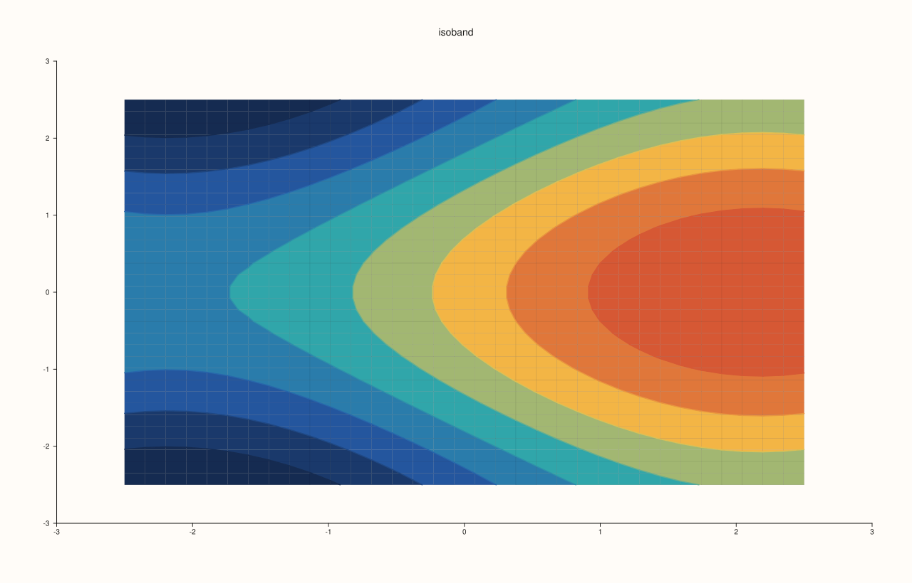
```

```{only} not html
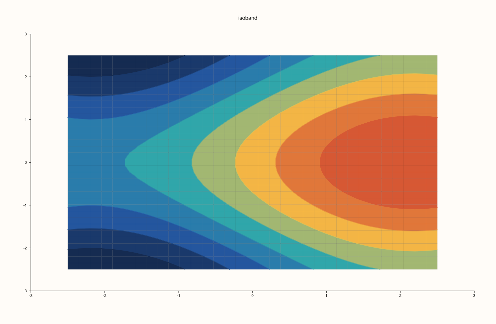
```

`Source section`: `plusspl_core_api.md`

### `Pane::isoband (overload 2)`

#### Signature

```cpp
Trace& isoband(self: Pane, x: SeriesLike, y: SeriesLike, z: SeriesLike, levels: int);
```

#### Notes

Filled contour bands in planar coordinates.

#### Example

```{literalinclude} ../../examples/docs/snippets/keys/core_isoband.cpp
:language: cpp
```

#### Output

```{only} html

```

```{only} not html

```

`Source section`: `plusspl_core_api.md`

### `Pane::isoband (overload 3)`

#### Signature

```cpp
Trace& isoband(self: Pane, x: SeriesLike, y: SeriesLike, z: SeriesLike, levels: std::vector<double>);
```

#### Notes

Filled contour bands in planar coordinates.

#### Example

```{literalinclude} ../../examples/docs/snippets/keys/core_isoband.cpp
:language: cpp
```

#### Output

```{only} html

```

```{only} not html

```

`Source section`: `plusspl_core_api.md`

### `Pane::isoshell (overload 1)`

#### Signature

```cpp
Trace& isoshell(self: Pane, values: SeriesLike, level_count: int = 4);
```

#### Notes

Extracts 3D iso-surfaces from volumetric scalar fields.

#### Example

```{literalinclude} ../../examples/docs/snippets/keys/core_isoshell.cpp
:language: cpp
```

#### Output

```{only} html

```

```{only} not html
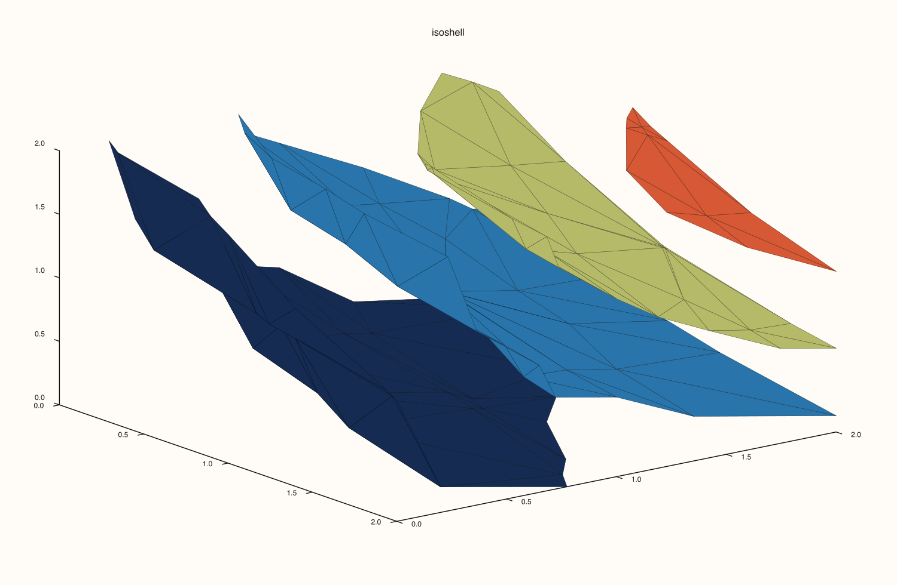
```

`Source section`: `plusspl_core_api.md`

### `Pane::isoshell (overload 2)`

#### Signature

```cpp
Trace& isoshell(self: Pane, x: SeriesLike, y: SeriesLike, z: SeriesLike, values: SeriesLike, level_count: int = 4);
```

#### Notes

Extracts 3D iso-surfaces from volumetric scalar fields.

#### Example

```{literalinclude} ../../examples/docs/snippets/keys/core_isoshell.cpp
:language: cpp
```

#### Output

```{only} html

```

```{only} not html

```

`Source section`: `plusspl_core_api.md`

### `Pane::isoshell (overload 3)`

#### Signature

```cpp
Trace& isoshell(self: Pane, x: SeriesLike, y: SeriesLike, z: SeriesLike, values: SeriesLike, levels: std::vector<double>);
```

#### Notes

Extracts 3D iso-surfaces from volumetric scalar fields.

#### Example

```{literalinclude} ../../examples/docs/snippets/keys/core_isoshell.cpp
:language: cpp
```

#### Output

```{only} html

```

```{only} not html

```

`Source section`: `plusspl_core_api.md`

### `Pane::lattice (overload 1)`

#### Signature

```cpp
Trace& lattice(self: Pane, x: SeriesLike, y: SeriesLike, z: SeriesLike);
```

#### Notes

Wireframe-style surface for gridded 3D data.

#### Example

```{literalinclude} ../../examples/docs/snippets/keys/core_lattice.cpp
:language: cpp
```

#### Output

```{only} html
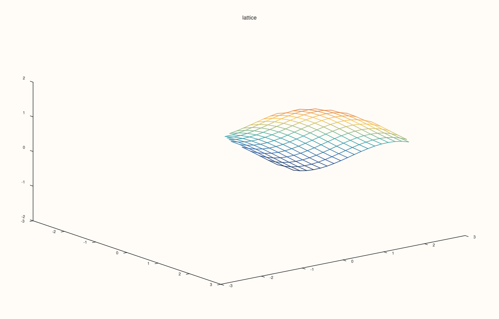
```

```{only} not html
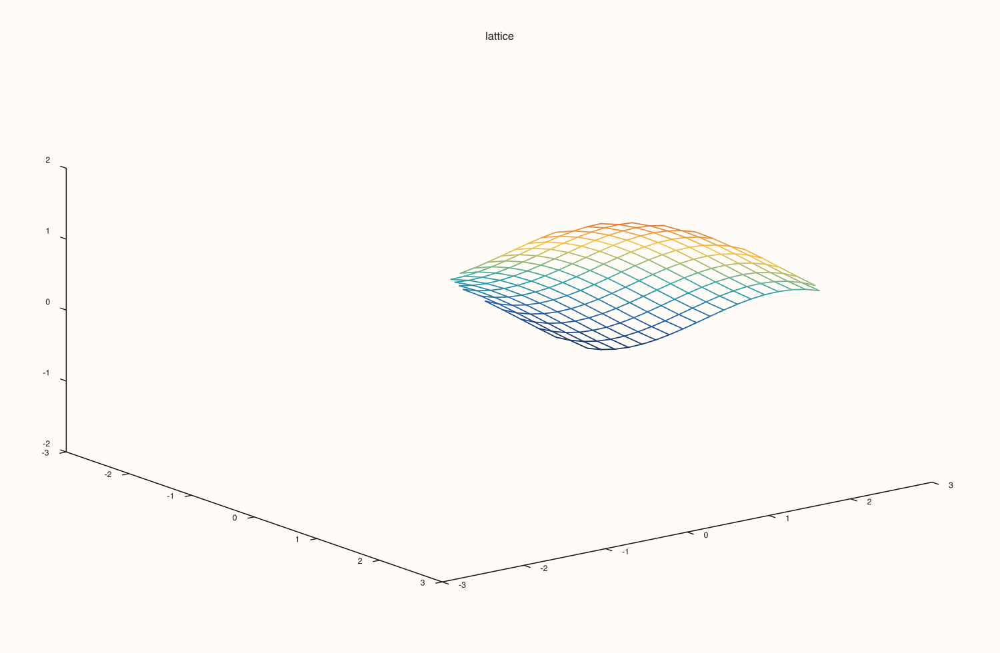
```

`Source section`: `plusspl_core_api.md`

### `Pane::lattice (overload 2)`

#### Signature

```cpp
Trace& lattice(self: Pane, x: SeriesLike, y: SeriesLike, z: SeriesLike, color: SeriesLike);
```

#### Notes

Wireframe-style surface for gridded 3D data.

#### Example

```{literalinclude} ../../examples/docs/snippets/keys/core_lattice.cpp
:language: cpp
```

#### Output

```{only} html

```

```{only} not html

```

`Source section`: `plusspl_core_api.md`

### `Pane::path3 (single form)`

#### Signature

```cpp
Trace& path3(self: Pane, x: SeriesLike, y: SeriesLike, z: SeriesLike);
```

#### Notes

3D path/trajectory primitive.

#### Example

```{literalinclude} ../../examples/docs/snippets/keys/core_path3.cpp
:language: cpp
```

#### Output

```{only} html
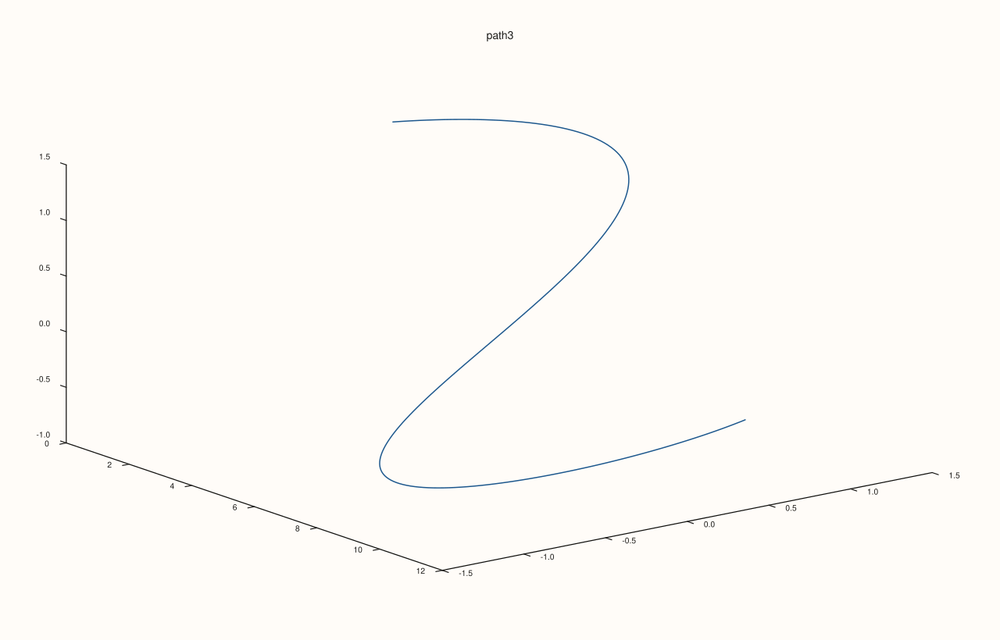
```

```{only} not html

```

`Source section`: `plusspl_core_api.md`

### `Pane::quartet (overload 1)`

#### Signature

```cpp
Trace& quartet(self: Pane, values: SeriesLike);
```

#### Notes

Box-and-whisker-style summary distribution marks, optionally grouped.

#### Example

```{literalinclude} ../../examples/docs/snippets/keys/core_quartet.cpp
:language: cpp
```

#### Output

```{only} html
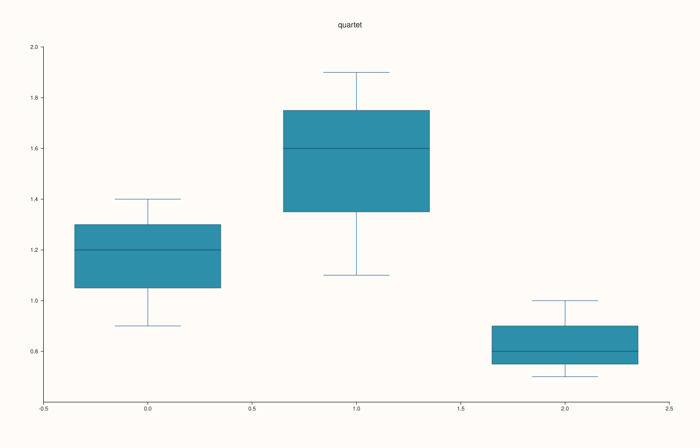
```

```{only} not html

```

`Source section`: `plusspl_core_api.md`

### `Pane::quartet (overload 2)`

#### Signature

```cpp
Trace& quartet(self: Pane, group: SeriesLike, values: SeriesLike);
```

#### Notes

Box-and-whisker-style summary distribution marks, optionally grouped.

#### Example

```{literalinclude} ../../examples/docs/snippets/keys/core_quartet.cpp
:language: cpp
```

#### Output

```{only} html

```

```{only} not html

```

`Source section`: `plusspl_core_api.md`

### `Pane::radial (single form)`

#### Signature

```cpp
Trace& radial(self: Pane, theta: SeriesLike, radius: SeriesLike);
```

#### Notes

Polar-coordinate trace primitive.

#### Example

```{literalinclude} ../../examples/docs/snippets/keys/core_radial.cpp
:language: cpp
```

#### Output

```{only} html
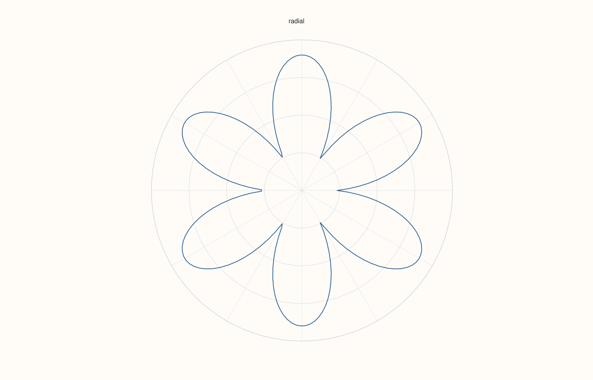
```

```{only} not html
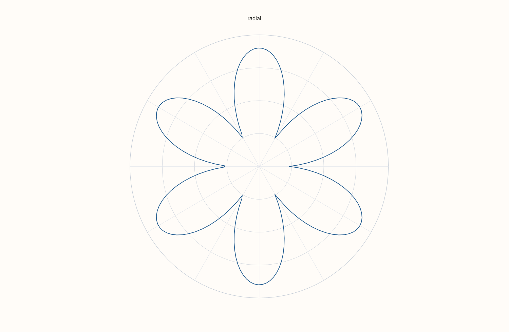
```

`Source section`: `plusspl_core_api.md`

### `Pane::ribbon (overload 1)`

#### Signature

```cpp
Trace& ribbon(self: Pane, y: SeriesLike, base: double = 0.0);
```

#### Notes

Area-under-curve primitive with explicit baseline.

#### Example

```{literalinclude} ../../examples/docs/snippets/keys/core_ribbon.cpp
:language: cpp
```

#### Output

```{only} html

```

```{only} not html
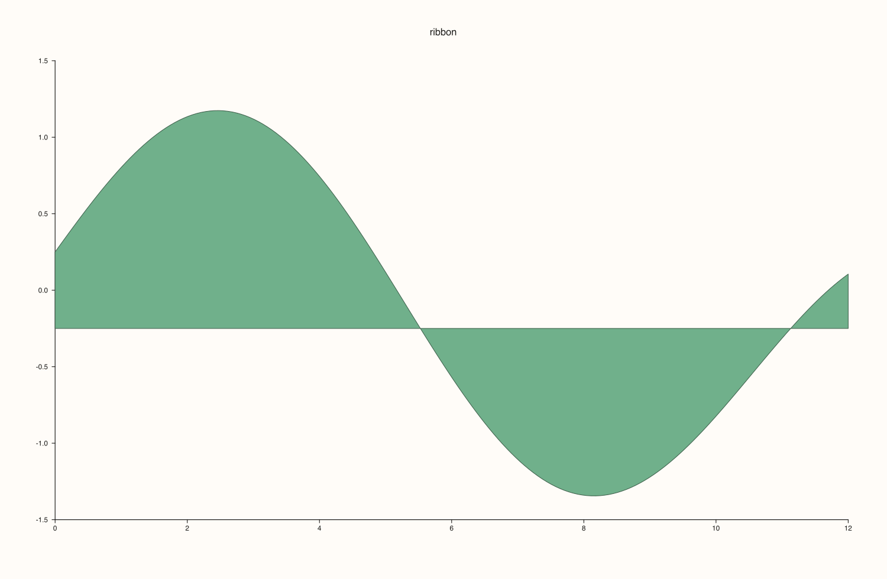
```

`Source section`: `plusspl_core_api.md`

### `Pane::ribbon (overload 2)`

#### Signature

```cpp
Trace& ribbon(self: Pane, x: SeriesLike, y: SeriesLike, base: double = 0.0);
```

#### Notes

Area-under-curve primitive with explicit baseline.

#### Example

```{literalinclude} ../../examples/docs/snippets/keys/core_ribbon.cpp
:language: cpp
```

#### Output

```{only} html

```

```{only} not html

```

`Source section`: `plusspl_core_api.md`

### `Pane::ridge3 (overload 1)`

#### Signature

```cpp
Trace& ridge3(self: Pane, x: SeriesLike, y: SeriesLike, z: SeriesLike);
```

#### Notes

Layered 3D ridge representation of gridded scalar surfaces.

#### Example

```{literalinclude} ../../examples/docs/snippets/keys/core_ridge3.cpp
:language: cpp
```

#### Output

```{only} html

```

```{only} not html
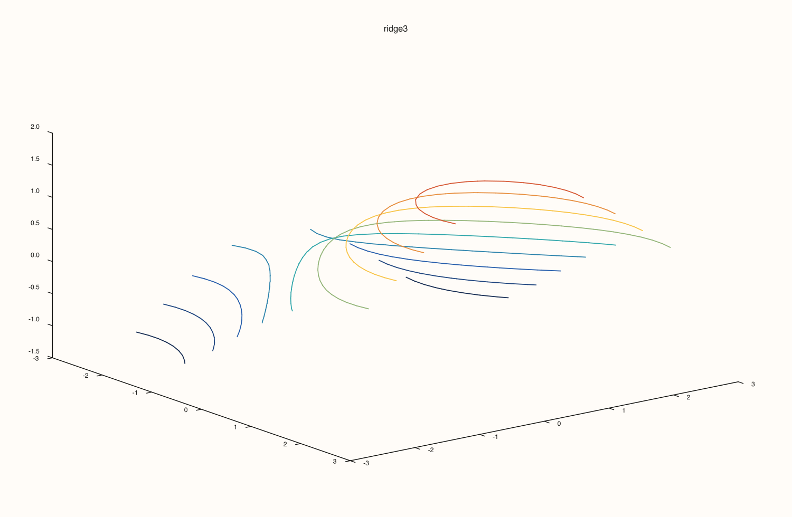
```

`Source section`: `plusspl_core_api.md`

### `Pane::ridge3 (overload 2)`

#### Signature

```cpp
Trace& ridge3(self: Pane, x: SeriesLike, y: SeriesLike, z: SeriesLike, levels: int);
```

#### Notes

Layered 3D ridge representation of gridded scalar surfaces.

#### Example

```{literalinclude} ../../examples/docs/snippets/keys/core_ridge3.cpp
:language: cpp
```

#### Output

```{only} html

```

```{only} not html

```

`Source section`: `plusspl_core_api.md`

### `Pane::ridge3 (overload 3)`

#### Signature

```cpp
Trace& ridge3(self: Pane, x: SeriesLike, y: SeriesLike, z: SeriesLike, levels: std::vector<double>);
```

#### Notes

Layered 3D ridge representation of gridded scalar surfaces.

#### Example

```{literalinclude} ../../examples/docs/snippets/keys/core_ridge3.cpp
:language: cpp
```

#### Output

```{only} html

```

```{only} not html

```

`Source section`: `plusspl_core_api.md`

### `Pane::rule_* / band_* / pin / caption (overload 1)`

#### Signature

```cpp
Pane& rule_x(self: Pane, value: double, label: std::string = {});
```

#### Notes

Adds reference lines, highlighted ranges, annotations, and pane captions without changing trace data.

#### Example

```{literalinclude} ../../examples/docs/snippets/keys/core_pane_guides_annotations.cpp
:language: cpp
```

#### Output

```{only} html
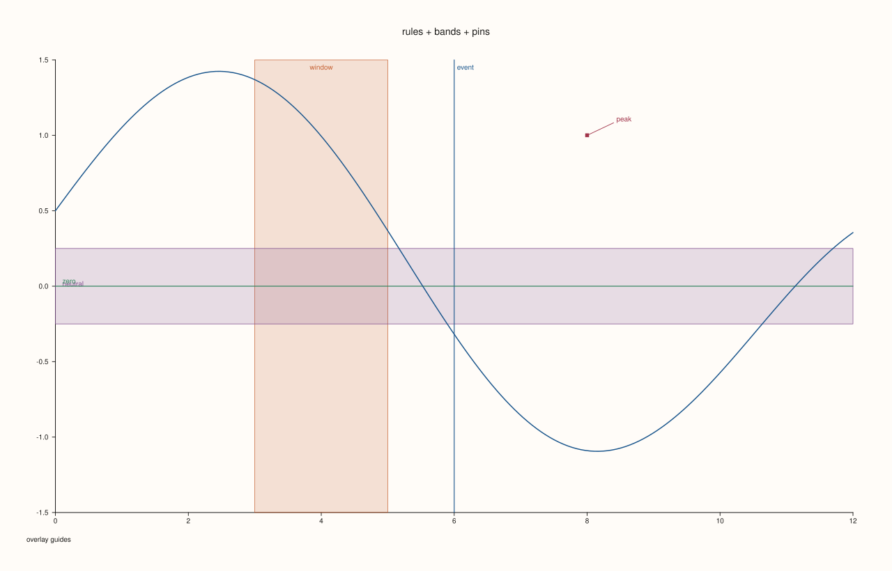
```

```{only} not html
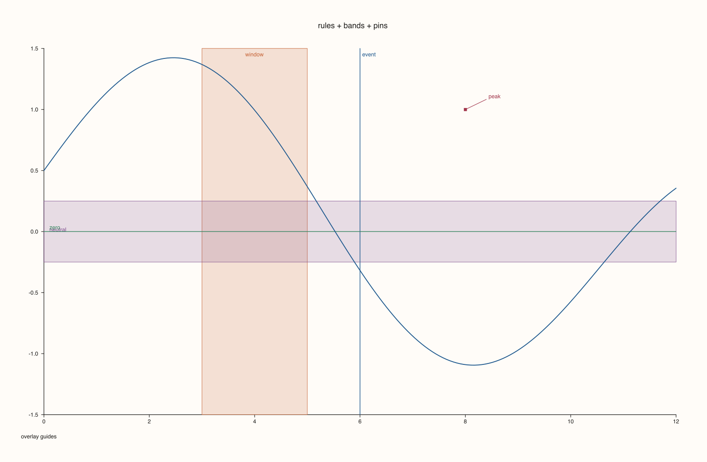
```

`Source section`: `plusspl_core_api.md`

### `Pane::rule_* / band_* / pin / caption (overload 2)`

#### Signature

```cpp
Pane& rule_y(self: Pane, value: double, label: std::string = {});
```

#### Notes

Adds reference lines, highlighted ranges, annotations, and pane captions without changing trace data.

#### Example

```{literalinclude} ../../examples/docs/snippets/keys/core_pane_guides_annotations.cpp
:language: cpp
```

#### Output

```{only} html

```

```{only} not html

```

`Source section`: `plusspl_core_api.md`

### `Pane::rule_* / band_* / pin / caption (overload 3)`

#### Signature

```cpp
Pane& band_x(self: Pane, span: Range1d, label: std::string = {});
```

#### Notes

Adds reference lines, highlighted ranges, annotations, and pane captions without changing trace data.

#### Example

```{literalinclude} ../../examples/docs/snippets/keys/core_pane_guides_annotations.cpp
:language: cpp
```

#### Output

```{only} html

```

```{only} not html

```

`Source section`: `plusspl_core_api.md`

### `Pane::rule_* / band_* / pin / caption (overload 4)`

#### Signature

```cpp
Pane& band_y(self: Pane, span: Range1d, label: std::string = {});
```

#### Notes

Adds reference lines, highlighted ranges, annotations, and pane captions without changing trace data.

#### Example

```{literalinclude} ../../examples/docs/snippets/keys/core_pane_guides_annotations.cpp
:language: cpp
```

#### Output

```{only} html

```

```{only} not html

```

`Source section`: `plusspl_core_api.md`

### `Pane::rule_* / band_* / pin / caption (overload 5)`

#### Signature

```cpp
Pane& pin(self: Pane, text: std::string, x: double, y: double, offset_x: double = 38.0, offset_y: double = -18.0);
```

#### Notes

Adds reference lines, highlighted ranges, annotations, and pane captions without changing trace data.

#### Example

```{literalinclude} ../../examples/docs/snippets/keys/core_pane_guides_annotations.cpp
:language: cpp
```

#### Output

```{only} html

```

```{only} not html

```

`Source section`: `plusspl_core_api.md`

### `Pane::rule_* / band_* / pin / caption (overload 6)`

#### Signature

```cpp
Pane& caption(self: Pane, text: std::string);
```

#### Notes

Adds reference lines, highlighted ranges, annotations, and pane captions without changing trace data.

#### Example

```{literalinclude} ../../examples/docs/snippets/keys/core_pane_guides_annotations.cpp
:language: cpp
```

#### Output

```{only} html

```

```{only} not html

```

`Source section`: `plusspl_core_api.md`

### `Pane::scale_x / scale_y (overload 1)`

#### Signature

```cpp
Pane& scale_x(self: Pane, policy: ScalePolicy);
```

#### Notes

Applies logarithmic/symlog/linear scale policies at axis level.

#### Example

```{literalinclude} ../../examples/docs/snippets/keys/core_pane_scales.cpp
:language: cpp
```

#### Output

```{only} html

```

```{only} not html
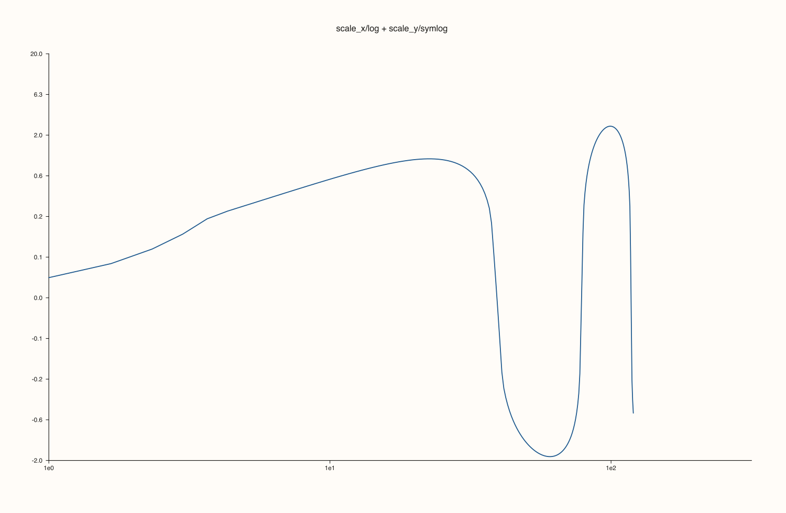
```

`Source section`: `plusspl_core_api.md`

### `Pane::scale_x / scale_y (overload 2)`

#### Signature

```cpp
Pane& scale_y(self: Pane, policy: ScalePolicy);
```

#### Notes

Applies logarithmic/symlog/linear scale policies at axis level.

#### Example

```{literalinclude} ../../examples/docs/snippets/keys/core_pane_scales.cpp
:language: cpp
```

#### Output

```{only} html

```

```{only} not html

```

`Source section`: `plusspl_core_api.md`

### `Pane::sheet (overload 1)`

#### Signature

```cpp
Trace& sheet(self: Pane, x: SeriesLike, y: SeriesLike, z: SeriesLike);
```

#### Notes

Filled 3D surface primitive.

#### Example

```{literalinclude} ../../examples/docs/snippets/keys/core_sheet.cpp
:language: cpp
```

#### Output

```{only} html
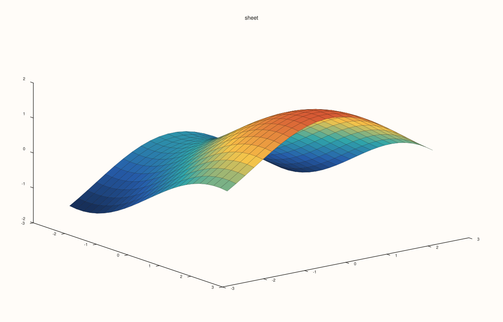
```

```{only} not html

```

`Source section`: `plusspl_core_api.md`

### `Pane::sheet (overload 2)`

#### Signature

```cpp
Trace& sheet(self: Pane, x: SeriesLike, y: SeriesLike, z: SeriesLike, color: SeriesLike);
```

#### Notes

Filled 3D surface primitive.

#### Example

```{literalinclude} ../../examples/docs/snippets/keys/core_sheet.cpp
:language: cpp
```

#### Output

```{only} html

```

```{only} not html

```

`Source section`: `plusspl_core_api.md`

### `Pane::spike (overload 1)`

#### Signature

```cpp
Trace& spike(self: Pane, y: SeriesLike, base: double = 0.0);
```

#### Notes

Stem/impulse rendering from baseline.

#### Example

```{literalinclude} ../../examples/docs/snippets/keys/core_spike.cpp
:language: cpp
```

#### Output

```{only} html
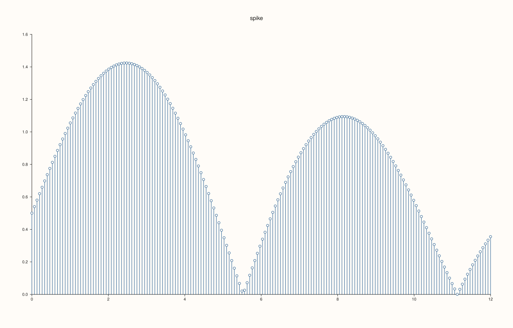
```

```{only} not html
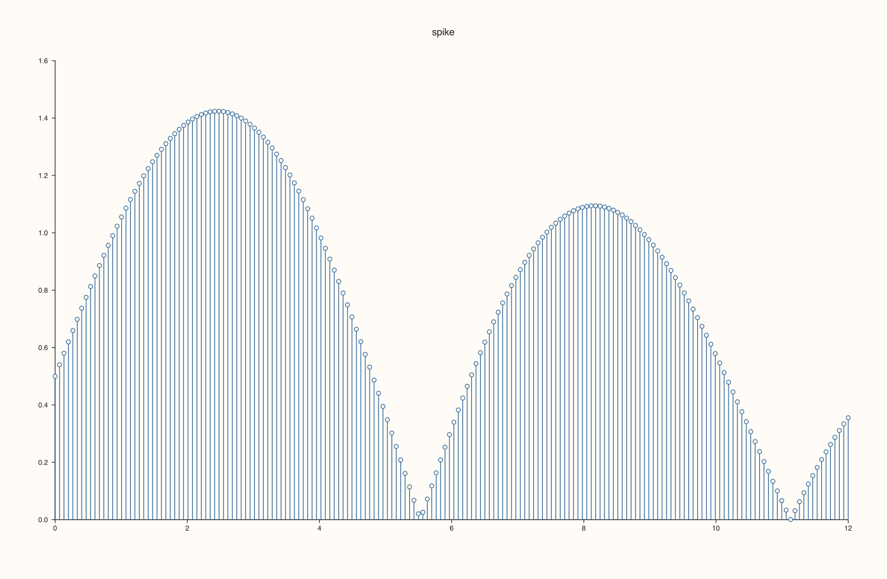
```

`Source section`: `plusspl_core_api.md`

### `Pane::spike (overload 2)`

#### Signature

```cpp
Trace& spike(self: Pane, x: SeriesLike, y: SeriesLike, base: double = 0.0);
```

#### Notes

Stem/impulse rendering from baseline.

#### Example

```{literalinclude} ../../examples/docs/snippets/keys/core_spike.cpp
:language: cpp
```

#### Output

```{only} html

```

```{only} not html

```

`Source section`: `plusspl_core_api.md`

### `Pane::spire3 (overload 1)`

#### Signature

```cpp
Trace& spire3(self: Pane, z: SeriesLike);
```

#### Notes

3D bar/spire primitive with optional explicit axis grids and color mapping.

#### Example

```{literalinclude} ../../examples/docs/snippets/keys/core_spire3.cpp
:language: cpp
```

#### Output

```{only} html
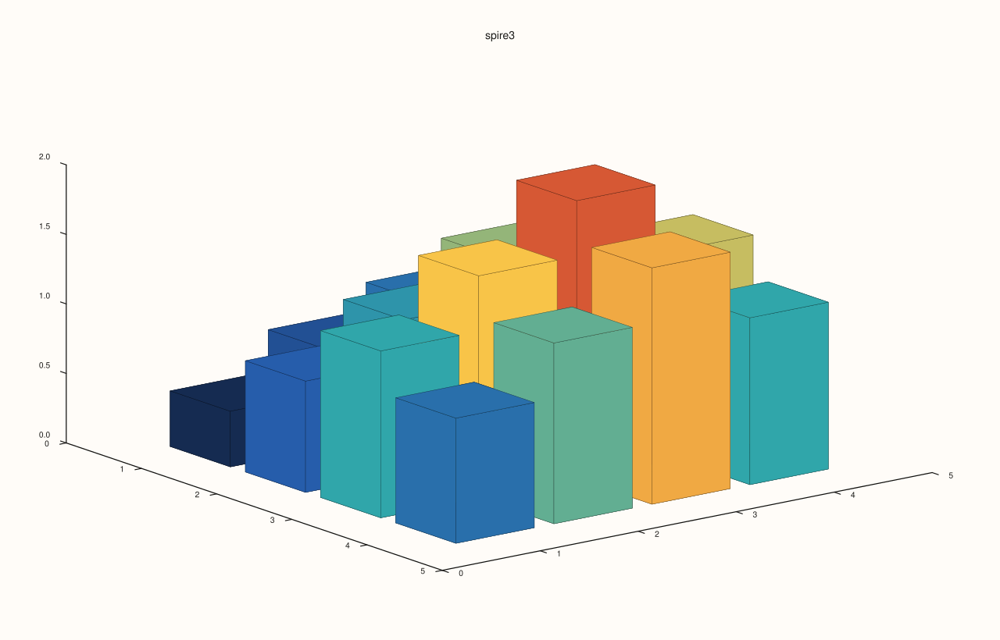
```

```{only} not html

```

`Source section`: `plusspl_core_api.md`

### `Pane::spire3 (overload 2)`

#### Signature

```cpp
Trace& spire3(self: Pane, y: SeriesLike, z: SeriesLike);
```

#### Notes

3D bar/spire primitive with optional explicit axis grids and color mapping.

#### Example

```{literalinclude} ../../examples/docs/snippets/keys/core_spire3.cpp
:language: cpp
```

#### Output

```{only} html

```

```{only} not html

```

`Source section`: `plusspl_core_api.md`

### `Pane::spire3 (overload 3)`

#### Signature

```cpp
Trace& spire3(self: Pane, x: SeriesLike, y: SeriesLike, z: SeriesLike);
```

#### Notes

3D bar/spire primitive with optional explicit axis grids and color mapping.

#### Example

```{literalinclude} ../../examples/docs/snippets/keys/core_spire3.cpp
:language: cpp
```

#### Output

```{only} html

```

```{only} not html

```

`Source section`: `plusspl_core_api.md`

### `Pane::spire3 (overload 4)`

#### Signature

```cpp
Trace& spire3(self: Pane, x: SeriesLike, y: SeriesLike, z: SeriesLike, color: SeriesLike);
```

#### Notes

3D bar/spire primitive with optional explicit axis grids and color mapping.

#### Example

```{literalinclude} ../../examples/docs/snippets/keys/core_spire3.cpp
:language: cpp
```

#### Output

```{only} html

```

```{only} not html

```

`Source section`: `plusspl_core_api.md`

### `Pane::trend (single form)`

#### Signature

```cpp
Trace& trend(self: Pane, x: SeriesLike, y: SeriesLike);
```

#### Notes

Base 2D line primitive used under many high-level wrappers.

#### Example

```{literalinclude} ../../examples/docs/snippets/keys/core_trend.cpp
:language: cpp
```

#### Output

```{only} html

```

```{only} not html
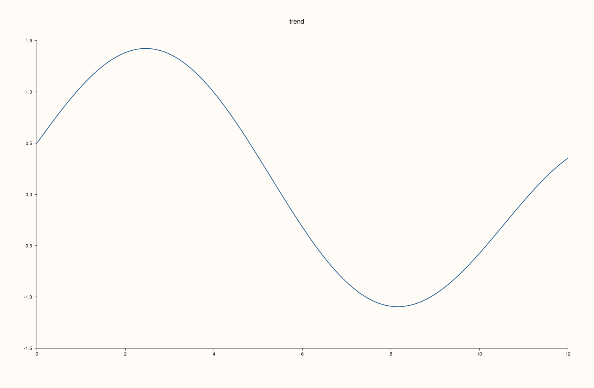
```

`Source section`: `plusspl_core_api.md`

### `Pane::violin (overload 1)`

#### Signature

```cpp
Trace& violin(self: Pane, values: SeriesLike);
```

#### Notes

Kernel-density distribution shape with optional grouping and configurable inner marks.

#### Example

```{literalinclude} ../../examples/docs/snippets/keys/core_violin.cpp
:language: cpp
```

#### Output

```{only} html
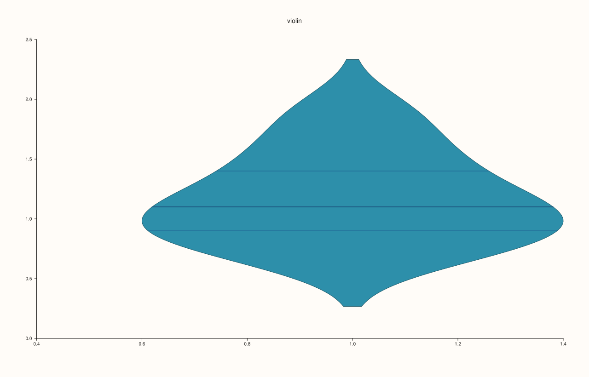
```

```{only} not html

```

`Source section`: `plusspl_core_api.md`

### `Pane::violin (overload 2)`

#### Signature

```cpp
Trace& violin(self: Pane, values: SeriesLike, options: ViolinOptions);
```

#### Notes

Kernel-density distribution shape with optional grouping and configurable inner marks.

#### Example

```{literalinclude} ../../examples/docs/snippets/keys/core_violin.cpp
:language: cpp
```

#### Output

```{only} html

```

```{only} not html

```

`Source section`: `plusspl_core_api.md`

### `Pane::violin (overload 3)`

#### Signature

```cpp
Trace& violin(self: Pane, group: SeriesLike, values: SeriesLike);
```

#### Notes

Kernel-density distribution shape with optional grouping and configurable inner marks.

#### Example

```{literalinclude} ../../examples/docs/snippets/keys/core_violin.cpp
:language: cpp
```

#### Output

```{only} html

```

```{only} not html

```

`Source section`: `plusspl_core_api.md`

### `Pane::violin (overload 4)`

#### Signature

```cpp
Trace& violin(self: Pane, group: SeriesLike, values: SeriesLike, options: ViolinOptions);
```

#### Notes

Kernel-density distribution shape with optional grouping and configurable inner marks.

#### Example

```{literalinclude} ../../examples/docs/snippets/keys/core_violin.cpp
:language: cpp
```

#### Output

```{only} html

```

```{only} not html

```

`Source section`: `plusspl_core_api.md`

### `Pane::visible / axes_visible (overload 1)`

#### Signature

```cpp
Pane& visible(self: Pane, enable: bool = true);
```

#### Notes

Controls pane and axis chrome visibility independently.

#### Example

```{literalinclude} ../../examples/docs/snippets/keys/core_pane_visibility.cpp
:language: cpp
```

#### Output

```{only} html

```

```{only} not html
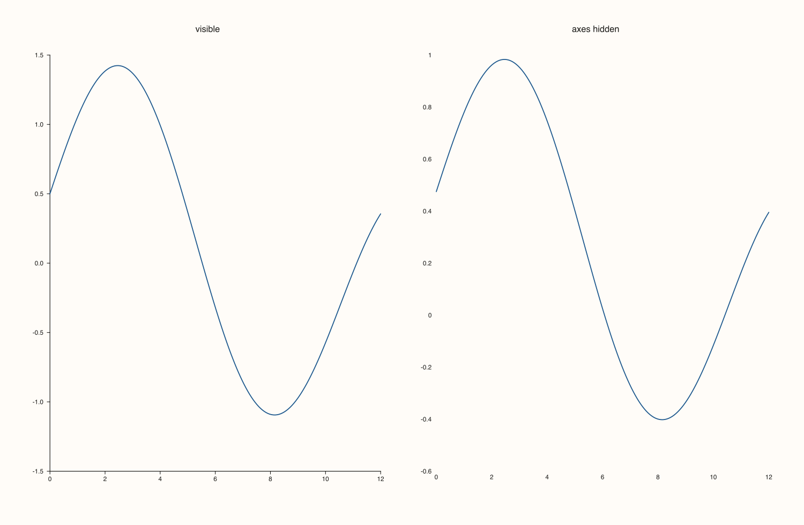
```

`Source section`: `plusspl_core_api.md`

### `Pane::visible / axes_visible (overload 2)`

#### Signature

```cpp
Pane& axes_visible(self: Pane, enable: bool = true);
```

#### Notes

Controls pane and axis chrome visibility independently.

#### Example

```{literalinclude} ../../examples/docs/snippets/keys/core_pane_visibility.cpp
:language: cpp
```

#### Output

```{only} html

```

```{only} not html

```

`Source section`: `plusspl_core_api.md`

### `Pane::visible / axes_visible (overload 3)`

#### Signature

```cpp
Pane& hide(self: Pane);
```

#### Notes

Controls pane and axis chrome visibility independently.

#### Example

```{literalinclude} ../../examples/docs/snippets/keys/core_pane_visibility.cpp
:language: cpp
```

#### Output

```{only} html

```

```{only} not html

```

`Source section`: `plusspl_core_api.md`

### `Pane::visible / axes_visible (overload 4)`

#### Signature

```cpp
Pane& show(self: Pane);
```

#### Notes

Controls pane and axis chrome visibility independently.

#### Example

```{literalinclude} ../../examples/docs/snippets/keys/core_pane_visibility.cpp
:language: cpp
```

#### Output

```{only} html

```

```{only} not html

```

`Source section`: `plusspl_core_api.md`

### `Pane::wedge (overload 1)`

#### Signature

```cpp
Trace& wedge(self: Pane, values: SeriesLike);
```

#### Notes

Pie/wedge primitive with optional explode offsets.

#### Example

```{literalinclude} ../../examples/docs/snippets/keys/core_wedge.cpp
:language: cpp
```

#### Output

```{only} html
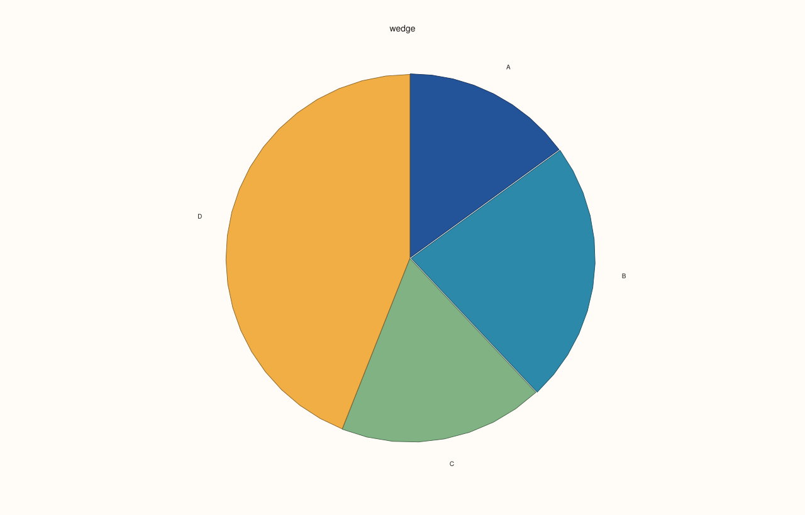
```

```{only} not html
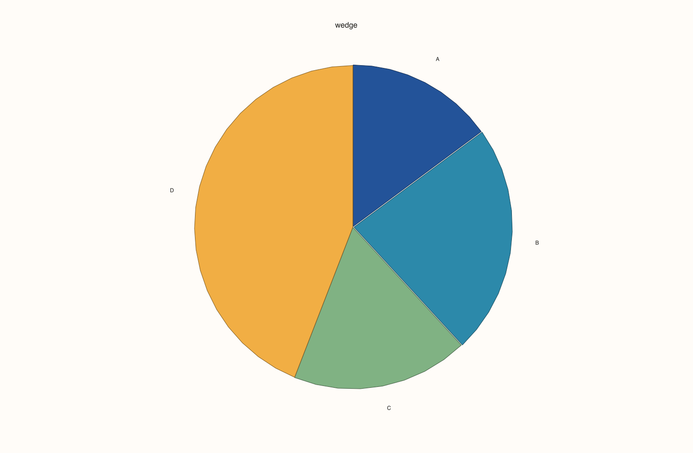
```

`Source section`: `plusspl_core_api.md`

### `Pane::wedge (overload 2)`

#### Signature

```cpp
Trace& wedge(self: Pane, values: SeriesLike, labels: std::vector<std::string>);
```

#### Notes

Pie/wedge primitive with optional explode offsets.

#### Example

```{literalinclude} ../../examples/docs/snippets/keys/core_wedge.cpp
:language: cpp
```

#### Output

```{only} html

```

```{only} not html

```

`Source section`: `plusspl_core_api.md`

### `Pane::wedge (overload 3)`

#### Signature

```cpp
Trace& wedge(self: Pane, values: SeriesLike, explode: SeriesLike, labels: std::vector<std::string>);
```

#### Notes

Pie/wedge primitive with optional explode offsets.

#### Example

```{literalinclude} ../../examples/docs/snippets/keys/core_wedge.cpp
:language: cpp
```

#### Output

```{only} html

```

```{only} not html

```

`Source section`: `plusspl_core_api.md`

### `Pane::whisk (overload 1)`

#### Signature

```cpp
Trace& whisk(self: Pane, y: SeriesLike, err: SeriesLike);
```

#### Notes

Error-bar primitive with symmetric or asymmetric intervals.

#### Example

```{literalinclude} ../../examples/docs/snippets/keys/core_whisk.cpp
:language: cpp
```

#### Output

```{only} html
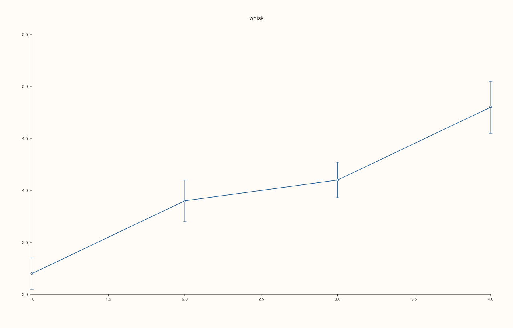
```

```{only} not html
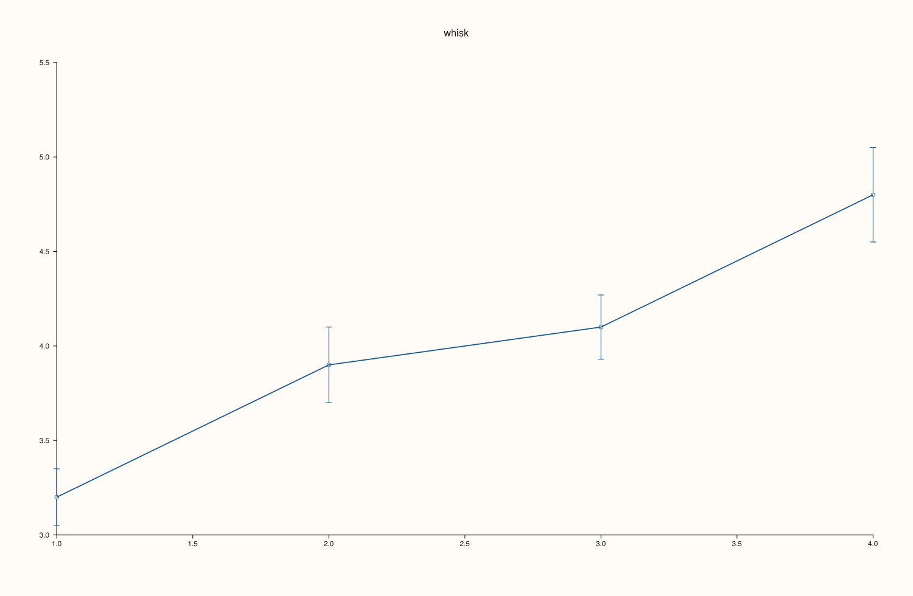
```

`Source section`: `plusspl_core_api.md`

### `Pane::whisk (overload 2)`

#### Signature

```cpp
Trace& whisk(self: Pane, x: SeriesLike, y: SeriesLike, err: SeriesLike);
```

#### Notes

Error-bar primitive with symmetric or asymmetric intervals.

#### Example

```{literalinclude} ../../examples/docs/snippets/keys/core_whisk.cpp
:language: cpp
```

#### Output

```{only} html

```

```{only} not html

```

`Source section`: `plusspl_core_api.md`

### `Pane::whisk (overload 3)`

#### Signature

```cpp
Trace& whisk(self: Pane, x: SeriesLike, y: SeriesLike, neg: SeriesLike, pos: SeriesLike);
```

#### Notes

Error-bar primitive with symmetric or asymmetric intervals.

#### Example

```{literalinclude} ../../examples/docs/snippets/keys/core_whisk.cpp
:language: cpp
```

#### Output

```{only} html

```

```{only} not html

```

`Source section`: `plusspl_core_api.md`

### `Pane::whisk (overload 4)`

#### Signature

```cpp
Trace& whisk(self: Pane, x: SeriesLike, y: SeriesLike, yneg: SeriesLike, ypos: SeriesLike, xneg: SeriesLike, xpos: SeriesLike);
```

#### Notes

Error-bar primitive with symmetric or asymmetric intervals.

#### Example

```{literalinclude} ../../examples/docs/snippets/keys/core_whisk.cpp
:language: cpp
```

#### Output

```{only} html

```

```{only} not html

```

`Source section`: `plusspl_core_api.md`

### `Pane::x_limits / y_limits / method (overload 1)`

#### Signature

```cpp
Pane& x_limits(self: Pane, limits: Range1d);
```

#### Notes

Sets explicit axis windows and autoscale policy for limit computation.

#### Example

```{literalinclude} ../../examples/docs/snippets/keys/core_pane_axes_limits.cpp
:language: cpp
```

#### Output

```{only} html

```

```{only} not html
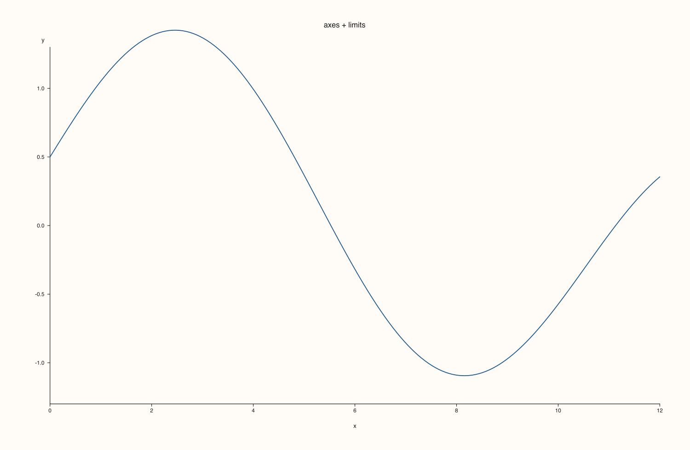
```

`Source section`: `plusspl_core_api.md`

### `Pane::x_limits / y_limits / method (overload 2)`

#### Signature

```cpp
Pane& y_limits(self: Pane, limits: Range1d);
```

#### Notes

Sets explicit axis windows and autoscale policy for limit computation.

#### Example

```{literalinclude} ../../examples/docs/snippets/keys/core_pane_axes_limits.cpp
:language: cpp
```

#### Output

```{only} html

```

```{only} not html

```

`Source section`: `plusspl_core_api.md`

### `Pane::x_limits / y_limits / method (overload 3)`

#### Signature

```cpp
Pane& x_limit_method(self: Pane, method: LimitMethod);
```

#### Notes

Sets explicit axis windows and autoscale policy for limit computation.

#### Example

```{literalinclude} ../../examples/docs/snippets/keys/core_pane_axes_limits.cpp
:language: cpp
```

#### Output

```{only} html

```

```{only} not html

```

`Source section`: `plusspl_core_api.md`

### `Pane::x_limits / y_limits / method (overload 4)`

#### Signature

```cpp
Pane& y_limit_method(self: Pane, method: LimitMethod);
```

#### Notes

Sets explicit axis windows and autoscale policy for limit computation.

#### Example

```{literalinclude} ../../examples/docs/snippets/keys/core_pane_axes_limits.cpp
:language: cpp
```

#### Output

```{only} html

```

```{only} not html

```

`Source section`: `plusspl_core_api.md`

### `Pane::x_tick_format / y_tick_format (overload 1)`

#### Signature

```cpp
Pane& x_tick_format(self: Pane, format: TickFormat);
```

#### Notes

Forces label formatting for readability and consistency in reports.

#### Example

```{literalinclude} ../../examples/docs/snippets/keys/core_pane_tick_format.cpp
:language: cpp
```

#### Output

```{only} html
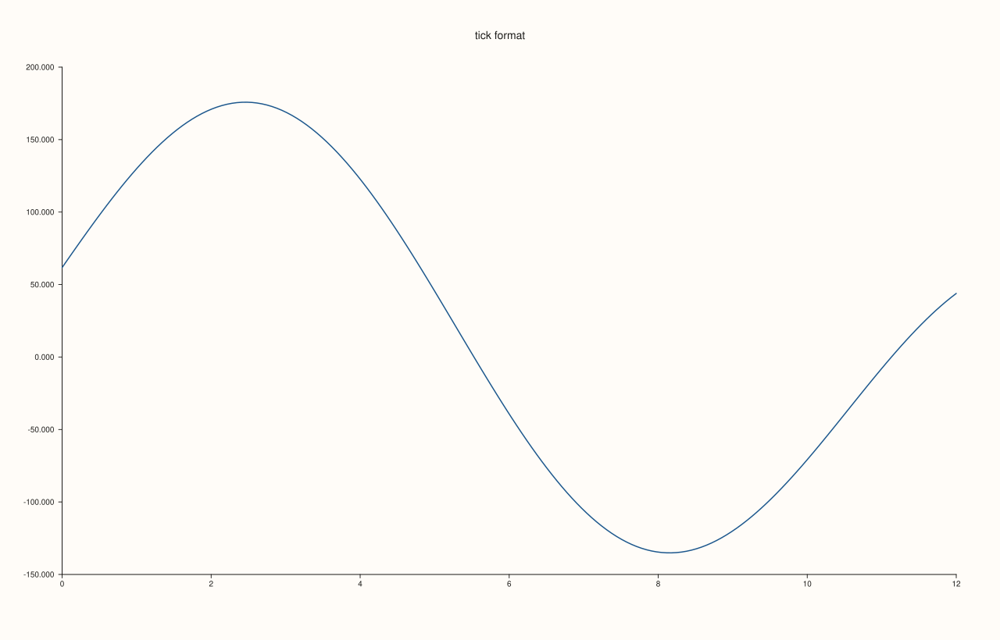
```

```{only} not html
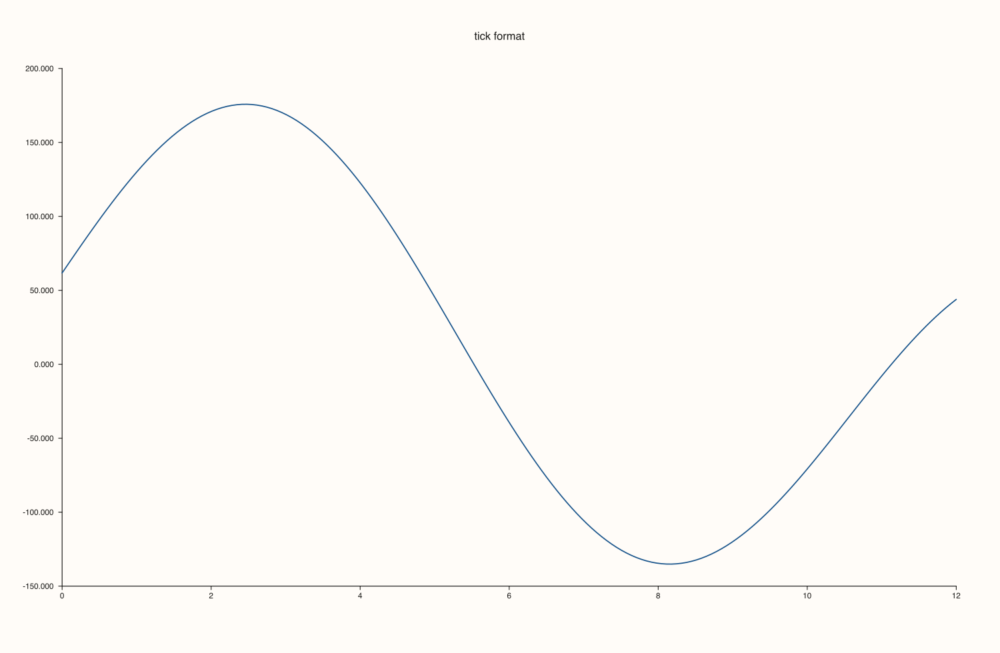
```

`Source section`: `plusspl_core_api.md`

### `Pane::x_tick_format / y_tick_format (overload 2)`

#### Signature

```cpp
Pane& y_tick_format(self: Pane, format: TickFormat);
```

#### Notes

Forces label formatting for readability and consistency in reports.

#### Example

```{literalinclude} ../../examples/docs/snippets/keys/core_pane_tick_format.cpp
:language: cpp
```

#### Output

```{only} html

```

```{only} not html

```

`Source section`: `plusspl_core_api.md`

### `Pane::x_tick_format / y_tick_format (overload 3)`

#### Signature

```cpp
Pane& x_auto_tick_decimals(self: Pane, decimals: int);
```

#### Notes

Forces label formatting for readability and consistency in reports.

#### Example

```{literalinclude} ../../examples/docs/snippets/keys/core_pane_tick_format.cpp
:language: cpp
```

#### Output

```{only} html

```

```{only} not html

```

`Source section`: `plusspl_core_api.md`

### `Pane::x_tick_format / y_tick_format (overload 4)`

#### Signature

```cpp
Pane& y_auto_tick_decimals(self: Pane, decimals: int);
```

#### Notes

Forces label formatting for readability and consistency in reports.

#### Example

```{literalinclude} ../../examples/docs/snippets/keys/core_pane_tick_format.cpp
:language: cpp
```

#### Output

```{only} html

```

```{only} not html

```

`Source section`: `plusspl_core_api.md`

### `Pane::x_tick_rotation / gaps (overload 1)`

#### Signature

```cpp
Pane& x_tick_rotation(self: Pane, degrees: double);
```

#### Notes

Controls tick/label spacing and angle to prevent overlaps in dense dashboards.

#### Example

```{literalinclude} ../../examples/docs/snippets/keys/core_pane_tick_rotation_gaps.cpp
:language: cpp
```

#### Output

```{only} html

```

```{only} not html
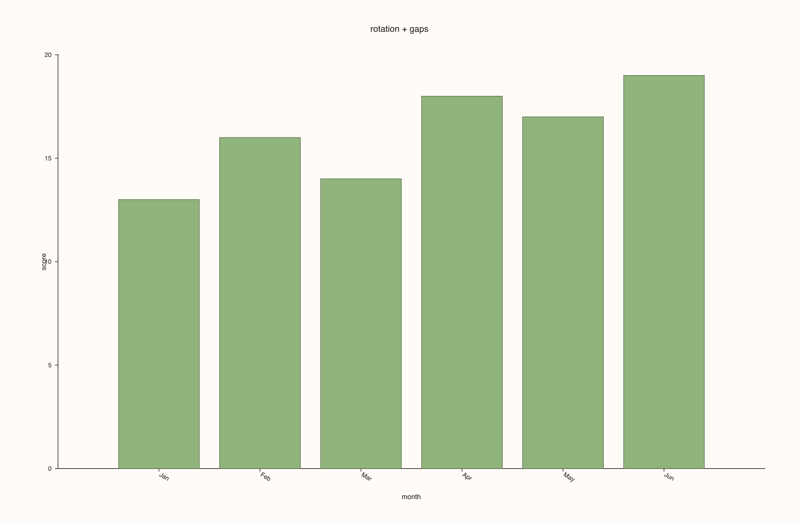
```

`Source section`: `plusspl_core_api.md`

### `Pane::x_tick_rotation / gaps (overload 2)`

#### Signature

```cpp
Pane& x_tick_label_gap(self: Pane, points: double);
```

#### Notes

Controls tick/label spacing and angle to prevent overlaps in dense dashboards.

#### Example

```{literalinclude} ../../examples/docs/snippets/keys/core_pane_tick_rotation_gaps.cpp
:language: cpp
```

#### Output

```{only} html

```

```{only} not html

```

`Source section`: `plusspl_core_api.md`

### `Pane::x_tick_rotation / gaps (overload 3)`

#### Signature

```cpp
Pane& x_label_gap(self: Pane, points: double);
```

#### Notes

Controls tick/label spacing and angle to prevent overlaps in dense dashboards.

#### Example

```{literalinclude} ../../examples/docs/snippets/keys/core_pane_tick_rotation_gaps.cpp
:language: cpp
```

#### Output

```{only} html

```

```{only} not html

```

`Source section`: `plusspl_core_api.md`

### `Pane::x_tick_rotation / gaps (overload 4)`

#### Signature

```cpp
Pane& y_label_centered(self: Pane, enable: bool = true);
```

#### Notes

Controls tick/label spacing and angle to prevent overlaps in dense dashboards.

#### Example

```{literalinclude} ../../examples/docs/snippets/keys/core_pane_tick_rotation_gaps.cpp
:language: cpp
```

#### Output

```{only} html

```

```{only} not html

```

`Source section`: `plusspl_core_api.md`

### `Pane::x_ticks / x_categories / y_categories (overload 1)`

#### Signature

```cpp
Pane& x_ticks(self: Pane, positions: SeriesLike, labels: pluss::msharp::RangeView::Of<std::string_view>);
Pane& x_ticks(self: Pane, positions: SeriesLike, labels: std::initializer_list<std::string_view>);
```

#### Notes

Switches between explicit numeric tick positions and category-axis labels.

#### Example

```{literalinclude} ../../examples/docs/snippets/keys/core_pane_ticks_categories.cpp
:language: cpp
```

#### Output

```{only} html
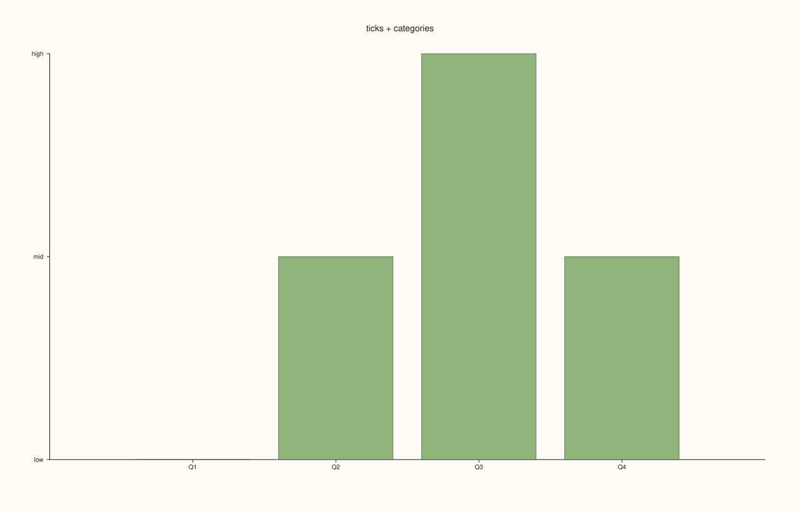
```

```{only} not html

```

`Source section`: `plusspl_core_api.md`

### `Pane::x_ticks / x_categories / y_categories (overload 2)`

#### Signature

```cpp
Pane& x_categories(self: Pane, labels: pluss::msharp::RangeView::Of<std::string_view>, first: double = 1.0, step: double = 1.0);
Pane& x_categories(self: Pane, labels: std::initializer_list<std::string_view>, first: double = 1.0, step: double = 1.0);
```

#### Notes

Switches between explicit numeric tick positions and category-axis labels.

#### Example

```{literalinclude} ../../examples/docs/snippets/keys/core_pane_ticks_categories.cpp
:language: cpp
```

#### Output

```{only} html

```

```{only} not html

```

`Source section`: `plusspl_core_api.md`

### `Pane::x_ticks / x_categories / y_categories (overload 3)`

#### Signature

```cpp
Pane& y_categories(self: Pane, labels: pluss::msharp::RangeView::Of<std::string_view>, first: double = 1.0, step: double = 1.0);
Pane& y_categories(self: Pane, labels: std::initializer_list<std::string_view>, first: double = 1.0, step: double = 1.0);
```

#### Notes

Switches between explicit numeric tick positions and category-axis labels.

#### Example

```{literalinclude} ../../examples/docs/snippets/keys/core_pane_ticks_categories.cpp
:language: cpp
```

#### Output

```{only} html

```

```{only} not html

```

`Source section`: `plusspl_core_api.md`

### `Studio::context_scales (single form)`

#### Signature

```cpp
Studio& context_scales(self: Studio, tick_font_scale: double, axis_label_font_scale: double);
```

#### Notes

Sets global text scale defaults applied to newly created panes.

#### Example

```{literalinclude} ../../examples/docs/snippets/keys/core_studio_context_scales.cpp
:language: cpp
```

#### Output

```{only} html
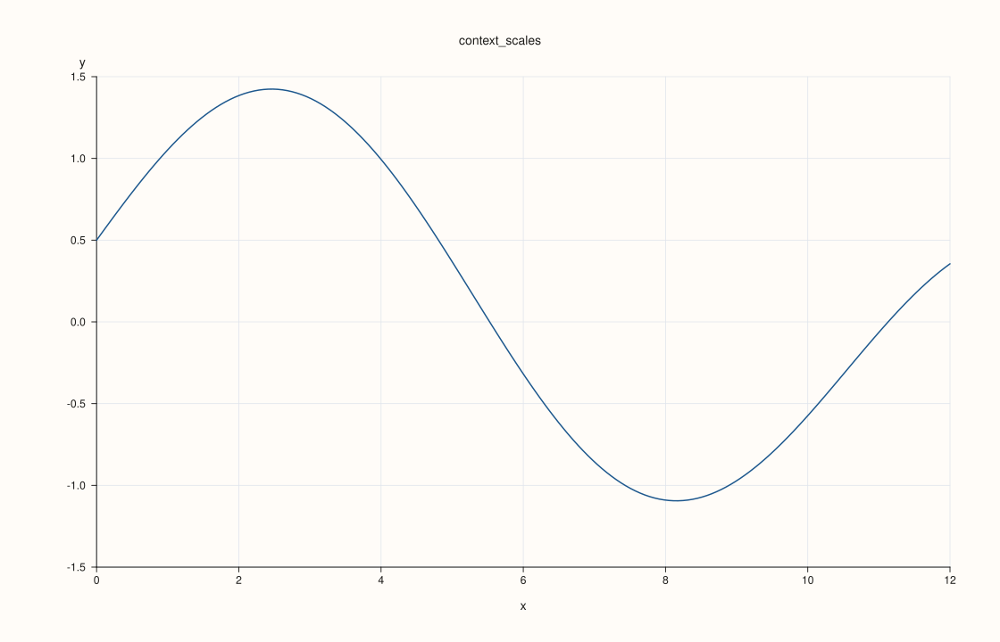
```

```{only} not html
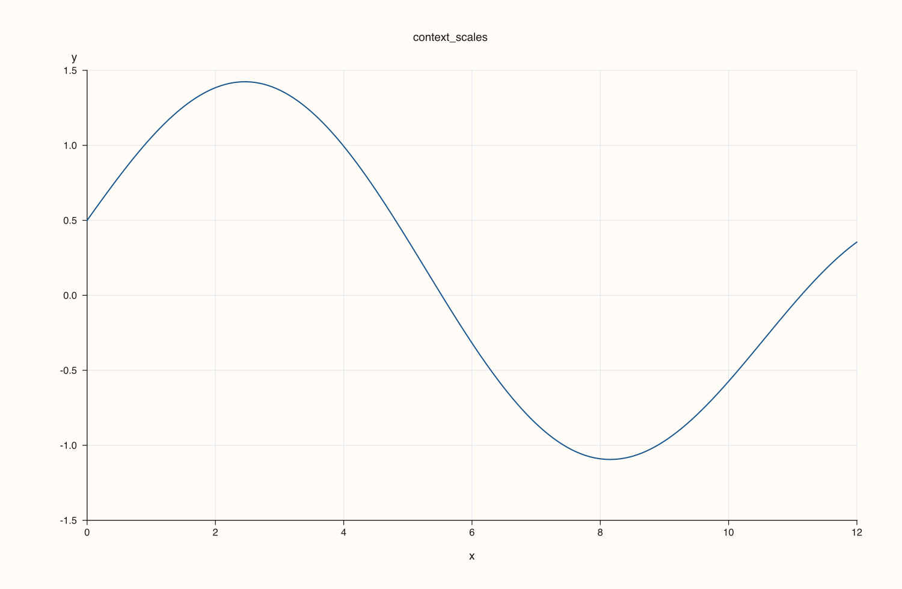
```

`Source section`: `plusspl_core_api.md`

### `Studio::mosaic / pane2 / place (overload 1)`

#### Signature

```cpp
Studio& mosaic(self: Studio, rows: int64_t, cols: int64_t, gutter_x: double = 18.0, gutter_y: double = 18.0);
```

#### Notes

Primary layout path for 2D dashboards.

#### Example

```{literalinclude} ../../examples/docs/snippets/keys/core_studio_mosaic.cpp
:language: cpp
```

#### Output

```{only} html
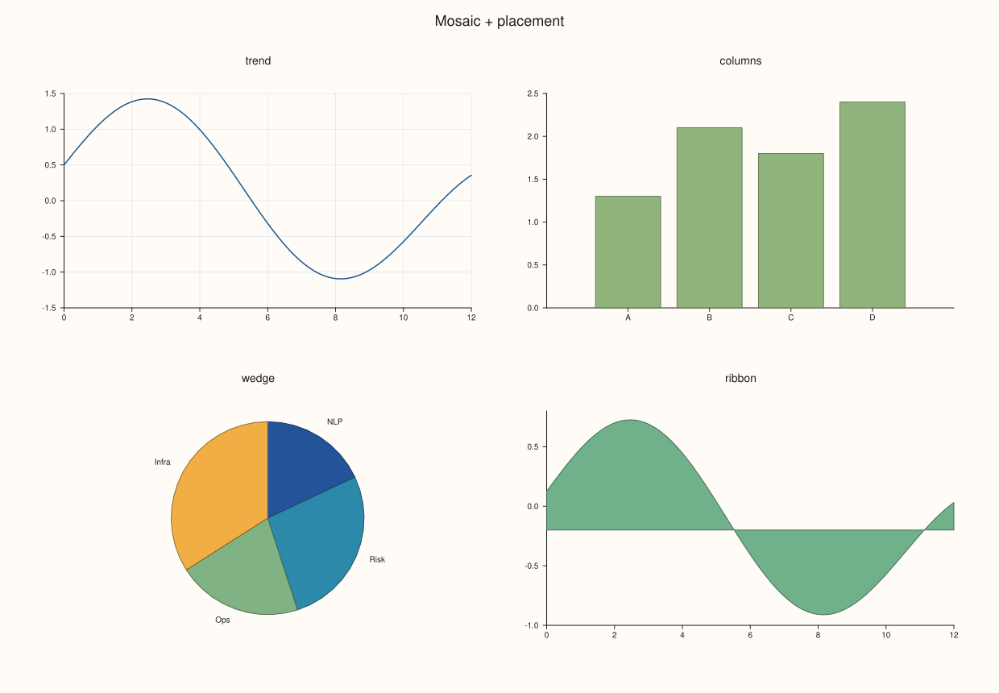
```

```{only} not html

```

`Source section`: `plusspl_core_api.md`

### `Studio::mosaic / pane2 / place (overload 2)`

#### Signature

```cpp
Pane& pane2(self: Studio, title: std::string = {});
```

#### Notes

Primary layout path for 2D dashboards.

#### Example

```{literalinclude} ../../examples/docs/snippets/keys/core_studio_mosaic.cpp
:language: cpp
```

#### Output

```{only} html

```

```{only} not html

```

`Source section`: `plusspl_core_api.md`

### `Studio::mosaic / pane2 / place (overload 3)`

#### Signature

```cpp
Pane& place(self: Pane, row: int64_t, col: int64_t, row_span: int64_t = 1, col_span: int64_t = 1);
```

#### Notes

Primary layout path for 2D dashboards.

#### Example

```{literalinclude} ../../examples/docs/snippets/keys/core_studio_mosaic.cpp
:language: cpp
```

#### Output

```{only} html

```

```{only} not html

```

`Source section`: `plusspl_core_api.md`

### `Studio::pane_style_defaults (overload 1)`

#### Signature

```cpp
Studio& pane_style_defaults(self: Studio, pane_style_template: Pane);
```

#### Notes

Copies style defaults from a template `Pane` into future panes.

#### Example

```{literalinclude} ../../examples/docs/snippets/keys/core_studio_pane_style_defaults.cpp
:language: cpp
```

#### Output

```{only} html
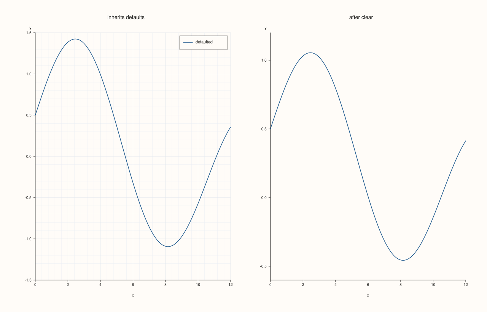
```

```{only} not html
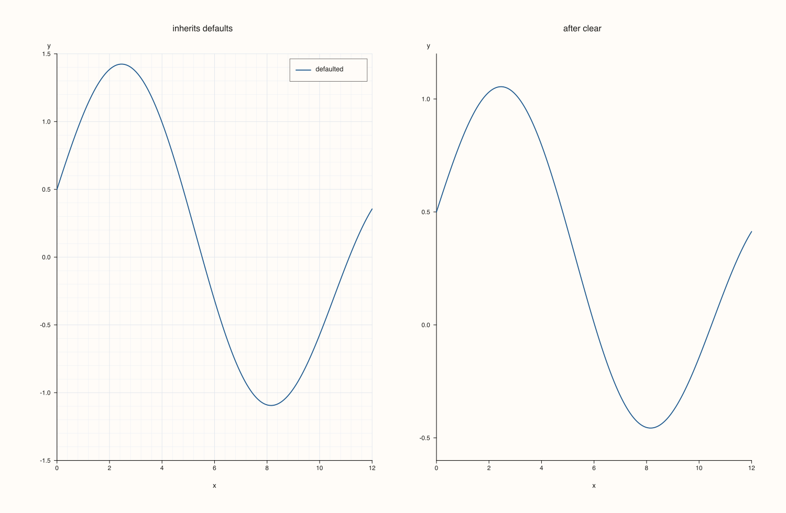
```

`Source section`: `plusspl_core_api.md`

### `Studio::pane_style_defaults (overload 2)`

#### Signature

```cpp
Studio& clear_pane_style_defaults(self: Studio);
```

#### Notes

Copies style defaults from a template `Pane` into future panes.

#### Example

```{literalinclude} ../../examples/docs/snippets/keys/core_studio_pane_style_defaults.cpp
:language: cpp
```

#### Output

```{only} html

```

```{only} not html

```

`Source section`: `plusspl_core_api.md`

### `Studio::row_title / x_caption / y_caption (overload 1)`

#### Signature

```cpp
Studio& row_title(self: Studio, row: int64_t, text: std::string);
```

#### Notes

Adds shared row and axis-group labeling for multi-pane reports.

#### Example

```{literalinclude} ../../examples/docs/snippets/keys/core_studio_captions_row_titles.cpp
:language: cpp
```

#### Output

```{only} html
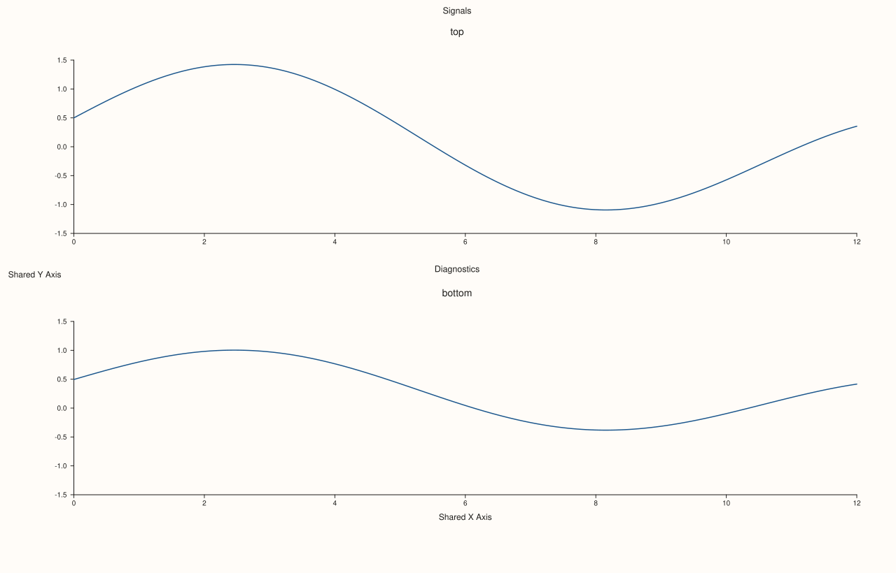
```

```{only} not html
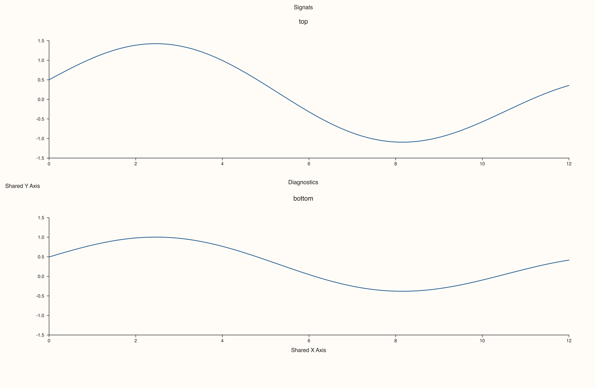
```

`Source section`: `plusspl_core_api.md`

### `Studio::row_title / x_caption / y_caption (overload 2)`

#### Signature

```cpp
Studio& clear_row_title(self: Studio, row: int64_t);
```

#### Notes

Adds shared row and axis-group labeling for multi-pane reports.

#### Example

```{literalinclude} ../../examples/docs/snippets/keys/core_studio_captions_row_titles.cpp
:language: cpp
```

#### Output

```{only} html

```

```{only} not html

```

`Source section`: `plusspl_core_api.md`

### `Studio::row_title / x_caption / y_caption (overload 3)`

#### Signature

```cpp
Studio& x_caption(self: Studio, group: std::string, text: std::string);
```

#### Notes

Adds shared row and axis-group labeling for multi-pane reports.

#### Example

```{literalinclude} ../../examples/docs/snippets/keys/core_studio_captions_row_titles.cpp
:language: cpp
```

#### Output

```{only} html

```

```{only} not html

```

`Source section`: `plusspl_core_api.md`

### `Studio::row_title / x_caption / y_caption (overload 4)`

#### Signature

```cpp
Studio& y_caption(self: Studio, group: std::string, text: std::string);
```

#### Notes

Adds shared row and axis-group labeling for multi-pane reports.

#### Example

```{literalinclude} ../../examples/docs/snippets/keys/core_studio_captions_row_titles.cpp
:language: cpp
```

#### Output

```{only} html

```

```{only} not html

```

`Source section`: `plusspl_core_api.md`

### `Studio::save_svg (single form)`

#### Signature

```cpp
void save_svg(self: Studio, path: std::string_view) const;
```

#### Notes

Writes deterministic vector output suitable for docs and version control.

#### Example

```{literalinclude} ../../examples/docs/snippets/keys/core_save_svg.cpp
:language: cpp
```

#### Output

```{only} html

```

```{only} not html

```

`Source section`: `plusspl_core_api.md`

### `Studio::save_png (single form)`

#### Signature

```cpp
void save_png(self: Studio, path: std::string_view, dpi: int64_t = 144) const;
```

#### Notes

Raster export path for slides and reports requiring pixel images.

#### Example

```{literalinclude} ../../examples/docs/snippets/keys/core_save_png.cpp
:language: cpp
```

#### Output

```{only} html

```

```{only} not html

```

`Source section`: `plusspl_core_api.md`

### `Studio::save_pdf (single form)`

#### Signature

```cpp
void save_pdf(self: Studio, path: std::string_view, engine: PdfEngine = PdfEngine::Auto) const;
```

#### Notes

Print/PDF export with backend selection.

#### Example

```{literalinclude} ../../examples/docs/snippets/keys/core_save_pdf.cpp
:language: cpp
```

#### Output

```{only} html

```

```{only} not html

```

`Source section`: `plusspl_core_api.md`

### `Studio::subpane2 (single form)`

#### Signature

```cpp
Pane& subpane2(self: Studio, parent_index: size_t, rows: int64_t, cols: int64_t, row: int64_t, col: int64_t, row_span: int64_t = 1, col_span: int64_t = 1, title: std::string = {});
```

#### Notes

Creates nested 2D panes inside a parent pane cell.

#### Example

```{literalinclude} ../../examples/docs/snippets/keys/core_studio_subpane2.cpp
:language: cpp
```

#### Output

```{only} html

```

```{only} not html

```

`Source section`: `plusspl_core_api.md`

### `Studio::subpane3 (single form)`

#### Signature

```cpp
Pane& subpane3(self: Studio, parent_index: size_t, rows: int64_t, cols: int64_t, row: int64_t, col: int64_t, row_span: int64_t = 1, col_span: int64_t = 1, title: std::string = {});
```

#### Notes

Creates nested 3D panes inside a parent pane cell.

#### Example

```{literalinclude} ../../examples/docs/snippets/keys/core_studio_subpane3.cpp
:language: cpp
```

#### Output

```{only} html

```

```{only} not html

```

`Source section`: `plusspl_core_api.md`

### `Studio::theme (overload 1)`

#### Signature

```cpp
Studio& theme(self: Studio, tokens: Theme);
```

#### Notes

Applies figure tokens and top-level identity metadata.

#### Example

```{literalinclude} ../../examples/docs/snippets/keys/core_studio_theme.cpp
:language: cpp
```

#### Output

```{only} html

```

```{only} not html

```

`Source section`: `plusspl_core_api.md`

### `Studio::theme (overload 2)`

#### Signature

```cpp
Studio& rename(self: Studio, name: std::string);
```

#### Notes

Applies figure tokens and top-level identity metadata.

#### Example

```{literalinclude} ../../examples/docs/snippets/keys/core_studio_theme.cpp
:language: cpp
```

#### Output

```{only} html

```

```{only} not html

```

`Source section`: `plusspl_core_api.md`

### `Studio::theme (overload 3)`

#### Signature

```cpp
Studio& headline(self: Studio, text: std::string);
```

#### Notes

Applies figure tokens and top-level identity metadata.

#### Example

```{literalinclude} ../../examples/docs/snippets/keys/core_studio_theme.cpp
:language: cpp
```

#### Output

```{only} html

```

```{only} not html

```

`Source section`: `plusspl_core_api.md`

### `Studio::tight_layout (single form)`

#### Signature

```cpp
Studio& tight_layout(self: Studio, enable: bool = true, padding: double = 6.0);
```

#### Notes

Compacts pane geometry to reduce overlaps and dead space.

#### Example

```{literalinclude} ../../examples/docs/snippets/keys/core_studio_tight_layout.cpp
:language: cpp
```

#### Output

```{only} html

```

```{only} not html

```

`Source section`: `plusspl_core_api.md`

### `Trace::hide / show (overload 1)`

#### Signature

```cpp
Trace& hide(self: Trace);
```

#### Notes

Allows toggling traces in chained construction flows without deleting geometry.

#### Example

```{literalinclude} ../../examples/docs/snippets/keys/core_trace_visibility.cpp
:language: cpp
```

#### Output

```{only} html

```

```{only} not html

```

`Source section`: `plusspl_core_api.md`

### `Trace::hide / show (overload 2)`

#### Signature

```cpp
Trace& show(self: Trace);
```

#### Notes

Allows toggling traces in chained construction flows without deleting geometry.

#### Example

```{literalinclude} ../../examples/docs/snippets/keys/core_trace_visibility.cpp
:language: cpp
```

#### Output

```{only} html

```

```{only} not html

```

`Source section`: `plusspl_core_api.md`

### `Trace::label / width / stroke / palette / color_limits (overload 1)`

#### Signature

```cpp
Trace& label(self: Trace, label: std::string);
```

#### Notes

Primary 2D/continuous styling controls for line/scatter/surface traces.

#### Example

```{literalinclude} ../../examples/docs/snippets/keys/core_trace_style_2d.cpp
:language: cpp
```

#### Output

```{only} html

```

```{only} not html

```

`Source section`: `plusspl_core_api.md`

### `Trace::label / width / stroke / palette / color_limits (overload 2)`

#### Signature

```cpp
Trace& width(self: Trace, width: float);
```

#### Notes

Primary 2D/continuous styling controls for line/scatter/surface traces.

#### Example

```{literalinclude} ../../examples/docs/snippets/keys/core_trace_style_2d.cpp
:language: cpp
```

#### Output

```{only} html

```

```{only} not html

```

`Source section`: `plusspl_core_api.md`

### `Trace::label / width / stroke / palette / color_limits (overload 3)`

#### Signature

```cpp
Trace& stroke(self: Trace, color: Rgba);
```

#### Notes

Primary 2D/continuous styling controls for line/scatter/surface traces.

#### Example

```{literalinclude} ../../examples/docs/snippets/keys/core_trace_style_2d.cpp
:language: cpp
```

#### Output

```{only} html

```

```{only} not html

```

`Source section`: `plusspl_core_api.md`

### `Trace::label / width / stroke / palette / color_limits (overload 4)`

#### Signature

```cpp
Trace& palette(self: Trace, palette: PaletteRamp);
```

#### Notes

Primary 2D/continuous styling controls for line/scatter/surface traces.

#### Example

```{literalinclude} ../../examples/docs/snippets/keys/core_trace_style_2d.cpp
:language: cpp
```

#### Output

```{only} html

```

```{only} not html

```

`Source section`: `plusspl_core_api.md`

### `Trace::label / width / stroke / palette / color_limits (overload 5)`

#### Signature

```cpp
Trace& color_limits(self: Trace, limits: Range1d);
```

#### Notes

Primary 2D/continuous styling controls for line/scatter/surface traces.

#### Example

```{literalinclude} ../../examples/docs/snippets/keys/core_trace_style_2d.cpp
:language: cpp
```

#### Output

```{only} html

```

```{only} not html

```

`Source section`: `plusspl_core_api.md`

### `Trace::shade / lighting / material / transparent (overload 1)`

#### Signature

```cpp
Trace& shade(self: Trace, mode: ShadeMode);
```

#### Notes

3D surface rendering controls for geometry perception and layering.

#### Example

```{literalinclude} ../../examples/docs/snippets/keys/core_trace_style_3d.cpp
:language: cpp
```

#### Output

```{only} html

```

```{only} not html

```

`Source section`: `plusspl_core_api.md`

### `Trace::shade / lighting / material / transparent (overload 2)`

#### Signature

```cpp
Trace& lighting(self: Trace, mode: LightingMode);
```

#### Notes

3D surface rendering controls for geometry perception and layering.

#### Example

```{literalinclude} ../../examples/docs/snippets/keys/core_trace_style_3d.cpp
:language: cpp
```

#### Output

```{only} html

```

```{only} not html

```

`Source section`: `plusspl_core_api.md`

### `Trace::shade / lighting / material / transparent (overload 3)`

#### Signature

```cpp
Trace& material(self: Trace, profile: MaterialProfile);
```

#### Notes

3D surface rendering controls for geometry perception and layering.

#### Example

```{literalinclude} ../../examples/docs/snippets/keys/core_trace_style_3d.cpp
:language: cpp
```

#### Output

```{only} html

```

```{only} not html

```

`Source section`: `plusspl_core_api.md`

### `Trace::shade / lighting / material / transparent (overload 4)`

#### Signature

```cpp
Trace& transparent(self: Trace, enable: bool = true);
```

#### Notes

3D surface rendering controls for geometry perception and layering.

#### Example

```{literalinclude} ../../examples/docs/snippets/keys/core_trace_style_3d.cpp
:language: cpp
```

#### Output

```{only} html

```

```{only} not html

```

`Source section`: `plusspl_core_api.md`

### `Trace::width (single form)`

#### Signature

```cpp
Trace& width(self: Trace, float width);
```

#### Notes

Sets stroke width for the active trace.

#### Example

```{literalinclude} ../../examples/docs/snippets/methods/trace__width.cpp
:language: cpp
```

#### Output

```{only} html

```

```{only} not html

```

`Source section`: `plusspl_core_controls_api.md`

### `Trace::stroke (single form)`

#### Signature

```cpp
Trace& stroke(self: Trace, Rgba color);
```

#### Notes

Overrides the trace stroke color.

#### Example

```{literalinclude} ../../examples/docs/snippets/methods/trace__stroke.cpp
:language: cpp
```

#### Output

```{only} html

```

```{only} not html

```

`Source section`: `plusspl_core_controls_api.md`

### `Trace::palette (single form)`

#### Signature

```cpp
Trace& palette(self: Trace, PaletteRamp palette);
```

#### Notes

Assigns a palette ramp used for continuous color mapping.

#### Example

```{literalinclude} ../../examples/docs/snippets/methods/trace__palette.cpp
:language: cpp
```

#### Output

```{only} html

```

```{only} not html

```

`Source section`: `plusspl_core_controls_api.md`

### `Trace::color_limits (single form)`

#### Signature

```cpp
Trace& color_limits(self: Trace, Range1d limits);
```

#### Notes

Fixes color normalization bounds for comparable panels.

#### Example

```{literalinclude} ../../examples/docs/snippets/methods/trace__color_limits.cpp
:language: cpp
```

#### Output

```{only} html

```

```{only} not html

```

`Source section`: `plusspl_core_controls_api.md`

### `Trace::lighting (single form)`

#### Signature

```cpp
Trace& lighting(self: Trace, LightingMode mode);
```

#### Notes

Sets lighting model for 3D surfaces.

#### Example

```{literalinclude} ../../examples/docs/snippets/methods/trace__lighting.cpp
:language: cpp
```

#### Output

```{only} html

```

```{only} not html

```

`Source section`: `plusspl_core_controls_api.md`

### `Trace::material (single form)`

#### Signature

```cpp
Trace& material(self: Trace, MaterialProfile profile);
```

#### Notes

Sets material profile for 3D rendering.

#### Example

```{literalinclude} ../../examples/docs/snippets/methods/trace__material.cpp
:language: cpp
```

#### Output

```{only} html

```

```{only} not html

```

`Source section`: `plusspl_core_controls_api.md`

### `Trace::transparent (single form)`

#### Signature

```cpp
Trace& transparent(self: Trace, bool enable = true);
```

#### Notes

Toggles trace alpha/transparency mode.

#### Example

```{literalinclude} ../../examples/docs/snippets/methods/trace__transparent.cpp
:language: cpp
```

#### Output

```{only} html

```

```{only} not html

```

`Source section`: `plusspl_core_controls_api.md`

### `Trace::annotate_levels (single form)`

#### Signature

```cpp
Trace& annotate_levels(self: Trace, bool enable = true);
```

#### Notes

Turns contour/level annotations on or off.

#### Example

```{literalinclude} ../../examples/docs/snippets/methods/trace__annotate_levels.cpp
:language: cpp
```

#### Output

```{only} html

```

```{only} not html

```

`Source section`: `plusspl_core_controls_api.md`

### `Trace::show (single form)`

#### Signature

```cpp
Trace& show(self: Trace);
```

#### Notes

Makes a previously hidden trace visible again.

#### Example

```{literalinclude} ../../examples/docs/snippets/methods/trace__show.cpp
:language: cpp
```

#### Output

```{only} html

```

```{only} not html

```

`Source section`: `plusspl_core_controls_api.md`

### `Pane::title (single form)`

#### Signature

```cpp
Pane& title(self: Pane, std::string title);
```

#### Notes

Sets or updates pane title text.

#### Example

```{literalinclude} ../../examples/docs/snippets/methods/pane__title.cpp
:language: cpp
```

#### Output

```{only} html

```

```{only} not html

```

`Source section`: `plusspl_core_controls_api.md`

### `Pane::scale_y (single form)`

#### Signature

```cpp
Pane& scale_y(self: Pane, ScalePolicy scale);
```

#### Notes

Applies scale policy on Y axis.

#### Example

```{literalinclude} ../../examples/docs/snippets/methods/pane__scale_y.cpp
:language: cpp
```

#### Output

```{only} html

```

```{only} not html

```

`Source section`: `plusspl_core_controls_api.md`

### `Pane::scale_z (single form)`

#### Signature

```cpp
Pane& scale_z(self: Pane, ScalePolicy scale);
```

#### Notes

Applies scale policy on Z axis (3D panes).

#### Example

```{literalinclude} ../../examples/docs/snippets/methods/pane__scale_z.cpp
:language: cpp
```

#### Output

```{only} html

```

```{only} not html

```

`Source section`: `plusspl_core_controls_api.md`

### `Pane::y_limits (single form)`

#### Signature

```cpp
Pane& y_limits(self: Pane, Range1d limits);
```

#### Notes

Sets explicit Y-axis limits.

#### Example

```{literalinclude} ../../examples/docs/snippets/methods/pane__y_limits.cpp
:language: cpp
```

#### Output

```{only} html

```

```{only} not html

```

`Source section`: `plusspl_core_controls_api.md`

### `Pane::z_limits (single form)`

#### Signature

```cpp
Pane& z_limits(self: Pane, Range1d limits);
```

#### Notes

Sets explicit Z-axis limits.

#### Example

```{literalinclude} ../../examples/docs/snippets/methods/pane__z_limits.cpp
:language: cpp
```

#### Output

```{only} html

```

```{only} not html

```

`Source section`: `plusspl_core_controls_api.md`

### `Pane::color_limits (single form)`

#### Signature

```cpp
Pane& color_limits(self: Pane, Range1d limits);
```

#### Notes

Sets explicit color-axis limits.

#### Example

```{literalinclude} ../../examples/docs/snippets/methods/pane__color_limits.cpp
:language: cpp
```

#### Output

```{only} html

```

```{only} not html

```

`Source section`: `plusspl_core_controls_api.md`

### `Pane::x_limit_method (single form)`

#### Signature

```cpp
Pane& x_limit_method(self: Pane, LimitMethod method);
```

#### Notes

Chooses X-axis auto-limit strategy.

#### Example

```{literalinclude} ../../examples/docs/snippets/methods/pane__x_limit_method.cpp
:language: cpp
```

#### Output

```{only} html

```

```{only} not html

```

`Source section`: `plusspl_core_controls_api.md`

### `Pane::y_limit_method (single form)`

#### Signature

```cpp
Pane& y_limit_method(self: Pane, LimitMethod method);
```

#### Notes

Chooses Y-axis auto-limit strategy.

#### Example

```{literalinclude} ../../examples/docs/snippets/methods/pane__y_limit_method.cpp
:language: cpp
```

#### Output

```{only} html

```

```{only} not html

```

`Source section`: `plusspl_core_controls_api.md`

### `Pane::z_limit_method (single form)`

#### Signature

```cpp
Pane& z_limit_method(self: Pane, LimitMethod method);
```

#### Notes

Chooses Z-axis auto-limit strategy.

#### Example

```{literalinclude} ../../examples/docs/snippets/methods/pane__z_limit_method.cpp
:language: cpp
```

#### Output

```{only} html

```

```{only} not html

```

`Source section`: `plusspl_core_controls_api.md`

### `Pane::color_limit_method (single form)`

#### Signature

```cpp
Pane& color_limit_method(self: Pane, LimitMethod method);
```

#### Notes

Chooses color-axis auto-limit strategy.

#### Example

```{literalinclude} ../../examples/docs/snippets/methods/pane__color_limit_method.cpp
:language: cpp
```

#### Output

```{only} html

```

```{only} not html

```

`Source section`: `plusspl_core_controls_api.md`

### `Pane::y_tick_format (single form)`

#### Signature

```cpp
Pane& y_tick_format(self: Pane, TickFormat format);
```

#### Notes

Sets Y tick label format.

#### Example

```{literalinclude} ../../examples/docs/snippets/methods/pane__y_tick_format.cpp
:language: cpp
```

#### Output

```{only} html

```

```{only} not html

```

`Source section`: `plusspl_core_controls_api.md`

### `Pane::z_tick_format (single form)`

#### Signature

```cpp
Pane& z_tick_format(self: Pane, TickFormat format);
```

#### Notes

Sets Z tick label format.

#### Example

```{literalinclude} ../../examples/docs/snippets/methods/pane__z_tick_format.cpp
:language: cpp
```

#### Output

```{only} html

```

```{only} not html

```

`Source section`: `plusspl_core_controls_api.md`

### `Pane::x_auto_tick_decimals (single form)`

#### Signature

```cpp
Pane& x_auto_tick_decimals(self: Pane, int decimals);
```

#### Notes

Hints decimal precision for X ticks.

#### Example

```{literalinclude} ../../examples/docs/snippets/methods/pane__x_auto_tick_decimals.cpp
:language: cpp
```

#### Output

```{only} html

```

```{only} not html

```

`Source section`: `plusspl_core_controls_api.md`

### `Pane::y_auto_tick_decimals (single form)`

#### Signature

```cpp
Pane& y_auto_tick_decimals(self: Pane, int decimals);
```

#### Notes

Hints decimal precision for Y ticks.

#### Example

```{literalinclude} ../../examples/docs/snippets/methods/pane__y_auto_tick_decimals.cpp
:language: cpp
```

#### Output

```{only} html

```

```{only} not html

```

`Source section`: `plusspl_core_controls_api.md`

### `Pane::z_auto_tick_decimals (single form)`

#### Signature

```cpp
Pane& z_auto_tick_decimals(self: Pane, int decimals);
```

#### Notes

Hints decimal precision for Z ticks.

#### Example

```{literalinclude} ../../examples/docs/snippets/methods/pane__z_auto_tick_decimals.cpp
:language: cpp
```

#### Output

```{only} html

```

```{only} not html

```

`Source section`: `plusspl_core_controls_api.md`

### `Pane::clear_x_auto_tick_decimals (single form)`

#### Signature

```cpp
Pane& clear_x_auto_tick_decimals(self: Pane);
```

#### Notes

Clears X decimal override.

#### Example

```{literalinclude} ../../examples/docs/snippets/methods/pane__clear_x_auto_tick_decimals.cpp
:language: cpp
```

#### Output

```{only} html

```

```{only} not html

```

`Source section`: `plusspl_core_controls_api.md`

### `Pane::clear_y_auto_tick_decimals (single form)`

#### Signature

```cpp
Pane& clear_y_auto_tick_decimals(self: Pane);
```

#### Notes

Clears Y decimal override.

#### Example

```{literalinclude} ../../examples/docs/snippets/methods/pane__clear_y_auto_tick_decimals.cpp
:language: cpp
```

#### Output

```{only} html

```

```{only} not html

```

`Source section`: `plusspl_core_controls_api.md`

### `Pane::clear_z_auto_tick_decimals (single form)`

#### Signature

```cpp
Pane& clear_z_auto_tick_decimals(self: Pane);
```

#### Notes

Clears Z decimal override.

#### Example

```{literalinclude} ../../examples/docs/snippets/methods/pane__clear_z_auto_tick_decimals.cpp
:language: cpp
```

#### Output

```{only} html

```

```{only} not html

```

`Source section`: `plusspl_core_controls_api.md`

### `Pane::tick_font_scale (single form)`

#### Signature

```cpp
Pane& tick_font_scale(self: Pane, double scale);
```

#### Notes

Scales tick font size for this pane.

#### Example

```{literalinclude} ../../examples/docs/snippets/methods/pane__tick_font_scale.cpp
:language: cpp
```

#### Output

```{only} html

```

```{only} not html

```

`Source section`: `plusspl_core_controls_api.md`

### `Pane::axis_label_font_scale (single form)`

#### Signature

```cpp
Pane& axis_label_font_scale(self: Pane, double scale);
```

#### Notes

Scales axis label font size for this pane.

#### Example

```{literalinclude} ../../examples/docs/snippets/methods/pane__axis_label_font_scale.cpp
:language: cpp
```

#### Output

```{only} html

```

```{only} not html

```

`Source section`: `plusspl_core_controls_api.md`

### `Pane::y_tick_rotation (single form)`

#### Signature

```cpp
Pane& y_tick_rotation(self: Pane, double degrees);
```

#### Notes

Rotates Y tick labels.

#### Example

```{literalinclude} ../../examples/docs/snippets/methods/pane__y_tick_rotation.cpp
:language: cpp
```

#### Output

```{only} html

```

```{only} not html

```

`Source section`: `plusspl_core_controls_api.md`

### `Pane::z_tick_rotation (single form)`

#### Signature

```cpp
Pane& z_tick_rotation(self: Pane, double degrees);
```

#### Notes

Rotates Z tick labels.

#### Example

```{literalinclude} ../../examples/docs/snippets/methods/pane__z_tick_rotation.cpp
:language: cpp
```

#### Output

```{only} html

```

```{only} not html

```

`Source section`: `plusspl_core_controls_api.md`

### `Pane::x_tick_label_gap (single form)`

#### Signature

```cpp
Pane& x_tick_label_gap(self: Pane, double points);
```

#### Notes

Sets X tick-label distance from axis.

#### Example

```{literalinclude} ../../examples/docs/snippets/methods/pane__x_tick_label_gap.cpp
:language: cpp
```

#### Output

```{only} html

```

```{only} not html

```

`Source section`: `plusspl_core_controls_api.md`

### `Pane::y_tick_label_gap (single form)`

#### Signature

```cpp
Pane& y_tick_label_gap(self: Pane, double points);
```

#### Notes

Sets Y tick-label distance from axis.

#### Example

```{literalinclude} ../../examples/docs/snippets/methods/pane__y_tick_label_gap.cpp
:language: cpp
```

#### Output

```{only} html

```

```{only} not html

```

`Source section`: `plusspl_core_controls_api.md`

### `Pane::z_tick_label_gap (single form)`

#### Signature

```cpp
Pane& z_tick_label_gap(self: Pane, double points);
```

#### Notes

Sets Z tick-label distance from axis.

#### Example

```{literalinclude} ../../examples/docs/snippets/methods/pane__z_tick_label_gap.cpp
:language: cpp
```

#### Output

```{only} html

```

```{only} not html

```

`Source section`: `plusspl_core_controls_api.md`

### `Pane::x_label_gap (single form)`

#### Signature

```cpp
Pane& x_label_gap(self: Pane, double points);
```

#### Notes

Sets X axis-label gap.

#### Example

```{literalinclude} ../../examples/docs/snippets/methods/pane__x_label_gap.cpp
:language: cpp
```

#### Output

```{only} html

```

```{only} not html

```

`Source section`: `plusspl_core_controls_api.md`

### `Pane::y_label_gap (single form)`

#### Signature

```cpp
Pane& y_label_gap(self: Pane, double points);
```

#### Notes

Sets Y axis-label gap.

#### Example

```{literalinclude} ../../examples/docs/snippets/methods/pane__y_label_gap.cpp
:language: cpp
```

#### Output

```{only} html

```

```{only} not html

```

`Source section`: `plusspl_core_controls_api.md`

### `Pane::z_label_gap (single form)`

#### Signature

```cpp
Pane& z_label_gap(self: Pane, double points);
```

#### Notes

Sets Z axis-label gap.

#### Example

```{literalinclude} ../../examples/docs/snippets/methods/pane__z_label_gap.cpp
:language: cpp
```

#### Output

```{only} html

```

```{only} not html

```

`Source section`: `plusspl_core_controls_api.md`

### `Pane::x_label_rotation (single form)`

#### Signature

```cpp
Pane& x_label_rotation(self: Pane, double degrees);
```

#### Notes

Rotates X axis label.

#### Example

```{literalinclude} ../../examples/docs/snippets/methods/pane__x_label_rotation.cpp
:language: cpp
```

#### Output

```{only} html

```

```{only} not html

```

`Source section`: `plusspl_core_controls_api.md`

### `Pane::y_label_rotation (single form)`

#### Signature

```cpp
Pane& y_label_rotation(self: Pane, double degrees);
```

#### Notes

Rotates Y axis label.

#### Example

```{literalinclude} ../../examples/docs/snippets/methods/pane__y_label_rotation.cpp
:language: cpp
```

#### Output

```{only} html

```

```{only} not html

```

`Source section`: `plusspl_core_controls_api.md`

### `Pane::z_label_rotation (single form)`

#### Signature

```cpp
Pane& z_label_rotation(self: Pane, double degrees);
```

#### Notes

Rotates Z axis label.

#### Example

```{literalinclude} ../../examples/docs/snippets/methods/pane__z_label_rotation.cpp
:language: cpp
```

#### Output

```{only} html

```

```{only} not html

```

`Source section`: `plusspl_core_controls_api.md`

### `Pane::y_label_centered (single form)`

#### Signature

```cpp
Pane& y_label_centered(self: Pane, bool enable = true);
```

#### Notes

Centers Y label along the axis span.

#### Example

```{literalinclude} ../../examples/docs/snippets/methods/pane__y_label_centered.cpp
:language: cpp
```

#### Output

```{only} html

```

```{only} not html

```

`Source section`: `plusspl_core_controls_api.md`

### `Pane::clear_x_tick_rotation (single form)`

#### Signature

```cpp
Pane& clear_x_tick_rotation(self: Pane);
```

#### Notes

Clears custom X tick rotation.

#### Example

```{literalinclude} ../../examples/docs/snippets/methods/pane__clear_x_tick_rotation.cpp
:language: cpp
```

#### Output

```{only} html

```

```{only} not html

```

`Source section`: `plusspl_core_controls_api.md`

### `Pane::clear_y_tick_rotation (single form)`

#### Signature

```cpp
Pane& clear_y_tick_rotation(self: Pane);
```

#### Notes

Clears custom Y tick rotation.

#### Example

```{literalinclude} ../../examples/docs/snippets/methods/pane__clear_y_tick_rotation.cpp
:language: cpp
```

#### Output

```{only} html

```

```{only} not html

```

`Source section`: `plusspl_core_controls_api.md`

### `Pane::clear_z_tick_rotation (single form)`

#### Signature

```cpp
Pane& clear_z_tick_rotation(self: Pane);
```

#### Notes

Clears custom Z tick rotation.

#### Example

```{literalinclude} ../../examples/docs/snippets/methods/pane__clear_z_tick_rotation.cpp
:language: cpp
```

#### Output

```{only} html

```

```{only} not html

```

`Source section`: `plusspl_core_controls_api.md`

### `Pane::clear_x_tick_label_gap (single form)`

#### Signature

```cpp
Pane& clear_x_tick_label_gap(self: Pane);
```

#### Notes

Clears X tick-label gap override.

#### Example

```{literalinclude} ../../examples/docs/snippets/methods/pane__clear_x_tick_label_gap.cpp
:language: cpp
```

#### Output

```{only} html

```

```{only} not html

```

`Source section`: `plusspl_core_controls_api.md`

### `Pane::clear_y_tick_label_gap (single form)`

#### Signature

```cpp
Pane& clear_y_tick_label_gap(self: Pane);
```

#### Notes

Clears Y tick-label gap override.

#### Example

```{literalinclude} ../../examples/docs/snippets/methods/pane__clear_y_tick_label_gap.cpp
:language: cpp
```

#### Output

```{only} html

```

```{only} not html

```

`Source section`: `plusspl_core_controls_api.md`

### `Pane::clear_z_tick_label_gap (single form)`

#### Signature

```cpp
Pane& clear_z_tick_label_gap(self: Pane);
```

#### Notes

Clears Z tick-label gap override.

#### Example

```{literalinclude} ../../examples/docs/snippets/methods/pane__clear_z_tick_label_gap.cpp
:language: cpp
```

#### Output

```{only} html

```

```{only} not html

```

`Source section`: `plusspl_core_controls_api.md`

### `Pane::clear_x_label_gap (single form)`

#### Signature

```cpp
Pane& clear_x_label_gap(self: Pane);
```

#### Notes

Clears X label gap override.

#### Example

```{literalinclude} ../../examples/docs/snippets/methods/pane__clear_x_label_gap.cpp
:language: cpp
```

#### Output

```{only} html

```

```{only} not html

```

`Source section`: `plusspl_core_controls_api.md`

### `Pane::clear_y_label_gap (single form)`

#### Signature

```cpp
Pane& clear_y_label_gap(self: Pane);
```

#### Notes

Clears Y label gap override.

#### Example

```{literalinclude} ../../examples/docs/snippets/methods/pane__clear_y_label_gap.cpp
:language: cpp
```

#### Output

```{only} html

```

```{only} not html

```

`Source section`: `plusspl_core_controls_api.md`

### `Pane::clear_z_label_gap (single form)`

#### Signature

```cpp
Pane& clear_z_label_gap(self: Pane);
```

#### Notes

Clears Z label gap override.

#### Example

```{literalinclude} ../../examples/docs/snippets/methods/pane__clear_z_label_gap.cpp
:language: cpp
```

#### Output

```{only} html

```

```{only} not html

```

`Source section`: `plusspl_core_controls_api.md`

### `Pane::x_tick_labels (single form)`

#### Signature

```cpp
Pane& x_tick_labels(self: Pane, bool enable = true);
```

#### Notes

Shows or hides X tick labels.

#### Example

```{literalinclude} ../../examples/docs/snippets/methods/pane__x_tick_labels.cpp
:language: cpp
```

#### Output

```{only} html

```

```{only} not html

```

`Source section`: `plusspl_core_controls_api.md`

### `Pane::y_tick_labels (single form)`

#### Signature

```cpp
Pane& y_tick_labels(self: Pane, bool enable = true);
```

#### Notes

Shows or hides Y tick labels.

#### Example

```{literalinclude} ../../examples/docs/snippets/methods/pane__y_tick_labels.cpp
:language: cpp
```

#### Output

```{only} html

```

```{only} not html

```

`Source section`: `plusspl_core_controls_api.md`

### `Pane::z_tick_labels (single form)`

#### Signature

```cpp
Pane& z_tick_labels(self: Pane, bool enable = true);
```

#### Notes

Shows or hides Z tick labels.

#### Example

```{literalinclude} ../../examples/docs/snippets/methods/pane__z_tick_labels.cpp
:language: cpp
```

#### Output

```{only} html

```

```{only} not html

```

`Source section`: `plusspl_core_controls_api.md`

### `Pane::clear_x_label_rotation (single form)`

#### Signature

```cpp
Pane& clear_x_label_rotation(self: Pane);
```

#### Notes

Clears X label rotation override.

#### Example

```{literalinclude} ../../examples/docs/snippets/methods/pane__clear_x_label_rotation.cpp
:language: cpp
```

#### Output

```{only} html

```

```{only} not html

```

`Source section`: `plusspl_core_controls_api.md`

### `Pane::clear_y_label_rotation (single form)`

#### Signature

```cpp
Pane& clear_y_label_rotation(self: Pane);
```

#### Notes

Clears Y label rotation override.

#### Example

```{literalinclude} ../../examples/docs/snippets/methods/pane__clear_y_label_rotation.cpp
:language: cpp
```

#### Output

```{only} html

```

```{only} not html

```

`Source section`: `plusspl_core_controls_api.md`

### `Pane::clear_z_label_rotation (single form)`

#### Signature

```cpp
Pane& clear_z_label_rotation(self: Pane);
```

#### Notes

Clears Z label rotation override.

#### Example

```{literalinclude} ../../examples/docs/snippets/methods/pane__clear_z_label_rotation.cpp
:language: cpp
```

#### Output

```{only} html

```

```{only} not html

```

`Source section`: `plusspl_core_controls_api.md`

### `Pane::auto_x (single form)`

#### Signature

```cpp
Pane& auto_x(self: Pane);
```

#### Notes

Restores automatic X-axis limits.

#### Example

```{literalinclude} ../../examples/docs/snippets/methods/pane__auto_x.cpp
:language: cpp
```

#### Output

```{only} html

```

```{only} not html

```

`Source section`: `plusspl_core_controls_api.md`

### `Pane::auto_y (single form)`

#### Signature

```cpp
Pane& auto_y(self: Pane);
```

#### Notes

Restores automatic Y-axis limits.

#### Example

```{literalinclude} ../../examples/docs/snippets/methods/pane__auto_y.cpp
:language: cpp
```

#### Output

```{only} html

```

```{only} not html

```

`Source section`: `plusspl_core_controls_api.md`

### `Pane::auto_z (single form)`

#### Signature

```cpp
Pane& auto_z(self: Pane);
```

#### Notes

Restores automatic Z-axis limits.

#### Example

```{literalinclude} ../../examples/docs/snippets/methods/pane__auto_z.cpp
:language: cpp
```

#### Output

```{only} html

```

```{only} not html

```

`Source section`: `plusspl_core_controls_api.md`

### `Pane::auto_color (single form)`

#### Signature

```cpp
Pane& auto_color(self: Pane);
```

#### Notes

Restores automatic color-axis limits.

#### Example

```{literalinclude} ../../examples/docs/snippets/methods/pane__auto_color.cpp
:language: cpp
```

#### Output

```{only} html

```

```{only} not html

```

`Source section`: `plusspl_core_controls_api.md`

### `Pane::x_label (single form)`

#### Signature

```cpp
Pane& x_label(self: Pane, std::string label);
```

#### Notes

Sets X axis label text.

#### Example

```{literalinclude} ../../examples/docs/snippets/methods/pane__x_label.cpp
:language: cpp
```

#### Output

```{only} html

```

```{only} not html

```

`Source section`: `plusspl_core_controls_api.md`

### `Pane::y_label (single form)`

#### Signature

```cpp
Pane& y_label(self: Pane, std::string label);
```

#### Notes

Sets Y axis label text.

#### Example

```{literalinclude} ../../examples/docs/snippets/methods/pane__y_label.cpp
:language: cpp
```

#### Output

```{only} html

```

```{only} not html

```

`Source section`: `plusspl_core_controls_api.md`

### `Pane::z_label (single form)`

#### Signature

```cpp
Pane& z_label(self: Pane, std::string label);
```

#### Notes

Sets Z axis label text.

#### Example

```{literalinclude} ../../examples/docs/snippets/methods/pane__z_label.cpp
:language: cpp
```

#### Output

```{only} html

```

```{only} not html

```

`Source section`: `plusspl_core_controls_api.md`

### `Pane::y_ticks (single form)`

#### Signature

```cpp
Pane& y_ticks(self: Pane, Series positions, pluss::msharp::RangeView::Of<std::string_view> labels);
Pane& y_ticks(self: Pane, Series positions, std::initializer_list<std::string_view> labels);
```

#### Notes

Sets explicit Y tick positions and labels.

#### Example

```{literalinclude} ../../examples/docs/snippets/methods/pane__y_ticks.cpp
:language: cpp
```

#### Output

```{only} html

```

```{only} not html

```

`Source section`: `plusspl_core_controls_api.md`

### `Pane::z_ticks (single form)`

#### Signature

```cpp
Pane& z_ticks(self: Pane, Series positions, pluss::msharp::RangeView::Of<std::string_view> labels);
Pane& z_ticks(self: Pane, Series positions, std::initializer_list<std::string_view> labels);
```

#### Notes

Sets explicit Z tick positions and labels.

#### Example

```{literalinclude} ../../examples/docs/snippets/methods/pane__z_ticks.cpp
:language: cpp
```

#### Output

```{only} html

```

```{only} not html

```

`Source section`: `plusspl_core_controls_api.md`

### `Pane::clear_x_ticks (single form)`

#### Signature

```cpp
Pane& clear_x_ticks(self: Pane);
```

#### Notes

Clears custom X ticks.

#### Example

```{literalinclude} ../../examples/docs/snippets/methods/pane__clear_x_ticks.cpp
:language: cpp
```

#### Output

```{only} html

```

```{only} not html

```

`Source section`: `plusspl_core_controls_api.md`

### `Pane::clear_y_ticks (single form)`

#### Signature

```cpp
Pane& clear_y_ticks(self: Pane);
```

#### Notes

Clears custom Y ticks.

#### Example

```{literalinclude} ../../examples/docs/snippets/methods/pane__clear_y_ticks.cpp
:language: cpp
```

#### Output

```{only} html

```

```{only} not html

```

`Source section`: `plusspl_core_controls_api.md`

### `Pane::clear_z_ticks (single form)`

#### Signature

```cpp
Pane& clear_z_ticks(self: Pane);
```

#### Notes

Clears custom Z ticks.

#### Example

```{literalinclude} ../../examples/docs/snippets/methods/pane__clear_z_ticks.cpp
:language: cpp
```

#### Output

```{only} html

```

```{only} not html

```

`Source section`: `plusspl_core_controls_api.md`

### `Pane::z_categories (single form)`

#### Signature

```cpp
Pane& z_categories(self: Pane, pluss::msharp::RangeView::Of<std::string_view> labels, double first = 1.0, double step = 1.0);
Pane& z_categories(self: Pane, std::initializer_list<std::string_view> labels, double first = 1.0, double step = 1.0);
```

#### Notes

Assigns categorical labels on the Z axis.

#### Example

```{literalinclude} ../../examples/docs/snippets/methods/pane__z_categories.cpp
:language: cpp
```

#### Output

```{only} html

```

```{only} not html

```

`Source section`: `plusspl_core_controls_api.md`

### `Pane::legend (single form)`

#### Signature

```cpp
Pane& legend(self: Pane, KeyPlace place);
```

#### Notes

Sets pane-level legend placement.

#### Example

```{literalinclude} ../../examples/docs/snippets/methods/pane__legend.cpp
:language: cpp
```

#### Output

```{only} html

```

```{only} not html

```

`Source section`: `plusspl_core_controls_api.md`

### `Pane::legend_frame (single form)`

#### Signature

```cpp
Pane& legend_frame(self: Pane, KeyFrame frame);
```

#### Notes

Sets pane-level legend frame style.

#### Example

```{literalinclude} ../../examples/docs/snippets/methods/pane__legend_frame.cpp
:language: cpp
```

#### Output

```{only} html

```

```{only} not html

```

`Source section`: `plusspl_core_controls_api.md`

### `Pane::legend_shape (single form)`

#### Signature

```cpp
Pane& legend_shape(self: Pane, KeyShape shape);
```

#### Notes

Sets pane-level legend orientation.

#### Example

```{literalinclude} ../../examples/docs/snippets/methods/pane__legend_shape.cpp
:language: cpp
```

#### Output

```{only} html

```

```{only} not html

```

`Source section`: `plusspl_core_controls_api.md`

### `Pane::x_major_grid (single form)`

#### Signature

```cpp
Pane& x_major_grid(self: Pane, bool enable = true);
```

#### Notes

Toggles major X grid lines.

#### Example

```{literalinclude} ../../examples/docs/snippets/methods/pane__x_major_grid.cpp
:language: cpp
```

#### Output

```{only} html

```

```{only} not html

```

`Source section`: `plusspl_core_controls_api.md`

### `Pane::y_major_grid (single form)`

#### Signature

```cpp
Pane& y_major_grid(self: Pane, bool enable = true);
```

#### Notes

Toggles major Y grid lines.

#### Example

```{literalinclude} ../../examples/docs/snippets/methods/pane__y_major_grid.cpp
:language: cpp
```

#### Output

```{only} html

```

```{only} not html

```

`Source section`: `plusspl_core_controls_api.md`

### `Pane::z_major_grid (single form)`

#### Signature

```cpp
Pane& z_major_grid(self: Pane, bool enable = true);
```

#### Notes

Toggles major Z grid lines.

#### Example

```{literalinclude} ../../examples/docs/snippets/methods/pane__z_major_grid.cpp
:language: cpp
```

#### Output

```{only} html

```

```{only} not html

```

`Source section`: `plusspl_core_controls_api.md`

### `Pane::x_minor_grid (single form)`

#### Signature

```cpp
Pane& x_minor_grid(self: Pane, bool enable = true);
```

#### Notes

Toggles minor X grid lines.

#### Example

```{literalinclude} ../../examples/docs/snippets/methods/pane__x_minor_grid.cpp
:language: cpp
```

#### Output

```{only} html

```

```{only} not html

```

`Source section`: `plusspl_core_controls_api.md`

### `Pane::y_minor_grid (single form)`

#### Signature

```cpp
Pane& y_minor_grid(self: Pane, bool enable = true);
```

#### Notes

Toggles minor Y grid lines.

#### Example

```{literalinclude} ../../examples/docs/snippets/methods/pane__y_minor_grid.cpp
:language: cpp
```

#### Output

```{only} html

```

```{only} not html

```

`Source section`: `plusspl_core_controls_api.md`

### `Pane::z_minor_grid (single form)`

#### Signature

```cpp
Pane& z_minor_grid(self: Pane, bool enable = true);
```

#### Notes

Toggles minor Z grid lines.

#### Example

```{literalinclude} ../../examples/docs/snippets/methods/pane__z_minor_grid.cpp
:language: cpp
```

#### Output

```{only} html

```

```{only} not html

```

`Source section`: `plusspl_core_controls_api.md`

### `Pane::scale_guide (single form)`

#### Signature

```cpp
Pane& scale_guide(self: Pane, bool enable = true);
```

#### Notes

Shows color scale guide when supported by trace type.

#### Example

```{literalinclude} ../../examples/docs/snippets/methods/pane__scale_guide.cpp
:language: cpp
```

#### Output

```{only} html

```

```{only} not html

```

`Source section`: `plusspl_core_controls_api.md`

### `Pane::rule_z (single form)`

#### Signature

```cpp
Pane& rule_z(self: Pane, double value, std::string label = {});
```

#### Notes

Adds a Z-axis reference line.

#### Example

```{literalinclude} ../../examples/docs/snippets/methods/pane__rule_z.cpp
:language: cpp
```

#### Output

```{only} html

```

```{only} not html

```

`Source section`: `plusspl_core_controls_api.md`

### `Pane::band_z (single form)`

#### Signature

```cpp
Pane& band_z(self: Pane, Range1d span, std::string label = {});
```

#### Notes

Adds a Z-axis highlighted band.

#### Example

```{literalinclude} ../../examples/docs/snippets/methods/pane__band_z.cpp
:language: cpp
```

#### Output

```{only} html

```

```{only} not html

```

`Source section`: `plusspl_core_controls_api.md`

### `Pane::align_z (single form)`

#### Signature

```cpp
Pane& align_z(self: Pane, std::string group);
```

#### Notes

Aligns Z-axis limits with panes in the same group.

#### Example

```{literalinclude} ../../examples/docs/snippets/methods/pane__align_z.cpp
:language: cpp
```

#### Output

```{only} html

```

```{only} not html

```

`Source section`: `plusspl_core_controls_api.md`

### `Pane::align_xyz (single form)`

#### Signature

```cpp
Pane& align_xyz(self: Pane, std::string group);
```

#### Notes

Aligns X, Y, and Z limits with panes in the same group.

#### Example

```{literalinclude} ../../examples/docs/snippets/methods/pane__align_xyz.cpp
:language: cpp
```

#### Output

```{only} html

```

```{only} not html

```

`Source section`: `plusspl_core_controls_api.md`

### `Pane::axes_visible (single form)`

#### Signature

```cpp
Pane& axes_visible(self: Pane, bool enable = true);
```

#### Notes

Shows/hides axis chrome while keeping data visible.

#### Example

```{literalinclude} ../../examples/docs/snippets/methods/pane__axes_visible.cpp
:language: cpp
```

#### Output

```{only} html

```

```{only} not html

```

`Source section`: `plusspl_core_controls_api.md`

### `Pane::hide (single form)`

#### Signature

```cpp
Pane& hide(self: Pane);
```

#### Notes

Hides pane output.

#### Example

```{literalinclude} ../../examples/docs/snippets/methods/pane__hide.cpp
:language: cpp
```

#### Output

```{only} html

```

```{only} not html

```

`Source section`: `plusspl_core_controls_api.md`

### `Pane::show (single form)`

#### Signature

```cpp
Pane& show(self: Pane);
```

#### Notes

Shows a previously hidden pane.

#### Example

```{literalinclude} ../../examples/docs/snippets/methods/pane__show.cpp
:language: cpp
```

#### Output

```{only} html

```

```{only} not html

```

`Source section`: `plusspl_core_controls_api.md`

### `Pane::clear_x_align (single form)`

#### Signature

```cpp
Pane& clear_x_align(self: Pane);
```

#### Notes

Clears X-axis alignment group.

#### Example

```{literalinclude} ../../examples/docs/snippets/methods/pane__clear_x_align.cpp
:language: cpp
```

#### Output

```{only} html

```

```{only} not html

```

`Source section`: `plusspl_core_controls_api.md`

### `Pane::clear_y_align (single form)`

#### Signature

```cpp
Pane& clear_y_align(self: Pane);
```

#### Notes

Clears Y-axis alignment group.

#### Example

```{literalinclude} ../../examples/docs/snippets/methods/pane__clear_y_align.cpp
:language: cpp
```

#### Output

```{only} html

```

```{only} not html

```

`Source section`: `plusspl_core_controls_api.md`

### `Pane::clear_z_align (single form)`

#### Signature

```cpp
Pane& clear_z_align(self: Pane);
```

#### Notes

Clears Z-axis alignment group.

#### Example

```{literalinclude} ../../examples/docs/snippets/methods/pane__clear_z_align.cpp
:language: cpp
```

#### Output

```{only} html

```

```{only} not html

```

`Source section`: `plusspl_core_controls_api.md`

### `Pane::clear_align (single form)`

#### Signature

```cpp
Pane& clear_align(self: Pane);
```

#### Notes

Clears all alignment groups.

#### Example

```{literalinclude} ../../examples/docs/snippets/methods/pane__clear_align.cpp
:language: cpp
```

#### Output

```{only} html

```

```{only} not html

```

`Source section`: `plusspl_core_controls_api.md`

### `Studio::rename (single form)`

#### Signature

```cpp
Studio& rename(self: Studio, std::string name);
```

#### Notes

Renames the figure/session handle.

#### Example

```{literalinclude} ../../examples/docs/snippets/methods/studio__rename.cpp
:language: cpp
```

#### Output

```{only} html

```

```{only} not html

```

`Source section`: `plusspl_core_controls_api.md`

### `Studio::headline (single form)`

#### Signature

```cpp
Studio& headline(self: Studio, std::string text);
```

#### Notes

Sets top headline text.

#### Example

```{literalinclude} ../../examples/docs/snippets/methods/studio__headline.cpp
:language: cpp
```

#### Output

```{only} html

```

```{only} not html

```

`Source section`: `plusspl_core_controls_api.md`

### `Studio::clear_pane_style_defaults (single form)`

#### Signature

```cpp
Studio& clear_pane_style_defaults(self: Studio);
```

#### Notes

Stops applying template defaults to new panes.

#### Example

```{literalinclude} ../../examples/docs/snippets/methods/studio__clear_pane_style_defaults.cpp
:language: cpp
```

#### Output

```{only} html

```

```{only} not html

```

`Source section`: `plusspl_core_controls_api.md`

### `Studio::size (single form)`

#### Signature

```cpp
Studio& size(self: Studio, double width, double height);
```

#### Notes

Sets figure pixel extent.

#### Example

```{literalinclude} ../../examples/docs/snippets/methods/studio__size.cpp
:language: cpp
```

#### Output

```{only} html

```

```{only} not html

```

`Source section`: `plusspl_core_controls_api.md`

### `Studio::legend (single form)`

#### Signature

```cpp
Studio& legend(self: Studio, KeyDock dock);
```

#### Notes

Sets figure-level legend docking.

#### Example

```{literalinclude} ../../examples/docs/snippets/methods/studio__legend.cpp
:language: cpp
```

#### Output

```{only} html

```

```{only} not html

```

`Source section`: `plusspl_core_controls_api.md`

### `Studio::legend_frame (single form)`

#### Signature

```cpp
Studio& legend_frame(self: Studio, KeyFrame frame);
```

#### Notes

Sets figure-level legend frame style.

#### Example

```{literalinclude} ../../examples/docs/snippets/methods/studio__legend_frame.cpp
:language: cpp
```

#### Output

```{only} html

```

```{only} not html

```

`Source section`: `plusspl_core_controls_api.md`

### `Studio::legend_shape (single form)`

#### Signature

```cpp
Studio& legend_shape(self: Studio, KeyShape shape);
```

#### Notes

Sets figure-level legend orientation.

#### Example

```{literalinclude} ../../examples/docs/snippets/methods/studio__legend_shape.cpp
:language: cpp
```

#### Output

```{only} html

```

```{only} not html

```

`Source section`: `plusspl_core_controls_api.md`

### `Studio::x_caption (single form)`

#### Signature

```cpp
Studio& x_caption(self: Studio, std::string group, std::string text);
```

#### Notes

Sets shared X caption for alignment group.

#### Example

```{literalinclude} ../../examples/docs/snippets/methods/studio__x_caption.cpp
:language: cpp
```

#### Output

```{only} html

```

```{only} not html

```

`Source section`: `plusspl_core_controls_api.md`

### `Studio::y_caption (single form)`

#### Signature

```cpp
Studio& y_caption(self: Studio, std::string group, std::string text);
```

#### Notes

Sets shared Y caption for alignment group.

#### Example

```{literalinclude} ../../examples/docs/snippets/methods/studio__y_caption.cpp
:language: cpp
```

#### Output

```{only} html

```

```{only} not html

```

`Source section`: `plusspl_core_controls_api.md`

### `Studio::z_caption (single form)`

#### Signature

```cpp
Studio& z_caption(self: Studio, std::string group, std::string text);
```

#### Notes

Sets shared Z caption for alignment group.

#### Example

```{literalinclude} ../../examples/docs/snippets/methods/studio__z_caption.cpp
:language: cpp
```

#### Output

```{only} html

```

```{only} not html

```

`Source section`: `plusspl_core_controls_api.md`

### `Studio::clear_row_title (single form)`

#### Signature

```cpp
Studio& clear_row_title(self: Studio, int64_t row);
```

#### Notes

Clears one row title.

#### Example

```{literalinclude} ../../examples/docs/snippets/methods/studio__clear_row_title.cpp
:language: cpp
```

#### Output

```{only} html

```

```{only} not html

```

`Source section`: `plusspl_core_controls_api.md`

### `Studio::clear_row_titles (single form)`

#### Signature

```cpp
Studio& clear_row_titles(self: Studio);
```

#### Notes

Clears all row titles.

#### Example

```{literalinclude} ../../examples/docs/snippets/methods/studio__clear_row_titles.cpp
:language: cpp
```

#### Output

```{only} html

```

```{only} not html

```

`Source section`: `plusspl_core_controls_api.md`

### `Studio::pane2 (single form)`

#### Signature

```cpp
Pane& pane2(self: Studio, std::string title = {});
```

#### Notes

Creates a new 2D pane in this studio.

#### Example

```{literalinclude} ../../examples/docs/snippets/methods/studio__pane2.cpp
:language: cpp
```

#### Output

```{only} html

```

```{only} not html

```

`Source section`: `plusspl_core_controls_api.md`

### `Studio::pane3 (single form)`

#### Signature

```cpp
Pane& pane3(self: Studio, std::string title = {});
```

#### Notes

Creates a new 3D pane in this studio.

#### Example

```{literalinclude} ../../examples/docs/snippets/methods/studio__pane3.cpp
:language: cpp
```

#### Output

```{only} html

```

```{only} not html

```

`Source section`: `plusspl_core_controls_api.md`

### `Studio::show (single form)`

#### Signature

```cpp
bool show(self: Studio, std::string_view title = {}, int64_t width = 1280, int64_t height = 820, bool launch = true) const;
```

#### Notes

Renders an HTML viewer payload (optionally launches a window).

#### Example

```{literalinclude} ../../examples/docs/snippets/methods/studio__show.cpp
:language: cpp
```

#### Output

```{only} html

```

```{only} not html

```

`Source section`: `plusspl_core_controls_api.md`

### `Pane::x_categories (single form)`

#### Signature

```cpp
Pane& x_categories(self: Pane, pluss::msharp::RangeView::Of<std::string_view> labels, double first = 1.0, double step = 1.0);
Pane& x_categories(self: Pane, std::initializer_list<std::string_view> labels, double first = 1.0, double step = 1.0);
```

#### Notes

Assigns categorical labels on the X axis.

#### Example

```{literalinclude} ../../examples/docs/snippets/methods/pane__x_categories.cpp
:language: cpp
```

#### Output

```{only} html

```

```{only} not html

```

`Source section`: `plusspl_core_controls_api.md`

### `Pane::y_categories (single form)`

#### Signature

```cpp
Pane& y_categories(self: Pane, pluss::msharp::RangeView::Of<std::string_view> labels, double first = 1.0, double step = 1.0);
Pane& y_categories(self: Pane, std::initializer_list<std::string_view> labels, double first = 1.0, double step = 1.0);
```

#### Notes

Assigns categorical labels on the Y axis.

#### Example

```{literalinclude} ../../examples/docs/snippets/methods/pane__y_categories.cpp
:language: cpp
```

#### Output

```{only} html

```

```{only} not html

```

`Source section`: `plusspl_core_controls_api.md`

### `Pane::caption (single form)`

#### Signature

```cpp
Pane& caption(self: Pane, std::string text);
```

#### Notes

Sets pane footer/caption text.

#### Example

```{literalinclude} ../../examples/docs/snippets/methods/pane__caption.cpp
:language: cpp
```

#### Output

```{only} html

```

```{only} not html

```

`Source section`: `plusspl_core_controls_api.md`

### `Pane::rule_x (single form)`

#### Signature

```cpp
Pane& rule_x(self: Pane, double value, std::string label = {});
```

#### Notes

Adds an X-axis reference line.

#### Example

```{literalinclude} ../../examples/docs/snippets/methods/pane__rule_x.cpp
:language: cpp
```

#### Output

```{only} html

```

```{only} not html

```

`Source section`: `plusspl_core_controls_api.md`

### `Pane::rule_y (single form)`

#### Signature

```cpp
Pane& rule_y(self: Pane, double value, std::string label = {});
```

#### Notes

Adds a Y-axis reference line.

#### Example

```{literalinclude} ../../examples/docs/snippets/methods/pane__rule_y.cpp
:language: cpp
```

#### Output

```{only} html

```

```{only} not html

```

`Source section`: `plusspl_core_controls_api.md`

### `Pane::band_x (single form)`

#### Signature

```cpp
Pane& band_x(self: Pane, Range1d span, std::string label = {});
```

#### Notes

Adds a highlighted X-axis span.

#### Example

```{literalinclude} ../../examples/docs/snippets/methods/pane__band_x.cpp
:language: cpp
```

#### Output

```{only} html

```

```{only} not html

```

`Source section`: `plusspl_core_controls_api.md`

### `Pane::band_y (single form)`

#### Signature

```cpp
Pane& band_y(self: Pane, Range1d span, std::string label = {});
```

#### Notes

Adds a highlighted Y-axis span.

#### Example

```{literalinclude} ../../examples/docs/snippets/methods/pane__band_y.cpp
:language: cpp
```

#### Output

```{only} html

```

```{only} not html

```

`Source section`: `plusspl_core_controls_api.md`

### `Pane::pin (overload 1)`

#### Signature

```cpp
Pane& pin(self: Pane, std::string text, double x, double y, double offset_x = 38.0, double offset_y = -18.0);
```

#### Notes

Adds text callouts anchored to 2D or 3D coordinates.

#### Example

```{literalinclude} ../../examples/docs/snippets/methods/pane__pin.cpp
:language: cpp
```

#### Output

```{only} html

```

```{only} not html

```

`Source section`: `plusspl_core_controls_api.md`

### `Pane::pin (overload 2)`

#### Signature

```cpp
Pane& pin(self: Pane, std::string text, Vec3d anchor, double offset_x = 38.0, double offset_y = -18.0);
```

#### Notes

Adds text callouts anchored to 2D or 3D coordinates.

#### Example

```{literalinclude} ../../examples/docs/snippets/methods/pane__pin.cpp
:language: cpp
```

#### Output

```{only} html

```

```{only} not html

```

`Source section`: `plusspl_core_controls_api.md`

### `Pane::align_x (single form)`

#### Signature

```cpp
Pane& align_x(self: Pane, std::string group);
```

#### Notes

Aligns X-axis range with other panes in the same group.

#### Example

```{literalinclude} ../../examples/docs/snippets/methods/pane__align_x.cpp
:language: cpp
```

#### Output

```{only} html

```

```{only} not html

```

`Source section`: `plusspl_core_controls_api.md`

### `Pane::align_y (single form)`

#### Signature

```cpp
Pane& align_y(self: Pane, std::string group);
```

#### Notes

Aligns Y-axis range with other panes in the same group.

#### Example

```{literalinclude} ../../examples/docs/snippets/methods/pane__align_y.cpp
:language: cpp
```

#### Output

```{only} html

```

```{only} not html

```

`Source section`: `plusspl_core_controls_api.md`

### `Pane::parallel_xy_labels (single form)`

#### Signature

```cpp
Pane& parallel_xy_labels(self: Pane, bool enable = true);
```

#### Notes

Controls alignment strategy for shared X/Y labels in grouped panes.

#### Example

```{literalinclude} ../../examples/docs/snippets/methods/pane__parallel_xy_labels.cpp
:language: cpp
```

#### Output

```{only} html

```

```{only} not html

```

`Source section`: `plusspl_core_controls_api.md`

### `Pane::place (overload 1)`

#### Signature

```cpp
Pane& place(self: Pane, int64_t row, int64_t col);
```

#### Notes

Assigns pane position in the active mosaic cell grid.

#### Example

```{literalinclude} ../../examples/docs/snippets/methods/pane__place.cpp
:language: cpp
```

#### Output

```{only} html

```

```{only} not html

```

`Source section`: `plusspl_core_controls_api.md`

### `Pane::place (overload 2)`

#### Signature

```cpp
Pane& place(self: Pane, int64_t row, int64_t col, int64_t row_span, int64_t col_span);
```

#### Notes

Assigns pane position in the active mosaic cell grid.

#### Example

```{literalinclude} ../../examples/docs/snippets/methods/pane__place.cpp
:language: cpp
```

#### Output

```{only} html

```

```{only} not html

```

`Source section`: `plusspl_core_controls_api.md`

### `PaletteRamp::name (single form)`

#### Signature

```cpp
const std::string& name(self: PaletteRamp) const;
```

#### Notes

Returns the palette name token (for example `ocean` or `thermal`).

#### Example

```{literalinclude} ../../examples/docs/snippets/methods/paletteramp__name.cpp
:language: cpp
```

#### Output

```{only} html

```

```{only} not html

```

`Source section`: `plusspl_object_model_api.md`

### `PaletteRamp::stops (single form)`

#### Signature

```cpp
const std::vector<Rgba>& stops(self: PaletteRamp) const;
```

#### Notes

Returns the color stops used by interpolation.

#### Example

```{literalinclude} ../../examples/docs/snippets/methods/paletteramp__stops.cpp
:language: cpp
```

#### Output

```{only} html

```

```{only} not html

```

`Source section`: `plusspl_object_model_api.md`

### `PaletteRamp::empty (single form)`

#### Signature

```cpp
bool empty(self: PaletteRamp) const;
```

#### Notes

Checks whether the palette has no stops.

#### Example

```{literalinclude} ../../examples/docs/snippets/methods/paletteramp__empty.cpp
:language: cpp
```

#### Output

```{only} html

```

```{only} not html

```

`Source section`: `plusspl_object_model_api.md`

### `PaletteRamp::sample (single form)`

#### Signature

```cpp
Rgba sample(self: PaletteRamp, position: double) const;
```

#### Notes

Samples a color at normalized position `position` in `[0, 1]`.

#### Example

```{literalinclude} ../../examples/docs/snippets/methods/paletteramp__sample.cpp
:language: cpp
```

#### Output

```{only} html

```

```{only} not html

```

`Source section`: `plusspl_object_model_api.md`

### `PaletteRamp::neutral (single form)`

#### Signature

```cpp
static PaletteRamp neutral();
```

#### Notes

Builds the neutral grayscale-like palette.

#### Example

```{literalinclude} ../../examples/docs/snippets/methods/paletteramp__neutral.cpp
:language: cpp
```

#### Output

```{only} html

```

```{only} not html

```

`Source section`: `plusspl_object_model_api.md`

### `PaletteRamp::thermal (single form)`

#### Signature

```cpp
static PaletteRamp thermal();
```

#### Notes

Builds the thermal warm-cool palette.

#### Example

```{literalinclude} ../../examples/docs/snippets/methods/paletteramp__thermal.cpp
:language: cpp
```

#### Output

```{only} html

```

```{only} not html

```

`Source section`: `plusspl_object_model_api.md`

### `PaletteRamp::lagoon (single form)`

#### Signature

```cpp
static PaletteRamp lagoon();
```

#### Notes

Builds a teal/cyan-focused palette.

#### Example

```{literalinclude} ../../examples/docs/snippets/methods/paletteramp__lagoon.cpp
:language: cpp
```

#### Output

```{only} html

```

```{only} not html

```

`Source section`: `plusspl_object_model_api.md`

### `PaletteRamp::ocean (single form)`

#### Signature

```cpp
static PaletteRamp ocean();
```

#### Notes

Builds the ocean palette used by several defaults.

#### Example

```{literalinclude} ../../examples/docs/snippets/methods/paletteramp__ocean.cpp
:language: cpp
```

#### Output

```{only} html

```

```{only} not html

```

`Source section`: `plusspl_object_model_api.md`

### `PaletteRamp::meadow (single form)`

#### Signature

```cpp
static PaletteRamp meadow();
```

#### Notes

Builds the green-forward meadow palette.

#### Example

```{literalinclude} ../../examples/docs/snippets/methods/paletteramp__meadow.cpp
:language: cpp
```

#### Output

```{only} html

```

```{only} not html

```

`Source section`: `plusspl_object_model_api.md`

### `Theme::name (single form)`

#### Signature

```cpp
const std::string& name(self: Theme) const;
```

#### Notes

Returns the theme name token.

#### Example

```{literalinclude} ../../examples/docs/snippets/methods/theme__name.cpp
:language: cpp
```

#### Output

```{only} html

```

```{only} not html

```

`Source section`: `plusspl_object_model_api.md`

### `Theme::accents (single form)`

#### Signature

```cpp
const std::vector<Rgba>& accents(self: Theme) const;
```

#### Notes

Returns the accent color sequence used for trace cycling.

#### Example

```{literalinclude} ../../examples/docs/snippets/methods/theme__accents.cpp
:language: cpp
```

#### Output

```{only} html

```

```{only} not html

```

`Source section`: `plusspl_object_model_api.md`

### `Theme::background (single form)`

#### Signature

```cpp
const Rgba& background(self: Theme) const;
```

#### Notes

Returns the figure/pane background color.

#### Example

```{literalinclude} ../../examples/docs/snippets/methods/theme__background.cpp
:language: cpp
```

#### Output

```{only} html

```

```{only} not html

```

`Source section`: `plusspl_object_model_api.md`

### `Theme::foreground (single form)`

#### Signature

```cpp
const Rgba& foreground(self: Theme) const;
```

#### Notes

Returns the primary text/foreground color.

#### Example

```{literalinclude} ../../examples/docs/snippets/methods/theme__foreground.cpp
:language: cpp
```

#### Output

```{only} html

```

```{only} not html

```

`Source section`: `plusspl_object_model_api.md`

### `Theme::surface_palette (single form)`

#### Signature

```cpp
const PaletteRamp& surface_palette(self: Theme) const;
```

#### Notes

Returns the default continuous palette for surfaces and fields.

#### Example

```{literalinclude} ../../examples/docs/snippets/methods/theme__surface_palette.cpp
:language: cpp
```

#### Output

```{only} html

```

```{only} not html

```

`Source section`: `plusspl_object_model_api.md`

### `Theme::accent (single form)`

#### Signature

```cpp
Rgba accent(self: Theme, index: std::size_t) const;
```

#### Notes

Returns one accent color by index (cycled internally).

#### Example

```{literalinclude} ../../examples/docs/snippets/methods/theme__accent.cpp
:language: cpp
```

#### Output

```{only} html

```

```{only} not html

```

`Source section`: `plusspl_object_model_api.md`

### `Theme::ocean (single form)`

#### Signature

```cpp
static Theme ocean();
```

#### Notes

Creates the built-in ocean theme preset.

#### Example

```{literalinclude} ../../examples/docs/snippets/methods/theme__ocean.cpp
:language: cpp
```

#### Output

```{only} html

```

```{only} not html

```

`Source section`: `plusspl_object_model_api.md`

### `Theme::paper (single form)`

#### Signature

```cpp
static Theme paper();
```

#### Notes

Creates the built-in paper/light theme preset.

#### Example

```{literalinclude} ../../examples/docs/snippets/methods/theme__paper.cpp
:language: cpp
```

#### Output

```{only} html

```

```{only} not html

```

`Source section`: `plusspl_object_model_api.md`

### `Lens::azimuth_deg (single form)`

#### Signature

```cpp
double azimuth_deg(self: Lens) const;
```

#### Notes

Reads current azimuth camera angle in degrees.

#### Example

```{literalinclude} ../../examples/docs/snippets/methods/lens__azimuth_deg.cpp
:language: cpp
```

#### Output

```{only} html

```

```{only} not html

```

`Source section`: `plusspl_object_model_api.md`

### `Lens::elevation_deg (single form)`

#### Signature

```cpp
double elevation_deg(self: Lens) const;
```

#### Notes

Reads current elevation camera angle in degrees.

#### Example

```{literalinclude} ../../examples/docs/snippets/methods/lens__elevation_deg.cpp
:language: cpp
```

#### Output

```{only} html

```

```{only} not html

```

`Source section`: `plusspl_object_model_api.md`

### `Lens::view_angle_deg (single form)`

#### Signature

```cpp
double view_angle_deg(self: Lens) const;
```

#### Notes

Reads current field-of-view angle in degrees.

#### Example

```{literalinclude} ../../examples/docs/snippets/methods/lens__view_angle_deg.cpp
:language: cpp
```

#### Output

```{only} html

```

```{only} not html

```

`Source section`: `plusspl_object_model_api.md`

### `Lens::projection (single form)`

#### Signature

```cpp
ProjectionKind projection(self: Lens) const;
```

#### Notes

Reads current projection model (perspective or orthographic).

#### Example

```{literalinclude} ../../examples/docs/snippets/methods/lens__projection.cpp
:language: cpp
```

#### Output

```{only} html

```

```{only} not html

```

`Source section`: `plusspl_object_model_api.md`

### `Lens::target (single form)`

#### Signature

```cpp
const Vec3d& target(self: Lens) const;
```

#### Notes

Reads current camera target point.

#### Example

```{literalinclude} ../../examples/docs/snippets/methods/lens__target.cpp
:language: cpp
```

#### Output

```{only} html

```

```{only} not html

```

`Source section`: `plusspl_object_model_api.md`

### `Lens::up_vector (single form)`

#### Signature

```cpp
const Vec3d& up_vector(self: Lens) const;
```

#### Notes

Reads camera up-vector.

#### Example

```{literalinclude} ../../examples/docs/snippets/methods/lens__up_vector.cpp
:language: cpp
```

#### Output

```{only} html

```

```{only} not html

```

`Source section`: `plusspl_object_model_api.md`

### `Lens::look (single form)`

#### Signature

```cpp
Lens& look(self: Lens, azimuth_deg: double, elevation_deg: double);
```

#### Notes

Sets camera orientation using absolute azimuth/elevation.

#### Example

```{literalinclude} ../../examples/docs/snippets/methods/lens__look.cpp
:language: cpp
```

#### Output

```{only} html

```

```{only} not html

```

`Source section`: `plusspl_object_model_api.md`

### `Lens::spin (single form)`

#### Signature

```cpp
Lens& spin(self: Lens, delta_azimuth_deg: double, delta_elevation_deg: double);
```

#### Notes

Applies incremental camera rotation.

#### Example

```{literalinclude} ../../examples/docs/snippets/methods/lens__spin.cpp
:language: cpp
```

#### Output

```{only} html

```

```{only} not html

```

`Source section`: `plusspl_object_model_api.md`

### `Lens::target_at (single form)`

#### Signature

```cpp
Lens& target_at(self: Lens, target: Vec3d);
```

#### Notes

Sets camera target point.

#### Example

```{literalinclude} ../../examples/docs/snippets/methods/lens__target_at.cpp
:language: cpp
```

#### Output

```{only} html

```

```{only} not html

```

`Source section`: `plusspl_object_model_api.md`

### `Lens::up (single form)`

#### Signature

```cpp
Lens& up(self: Lens, up_vector: Vec3d);
```

#### Notes

Sets camera up-vector.

#### Example

```{literalinclude} ../../examples/docs/snippets/methods/lens__up.cpp
:language: cpp
```

#### Output

```{only} html

```

```{only} not html

```

`Source section`: `plusspl_object_model_api.md`

### `Lens::project (single form)`

#### Signature

```cpp
Lens& project(self: Lens, projection: ProjectionKind);
```

#### Notes

Chooses projection mode.

#### Example

```{literalinclude} ../../examples/docs/snippets/methods/lens__project.cpp
:language: cpp
```

#### Output

```{only} html

```

```{only} not html

```

`Source section`: `plusspl_object_model_api.md`

### `Lens::view_angle (single form)`

#### Signature

```cpp
Lens& view_angle(self: Lens, degrees: double);
```

#### Notes

Sets field-of-view angle in degrees.

#### Example

```{literalinclude} ../../examples/docs/snippets/methods/lens__view_angle.cpp
:language: cpp
```

#### Output

```{only} html

```

```{only} not html

```

`Source section`: `plusspl_object_model_api.md`

### `Lens::planar (single form)`

#### Signature

```cpp
static Lens planar();
```

#### Notes

Returns a lens preset suited for planar scenes.

#### Example

```{literalinclude} ../../examples/docs/snippets/methods/lens__planar.cpp
:language: cpp
```

#### Output

```{only} html

```

```{only} not html

```

`Source section`: `plusspl_object_model_api.md`

### `Lens::spatial (single form)`

#### Signature

```cpp
static Lens spatial();
```

#### Notes

Returns a lens preset suited for volumetric/3D scenes.

#### Example

```{literalinclude} ../../examples/docs/snippets/methods/lens__spatial.cpp
:language: cpp
```

#### Output

```{only} html

```

```{only} not html

```

`Source section`: `plusspl_object_model_api.md`

### `LightRig::lights (single form)`

#### Signature

```cpp
const std::vector<LightSpec>& lights(self: LightRig) const;
```

#### Notes

Returns configured light sources.

#### Example

```{literalinclude} ../../examples/docs/snippets/methods/lightrig__lights.cpp
:language: cpp
```

#### Output

```{only} html

```

```{only} not html

```

`Source section`: `plusspl_object_model_api.md`

### `LightRig::empty (single form)`

#### Signature

```cpp
bool empty(self: LightRig) const;
```

#### Notes

Checks whether any lights are configured.

#### Example

```{literalinclude} ../../examples/docs/snippets/methods/lightrig__empty.cpp
:language: cpp
```

#### Output

```{only} html

```

```{only} not html

```

`Source section`: `plusspl_object_model_api.md`

### `LightRig::clear (single form)`

#### Signature

```cpp
LightRig& clear(self: LightRig);
```

#### Notes

Removes all configured lights.

#### Example

```{literalinclude} ../../examples/docs/snippets/methods/lightrig__clear.cpp
:language: cpp
```

#### Output

```{only} html

```

```{only} not html

```

`Source section`: `plusspl_object_model_api.md`

### `LightRig::add (single form)`

#### Signature

```cpp
LightRig& add(self: LightRig, light: LightSpec);
```

#### Notes

Appends a custom light specification.

#### Example

```{literalinclude} ../../examples/docs/snippets/methods/lightrig__add.cpp
:language: cpp
```

#### Output

```{only} html

```

```{only} not html

```

`Source section`: `plusspl_object_model_api.md`

### `LightRig::headlight (single form)`

#### Signature

```cpp
LightRig& headlight(self: LightRig);
```

#### Notes

Adds a camera-facing key light preset.

#### Example

```{literalinclude} ../../examples/docs/snippets/methods/lightrig__headlight.cpp
:language: cpp
```

#### Output

```{only} html

```

```{only} not html

```

`Source section`: `plusspl_object_model_api.md`

### `LightRig::lamp_right (single form)`

#### Signature

```cpp
LightRig& lamp_right(self: LightRig);
```

#### Notes

Adds a right-side fill light preset.

#### Example

```{literalinclude} ../../examples/docs/snippets/methods/lightrig__lamp_right.cpp
:language: cpp
```

#### Output

```{only} html

```

```{only} not html

```

`Source section`: `plusspl_object_model_api.md`

### `LightRig::lamp_left (single form)`

#### Signature

```cpp
LightRig& lamp_left(self: LightRig);
```

#### Notes

Adds a left-side fill light preset.

#### Example

```{literalinclude} ../../examples/docs/snippets/methods/lightrig__lamp_left.cpp
:language: cpp
```

#### Output

```{only} html

```

```{only} not html

```

`Source section`: `plusspl_object_model_api.md`

### `LightRig::sun_key (single form)`

#### Signature

```cpp
LightRig& sun_key(self: LightRig);
```

#### Notes

Adds a top/key directional light preset.

#### Example

```{literalinclude} ../../examples/docs/snippets/methods/lightrig__sun_key.cpp
:language: cpp
```

#### Output

```{only} html

```

```{only} not html

```

`Source section`: `plusspl_object_model_api.md`

### `Studio::name (single form)`

#### Signature

```cpp
const std::string& name(self: Studio) const;
```

#### Notes

Returns the studio identifier used for exported artifacts.

#### Example

```{literalinclude} ../../examples/docs/snippets/methods/studio__name.cpp
:language: cpp
```

#### Output

```{only} html

```

```{only} not html

```

`Source section`: `plusspl_object_model_api.md`

### `Studio::headline_text (single form)`

#### Signature

```cpp
const std::string& headline_text(self: Studio) const;
```

#### Notes

Returns the figure headline/title string.

#### Example

```{literalinclude} ../../examples/docs/snippets/methods/studio__headline_text.cpp
:language: cpp
```

#### Output

```{only} html

```

```{only} not html

```

`Source section`: `plusspl_object_model_api.md`

### `Studio::theme_tokens (single form)`

#### Signature

```cpp
const Theme& theme_tokens(self: Studio) const;
```

#### Notes

Returns the active theme object.

#### Example

```{literalinclude} ../../examples/docs/snippets/methods/studio__theme_tokens.cpp
:language: cpp
```

#### Output

```{only} html

```

```{only} not html

```

`Source section`: `plusspl_object_model_api.md`

### `Studio::panes (single form)`

#### Signature

```cpp
const std::vector<Pane>& panes(self: Studio) const;
```

#### Notes

Returns all panes currently attached to the figure.

#### Example

```{literalinclude} ../../examples/docs/snippets/methods/studio__panes.cpp
:language: cpp
```

#### Output

```{only} html

```

```{only} not html

```

`Source section`: `plusspl_object_model_api.md`

### `Studio::pane_count (single form)`

#### Signature

```cpp
std::size_t pane_count(self: Studio) const;
```

#### Notes

Returns number of panes in the figure.

#### Example

```{literalinclude} ../../examples/docs/snippets/methods/studio__pane_count.cpp
:language: cpp
```

#### Output

```{only} html

```

```{only} not html

```

`Source section`: `plusspl_object_model_api.md`

### `Studio::extent (single form)`

#### Signature

```cpp
const Extent2d& extent(self: Studio) const;
```

#### Notes

Returns figure width/height in rendering units.

#### Example

```{literalinclude} ../../examples/docs/snippets/methods/studio__extent.cpp
:language: cpp
```

#### Output

```{only} html

```

```{only} not html

```

`Source section`: `plusspl_object_model_api.md`

### `Studio::mosaic_layout (single form)`

#### Signature

```cpp
const MosaicLayout& mosaic_layout(self: Studio) const;
```

#### Notes

Returns current mosaic grid layout metadata.

#### Example

```{literalinclude} ../../examples/docs/snippets/methods/studio__mosaic_layout.cpp
:language: cpp
```

#### Output

```{only} html

```

```{only} not html

```

`Source section`: `plusspl_object_model_api.md`

### `Studio::tight_layout_enabled (single form)`

#### Signature

```cpp
bool tight_layout_enabled(self: Studio) const;
```

#### Notes

Reads whether tight layout packing is enabled.

#### Example

```{literalinclude} ../../examples/docs/snippets/methods/studio__tight_layout_enabled.cpp
:language: cpp
```

#### Output

```{only} html

```

```{only} not html

```

`Source section`: `plusspl_object_model_api.md`

### `Studio::tight_layout_padding (single form)`

#### Signature

```cpp
double tight_layout_padding(self: Studio) const;
```

#### Notes

Reads tight-layout padding.

#### Example

```{literalinclude} ../../examples/docs/snippets/methods/studio__tight_layout_padding.cpp
:language: cpp
```

#### Output

```{only} html

```

```{only} not html

```

`Source section`: `plusspl_object_model_api.md`

### `Studio::default_tick_font_scale (single form)`

#### Signature

```cpp
double default_tick_font_scale(self: Studio) const;
```

#### Notes

Reads default tick font scale applied to panes.

#### Example

```{literalinclude} ../../examples/docs/snippets/methods/studio__default_tick_font_scale.cpp
:language: cpp
```

#### Output

```{only} html

```

```{only} not html

```

`Source section`: `plusspl_object_model_api.md`

### `Studio::default_axis_label_font_scale (single form)`

#### Signature

```cpp
double default_axis_label_font_scale(self: Studio) const;
```

#### Notes

Reads default axis-label font scale applied to panes.

#### Example

```{literalinclude} ../../examples/docs/snippets/methods/studio__default_axis_label_font_scale.cpp
:language: cpp
```

#### Output

```{only} html

```

```{only} not html

```

`Source section`: `plusspl_object_model_api.md`

### `Studio::legend_dock (single form)`

#### Signature

```cpp
KeyDock legend_dock(self: Studio) const;
```

#### Notes

Reads legend docking configuration at figure level.

#### Example

```{literalinclude} ../../examples/docs/snippets/methods/studio__legend_dock.cpp
:language: cpp
```

#### Output

```{only} html

```

```{only} not html

```

`Source section`: `plusspl_object_model_api.md`

### `Studio::x_captions (single form)`

#### Signature

```cpp
const std::map<std::string, std::string>& x_captions(self: Studio) const;
```

#### Notes

Reads stored shared-X caption map.

#### Example

```{literalinclude} ../../examples/docs/snippets/methods/studio__x_captions.cpp
:language: cpp
```

#### Output

```{only} html

```

```{only} not html

```

`Source section`: `plusspl_object_model_api.md`

### `Studio::y_captions (single form)`

#### Signature

```cpp
const std::map<std::string, std::string>& y_captions(self: Studio) const;
```

#### Notes

Reads stored shared-Y caption map.

#### Example

```{literalinclude} ../../examples/docs/snippets/methods/studio__y_captions.cpp
:language: cpp
```

#### Output

```{only} html

```

```{only} not html

```

`Source section`: `plusspl_object_model_api.md`

### `Studio::z_captions (single form)`

#### Signature

```cpp
const std::map<std::string, std::string>& z_captions(self: Studio) const;
```

#### Notes

Reads stored shared-Z caption map.

#### Example

```{literalinclude} ../../examples/docs/snippets/methods/studio__z_captions.cpp
:language: cpp
```

#### Output

```{only} html

```

```{only} not html

```

`Source section`: `plusspl_object_model_api.md`

### `Studio::row_titles (single form)`

#### Signature

```cpp
const std::map<std::int64_t, std::string>& row_titles(self: Studio) const;
```

#### Notes

Reads row-title labels currently configured for the mosaic.

#### Example

```{literalinclude} ../../examples/docs/snippets/methods/studio__row_titles.cpp
:language: cpp
```

#### Output

```{only} html

```

```{only} not html

```

`Source section`: `plusspl_object_model_api.md`

### `Studio::mosaic (single form)`

#### Signature

```cpp
Studio& mosaic(self: Studio, rows: int64_t, cols: int64_t, gutter_x: double = 18.0, gutter_y: double = 18.0);
```

#### Notes

Defines or redefines figure mosaic layout.

#### Example

```{literalinclude} ../../examples/docs/snippets/methods/studio__mosaic.cpp
:language: cpp
```

#### Output

```{only} html

```

```{only} not html

```

`Source section`: `plusspl_object_model_api.md`

### `Studio::row_title (single form)`

#### Signature

```cpp
Studio& row_title(self: Studio, row: int64_t, text: std::string);
```

#### Notes

Sets a per-row title in the mosaic.

#### Example

```{literalinclude} ../../examples/docs/snippets/methods/studio__row_title.cpp
:language: cpp
```

#### Output

```{only} html

```

```{only} not html

```

`Source section`: `plusspl_object_model_api.md`

### `Studio::pane_index (single form)`

#### Signature

```cpp
std::size_t pane_index(self: Studio, pane: const Pane&) const;
```

#### Notes

Returns the index of a pane in the studio pane list.

#### Example

```{literalinclude} ../../examples/docs/snippets/methods/studio__pane_index.cpp
:language: cpp
```

#### Output

```{only} html

```

```{only} not html

```

`Source section`: `plusspl_object_model_api.md`

### `Pane::kind (single form)`

#### Signature

```cpp
PaneKind kind(self: Pane) const;
```

#### Notes

Returns whether pane is planar or volumetric.

#### Example

```{literalinclude} ../../examples/docs/snippets/methods/pane__kind.cpp
:language: cpp
```

#### Output

```{only} html

```

```{only} not html

```

`Source section`: `plusspl_object_model_api.md`

### `Pane::title_text (single form)`

#### Signature

```cpp
const std::string& title_text(self: Pane) const;
```

#### Notes

Returns pane title text.

#### Example

```{literalinclude} ../../examples/docs/snippets/methods/pane__title_text.cpp
:language: cpp
```

#### Output

```{only} html

```

```{only} not html

```

`Source section`: `plusspl_object_model_api.md`

### `Pane::theme_tokens (single form)`

#### Signature

```cpp
const Theme& theme_tokens(self: Pane) const;
```

#### Notes

Returns pane theme snapshot.

#### Example

```{literalinclude} ../../examples/docs/snippets/methods/pane__theme_tokens.cpp
:language: cpp
```

#### Output

```{only} html

```

```{only} not html

```

`Source section`: `plusspl_object_model_api.md`

### `Pane::x_axis (single form)`

#### Signature

```cpp
const AxisState& x_axis(self: Pane) const;
```

#### Notes

Returns current X-axis state object.

#### Example

```{literalinclude} ../../examples/docs/snippets/methods/pane__x_axis.cpp
:language: cpp
```

#### Output

```{only} html

```

```{only} not html

```

`Source section`: `plusspl_object_model_api.md`

### `Pane::y_axis (single form)`

#### Signature

```cpp
const AxisState& y_axis(self: Pane) const;
```

#### Notes

Returns current Y-axis state object.

#### Example

```{literalinclude} ../../examples/docs/snippets/methods/pane__y_axis.cpp
:language: cpp
```

#### Output

```{only} html

```

```{only} not html

```

`Source section`: `plusspl_object_model_api.md`

### `Pane::z_axis (single form)`

#### Signature

```cpp
const AxisState& z_axis(self: Pane) const;
```

#### Notes

Returns current Z-axis state object.

#### Example

```{literalinclude} ../../examples/docs/snippets/methods/pane__z_axis.cpp
:language: cpp
```

#### Output

```{only} html

```

```{only} not html

```

`Source section`: `plusspl_object_model_api.md`

### `Pane::color_axis (single form)`

#### Signature

```cpp
const AxisState& color_axis(self: Pane) const;
```

#### Notes

Returns current color-axis state object.

#### Example

```{literalinclude} ../../examples/docs/snippets/methods/pane__color_axis.cpp
:language: cpp
```

#### Output

```{only} html

```

```{only} not html

```

`Source section`: `plusspl_object_model_api.md`

### `Pane::legend_place (single form)`

#### Signature

```cpp
KeyPlace legend_place(self: Pane) const;
```

#### Notes

Returns pane legend placement.

#### Example

```{literalinclude} ../../examples/docs/snippets/methods/pane__legend_place.cpp
:language: cpp
```

#### Output

```{only} html

```

```{only} not html

```

`Source section`: `plusspl_object_model_api.md`

### `Pane::grid_style (single form)`

#### Signature

```cpp
GridStyle grid_style(self: Pane) const;
```

#### Notes

Returns grid style mode.

#### Example

```{literalinclude} ../../examples/docs/snippets/methods/pane__grid_style.cpp
:language: cpp
```

#### Output

```{only} html

```

```{only} not html

```

`Source section`: `plusspl_object_model_api.md`

### `Pane::lens (single form)`

#### Signature

```cpp
const Lens& lens(self: Pane) const;
```

#### Notes

Returns pane camera/lens state (for 3D panes).

#### Example

```{literalinclude} ../../examples/docs/snippets/methods/pane__lens.cpp
:language: cpp
```

#### Output

```{only} html

```

```{only} not html

```

`Source section`: `plusspl_object_model_api.md`

### `Pane::lights (single form)`

#### Signature

```cpp
const LightRig& lights(self: Pane) const;
```

#### Notes

Returns pane lighting rig state.

#### Example

```{literalinclude} ../../examples/docs/snippets/methods/pane__lights.cpp
:language: cpp
```

#### Output

```{only} html

```

```{only} not html

```

`Source section`: `plusspl_object_model_api.md`

### `Pane::traces (single form)`

#### Signature

```cpp
const std::vector<Trace>& traces(self: Pane) const;
```

#### Notes

Returns traces currently attached to pane.

#### Example

```{literalinclude} ../../examples/docs/snippets/methods/pane__traces.cpp
:language: cpp
```

#### Output

```{only} html

```

```{only} not html

```

`Source section`: `plusspl_object_model_api.md`

### `Pane::trace_count (single form)`

#### Signature

```cpp
std::size_t trace_count(self: Pane) const;
```

#### Notes

Returns number of traces in pane.

#### Example

```{literalinclude} ../../examples/docs/snippets/methods/pane__trace_count.cpp
:language: cpp
```

#### Output

```{only} html

```

```{only} not html

```

`Source section`: `plusspl_object_model_api.md`

### `Pane::scale_guide_enabled (single form)`

#### Signature

```cpp
bool scale_guide_enabled(self: Pane) const;
```

#### Notes

Returns whether color-scale guide is enabled.

#### Example

```{literalinclude} ../../examples/docs/snippets/methods/pane__scale_guide_enabled.cpp
:language: cpp
```

#### Output

```{only} html

```

```{only} not html

```

`Source section`: `plusspl_object_model_api.md`

### `Pane::caption_text (single form)`

#### Signature

```cpp
const std::string& caption_text(self: Pane) const;
```

#### Notes

Returns pane caption text.

#### Example

```{literalinclude} ../../examples/docs/snippets/methods/pane__caption_text.cpp
:language: cpp
```

#### Output

```{only} html

```

```{only} not html

```

`Source section`: `plusspl_object_model_api.md`

### `Pane::rules (single form)`

#### Signature

```cpp
const std::vector<RuleCue>& rules(self: Pane) const;
```

#### Notes

Returns rule overlays configured on pane.

#### Example

```{literalinclude} ../../examples/docs/snippets/methods/pane__rules.cpp
:language: cpp
```

#### Output

```{only} html

```

```{only} not html

```

`Source section`: `plusspl_object_model_api.md`

### `Pane::bands (single form)`

#### Signature

```cpp
const std::vector<BandCue>& bands(self: Pane) const;
```

#### Notes

Returns band overlays configured on pane.

#### Example

```{literalinclude} ../../examples/docs/snippets/methods/pane__bands.cpp
:language: cpp
```

#### Output

```{only} html

```

```{only} not html

```

`Source section`: `plusspl_object_model_api.md`

### `Pane::pins (single form)`

#### Signature

```cpp
const std::vector<PinCue>& pins(self: Pane) const;
```

#### Notes

Returns annotation pins configured on pane.

#### Example

```{literalinclude} ../../examples/docs/snippets/methods/pane__pins.cpp
:language: cpp
```

#### Output

```{only} html

```

```{only} not html

```

`Source section`: `plusspl_object_model_api.md`

### `Pane::x_align_group (single form)`

#### Signature

```cpp
const std::string& x_align_group(self: Pane) const;
```

#### Notes

Returns X alignment group key.

#### Example

```{literalinclude} ../../examples/docs/snippets/methods/pane__x_align_group.cpp
:language: cpp
```

#### Output

```{only} html

```

```{only} not html

```

`Source section`: `plusspl_object_model_api.md`

### `Pane::y_align_group (single form)`

#### Signature

```cpp
const std::string& y_align_group(self: Pane) const;
```

#### Notes

Returns Y alignment group key.

#### Example

```{literalinclude} ../../examples/docs/snippets/methods/pane__y_align_group.cpp
:language: cpp
```

#### Output

```{only} html

```

```{only} not html

```

`Source section`: `plusspl_object_model_api.md`

### `Pane::z_align_group (single form)`

#### Signature

```cpp
const std::string& z_align_group(self: Pane) const;
```

#### Notes

Returns Z alignment group key.

#### Example

```{literalinclude} ../../examples/docs/snippets/methods/pane__z_align_group.cpp
:language: cpp
```

#### Output

```{only} html

```

```{only} not html

```

`Source section`: `plusspl_object_model_api.md`

### `Pane::placement (single form)`

#### Signature

```cpp
const PanePlacement& placement(self: Pane) const;
```

#### Notes

Returns pane placement coordinates/spans in mosaic.

#### Example

```{literalinclude} ../../examples/docs/snippets/methods/pane__placement.cpp
:language: cpp
```

#### Output

```{only} html

```

```{only} not html

```

`Source section`: `plusspl_object_model_api.md`

### `Pane::visible (single form)`

#### Signature

```cpp
bool visible(self: Pane) const;
```

#### Notes

Returns pane visibility state.

#### Example

```{literalinclude} ../../examples/docs/snippets/methods/pane__visible.cpp
:language: cpp
```

#### Output

```{only} html

```

```{only} not html

```

`Source section`: `plusspl_object_model_api.md`

### `Trace::kind (single form)`

#### Signature

```cpp
TraceKind kind(self: Trace) const;
```

#### Notes

Returns the low-level trace kind enum.

#### Example

```{literalinclude} ../../examples/docs/snippets/methods/trace__kind.cpp
:language: cpp
```

#### Output

```{only} html

```

```{only} not html

```

`Source section`: `plusspl_object_model_api.md`

### `Trace::payload (single form)`

#### Signature

```cpp
const TracePayload& payload(self: Trace) const;
```

#### Notes

Returns payload variant storing trace data vectors/fields.

#### Example

```{literalinclude} ../../examples/docs/snippets/methods/trace__payload.cpp
:language: cpp
```

#### Output

```{only} html

```

```{only} not html

```

`Source section`: `plusspl_object_model_api.md`

### `Trace::label_text (single form)`

#### Signature

```cpp
const std::string& label_text(self: Trace) const;
```

#### Notes

Returns legend label text currently attached to trace.

#### Example

```{literalinclude} ../../examples/docs/snippets/methods/trace__label_text.cpp
:language: cpp
```

#### Output

```{only} html

```

```{only} not html

```

`Source section`: `plusspl_object_model_api.md`

### `Trace::stroke_width (single form)`

#### Signature

```cpp
float stroke_width(self: Trace) const;
```

#### Notes

Returns current stroke width.

#### Example

```{literalinclude} ../../examples/docs/snippets/methods/trace__stroke_width.cpp
:language: cpp
```

#### Output

```{only} html

```

```{only} not html

```

`Source section`: `plusspl_object_model_api.md`

### `Trace::stroke_color (single form)`

#### Signature

```cpp
const Rgba& stroke_color(self: Trace) const;
```

#### Notes

Returns current stroke color.

#### Example

```{literalinclude} ../../examples/docs/snippets/methods/trace__stroke_color.cpp
:language: cpp
```

#### Output

```{only} html

```

```{only} not html

```

`Source section`: `plusspl_object_model_api.md`

### `Trace::palette_ramp (single form)`

#### Signature

```cpp
const PaletteRamp& palette_ramp(self: Trace) const;
```

#### Notes

Returns palette used for scalar-mapped rendering.

#### Example

```{literalinclude} ../../examples/docs/snippets/methods/trace__palette_ramp.cpp
:language: cpp
```

#### Output

```{only} html

```

```{only} not html

```

`Source section`: `plusspl_object_model_api.md`

### `Trace::shade_mode (single form)`

#### Signature

```cpp
ShadeMode shade_mode(self: Trace) const;
```

#### Notes

Returns surface shading mode.

#### Example

```{literalinclude} ../../examples/docs/snippets/methods/trace__shade_mode.cpp
:language: cpp
```

#### Output

```{only} html

```

```{only} not html

```

`Source section`: `plusspl_object_model_api.md`

### `Trace::lighting_mode (single form)`

#### Signature

```cpp
LightingMode lighting_mode(self: Trace) const;
```

#### Notes

Returns lighting algorithm mode.

#### Example

```{literalinclude} ../../examples/docs/snippets/methods/trace__lighting_mode.cpp
:language: cpp
```

#### Output

```{only} html

```

```{only} not html

```

`Source section`: `plusspl_object_model_api.md`

### `Trace::material_profile (single form)`

#### Signature

```cpp
MaterialProfile material_profile(self: Trace) const;
```

#### Notes

Returns active material profile.

#### Example

```{literalinclude} ../../examples/docs/snippets/methods/trace__material_profile.cpp
:language: cpp
```

#### Output

```{only} html

```

```{only} not html

```

`Source section`: `plusspl_object_model_api.md`

### `Trace::visible (single form)`

#### Signature

```cpp
bool visible(self: Trace) const;
```

#### Notes

Returns trace visibility state.

#### Example

```{literalinclude} ../../examples/docs/snippets/methods/trace__visible.cpp
:language: cpp
```

#### Output

```{only} html

```

```{only} not html

```

`Source section`: `plusspl_object_model_api.md`

### `Trace::label (single form)`

#### Signature

```cpp
Trace& label(self: Trace, label: std::string);
```

#### Notes

Sets legend/display label for the trace.

#### Example

```{literalinclude} ../../examples/docs/snippets/methods/trace__label.cpp
:language: cpp
```

#### Output

```{only} html

```

```{only} not html

```

`Source section`: `plusspl_object_model_api.md`

### `Trace::shade (single form)`

#### Signature

```cpp
Trace& shade(self: Trace, mode: ShadeMode);
```

#### Notes

Sets trace shading mode.

#### Example

```{literalinclude} ../../examples/docs/snippets/methods/trace__shade.cpp
:language: cpp
```

#### Output

```{only} html

```

```{only} not html

```

`Source section`: `plusspl_object_model_api.md`

### `Trace::hide (single form)`

#### Signature

```cpp
Trace& hide(self: Trace);
```

#### Notes

Hides a trace without removing it from pane state.

#### Example

```{literalinclude} ../../examples/docs/snippets/methods/trace__hide.cpp
:language: cpp
```

#### Output

```{only} html

```

```{only} not html

```

`Source section`: `plusspl_object_model_api.md`

### `Pane::scale_x (single form)`

#### Signature

```cpp
Pane& scale_x(self: Pane, scale: ScalePolicy);
```

#### Notes

Sets the X-axis scaling policy (`linear`, `log10`, or `symlog`).

#### Example

```{literalinclude} ../../examples/docs/snippets/methods/pane__scale_x.cpp
:language: cpp
```

#### Output

```{only} html

```

```{only} not html

```

`Source section`: `plusspl_object_model_api.md`

### `Pane::x_limits (single form)`

#### Signature

```cpp
Pane& x_limits(self: Pane, limits: Range1d);
```

#### Notes

Pins the visible X range to manual limits.

#### Example

```{literalinclude} ../../examples/docs/snippets/methods/pane__x_limits.cpp
:language: cpp
```

#### Output

```{only} html

```

```{only} not html

```

`Source section`: `plusspl_object_model_api.md`

### `Pane::x_tick_format (single form)`

#### Signature

```cpp
Pane& x_tick_format(self: Pane, format: TickFormat);
```

#### Notes

Selects numeric formatting style for X tick labels.

#### Example

```{literalinclude} ../../examples/docs/snippets/methods/pane__x_tick_format.cpp
:language: cpp
```

#### Output

```{only} html

```

```{only} not html

```

`Source section`: `plusspl_object_model_api.md`

### `Pane::x_tick_rotation (single form)`

#### Signature

```cpp
Pane& x_tick_rotation(self: Pane, degrees: double);
```

#### Notes

Rotates X tick labels to improve readability for dense or long labels.

#### Example

```{literalinclude} ../../examples/docs/snippets/methods/pane__x_tick_rotation.cpp
:language: cpp
```

#### Output

```{only} html

```

```{only} not html

```

`Source section`: `plusspl_object_model_api.md`

### `Pane::x_ticks (single form)`

#### Signature

```cpp
Pane& x_ticks(self: Pane, positions: Series, labels: pluss::msharp::RangeView::Of<std::string_view>);
Pane& x_ticks(self: Pane, positions: Series, labels: std::initializer_list<std::string_view>);
```

#### Notes

Sets explicit X tick locations and labels.

#### Example

```{literalinclude} ../../examples/docs/snippets/methods/pane__x_ticks.cpp
:language: cpp
```

#### Output

```{only} html

```

```{only} not html

```

`Source section`: `plusspl_object_model_api.md`

### `Pane::grid (single form)`

#### Signature

```cpp
Pane& grid(self: Pane, style: GridStyle);
```

#### Notes

Sets pane grid style (`None`, `Major`, `MajorMinor`).

#### Example

```{literalinclude} ../../examples/docs/snippets/methods/pane__grid.cpp
:language: cpp
```

#### Output

```{only} html

```

```{only} not html

```

`Source section`: `plusspl_object_model_api.md`

### `Studio::to_svg (single form)`

#### Signature

```cpp
std::string to_svg(self: Studio) const;
```

#### Notes

Returns an in-memory SVG payload of the fully composed figure.

#### Example

```{literalinclude} ../../examples/docs/snippets/methods/studio__to_svg.cpp
:language: cpp
```

#### Output

```{only} html

```

```{only} not html

```

`Source section`: `plusspl_object_model_api.md`

### `Studio::to_pdf (single form)`

#### Signature

```cpp
std::string to_pdf(self: Studio) const;
```

#### Notes

Returns an in-memory PDF payload of the fully composed figure.

#### Example

```{literalinclude} ../../examples/docs/snippets/methods/studio__to_pdf.cpp
:language: cpp
```

#### Output

```{only} html

```

```{only} not html

```

`Source section`: `plusspl_object_model_api.md`

