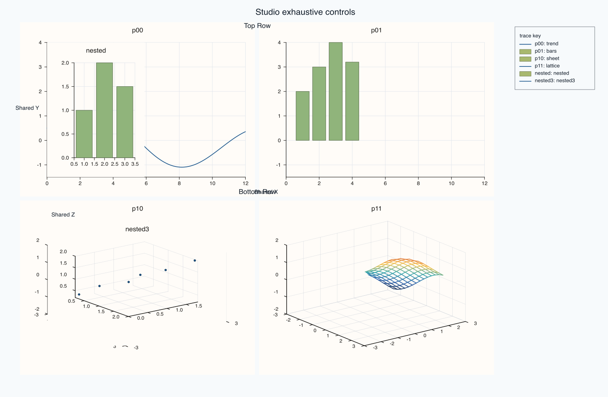

# PlussPl Object/State API

This page expands the low-level object model coverage for `Studio`, `Pane`, `Trace`, `Theme`, `PaletteRamp`, `Lens`, and `LightRig`.

All sections follow the same pattern used elsewhere:

- Signature
- Notes
- Example
- Output

The examples are pulled from the exhaustive runnable capture block in:

`PlussPl/examples/docs/flash_api_capture_demo.cpp`

## Methods

### `PaletteRamp::name`

#### Signature

```cpp
const std::string& name(self: PaletteRamp) const;
```

#### Notes

Returns the palette name token (for example `ocean` or `thermal`).

#### Example

```{literalinclude} ../../examples/docs/snippets/methods/paletteramp__name.cpp
:language: cpp
```

#### Output

```{only} html

```

```{only} not html

```

### `PaletteRamp::stops`

#### Signature

```cpp
const std::vector<Rgba>& stops(self: PaletteRamp) const;
```

#### Notes

Returns the color stops used by interpolation.

#### Example

```{literalinclude} ../../examples/docs/snippets/methods/paletteramp__stops.cpp
:language: cpp
```

#### Output

```{only} html

```

```{only} not html

```

### `PaletteRamp::empty`

#### Signature

```cpp
bool empty(self: PaletteRamp) const;
```

#### Notes

Checks whether the palette has no stops.

#### Example

```{literalinclude} ../../examples/docs/snippets/methods/paletteramp__empty.cpp
:language: cpp
```

#### Output

```{only} html

```

```{only} not html

```

### `PaletteRamp::sample`

#### Signature

```cpp
Rgba sample(self: PaletteRamp, position: double) const;
```

#### Notes

Samples a color at normalized position `position` in `[0, 1]`.

#### Example

```{literalinclude} ../../examples/docs/snippets/methods/paletteramp__sample.cpp
:language: cpp
```

#### Output

```{only} html

```

```{only} not html

```

### `PaletteRamp::neutral`

#### Signature

```cpp
static PaletteRamp neutral();
```

#### Notes

Builds the neutral grayscale-like palette.

#### Example

```{literalinclude} ../../examples/docs/snippets/methods/paletteramp__neutral.cpp
:language: cpp
```

#### Output

```{only} html

```

```{only} not html

```

### `PaletteRamp::thermal`

#### Signature

```cpp
static PaletteRamp thermal();
```

#### Notes

Builds the thermal warm-cool palette.

#### Example

```{literalinclude} ../../examples/docs/snippets/methods/paletteramp__thermal.cpp
:language: cpp
```

#### Output

```{only} html

```

```{only} not html

```

### `PaletteRamp::lagoon`

#### Signature

```cpp
static PaletteRamp lagoon();
```

#### Notes

Builds a teal/cyan-focused palette.

#### Example

```{literalinclude} ../../examples/docs/snippets/methods/paletteramp__lagoon.cpp
:language: cpp
```

#### Output

```{only} html

```

```{only} not html

```

### `PaletteRamp::ocean`

#### Signature

```cpp
static PaletteRamp ocean();
```

#### Notes

Builds the ocean palette used by several defaults.

#### Example

```{literalinclude} ../../examples/docs/snippets/methods/paletteramp__ocean.cpp
:language: cpp
```

#### Output

```{only} html

```

```{only} not html

```

### `PaletteRamp::meadow`

#### Signature

```cpp
static PaletteRamp meadow();
```

#### Notes

Builds the green-forward meadow palette.

#### Example

```{literalinclude} ../../examples/docs/snippets/methods/paletteramp__meadow.cpp
:language: cpp
```

#### Output

```{only} html

```

```{only} not html

```

### `Theme::name`

#### Signature

```cpp
const std::string& name(self: Theme) const;
```

#### Notes

Returns the theme name token.

#### Example

```{literalinclude} ../../examples/docs/snippets/methods/theme__name.cpp
:language: cpp
```

#### Output

```{only} html

```

```{only} not html

```

### `Theme::accents`

#### Signature

```cpp
const std::vector<Rgba>& accents(self: Theme) const;
```

#### Notes

Returns the accent color sequence used for trace cycling.

#### Example

```{literalinclude} ../../examples/docs/snippets/methods/theme__accents.cpp
:language: cpp
```

#### Output

```{only} html

```

```{only} not html

```

### `Theme::background`

#### Signature

```cpp
const Rgba& background(self: Theme) const;
```

#### Notes

Returns the figure/pane background color.

#### Example

```{literalinclude} ../../examples/docs/snippets/methods/theme__background.cpp
:language: cpp
```

#### Output

```{only} html

```

```{only} not html

```

### `Theme::foreground`

#### Signature

```cpp
const Rgba& foreground(self: Theme) const;
```

#### Notes

Returns the primary text/foreground color.

#### Example

```{literalinclude} ../../examples/docs/snippets/methods/theme__foreground.cpp
:language: cpp
```

#### Output

```{only} html

```

```{only} not html

```

### `Theme::surface_palette`

#### Signature

```cpp
const PaletteRamp& surface_palette(self: Theme) const;
```

#### Notes

Returns the default continuous palette for surfaces and fields.

#### Example

```{literalinclude} ../../examples/docs/snippets/methods/theme__surface_palette.cpp
:language: cpp
```

#### Output

```{only} html

```

```{only} not html

```

### `Theme::accent`

#### Signature

```cpp
Rgba accent(self: Theme, index: std::size_t) const;
```

#### Notes

Returns one accent color by index (cycled internally).

#### Example

```{literalinclude} ../../examples/docs/snippets/methods/theme__accent.cpp
:language: cpp
```

#### Output

```{only} html

```

```{only} not html

```

### `Theme::ocean`

#### Signature

```cpp
static Theme ocean();
```

#### Notes

Creates the built-in ocean theme preset.

#### Example

```{literalinclude} ../../examples/docs/snippets/methods/theme__ocean.cpp
:language: cpp
```

#### Output

```{only} html

```

```{only} not html

```

### `Theme::paper`

#### Signature

```cpp
static Theme paper();
```

#### Notes

Creates the built-in paper/light theme preset.

#### Example

```{literalinclude} ../../examples/docs/snippets/methods/theme__paper.cpp
:language: cpp
```

#### Output

```{only} html

```

```{only} not html

```

### `Lens::azimuth_deg`

#### Signature

```cpp
double azimuth_deg(self: Lens) const;
```

#### Notes

Reads current azimuth camera angle in degrees.

#### Example

```{literalinclude} ../../examples/docs/snippets/methods/lens__azimuth_deg.cpp
:language: cpp
```

#### Output

```{only} html

```

```{only} not html

```

### `Lens::elevation_deg`

#### Signature

```cpp
double elevation_deg(self: Lens) const;
```

#### Notes

Reads current elevation camera angle in degrees.

#### Example

```{literalinclude} ../../examples/docs/snippets/methods/lens__elevation_deg.cpp
:language: cpp
```

#### Output

```{only} html

```

```{only} not html

```

### `Lens::view_angle_deg`

#### Signature

```cpp
double view_angle_deg(self: Lens) const;
```

#### Notes

Reads current field-of-view angle in degrees.

#### Example

```{literalinclude} ../../examples/docs/snippets/methods/lens__view_angle_deg.cpp
:language: cpp
```

#### Output

```{only} html

```

```{only} not html

```

### `Lens::projection`

#### Signature

```cpp
ProjectionKind projection(self: Lens) const;
```

#### Notes

Reads current projection model (perspective or orthographic).

#### Example

```{literalinclude} ../../examples/docs/snippets/methods/lens__projection.cpp
:language: cpp
```

#### Output

```{only} html

```

```{only} not html

```

### `Lens::target`

#### Signature

```cpp
const Vec3d& target(self: Lens) const;
```

#### Notes

Reads current camera target point.

#### Example

```{literalinclude} ../../examples/docs/snippets/methods/lens__target.cpp
:language: cpp
```

#### Output

```{only} html

```

```{only} not html

```

### `Lens::up_vector`

#### Signature

```cpp
const Vec3d& up_vector(self: Lens) const;
```

#### Notes

Reads camera up-vector.

#### Example

```{literalinclude} ../../examples/docs/snippets/methods/lens__up_vector.cpp
:language: cpp
```

#### Output

```{only} html

```

```{only} not html

```

### `Lens::look`

#### Signature

```cpp
Lens& look(self: Lens, azimuth_deg: double, elevation_deg: double);
```

#### Notes

Sets camera orientation using absolute azimuth/elevation.

#### Example

```{literalinclude} ../../examples/docs/snippets/methods/lens__look.cpp
:language: cpp
```

#### Output

```{only} html

```

```{only} not html

```

### `Lens::spin`

#### Signature

```cpp
Lens& spin(self: Lens, delta_azimuth_deg: double, delta_elevation_deg: double);
```

#### Notes

Applies incremental camera rotation.

#### Example

```{literalinclude} ../../examples/docs/snippets/methods/lens__spin.cpp
:language: cpp
```

#### Output

```{only} html

```

```{only} not html

```

### `Lens::target_at`

#### Signature

```cpp
Lens& target_at(self: Lens, target: Vec3d);
```

#### Notes

Sets camera target point.

#### Example

```{literalinclude} ../../examples/docs/snippets/methods/lens__target_at.cpp
:language: cpp
```

#### Output

```{only} html

```

```{only} not html

```

### `Lens::up`

#### Signature

```cpp
Lens& up(self: Lens, up_vector: Vec3d);
```

#### Notes

Sets camera up-vector.

#### Example

```{literalinclude} ../../examples/docs/snippets/methods/lens__up.cpp
:language: cpp
```

#### Output

```{only} html

```

```{only} not html

```

### `Lens::project`

#### Signature

```cpp
Lens& project(self: Lens, projection: ProjectionKind);
```

#### Notes

Chooses projection mode.

#### Example

```{literalinclude} ../../examples/docs/snippets/methods/lens__project.cpp
:language: cpp
```

#### Output

```{only} html

```

```{only} not html

```

### `Lens::view_angle`

#### Signature

```cpp
Lens& view_angle(self: Lens, degrees: double);
```

#### Notes

Sets field-of-view angle in degrees.

#### Example

```{literalinclude} ../../examples/docs/snippets/methods/lens__view_angle.cpp
:language: cpp
```

#### Output

```{only} html

```

```{only} not html

```

### `Lens::planar`

#### Signature

```cpp
static Lens planar();
```

#### Notes

Returns a lens preset suited for planar scenes.

#### Example

```{literalinclude} ../../examples/docs/snippets/methods/lens__planar.cpp
:language: cpp
```

#### Output

```{only} html

```

```{only} not html

```

### `Lens::spatial`

#### Signature

```cpp
static Lens spatial();
```

#### Notes

Returns a lens preset suited for volumetric/3D scenes.

#### Example

```{literalinclude} ../../examples/docs/snippets/methods/lens__spatial.cpp
:language: cpp
```

#### Output

```{only} html

```

```{only} not html

```

### `LightRig::lights`

#### Signature

```cpp
const std::vector<LightSpec>& lights(self: LightRig) const;
```

#### Notes

Returns configured light sources.

#### Example

```{literalinclude} ../../examples/docs/snippets/methods/lightrig__lights.cpp
:language: cpp
```

#### Output

```{only} html

```

```{only} not html

```

### `LightRig::empty`

#### Signature

```cpp
bool empty(self: LightRig) const;
```

#### Notes

Checks whether any lights are configured.

#### Example

```{literalinclude} ../../examples/docs/snippets/methods/lightrig__empty.cpp
:language: cpp
```

#### Output

```{only} html

```

```{only} not html

```

### `LightRig::clear`

#### Signature

```cpp
LightRig& clear(self: LightRig);
```

#### Notes

Removes all configured lights.

#### Example

```{literalinclude} ../../examples/docs/snippets/methods/lightrig__clear.cpp
:language: cpp
```

#### Output

```{only} html

```

```{only} not html

```

### `LightRig::add`

#### Signature

```cpp
LightRig& add(self: LightRig, light: LightSpec);
```

#### Notes

Appends a custom light specification.

#### Example

```{literalinclude} ../../examples/docs/snippets/methods/lightrig__add.cpp
:language: cpp
```

#### Output

```{only} html

```

```{only} not html

```

### `LightRig::headlight`

#### Signature

```cpp
LightRig& headlight(self: LightRig);
```

#### Notes

Adds a camera-facing key light preset.

#### Example

```{literalinclude} ../../examples/docs/snippets/methods/lightrig__headlight.cpp
:language: cpp
```

#### Output

```{only} html

```

```{only} not html

```

### `LightRig::lamp_right`

#### Signature

```cpp
LightRig& lamp_right(self: LightRig);
```

#### Notes

Adds a right-side fill light preset.

#### Example

```{literalinclude} ../../examples/docs/snippets/methods/lightrig__lamp_right.cpp
:language: cpp
```

#### Output

```{only} html

```

```{only} not html

```

### `LightRig::lamp_left`

#### Signature

```cpp
LightRig& lamp_left(self: LightRig);
```

#### Notes

Adds a left-side fill light preset.

#### Example

```{literalinclude} ../../examples/docs/snippets/methods/lightrig__lamp_left.cpp
:language: cpp
```

#### Output

```{only} html

```

```{only} not html

```

### `LightRig::sun_key`

#### Signature

```cpp
LightRig& sun_key(self: LightRig);
```

#### Notes

Adds a top/key directional light preset.

#### Example

```{literalinclude} ../../examples/docs/snippets/methods/lightrig__sun_key.cpp
:language: cpp
```

#### Output

```{only} html

```

```{only} not html

```

### `Studio::name`

#### Signature

```cpp
const std::string& name(self: Studio) const;
```

#### Notes

Returns the studio identifier used for exported artifacts.

#### Example

```{literalinclude} ../../examples/docs/snippets/methods/studio__name.cpp
:language: cpp
```

#### Output

```{only} html

```

```{only} not html

```

### `Studio::headline_text`

#### Signature

```cpp
const std::string& headline_text(self: Studio) const;
```

#### Notes

Returns the figure headline/title string.

#### Example

```{literalinclude} ../../examples/docs/snippets/methods/studio__headline_text.cpp
:language: cpp
```

#### Output

```{only} html

```

```{only} not html

```

### `Studio::theme_tokens`

#### Signature

```cpp
const Theme& theme_tokens(self: Studio) const;
```

#### Notes

Returns the active theme object.

#### Example

```{literalinclude} ../../examples/docs/snippets/methods/studio__theme_tokens.cpp
:language: cpp
```

#### Output

```{only} html

```

```{only} not html

```

### `Studio::panes`

#### Signature

```cpp
const std::vector<Pane>& panes(self: Studio) const;
```

#### Notes

Returns all panes currently attached to the figure.

#### Example

```{literalinclude} ../../examples/docs/snippets/methods/studio__panes.cpp
:language: cpp
```

#### Output

```{only} html

```

```{only} not html

```

### `Studio::pane_count`

#### Signature

```cpp
std::size_t pane_count(self: Studio) const;
```

#### Notes

Returns number of panes in the figure.

#### Example

```{literalinclude} ../../examples/docs/snippets/methods/studio__pane_count.cpp
:language: cpp
```

#### Output

```{only} html

```

```{only} not html

```

### `Studio::extent`

#### Signature

```cpp
const Extent2d& extent(self: Studio) const;
```

#### Notes

Returns figure width/height in rendering units.

#### Example

```{literalinclude} ../../examples/docs/snippets/methods/studio__extent.cpp
:language: cpp
```

#### Output

```{only} html

```

```{only} not html

```

### `Studio::mosaic_layout`

#### Signature

```cpp
const MosaicLayout& mosaic_layout(self: Studio) const;
```

#### Notes

Returns current mosaic grid layout metadata.

#### Example

```{literalinclude} ../../examples/docs/snippets/methods/studio__mosaic_layout.cpp
:language: cpp
```

#### Output

```{only} html

```

```{only} not html

```

### `Studio::tight_layout_enabled`

#### Signature

```cpp
bool tight_layout_enabled(self: Studio) const;
```

#### Notes

Reads whether tight layout packing is enabled.

#### Example

```{literalinclude} ../../examples/docs/snippets/methods/studio__tight_layout_enabled.cpp
:language: cpp
```

#### Output

```{only} html

```

```{only} not html

```

### `Studio::tight_layout_padding`

#### Signature

```cpp
double tight_layout_padding(self: Studio) const;
```

#### Notes

Reads tight-layout padding.

#### Example

```{literalinclude} ../../examples/docs/snippets/methods/studio__tight_layout_padding.cpp
:language: cpp
```

#### Output

```{only} html

```

```{only} not html

```

### `Studio::default_tick_font_scale`

#### Signature

```cpp
double default_tick_font_scale(self: Studio) const;
```

#### Notes

Reads default tick font scale applied to panes.

#### Example

```{literalinclude} ../../examples/docs/snippets/methods/studio__default_tick_font_scale.cpp
:language: cpp
```

#### Output

```{only} html

```

```{only} not html

```

### `Studio::default_axis_label_font_scale`

#### Signature

```cpp
double default_axis_label_font_scale(self: Studio) const;
```

#### Notes

Reads default axis-label font scale applied to panes.

#### Example

```{literalinclude} ../../examples/docs/snippets/methods/studio__default_axis_label_font_scale.cpp
:language: cpp
```

#### Output

```{only} html

```

```{only} not html

```

### `Studio::legend_dock`

#### Signature

```cpp
KeyDock legend_dock(self: Studio) const;
```

#### Notes

Reads legend docking configuration at figure level.

#### Example

```{literalinclude} ../../examples/docs/snippets/methods/studio__legend_dock.cpp
:language: cpp
```

#### Output

```{only} html

```

```{only} not html

```

### `Studio::x_captions`

#### Signature

```cpp
const std::map<std::string, std::string>& x_captions(self: Studio) const;
```

#### Notes

Reads stored shared-X caption map.

#### Example

```{literalinclude} ../../examples/docs/snippets/methods/studio__x_captions.cpp
:language: cpp
```

#### Output

```{only} html

```

```{only} not html

```

### `Studio::y_captions`

#### Signature

```cpp
const std::map<std::string, std::string>& y_captions(self: Studio) const;
```

#### Notes

Reads stored shared-Y caption map.

#### Example

```{literalinclude} ../../examples/docs/snippets/methods/studio__y_captions.cpp
:language: cpp
```

#### Output

```{only} html

```

```{only} not html

```

### `Studio::z_captions`

#### Signature

```cpp
const std::map<std::string, std::string>& z_captions(self: Studio) const;
```

#### Notes

Reads stored shared-Z caption map.

#### Example

```{literalinclude} ../../examples/docs/snippets/methods/studio__z_captions.cpp
:language: cpp
```

#### Output

```{only} html

```

```{only} not html

```

### `Studio::row_titles`

#### Signature

```cpp
const std::map<std::int64_t, std::string>& row_titles(self: Studio) const;
```

#### Notes

Reads row-title labels currently configured for the mosaic.

#### Example

```{literalinclude} ../../examples/docs/snippets/methods/studio__row_titles.cpp
:language: cpp
```

#### Output

```{only} html

```

```{only} not html

```

### `Studio::mosaic`

#### Signature

```cpp
Studio& mosaic(self: Studio, rows: int64_t, cols: int64_t, gutter_x: double = 18.0, gutter_y: double = 18.0);
```

#### Notes

Defines or redefines figure mosaic layout.

#### Example

```{literalinclude} ../../examples/docs/snippets/methods/studio__mosaic.cpp
:language: cpp
```

#### Output

```{only} html

```

```{only} not html

```

### `Studio::row_title`

#### Signature

```cpp
Studio& row_title(self: Studio, row: int64_t, text: std::string);
```

#### Notes

Sets a per-row title in the mosaic.

#### Example

```{literalinclude} ../../examples/docs/snippets/methods/studio__row_title.cpp
:language: cpp
```

#### Output

```{only} html

```

```{only} not html

```

### `Studio::pane_index`

#### Signature

```cpp
std::size_t pane_index(self: Studio, pane: const Pane&) const;
```

#### Notes

Returns the index of a pane in the studio pane list.

#### Example

```{literalinclude} ../../examples/docs/snippets/methods/studio__pane_index.cpp
:language: cpp
```

#### Output

```{only} html

```

```{only} not html

```

### `Pane::kind`

#### Signature

```cpp
PaneKind kind(self: Pane) const;
```

#### Notes

Returns whether pane is planar or volumetric.

#### Example

```{literalinclude} ../../examples/docs/snippets/methods/pane__kind.cpp
:language: cpp
```

#### Output

```{only} html

```

```{only} not html

```

### `Pane::title_text`

#### Signature

```cpp
const std::string& title_text(self: Pane) const;
```

#### Notes

Returns pane title text.

#### Example

```{literalinclude} ../../examples/docs/snippets/methods/pane__title_text.cpp
:language: cpp
```

#### Output

```{only} html

```

```{only} not html

```

### `Pane::theme_tokens`

#### Signature

```cpp
const Theme& theme_tokens(self: Pane) const;
```

#### Notes

Returns pane theme snapshot.

#### Example

```{literalinclude} ../../examples/docs/snippets/methods/pane__theme_tokens.cpp
:language: cpp
```

#### Output

```{only} html

```

```{only} not html

```

### `Pane::x_axis`

#### Signature

```cpp
const AxisState& x_axis(self: Pane) const;
```

#### Notes

Returns current X-axis state object.

#### Example

```{literalinclude} ../../examples/docs/snippets/methods/pane__x_axis.cpp
:language: cpp
```

#### Output

```{only} html

```

```{only} not html

```

### `Pane::y_axis`

#### Signature

```cpp
const AxisState& y_axis(self: Pane) const;
```

#### Notes

Returns current Y-axis state object.

#### Example

```{literalinclude} ../../examples/docs/snippets/methods/pane__y_axis.cpp
:language: cpp
```

#### Output

```{only} html

```

```{only} not html

```

### `Pane::z_axis`

#### Signature

```cpp
const AxisState& z_axis(self: Pane) const;
```

#### Notes

Returns current Z-axis state object.

#### Example

```{literalinclude} ../../examples/docs/snippets/methods/pane__z_axis.cpp
:language: cpp
```

#### Output

```{only} html

```

```{only} not html

```

### `Pane::color_axis`

#### Signature

```cpp
const AxisState& color_axis(self: Pane) const;
```

#### Notes

Returns current color-axis state object.

#### Example

```{literalinclude} ../../examples/docs/snippets/methods/pane__color_axis.cpp
:language: cpp
```

#### Output

```{only} html

```

```{only} not html

```

### `Pane::legend_place`

#### Signature

```cpp
KeyPlace legend_place(self: Pane) const;
```

#### Notes

Returns pane legend placement.

#### Example

```{literalinclude} ../../examples/docs/snippets/methods/pane__legend_place.cpp
:language: cpp
```

#### Output

```{only} html

```

```{only} not html

```

### `Pane::grid_style`

#### Signature

```cpp
GridStyle grid_style(self: Pane) const;
```

#### Notes

Returns grid style mode.

#### Example

```{literalinclude} ../../examples/docs/snippets/methods/pane__grid_style.cpp
:language: cpp
```

#### Output

```{only} html

```

```{only} not html

```

### `Pane::lens`

#### Signature

```cpp
const Lens& lens(self: Pane) const;
```

#### Notes

Returns pane camera/lens state (for 3D panes).

#### Example

```{literalinclude} ../../examples/docs/snippets/methods/pane__lens.cpp
:language: cpp
```

#### Output

```{only} html

```

```{only} not html

```

### `Pane::lights`

#### Signature

```cpp
const LightRig& lights(self: Pane) const;
```

#### Notes

Returns pane lighting rig state.

#### Example

```{literalinclude} ../../examples/docs/snippets/methods/pane__lights.cpp
:language: cpp
```

#### Output

```{only} html

```

```{only} not html

```

### `Pane::traces`

#### Signature

```cpp
const std::vector<Trace>& traces(self: Pane) const;
```

#### Notes

Returns traces currently attached to pane.

#### Example

```{literalinclude} ../../examples/docs/snippets/methods/pane__traces.cpp
:language: cpp
```

#### Output

```{only} html

```

```{only} not html

```

### `Pane::trace_count`

#### Signature

```cpp
std::size_t trace_count(self: Pane) const;
```

#### Notes

Returns number of traces in pane.

#### Example

```{literalinclude} ../../examples/docs/snippets/methods/pane__trace_count.cpp
:language: cpp
```

#### Output

```{only} html

```

```{only} not html

```

### `Pane::scale_guide_enabled`

#### Signature

```cpp
bool scale_guide_enabled(self: Pane) const;
```

#### Notes

Returns whether color-scale guide is enabled.

#### Example

```{literalinclude} ../../examples/docs/snippets/methods/pane__scale_guide_enabled.cpp
:language: cpp
```

#### Output

```{only} html

```

```{only} not html

```

### `Pane::caption_text`

#### Signature

```cpp
const std::string& caption_text(self: Pane) const;
```

#### Notes

Returns pane caption text.

#### Example

```{literalinclude} ../../examples/docs/snippets/methods/pane__caption_text.cpp
:language: cpp
```

#### Output

```{only} html

```

```{only} not html

```

### `Pane::rules`

#### Signature

```cpp
const std::vector<RuleCue>& rules(self: Pane) const;
```

#### Notes

Returns rule overlays configured on pane.

#### Example

```{literalinclude} ../../examples/docs/snippets/methods/pane__rules.cpp
:language: cpp
```

#### Output

```{only} html

```

```{only} not html

```

### `Pane::bands`

#### Signature

```cpp
const std::vector<BandCue>& bands(self: Pane) const;
```

#### Notes

Returns band overlays configured on pane.

#### Example

```{literalinclude} ../../examples/docs/snippets/methods/pane__bands.cpp
:language: cpp
```

#### Output

```{only} html

```

```{only} not html

```

### `Pane::pins`

#### Signature

```cpp
const std::vector<PinCue>& pins(self: Pane) const;
```

#### Notes

Returns annotation pins configured on pane.

#### Example

```{literalinclude} ../../examples/docs/snippets/methods/pane__pins.cpp
:language: cpp
```

#### Output

```{only} html

```

```{only} not html

```

### `Pane::x_align_group`

#### Signature

```cpp
const std::string& x_align_group(self: Pane) const;
```

#### Notes

Returns X alignment group key.

#### Example

```{literalinclude} ../../examples/docs/snippets/methods/pane__x_align_group.cpp
:language: cpp
```

#### Output

```{only} html

```

```{only} not html

```

### `Pane::y_align_group`

#### Signature

```cpp
const std::string& y_align_group(self: Pane) const;
```

#### Notes

Returns Y alignment group key.

#### Example

```{literalinclude} ../../examples/docs/snippets/methods/pane__y_align_group.cpp
:language: cpp
```

#### Output

```{only} html

```

```{only} not html

```

### `Pane::z_align_group`

#### Signature

```cpp
const std::string& z_align_group(self: Pane) const;
```

#### Notes

Returns Z alignment group key.

#### Example

```{literalinclude} ../../examples/docs/snippets/methods/pane__z_align_group.cpp
:language: cpp
```

#### Output

```{only} html

```

```{only} not html

```

### `Pane::placement`

#### Signature

```cpp
const PanePlacement& placement(self: Pane) const;
```

#### Notes

Returns pane placement coordinates/spans in mosaic.

#### Example

```{literalinclude} ../../examples/docs/snippets/methods/pane__placement.cpp
:language: cpp
```

#### Output

```{only} html

```

```{only} not html

```

### `Pane::visible`

#### Signature

```cpp
bool visible(self: Pane) const;
```

#### Notes

Returns pane visibility state.

#### Example

```{literalinclude} ../../examples/docs/snippets/methods/pane__visible.cpp
:language: cpp
```

#### Output

```{only} html

```

```{only} not html

```

### `Trace::kind`

#### Signature

```cpp
TraceKind kind(self: Trace) const;
```

#### Notes

Returns the low-level trace kind enum.

#### Example

```{literalinclude} ../../examples/docs/snippets/methods/trace__kind.cpp
:language: cpp
```

#### Output

```{only} html

```

```{only} not html

```

### `Trace::payload`

#### Signature

```cpp
const TracePayload& payload(self: Trace) const;
```

#### Notes

Returns payload variant storing trace data vectors/fields.

#### Example

```{literalinclude} ../../examples/docs/snippets/methods/trace__payload.cpp
:language: cpp
```

#### Output

```{only} html

```

```{only} not html

```

### `Trace::label_text`

#### Signature

```cpp
const std::string& label_text(self: Trace) const;
```

#### Notes

Returns legend label text currently attached to trace.

#### Example

```{literalinclude} ../../examples/docs/snippets/methods/trace__label_text.cpp
:language: cpp
```

#### Output

```{only} html

```

```{only} not html

```

### `Trace::stroke_width`

#### Signature

```cpp
float stroke_width(self: Trace) const;
```

#### Notes

Returns current stroke width.

#### Example

```{literalinclude} ../../examples/docs/snippets/methods/trace__stroke_width.cpp
:language: cpp
```

#### Output

```{only} html

```

```{only} not html

```

### `Trace::stroke_color`

#### Signature

```cpp
const Rgba& stroke_color(self: Trace) const;
```

#### Notes

Returns current stroke color.

#### Example

```{literalinclude} ../../examples/docs/snippets/methods/trace__stroke_color.cpp
:language: cpp
```

#### Output

```{only} html

```

```{only} not html

```

### `Trace::palette_ramp`

#### Signature

```cpp
const PaletteRamp& palette_ramp(self: Trace) const;
```

#### Notes

Returns palette used for scalar-mapped rendering.

#### Example

```{literalinclude} ../../examples/docs/snippets/methods/trace__palette_ramp.cpp
:language: cpp
```

#### Output

```{only} html

```

```{only} not html

```

### `Trace::shade_mode`

#### Signature

```cpp
ShadeMode shade_mode(self: Trace) const;
```

#### Notes

Returns surface shading mode.

#### Example

```{literalinclude} ../../examples/docs/snippets/methods/trace__shade_mode.cpp
:language: cpp
```

#### Output

```{only} html

```

```{only} not html

```

### `Trace::lighting_mode`

#### Signature

```cpp
LightingMode lighting_mode(self: Trace) const;
```

#### Notes

Returns lighting algorithm mode.

#### Example

```{literalinclude} ../../examples/docs/snippets/methods/trace__lighting_mode.cpp
:language: cpp
```

#### Output

```{only} html

```

```{only} not html

```

### `Trace::material_profile`

#### Signature

```cpp
MaterialProfile material_profile(self: Trace) const;
```

#### Notes

Returns active material profile.

#### Example

```{literalinclude} ../../examples/docs/snippets/methods/trace__material_profile.cpp
:language: cpp
```

#### Output

```{only} html

```

```{only} not html

```

### `Trace::visible`

#### Signature

```cpp
bool visible(self: Trace) const;
```

#### Notes

Returns trace visibility state.

#### Example

```{literalinclude} ../../examples/docs/snippets/methods/trace__visible.cpp
:language: cpp
```

#### Output

```{only} html

```

```{only} not html

```

### `Trace::label`

#### Signature

```cpp
Trace& label(self: Trace, label: std::string);
```

#### Notes

Sets legend/display label for the trace.

#### Example

```{literalinclude} ../../examples/docs/snippets/methods/trace__label.cpp
:language: cpp
```

#### Output

```{only} html

```

```{only} not html

```

### `Trace::shade`

#### Signature

```cpp
Trace& shade(self: Trace, mode: ShadeMode);
```

#### Notes

Sets trace shading mode.

#### Example

```{literalinclude} ../../examples/docs/snippets/methods/trace__shade.cpp
:language: cpp
```

#### Output

```{only} html

```

```{only} not html

```

### `Trace::hide`

#### Signature

```cpp
Trace& hide(self: Trace);
```

#### Notes

Hides a trace without removing it from pane state.

#### Example

```{literalinclude} ../../examples/docs/snippets/methods/trace__hide.cpp
:language: cpp
```

#### Output

```{only} html

```

```{only} not html

```

### `Pane::scale_x`

#### Signature

```cpp
Pane& scale_x(self: Pane, scale: ScalePolicy);
```

#### Notes

Sets the X-axis scaling policy (`linear`, `log10`, or `symlog`).

#### Example

```{literalinclude} ../../examples/docs/snippets/methods/pane__scale_x.cpp
:language: cpp
```

#### Output

```{only} html

```

```{only} not html

```

### `Pane::x_limits`

#### Signature

```cpp
Pane& x_limits(self: Pane, limits: Range1d);
```

#### Notes

Pins the visible X range to manual limits.

#### Example

```{literalinclude} ../../examples/docs/snippets/methods/pane__x_limits.cpp
:language: cpp
```

#### Output

```{only} html

```

```{only} not html

```

### `Pane::x_tick_format`

#### Signature

```cpp
Pane& x_tick_format(self: Pane, format: TickFormat);
```

#### Notes

Selects numeric formatting style for X tick labels.

#### Example

```{literalinclude} ../../examples/docs/snippets/methods/pane__x_tick_format.cpp
:language: cpp
```

#### Output

```{only} html

```

```{only} not html

```

### `Pane::x_tick_rotation`

#### Signature

```cpp
Pane& x_tick_rotation(self: Pane, degrees: double);
```

#### Notes

Rotates X tick labels to improve readability for dense or long labels.

#### Example

```{literalinclude} ../../examples/docs/snippets/methods/pane__x_tick_rotation.cpp
:language: cpp
```

#### Output

```{only} html

```

```{only} not html

```

### `Pane::x_ticks`

#### Signature

```cpp
Pane& x_ticks(self: Pane, positions: Series, labels: pluss::msharp::RangeView::Of<std::string_view>);
Pane& x_ticks(self: Pane, positions: Series, labels: std::initializer_list<std::string_view>);
```

#### Notes

Sets explicit X tick locations and labels.

#### Example

```{literalinclude} ../../examples/docs/snippets/methods/pane__x_ticks.cpp
:language: cpp
```

#### Output

```{only} html

```

```{only} not html

```

### `Pane::grid`

#### Signature

```cpp
Pane& grid(self: Pane, style: GridStyle);
```

#### Notes

Sets pane grid style (`None`, `Major`, `MajorMinor`).

#### Example

```{literalinclude} ../../examples/docs/snippets/methods/pane__grid.cpp
:language: cpp
```

#### Output

```{only} html

```

```{only} not html

```

### `Studio::to_svg`

#### Signature

```cpp
std::string to_svg(self: Studio) const;
```

#### Notes

Returns an in-memory SVG payload of the fully composed figure.

#### Example

```{literalinclude} ../../examples/docs/snippets/methods/studio__to_svg.cpp
:language: cpp
```

#### Output

```{only} html

```

```{only} not html

```

### `Studio::to_pdf`

#### Signature

```cpp
std::string to_pdf(self: Studio) const;
```

#### Notes

Returns an in-memory PDF payload of the fully composed figure.

#### Example

```{literalinclude} ../../examples/docs/snippets/methods/studio__to_pdf.cpp
:language: cpp
```

#### Output

```{only} html

```

```{only} not html

```
