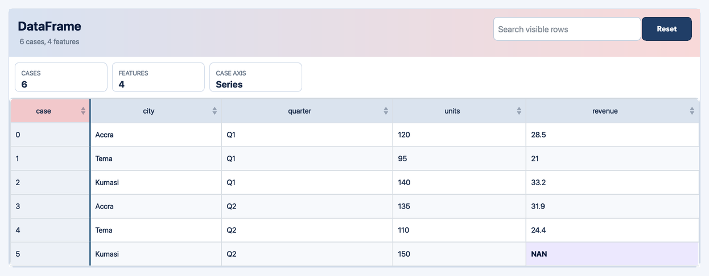
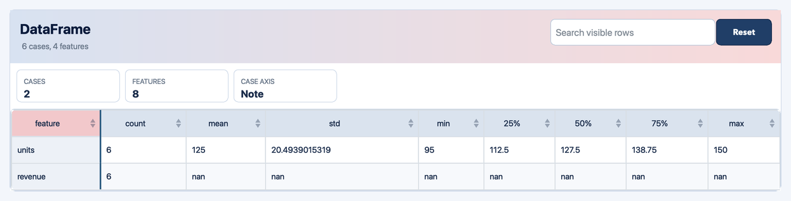
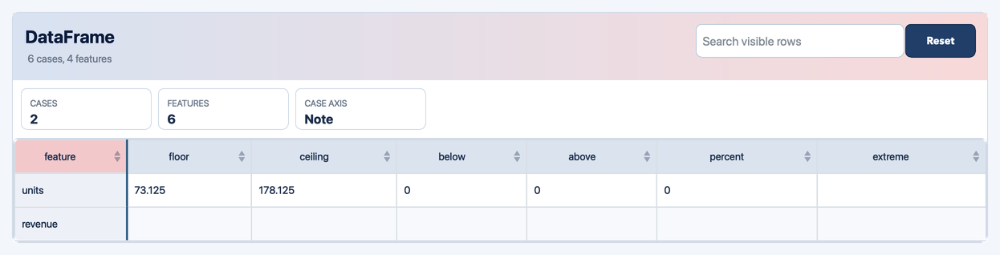
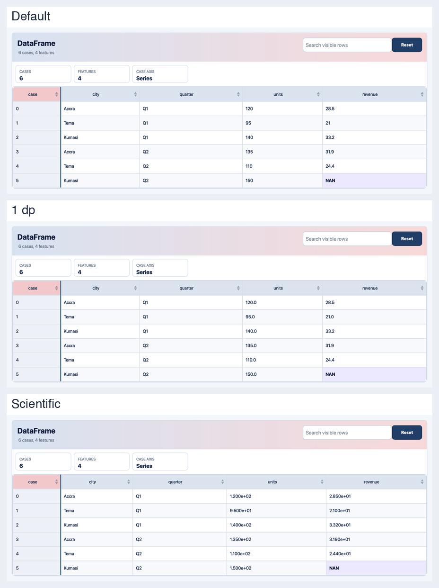
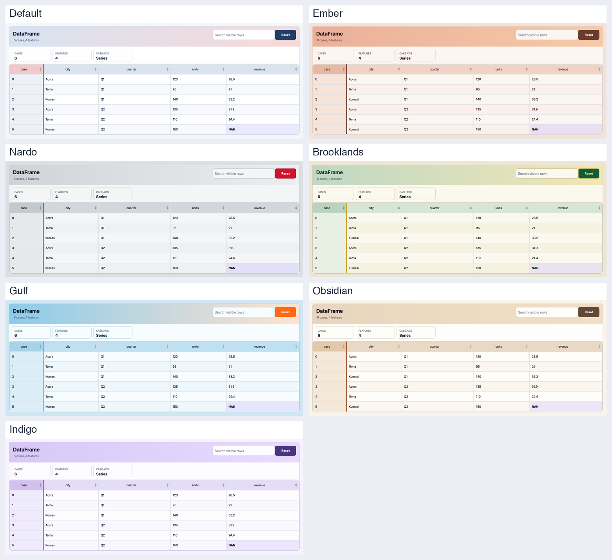
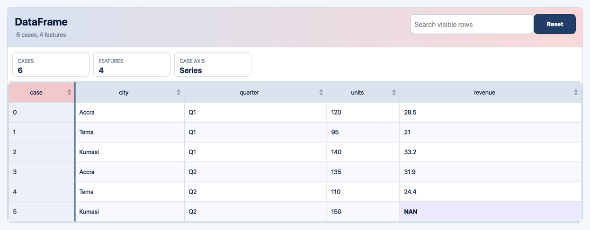

# PlussView: the window behind `.show()`

```{raw} html
<meta name="pluss-doc-kind" content="guide">
```

[Back to PlussTils](../index.md) · [PlussView reference](../api/view.md)

PlussView is a window, not a library you program. You never write code for it: you call `.show()` on the thing you want to look at, and PlussView opens a window that displays it. It works the same way on macOS, Windows and Linux. This guide walks through what the window shows and how to work with it. Every picture is the real window.

## Opening it

Call `.show()` with no arguments on a table, a stack of tables or a plot.

```cpp
#include <pluss/pluss.h>

#include <cmath>

int main() {
  using namespace pluss::table;

  auto sales = DataFrame({
      {"city", Shelf(pluss::make_note({"Accra", "Tema", "Kumasi", "Accra", "Tema", "Kumasi"}))},
      {"quarter", Shelf(pluss::make_note({"Q1", "Q1", "Q1", "Q2", "Q2", "Q2"}))},
      {"units", Shelf(pluss::make_series({120, 95, 140, 135, 110, 150}))},
      {"revenue", Shelf(pluss::make_series({28.5, 21.0, 33.2, 31.9, 24.4, std::nan("")}))},
  });

  sales.show();  // opens the PlussView window
}
```

The same call exists on `DataFrame`, `Atlas`, and on plots (`Studio` and the `flash` functions). Each type's own reference describes its `.show()` options.

## The table window

The window opens on the table. Above it are the frame's title, a search box that filters the visible rows with a Reset button, and three counters: cases, features and the case axis. The number that is not a number in the last row of `revenue` shows as `NAN` in a violet cell. The next section explains the colours.



The toolbar above the table has three menus: **Theme**, **View** and **Save As**. The sections below use each in turn.

### Missing, NaN and infinity

The window keeps three different things apart, each with its own background. Only a missing value is red-ish; the other two are values, so they are tinted without any alarm.

| Cell | Meaning | Background |
|---|---|---|
| `NULL` | no value was recorded | red-ish |
| `NAN` | a value that is not a number, such as `0 / 0` | violet |
| `INF`, `-INF` | an infinite value, such as `120 / 0` | blue |

This frame divides `spend` by `balance`. The fifth balance was never recorded, so its ratio is `NULL`. Rows 1, 3 and 6 divide by a zero balance and give NaN, infinity and negative infinity:


The frame is the accounts table from the PlussMic guide to missing values, NaN and infinity, which also explains how to find, drop and fill each kind.

### Views

Open the **View** menu and choose one of five views of the same frame.

| View | What it shows |
|---|---|
| Table | The cases and features as stored |
| Summary | One row per numeric feature: count, mean, standard deviation, minimum, quartiles and maximum |
| Correlation | The correlation between every pair of numeric features, shaded by strength |
| Validity | How many cells of each feature are null, NaN or infinite, as counts and percentages |
| Outliers | The floor and ceiling each numeric feature is expected to stay between, and how many values fall below or above |

Choose **Summary**:



Choose **Correlation**:


Choose **Validity**. The one NaN in `revenue` is counted, with its share of the column:


Choose **Outliers**:



### Number format

Inside the **View** menu, **Format** changes how the numbers are written: the default, a fixed number of decimals (0 to 4), thousands separators, or scientific notation. The pictures show the Table view with Default, then 1 dp, then Scientific.



### Themes

Open the **Theme** menu to restyle the window: Default, Ember, Nardo, Brooklands, Gulf, Obsidian or Indigo. A theme keeps the view and the number format you chose.



### Sorting and column widths

Each column header has two small stacked triangles. One sorts that column ascending and the other descending. Clicking elsewhere on the header does not sort.

Drag the border between two headers to resize the column to its left, or double-click the border to fit the column to its contents and double-click again to return it. Only that column changes. The last column has no border to drag: it is the table's automatic column, so it takes whatever room the others leave and the table always fills the window. Here the `units` column has been dragged narrower and `revenue` has taken the room:



Text that does not fit in its column is cut with an ellipsis. A number that does not fit shows `#` until the column is wide enough.

## The plot window

A plot opens in the same kind of window, with a **Theme** menu for the plot's look, a **Colors** menu for the palette, and buttons to zoom out, fit and zoom in.

```cpp
#include <pluss/pluss.h>

int main() {
  using namespace pluss::table;

  auto monthly = DataFrame({
      {"sales", Shelf(pluss::make_series({120.0, 135.0, 128.0, 150.0, 162.0, 171.0}))},
      {"forecast", Shelf(pluss::make_series({118.0, 130.0, 132.0, 147.0, 158.0, 168.0}))},
      {"month", Shelf(pluss::make_note({"Jan", "Feb", "Mar", "Apr", "May", "Jun"}))},
  });

  auto chart = monthly.plot().line({"sales", "forecast"});
  chart.headline("Sales and forecast");
  chart.show();
}
```


The plot themes are Original, Light grid, Dark grid, Sand, Midnight, Ocean, High contrast and Print (gray):


## Saving

Use **Save As** at the right of the toolbar. It saves what you are looking at and nothing else: the table from its column headers down, or the plot itself, with no scrollbars or window chrome.

| Showing | Save As formats |
|---|---|
| A table | PNG, PDF, CSV data, tab-delimited text, Excel workbook |
| A plot | PNG, PDF, SVG |

## What it is not

PlussView does not have an interface for building windows or drawing by hand. If you want a file and no window, use the type's own save methods.
