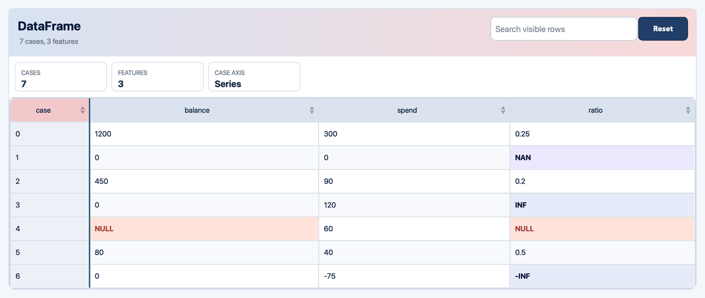
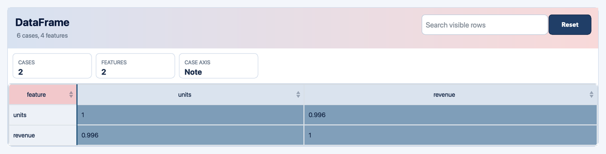
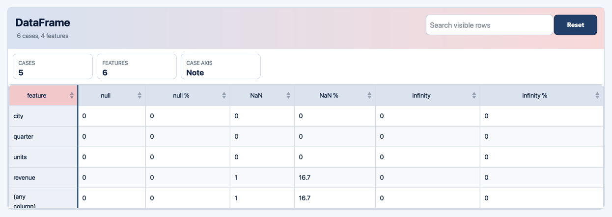
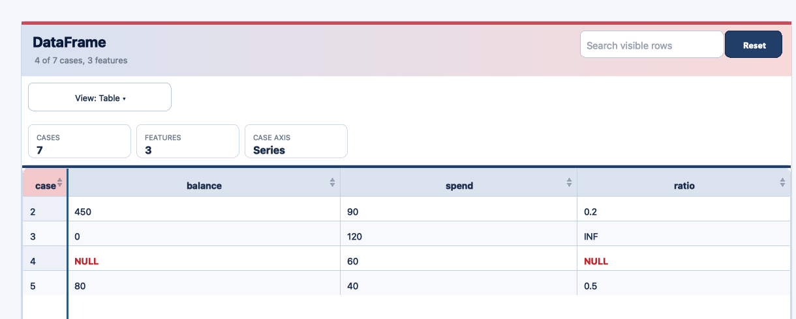
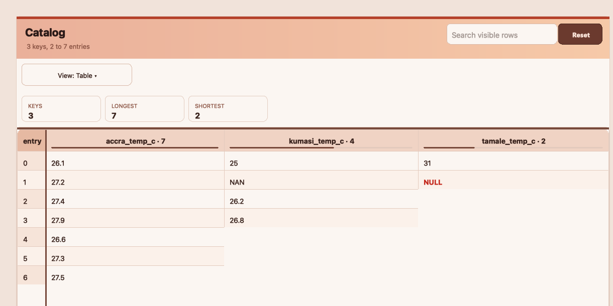
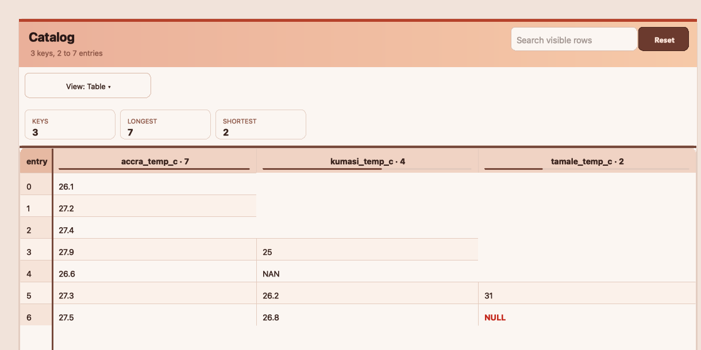
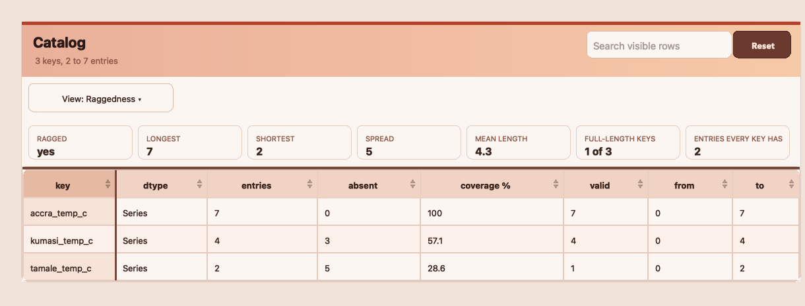
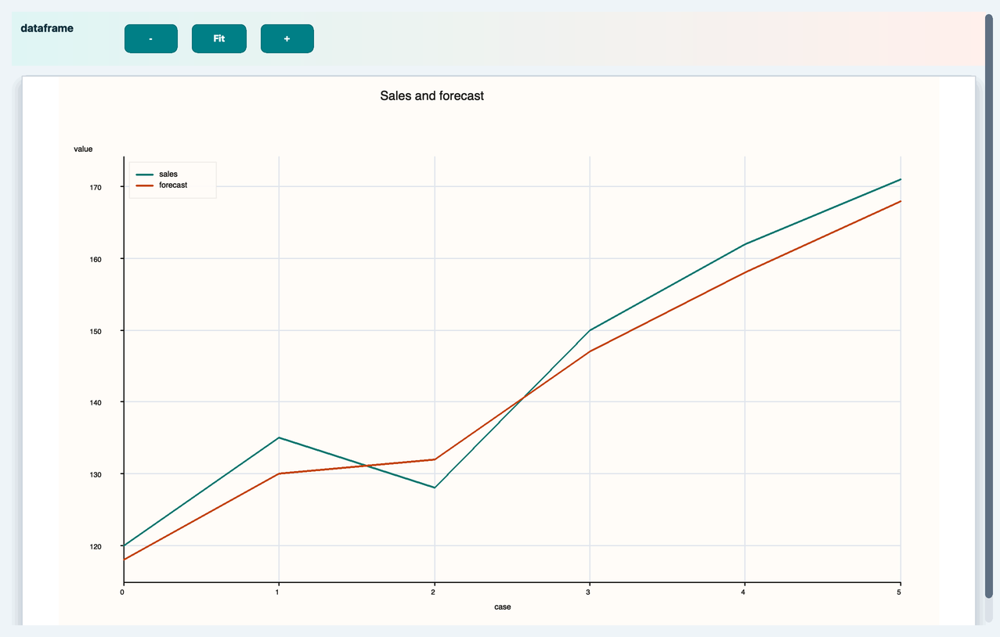
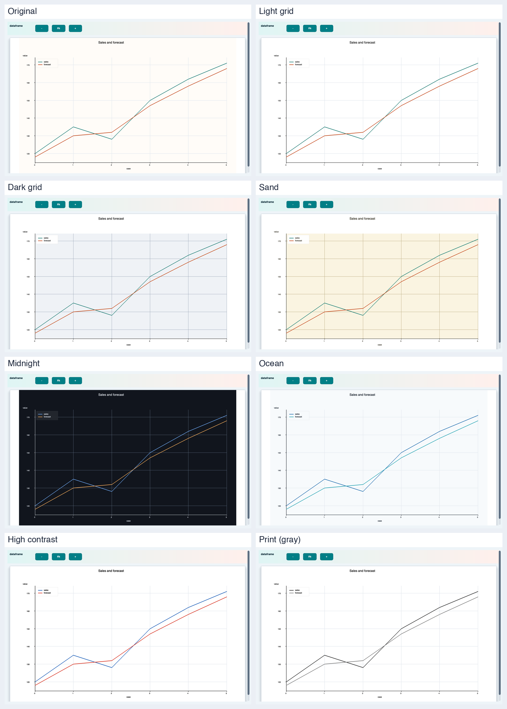

# PlussView: the window behind `.show()`

```{raw} html
<meta name="pluss-doc-kind" content="guide">
```

[Back to PlussTils](../index.md) · [PlussView reference](../api/view.md)

PlussView is a window, not a library you program. You never write code for it: you call `.show()` on the thing you want to look at, and PlussView opens a window that displays it. It works the same way on macOS, Windows and Linux. This guide walks through what the window shows and how to work with it. Every picture is the real window.

## Opening it

Call `.show()` with no arguments on a table, a stack of tables or a plot.

```cpp
#include <pluss/pluss.h>

#include <cmath>

int main() {
  using namespace pluss::table;

  auto sales = DataFrame({
      {"city", Shelf(pluss::make_note({"Accra", "Tema", "Kumasi", "Accra", "Tema", "Kumasi"}))},
      {"quarter", Shelf(pluss::make_note({"Q1", "Q1", "Q1", "Q2", "Q2", "Q2"}))},
      {"units", Shelf(pluss::make_series({120, 95, 140, 135, 110, 150}))},
      {"revenue", Shelf(pluss::make_series({28.5, 21.0, 33.2, 31.9, 24.4, std::nan("")}))},
  });

  sales.show();  // opens the PlussView window
}
```

The same call exists on `DataFrame`, `Atlas`, and on plots (`Studio` and the `flash` functions). Each type's own reference describes its `.show()` options.

## The table window

The window opens on the table. Above it are the frame's title, a search box that filters the visible rows with a Reset button, and three counters: cases, features and the case axis. The number that is not a number in the last row of `revenue` shows as `NAN`. The next section explains how missing values, NaN and infinity differ.


The toolbar above the table has three menus: **Theme**, **View** and **Save As**. The sections below use each in turn.

### Missing, NaN and infinity

The window keeps three different things apart. Only a missing value is marked: its text is bold and red. The other two are values, so they are drawn like any other value and nothing is painted behind them.

| Cell | Meaning | Look |
|---|---|---|
| `NULL` | no value was recorded | bold red text |
| `NAN` | a value that is not a number, such as `0 / 0` | like any value |
| `INF`, `-INF` | an infinite value, such as `120 / 0` | like any value |

This frame divides `spend` by `balance`. The fifth balance was never recorded, so its ratio is `NULL`. Rows 1, 3 and 6 divide by a zero balance and give NaN, infinity and negative infinity. To find them in a table of any size, use **View → Filter**, described below.



The frame is the accounts table from the PlussMic guide to missing values, NaN and infinity, which also explains how to find, drop and fill each kind.

### Views

Open the **View** menu and choose one of five views of the same frame.

| View | What it shows |
|---|---|
| Table | The cases and features as stored |
| Summary | One row per numeric feature: count, mean, standard deviation, minimum, quartiles and maximum |
| Correlation | The correlation between every pair of numeric features, shaded by strength |
| Validity | How many cells of each feature are null, NaN or infinite, as counts and percentages |
| Outliers | The floor and ceiling each numeric feature is expected to stay between, and how many values fall below or above |

Choose **Summary**:


Choose **Correlation**:



Choose **Validity**. The one NaN in `revenue` is counted, with its share of the column:



Choose **Outliers**:


### Filter

**View → Filter** keeps only the rows that hold a kind of cell you are looking for.

| Entry | Keeps the rows where some cell is |
|---|---|
| Invalid | NULL, NaN or infinite |
| Null | NULL |
| NaN | NaN |
| Inf | infinite, positive or negative |

The decision is made on what each cell is, never on its text, so a name such as `Nancy` is not mistaken for a NaN and the text `NULL` in a text column is not a missing value. The subtitle shows how many rows remain ("3 of 24 cases"). Choose the same entry again, or the Table view, to bring every row back. A filter works the same on a table of five rows and one of five million.

The picture shows the accounts frame under **Invalid**: of its seven rows, rows 1, 3, 4 and 6 hold a NaN, an infinity or a NULL, so those four stay and the subtitle says "4 of 7 cases".


### Visit

**View → Visit** shows one stretch of the table: the first, the middle or the last rows, or a range you type.

| Entry | Shows |
|---|---|
| First 10 | the first ten rows |
| Middle 10 | the ten rows in the middle, counted from the top |
| Last 10 | the last ten rows |
| Custom | the rows from one position to another, both included |

When the table has ten rows or fewer, every entry shows all of them. With 11 rows the first ten are rows 1 to 10, and the middle and last ten are both rows 2 to 11. With 12 rows the three differ: 1 to 10, 2 to 11 and 3 to 12. The middle is always counted from the top.

**Custom** asks for two positions. On macOS a small dialog appears; elsewhere a small row of two boxes and an Apply button opens in the middle of the header. Positions start at 0, like the numbers in the case column, and both ends are included: 3 to 8 shows rows 3, 4, 5, 6, 7 and 8. Leave the first box empty for the start and the second for the end. A negative position counts from the end, so -1 is the last row. A range that ends before it begins shows no rows.



Visit and Filter combine: Visit applies to the rows that the filter kept. Choose the Table view to clear both.

### Number format

Inside the **View** menu, **Format** changes how the numbers are written: the default, a fixed number of decimals (0 to 4), thousands separators, or scientific notation. The pictures show the Table view with Default, then 1 dp, then Scientific.


### Themes

Open the **Theme** menu to restyle the window: Default, Ember, Nardo, Brooklands, Gulf, Obsidian, Indigo, Paperwhite or Sepia. A theme keeps the view and the number format you chose. Paperwhite and Sepia are the pages of an e-reader: thin rules, no row stripes and a dark rule along the top, in white or in warm paper.


### Sorting and column widths

Each column header has two small stacked triangles. One sorts that column ascending and the other descending. Clicking elsewhere on the header does not sort. Column names are bold. Everything in this section works the same whatever the size of the table: a frame of five rows and one of five million are painted by the same code.

Drag the border between two headers to resize the column to its left, or double-click the border to fit the column to its contents and double-click again to return it. Only that column changes. The last column has no border to drag: it is the table's automatic column, so it takes whatever room the others leave and the table always fills the window. Here the `units` column has been dragged narrower and `revenue` has taken the room:


Text that does not fit in its column is cut with an ellipsis. A number that does not fit shows `#` until the column is wide enough.

## The catalog window

A catalog is not a table: its keys can hold streams of different lengths, and a table would have to invent cells to make them equal. `.show()` on a catalog therefore opens a **ragged grid**. The keys sit side by side, each column is exactly as long as its own stream, and nothing is padded.

```cpp
#include <pluss/pluss.h>

#include <limits>

using namespace pluss::kindle::literals;

int main() {
    const double nan = std::numeric_limits<double>::quiet_NaN();
    auto weather = pluss::kindle::Catalog({
        "accra_temp_c"_k   = pluss::kindle::Stream(pluss::make_series({26.1, 27.2, 27.4, 27.9, 26.6, 27.3, 27.5})),
        "kumasi_temp_c"_k  = pluss::kindle::Stream(pluss::make_series({25.0, nan, 26.2, 26.8})),
        "tamale_temp_c"_k  = pluss::kindle::Stream(pluss::make_series({31.0, 30.4}), pluss::make_series(std::vector<bool>{true, false})),
    });
    weather.show();
}
```

The window shows three columns of seven, four and two entries. Under the short columns nothing is drawn: no cell, no line and no text.



| What you see | Meaning |
|---|---|
| nothing below the end of a column | the stream has no entry there (absent) |
| `NULL` in bold red | the stream has an entry there and its value is unknown |
| `NAN` | a value that is not a number |
| the key and a number in the header (`kumasi_temp_c · 4`) | the key and how many entries it really has |
| a thin bar under the name | how much of the longest key this one covers |

An absent cell is not a NULL: the NULL filter, the NaN filter and the Validity view ignore it. The left column counts entries.

**View → Align** decides where keys of different lengths sit against each other. **Head** starts every key at the top, which is the default. **Tail** ends every key at the bottom, so the most recent entries of every key line up. The Table view puts the alignment back to Head.



The columns of a ragged catalog are independent, so the headers have no sort arrows. Filter, Visit and Format work as they do on a table, and a catalog opens in the Ember theme so it does not look like a table.

The **View** menu lists the same views as a table, each computed from the streams as they are and never from a padded rectangle:

| View | What it shows |
|---|---|
| Summary | One row per numeric key: count, mean, standard deviation, minimum, quartiles and maximum |
| Correlation | The correlation between numeric keys, over the entries every key has: the first ones under head alignment, the last ones under tail |
| Validity | Each key's NULLs, NaNs and infinities, and separately the entries it does not have |
| Outliers | The floor and ceiling each numeric key is expected to stay between, and how many values fall outside |
| Raggedness | Whether the catalog is ragged, the longest, shortest and spread, the mean length, how many keys are full length, and for each key its entries, absent entries, coverage of the longest key, non-NULL entries and where it sits |

The Raggedness view of the weather catalog: Accra is full length, Kumasi covers 57.1% of it and Tamale 28.6%.



## The plot window

A plot opens in the same kind of window, with a **Theme** menu for the plot's look, a **Colors** menu for the palette, and buttons to zoom out, fit and zoom in.

```cpp
#include <pluss/pluss.h>

int main() {
  using namespace pluss::table;

  auto monthly = DataFrame({
      {"sales", Shelf(pluss::make_series({120.0, 135.0, 128.0, 150.0, 162.0, 171.0}))},
      {"forecast", Shelf(pluss::make_series({118.0, 130.0, 132.0, 147.0, 158.0, 168.0}))},
      {"month", Shelf(pluss::make_note({"Jan", "Feb", "Mar", "Apr", "May", "Jun"}))},
  });

  auto chart = monthly.plot().line({"sales", "forecast"});
  chart.headline("Sales and forecast");
  chart.show();
}
```



The plot themes are Original, Light grid, Dark grid, Sand, Midnight, Ocean, High contrast and Print (gray):



## Saving

Use **Save As** at the right of the toolbar. It saves what you are looking at and nothing else: the table from its column headers down, or the plot itself, with no scrollbars or window chrome.

| Showing | Save As formats |
|---|---|
| A table | PNG, PDF, CSV data, tab-delimited text, Excel workbook |
| A plot | PNG, PDF, SVG |

## What it is not

PlussView does not have an interface for building windows or drawing by hand. If you want a file and no window, use the type's own save methods.
